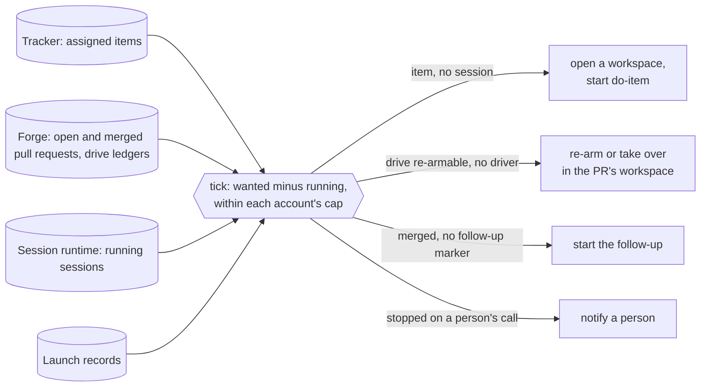

# The dispatcher, a tick that starts the execution line's stages: design

**What problem this solves.** Jig's [execution line](../FACTORY.md#execution-the-work-item-line)
has a skill for each stage: `do-item` picks an item up, `drive-pr` drives its
pull request through review, a follow-up settles what the merge owes. Each
of them starts only when a person types it. An item assigned to the team
waits until someone opens a session for it; a drive stopped by a usage
limit or by a parked question waits until someone re-arms it, though
`drive-pr` already admits that re-arm on a mechanical state; a merge waits
for someone to remember its follow-up. With nobody at the keyboard (at
night, in a meeting, on a phone) the line stops at the first stage boundary.
With this built, a small program on the machine that runs the agent
sessions looks at the tracker, the pull requests and the running sessions
every few minutes, starts each stage that should be running and is not,
and tells a person when a stage stops on something only a person can
settle. It never merges: that stays a person's
([ADR-0003](../docs/adr/ADR-0003-a-person-merges.md)).

This is the design of [plan.md](plan.md) item 33. Nothing of it is built
yet. It builds on item 32 (driving any pull request from anywhere): the
[drive ledger](../plugin/skills/drive-pr/README.md#where-its-state-lives)
on each pull request, the re-arm of a stopped drive and the takeover of a
wedged one are in `drive-pr` today; item 32's framed park (a park that
carries the question, the options and the recommended one) and its morning
report are still being built. M0 names the service this is: a
[control plane](../GLOSSARY.md), "a service that tracks an agent's job and
can reach a person". The dispatcher is the first one Jig ships, for the
execution line only. Its first [session runtime](../GLOSSARY.md) is Orca
([ADR-0011](../docs/adr/ADR-0011-the-dispatcher-targets-orca-first.md)).

## How it works

`jig dispatch` runs one **tick**: it reads records it does not own,
computes the stages that are wanted and not running, and, when told to,
starts each one as an agent session. A timer runs the tick every few
minutes. What is *wanted* is always derived from those records, never from
the dispatcher's memory; the dispatcher keeps only what it did: a launch
record per session it started (what, where, on which account, and how it
ended), a receipt per tick, and the account walls and repeat suppressions
those imply. Stopping it loses nothing, and there is no resident
process to supervise: the "daemon" is the timer.



### Guards against a second launch

A tick acts on facts that can go stale between its read and its launch,
and two ticks can overlap (the timer and a person's manual run). These
guards keep one stage from starting twice:

- **One tick at a time per machine.** A tick takes an exclusive lock under
  `~/.local/state/jig/dispatch/`; a second tick that finds it held exits at
  once and says so.
- **A fresh read before each launch.** With `--apply`, the tick reads the
  action's own facts again just before it starts it: the item still
  assigned and in a dispatch state, the ledger still re-armable, no running
  session for it.
- **The stages' own refusals.** `drive.ts` refuses a second driver by its
  lock and the ledger's claim, and admits a re-arm or takeover only on a
  mechanical state. `do-item` has no such refusal today: its start step
  moves the item to its in-progress state "if not already active" and goes
  on, so a person's manual pickup racing a dispatched one starts beside it.
  The pickup stage (build step 4) therefore depends on a change to
  `do-item`'s claim: it refuses an item already in its in-progress state or
  assigned to anyone but the session's own identity, and it re-reads the
  item after its transition and stands down when another claim landed
  first. A tracker offers no conditional write, so a race inside that
  re-read is narrowed, not closed, and when both claims come from the
  factory identity the item's state and assignee cannot tell them apart.
  The tick therefore checks the sessions instead: an item that more than
  one running session joins to (two workspaces, or a workspace beside a
  still-running launch record for another one) is reported as a double
  claim and notified once, and the tick starts nothing for it. A manual
  pickup on another host is not in this host's runtime report, so it stays
  invisible until it opens its pull request.
- **A marker on the pull request for the follow-up**, which has no claim of
  its own: the tick posts a hidden-marker comment
  (`<!-- jig-dispatch-followup -->`) on the merged pull request before it
  starts the follow-up session, carrying the launch record's id. The marker
  is trusted only as the drive trusts a ledger: written by the dispatcher's
  own login or by an owner, member or collaborator; a marker from anyone
  else is ignored and reported, and an unreadable marker leaves the pull
  request unplaced (reported, nothing started). A trusted marker is a
  claim, not a completion: the tick classifies a pull request its own
  marker claims by the launch record that marker names and by the
  follow-up's outcome record (a manual run's marker names none; see
  below). Both must
  name that pull request and the follow-up action; a marker naming a
  record for anything else (one copied from another pull request) leaves
  the pull request unplaced (reported, nothing started). When a
  follow-up's launch record ends, the tick writes a compact outcome record
  for that pull request (done or failed, and the launch record's id), which
  the receipts' retention never removes (see Receipts), so a launch record
  that expires after a successful follow-up does not turn it into a
  failure. An outcome counts only for the marker that carries its launch
  record's id: each attempt posts a new marker with a new launch record, an
  outcome naming another launch record (an earlier attempt's, whose marker
  a person deleted) neither settles nor fails the current one, and the
  current attempt's outcome replaces it when its launch record ends. An
  outcome of done means the follow-up is done; a launch record
  still running holds it; a failed outcome, a launch record that died, or
  a tick's marker whose launch record and outcome are both absent on this
  machine is a failed follow-up, notified once and never relaunched by the
  tick. A person settles it by deleting the marker, which makes the
  follow-up wanted again, then running the follow-up or leaving it to the
  next tick. The marker lives on the forge, so a lost launch record does not
  start a second follow-up on this machine.

  The marker is also the claim a follow-up started by hand honours, since
  a person can start one after the tick reads no marker and before it posts
  its own. The follow-up stage (build step 5) therefore depends on the
  repository's follow-up command claiming the same way: it posts a marker
  of its own before it acts and refuses a pull request that already carries
  a trusted marker from another run. A manual run has no launch record on
  the dispatching machine, and may run on another host, so its marker
  names none: it says the run is manual (`run: manual`). The tick reads
  nothing on this machine for it, so a manual marker carries its own
  outcome, written by the run that posted it: the follow-up command edits
  its marker to `done` once its last act has succeeded. A trusted manual
  marker marked done means the follow-up is done: it is never started,
  notified or reported again. One not marked done holds the follow-up
  (never started by the tick, never notified as failed) and is reported on
  every tick with its author and age, since the person who ran it sees its
  outcome and the tick has no record that could; a person settles it by
  marking it done when the run succeeded without marking it, or, as the
  tick's are, by deleting it when the run failed, which makes the
  follow-up wanted again. Whoever posts a marker, the tick or a
  manual run, reads the markers back after posting, and of two trusted
  markers on one pull request the earlier comment wins, as the drive's
  takeover claims do: the later poster deletes its marker and stands down
  (the tick ends its launch record without starting a session; a manual run
  stops before it acts). A read-back that fails starts nothing. The forge
  offers no conditional create for a comment, so the read-back is not
  atomic: a read that lags can omit a marker posted a moment earlier, and
  two runs can each read themselves the winner. The follow-up command
  therefore reads the markers again before each act that writes outside
  the pull request (an issue closed, a tag pushed) and stops when an
  earlier trusted marker than its own has appeared, as a drive stands down
  at its next round boundary on a claim a lagging read hid. What remains is
  a read that lags past every one of those checks; the tick reports two
  trusted markers on one pull request whenever it finds them, so a double
  run is seen and a person settles it. The marker
  settles who starts the follow-up, but the outcome record stays on the
  machine that launched it, and another machine cannot tell its done from
  its failed; so one machine dispatches a repository: at most one machine
  file lists it (see Left out, several Orca hosts).

### The records it reads

| Record | Read through | What the tick takes from it |
| --- | --- | --- |
| The tracker | the [tracker interface](../GLOSSARY.md) (`plugin/skills/do-item/scripts/lib/tracker/port.ts`), Linear, GitHub Issues and Jira today | the items assigned to the repository's [factory identity](../GLOSSARY.md): in a dispatch state (`todo` by default), the pickups wanted; in the in-progress state, the claimed pickups to watch |
| The forge | the open pull requests and their drive ledgers; the pull requests merged since the follow-up stage was switched on, and their follow-up markers | the drives to re-arm, take over or report; the follow-ups wanted, running or failed |
| The session runtime | in Orca, `orca worktree ps --json` | which workspace holds which item or pull request, and whether an agent in it is working or waiting |

**The tracker.** The interface gains one read, `assignedIssues(identity,
states)`: the issues assigned to that user in those states, in the pool
form whose fields (`assignee`, `state`) the interface already returns. Both
adapters answer it natively. It is a new read rather than a change to
`openIssues`, which keeps refusing an empty label list. The trigger needs no
label in any repository's taxonomy. It gains a second read,
`assignedBy(key)`: the user who made the issue's current assignment, from
the tracker's history. Like every read of the interface it returns that
user or throws with a reason, so a history it cannot read in full leaves
the pickup out of the plan and names the failure.

Only an assignment a person with write access made starts a pickup: for an
item in a dispatch state, the tick reads who made its current assignment
through `assignedBy` and requires a member of the team (Linear), an
owner, member or collaborator of the repository (GitHub), or a person's
Atlassian account, not a guest, that can be assigned issues in the project
(Jira; an app's account, Jira Automation's included, never), as the drive
requires of a ledger or an answer. The check gates pickups only. A claimed
item's current assignment is the claim's own, made by the factory
identity, so the stalled and double-claim reports below read claimed items
without it; they start nothing, so an unauthorized assignment gains
nothing from them. The
item's text is untrusted data: the tick passes the session the item's key
and nothing else, and `do-item` reads the item as it reads any issue.

A dispatched session uses the factory identity's tracker credentials, so
`do-item`'s claim (moving the item to its in-progress state and assigning
it to itself) keeps the item assigned to the factory identity. The tick
then finds claimed items with the same read over the in-progress state: one
with no running session and no launch record still running for longer than
`dispatch.stalled_after` (30 minutes by default) is reported as stalled and
notified, never relaunched, since a relaunch would start a second
implementer on a claimed item. One with more than one running session is
a double claim (see Guards against a second launch). A repository with no factory identity
configured has no pickups; its other stages still run.

**The forge.** The tick lists the repository's open pull requests and reads
each one's comments for the ledger's marker, as the drive itself does; it
does not rely on the forge's search to find the marker. It trusts only a
ledger the drive trusts: written by the drive's own login or by an owner,
member or collaborator. Each ledger is classified from its driver's state
and exit code, first match wins. The exit is the one `drive.ts` returned,
which the driver writes into its ledger as it stops, not the status
reporter's: `drive.ts` maps convergence to `0`, where `drive-status.ts`
reports `3`
([terminal states](../plugin/skills/drive-pr/references/terminal-states.md)).
A converged drive is read beside what its stop does not fix: the
pull request's mergeability as the forge reports it, read with the pull
request, and its head against the head the ledger says the drive
verified. Main moving under a converged pull request can make it
conflict, and a person's push after the drive stopped leaves the new
head unreviewed; either makes the drive stale, and the drive itself
already knows what to do on a re-arm (a conflict-resolve round for the
first, its ordinary rounds for the second). A mergeability the forge is
still computing leaves the pull request unplaced for that tick.
A stopped ledger with no exit has no known origin: `drives.ts --stop`
records one, and so does the driver's own recovery after a crash, a thrown
refusal or a signal, so the tick cannot read a person's decision into it.

| Ledger says | Class | The tick |
| --- | --- | --- |
| running, heartbeat inside the lease window | driven | nothing |
| running, heartbeat past the lease window | silent | takes it over only when this machine's launch record started that driver; otherwise reports it |
| stopped `0` (converged), the pull request open and now conflicting with its base, or its head past the head the drive verified | stale | re-arms on any admitted account: the drive's conflict-resolve round merges the base in, or its rounds review the new head |
| stopped `0` (converged, the pull request still at the verified head and not conflicting), `5` (merged or closed), `20` (taken over) | done | nothing; a merge is the follow-up's |
| stopped `18` or `19` (a mailbox stop or pause) | stopped by a person | nothing: a person's stop is never re-armed |
| stopped with no exit | stopped, origin unknown | never re-armed, since it may be a person's stop; notifies once per stop, with the drive's handoff |
| stopped `16` (quota-parked) | re-armable | re-arms on an admitted account other than the one its launch record names, when one does, or after the wall's reset |
| stopped `8` (parked), every parked item answered | re-armable | re-arms on any admitted account |
| stopped `4` (not judgeable yet: a converged drive that left the Ready mark to another driver, or whose final CI witness did not arrive) | re-armable | re-arms on any admitted account, as `drive-pr` asks an unattended wrapper to |
| stopped `8`, an item unanswered | parked | notifies once per park |
| stopped `11` or `13` | refused | nothing; another driver holds it |
| stopped on any other exit (`1`, `2`, `6`, `7`, `9`, `12`, `14`, `15`, or one this table does not know) | needs a person | notifies once per stop, with the exit and the drive's handoff |

The tick reads every pull request merged after the date the follow-up
stage was switched on for the repository (`followup_since` in the machine
file, written when that stage is turned on), marked or not. One with no
follow-up marker is a follow-up wanted; one with a marker is classified by
it (see Guards against a second launch), so a marker whose launch record
this machine no longer has is still found and reported. A merge
the cap keeps from starting at once stays wanted until a later tick starts
it; nothing about it depends on a time window between ticks.

**The session runtime.** Each workspace is joined to an item or a pull
request by the pull request the runtime links to it, by the issue it links
where the runtime links issues of that tracker (Orca links Linear issues),
and otherwise by its branch: the branch carries the item's key in the
adapter's branch form (the [issue key](../GLOSSARY.md)'s `eng-123-…` or
`123-…`), and the pull request's head branch names the pull request. An
agent counts as running when the runtime reports it working or waiting; a
finished agent does not hold the stage, and the report shows its state as
evidence. A headless drive started in a terminal is not an agent the
runtime reports, so its running state comes from its launch record (below)
and from the ledger's heartbeat. These answers are unknowns, never "no
session": a host the runtime's answer marks as not covered, a page cut
short by its row limit, and a workspace on a branch that matches the item
or pull request but whose agents the runtime does not report. The tick
plans nothing for an item or pull request it cannot place, and reports why.

### The tick reports by default and acts only with `--apply`

```sh
jig dispatch [--repo <path>]... [--json]          # report: what it would start, and why
jig dispatch --apply [--repo <path>]...           # start what the machine file enables
jig dispatch install [--interval 5m] --yes        # the timer
jig dispatch receipts                             # past ticks
jig dispatch result <record> <token> done|failed  # an interactive session's answer
```

A tick without `--apply` prints every action it would take, each with the
record that wants it and the evidence (the item's state and assignee, the
ledger's class and heartbeat, the session's state), and starts nothing.
This is the same contract as [resource collection](../plugin/gc/README.md):
report first, act only when told, and fail closed: a record that cannot be
read leaves the actions that depend on it out of the plan and names the
failure. `--apply` starts only the stages the machine file enables for each
repository (`stages: [rearm, pickup, followup, notify, steer]`); a stage it does
not enable is reported as with no `--apply`. The timer always runs with
`--apply`, so the machine file alone decides what it starts, and a
repository is switched on one stage at a time once its report has been read
for a while. An item or pull request gets at most one action per tick.

### Launch records: how a stage's answer comes back

A launched stage runs for minutes or hours in its session, long after the
tick that started it has ended, so the tick never sees its exit directly.
Every launch therefore begins with a launch record under
`~/.local/state/jig/dispatch/launches/`, which the tick writes before it
calls the runtime's `launch` (the action, the item or pull request, the
account, and a random token minted for that launch). From that write on,
the record holds its stage and its account slot, so a launch whose answer
is lost is never followed by a second session on the same stage or past
the account's cap. A headless pass runs through a small wrapper,
`plugin/dispatch/run.ts`, which is handed the record and adds its process
identity before it starts the stage (host, boot id, process id and the
process's start time, the identity `drives.ts` captures for a driver so
that a reused process id is never read as the same process) and records
the stage's exit when it ends. A record that has neither a process
identity nor an agent id is **pending**: it holds its stage and slot, and
its launch is retried only under its own token, which the tick hands
`launch` as the launch's key (see The session runtime interface), never as
a fresh launch. A record still pending at a later tick, with its launch's
answer lost and no keyed retry that produced one, is an unknown, reported,
holding its stage and slot until a person clears it. The next
tick reads the records: a record whose process is alive under that same
identity holds its stage; one that ended carries the stage's answer; one
whose identity cannot be checked (another boot, an unreadable process
table) is an unknown, reported, holding its stage and its account slot
until a person clears it. The one exception to "alive holds its stage" is
a takeover: a drive whose ledger is `silent` and whose driver this
machine's launch record started is planned for takeover although that
record is alive, since a wedged driver stays alive by definition; whether
the takeover is admitted stays `drive.ts --take-over`'s decision. The
takeover runs in that record's slot rather than needing a free one (see
Admission by account). A refusal (`drive.ts`
exiting `11`, `13`, `16` or `20`; `do-item` finding the item already
claimed) is recorded as the stage's own answer and never fought: an action
whose facts have not changed since the refusal is reported, not launched
again. A record whose process is gone without an exit is a launch that
died, reported with its last state.

The wrapper is the command a headless pass runs. An interactive session
(`do-item`, the follow-up) is started as the runtime's agent, which runs
no wrapper, and an agent's state says that it finished, not whether its
stage succeeded. Its launch record, written by the tick before the launch,
gains the agent's id from the launch's receipt, and the prompt the tick composes ends by asking the
session to record its result: `jig dispatch result <record> <token>
done|failed`, which writes the stage's answer into that launch record. The
command refuses a token that is not the record's own and a record that
already has a result, so a session settles its own launch and no other,
once; the token binds a session to its record, and does not guard the
state directory against a process of the same user, which can write it
directly. The result is the stage's answer, not proof that its session
stopped: an agent can record its result and go on working or wait for
another prompt. So the record's state is its agent's: the agent `sessions`
reports under the record's agent id holds the stage and its account slot
while working or waiting, whether or not a result is recorded, and the
record ends only when the runtime reports that agent finished or gone. It
ends with its result, or as failed when none was recorded, since a session
that stopped on a question or a crash records none; a pickup's record is
read beside the item's state, and a follow-up's result is what its outcome
record keeps.

### The session runtime interface

The tick reaches the runtime only through these methods:

| Method | What it does |
| --- | --- |
| `sessions(repo)` | the workspaces and their agents, joined to items and pull requests, with each agent's id and state and each workspace's comment and unread mark |
| `openWorkspace(...)` | a workspace for an item (a new branch) or a pull request (its head branch), reused when one exists |
| `launch(workspace, stage, account, key, sessionId?)` | a session in the workspace that runs the stage, billed to the account; for an interactive session, its receipt names the agent's id. `key` is the launch record's token: a second call with a key already launched starts no second session. `sessionId`, given for an interactive session, is the vendor session id the tick minted and keeps on the launch record (see Control), distinct from the agent's id and the key; a launch that cannot carry it records no wall and gets no nudge |
| `notify(target, message)` | a message that reaches a person; its receipt carries the target's comment as written |
| `steer(session, nudge)` | one of the closed set of nudges (see Control) sent to a session the runtime reports waiting, its screen and attachment re-read in the same call just before the send |

Each returns the runtime's receipt, and each, a terminal-screen read for
`steer` included, runs under a deadline and is cancelled past it: its
answer counts as lost, and the tick goes on to its other actions and
releases its lock, so a runtime that hangs costs one action, not every
later tick. The deadline is `dispatch.runtime_timeout` (one minute by
default) for every method but `openWorkspace`, whose setup runs the
repository's create hook, a dependency install among it, and which runs
under `dispatch.workspace_timeout`. Its default is the limit the Orca
workspace tool puts on its own open (`OPEN_LIMIT_MS` in
`tools/orca/workspace.ts`: a clone, the create hook, the wait for another
open's start of its agent, and the calls around them), read from that
constant rather than restated, so the two cannot drift apart; a shorter
setting can cut off an open the tool itself would let finish. A tick
opening a workspace holds the tick lock for as long as the open runs, and
the ticks that find it held meanwhile exit at once. A launch whose answer is lost
is retried only by calling `launch` again with the same key, never as a
fresh one, and its launch record, written before the call, holds its
stage and slot meanwhile (see Launch records). An adapter that cannot keep
that promise for a kind of session does not retry it: a pending record of
that kind stays the reported unknown. Orca is the first
implementation:

- `sessions` from `orca worktree ps --json`; that it carries a workspace's
  comment and unread mark is checked when the notifications are built, and
  until it does, notifications are reported in the receipts and not sent;
  that `orca agent launch`'s answer names the agent by the id `orca
  worktree ps --json` reports it under is checked when the pickup stage is
  built, and until it does, interactive sessions are not launched, since
  their launch records could not be joined to their agents;
- `openWorkspace` as `orca worktree create` with the pull request or issue
  linked, called by the adapter itself in `plugin/dispatch/`: the
  [Orca workspace tool](../tools/orca/README.md) runs from a checkout of
  Jig, not from the plugin, so the installed dispatcher cannot call it.
  Its workspace rules (branch selection, an existing checkout of the
  branch first, branch correction and setup, which a bare `orca worktree
  create` does not do) move into the plugin in build step 3, the first
  step that opens a workspace, and the tool then calls the moved code, so
  the pickups in step 4 reuse it rather than a copy;
- `launch` for a **headless pass** (a drive re-arm or takeover) as
  `orca terminal create --worktree <selector> --title <stage> --command
  <wrapper>`, the account's configuration directory set in the command's
  environment (below); for an **interactive session** (a pickup, a
  follow-up) as `orca agent launch --agent <id> --worktree <selector>
  --prompt "<skill> <key>"`, with the model and effort from the item's
  route where the repository declares `routing`, bound to the account as a
  headless pass is (below), and with `sessionId` passed to the agent where
  `orca agent launch` can carry it, which is checked when the control step
  is built; that `orca agent launch` can bind its agent to
  an account so is checked when the pickup stage is built, and until it
  does, interactive sessions are not launched. The key is kept by the
  record itself for a headless pass: the wrapper claims the record
  atomically before it starts the stage, so a second terminal for a record
  already claimed exits without starting it, and a retry relaunches the
  wrapper under the same record. For an interactive session, that `orca
  agent launch --retry-launch` retries by a key the adapter passes it,
  rather than starting a second agent, is checked when the pickup stage is
  built, and until it does, a lost interactive launch is not retried;
- `notify` as a workspace marked unread with the message as its comment,
  appended to the comment while the workspace is still unread (see
  Notifications), which Orca's phone app shows. A workspace's comment carries a kickoff
  prompt until its agent starts, so the tick never writes one on a
  workspace that may yet start an agent with it. The target is the item's
  or pull request's workspace when its agent has started; otherwise
  (a drive a person or another machine started, a pull request with no
  local workspace, a pickup whose agent never started) it is a
  notification workspace the dispatcher keeps per repository, on the
  default branch, into which it never launches an agent, its comment
  naming the item or pull request the message is about;
- `steer` as the nudge's text sent to the session's terminal, after the
  terminal's screen is read for the checks in Control; that Orca can read
  a running agent's terminal and send it text by the id `orca worktree ps
  --json` reports is checked when the control step is built, and until it
  does, the nudge is reported and not sent.

A second runtime is a second implementation of the same methods, with
nothing in the tick changed.

### Admission by account

The machine file lists the subscription accounts the dispatcher may bill
and a cap for each (`max_per_account`, 2 by default): the number of
sessions the dispatcher started on that account that are still running,
waiting ones and pending launch records (see Launch records) included. Sessions a person started are not counted: the
runtime does not report their account, and a person who shares an account
with the dispatcher lowers its cap. A headless pass is admitted on an
account with a free slot and no wall in effect, the accounts taken in turn
starting after the account of the most recent launch record, so the turn
survives between ticks without state of its own.

A takeover is the exception to "a free slot": it replaces a driver whose
launch record holds a slot, and a wedged driver never gives that slot
back, so with every slot of the permitted accounts held by wedged drivers
nothing could replace them. A takeover is therefore admitted into the slot
of the launch record it replaces, on that record's account and only while
that account has no wall in effect (a walled account's takeover waits for
the reset, as any pass does). Its launch record names the record it
replaces, and the two count as one slot until the old one ends:
`drive.ts --take-over` stops the wedged holder through `drives.ts --stop`
before it drives, so the account never runs more than its cap of drivers
that work. A takeover `drive.ts` refuses ends its own record, and the old
record keeps its slot.

An interactive session (a pickup, a follow-up) is admitted the same way, on
one account with a free slot and no wall in effect, and its launch binds
it to that account (below), so its launch record names the account and
holds one slot. A session whose launch cannot bind its account is never
started: the host's active account can change under it at any moment, and
no read before or after the launch proves which account it bills, or that
the account is listed and unwalled. With no account free, the action waits
for a later tick and the report names the full caps.

**Walls.** The dispatcher keeps its own record of each account's
usage-limit wall, under `~/.local/state/jig/dispatch/walls/`, keyed by the
account's name in the machine file. A launch record that ends with
`drive.ts`'s exit `16` writes the wall for the account the record names,
with the reset the drive printed, or, when the reset is unknown,
`dispatch.wall_backoff` (one hour by default) from the stop. Several
sessions can write the same account's wall; a write never moves the
reset earlier, so the record keeps the latest reset any write has
recorded, and the wall is lifted at that reset; nothing else lifts it. The drive's own quota park
stays where `drive-pr` keeps it and still decides whether `drive.ts` admits
the re-arm. A wall an interactive session meets is not recorded before the
control step (see Control): that session shows as waiting, holds its slot, and is
reported once it has waited past `dispatch.blocked_after` (30 minutes by
default).

**Binding a session to its account.** A headless pass is bound to its
account through the configuration directory of that account's Orca
profile, set in the wrapper's environment (`CLAUDE_CONFIG_DIR` for Claude
Code, `CODEX_HOME` for Codex), so the drive's identity resolver and quota
adapters see the account the pass bills. The directory alone does not bind
it: the resolver reads a credential in the environment
(`CLAUDE_CODE_OAUTH_TOKEN`, `ANTHROPIC_API_KEY`, `OPENAI_API_KEY`) before
the directory, so a wrapper that selects one account's directory while
inheriting another's token bills the other. The wrapper therefore starts
the pass with those variables removed, and before the launch the tick resolves the
identity the wrapper's environment yields, with the drive's own resolver,
and compares it with the admitted account. A mismatch, or an identity that
does not resolve, starts nothing and is reported. An interactive session is bound
the same way, through the environment or account selection of its agent's
launch, with the same isolation and the same check before it starts, and a
person switching the host's active account does not move it.
Switching Orca's active account before a launch is not used: it is
host-wide and would move every other session's next pass too. Whether an
Orca agent launch can bind its agent to an account is not verified (Orca's
command line selects accounts only for some agents), so until it is shown
to work the dispatcher launches headless passes only, and pickups and
follow-ups are reported, not started.

**Sessions that wait.** Pickups and follow-ups are interactive skills, and
with nobody to answer a question they stop and state it, as every Jig skill
does without a person. An agent the runtime reports waiting for longer than
`dispatch.blocked_after` is reported and notified once; it keeps its slot
until it ends or a person ends it, so a cap full of waiting sessions is
visible in every report rather than silent.

### The agent behind a session

The agent a launched session runs in (Claude Code or Codex today) is the
admitted account's vendor, and nothing else chooses it: admission picks the
account, the account's `vendor` names the agent, and the launch is bound
to that account through its configuration directory (`CLAUDE_CONFIG_DIR`,
`CODEX_HOME`). A repository never names an agent; it names a model per
runtime in `routing.models`, which the launch reads for the vendor it got,
so one repository is picked up by whichever account has a free slot. The
skills are the same text in both agents, and the prompts the tick composes
and the `jig dispatch result` instruction name no agent. A headless pass
runs the drive's documented pass command for the vendor; the dispatcher
admits an account only for a vendor whose pass command the drive
documents, and reports an account of any other vendor as accepted and not
admitted. An interactive session is launched as that vendor's Orca agent.
These differences travel with the session, not the dispatcher: the
review-arbiter agent exists only in Claude Code, and a Codex session uses
the substitute the plugin documents; the turn-budget hook counts nothing
under Codex, so a Codex pass has no turn cap of its own, and the
expectations in Control are its backstop. A Codex wall is recorded as a
Claude one is, by the drive's quota adapter for the vendor, keyed by the
account; binding the pass through the account's own configuration
directory is what lets the adapter attribute the wall to that account,
which a directory shared between accounts could not.

### What it never does

- **Merge**, or arm a merge: a person merges
  ([ADR-0003](../docs/adr/ADR-0003-a-person-merges.md)).
- **Answer a park.** A parked question is a person's; the tick notifies and
  waits for the answer on the pull request.
- **Stop a driver that is making progress.** It takes over only a driver its
  own machine started, whose ledger heartbeat is past the lease window, and
  only through `drive.ts --take-over`, which admits it against a wedged or
  dead driver alone. A driver another machine or a person started is
  reported, never taken over.
- **Re-arm a drive a person may have stopped** (a mailbox stop or pause,
  or a stop with no exit), or relaunch a stalled pickup.
- **Keep a converged pull request current with its base.** It re-drives a
  converged pull request on mechanical facts only: the forge reports
  it conflicting with its base, or its head moved past the head the drive
  verified. A pull request its base merely moved past, still mergeable,
  is left as it is: merging the base in on every move is a round and a
  CI run for a pull request the merge would take cleanly.
- **Pass the flags the skills reserve for a person**: `--window-reopened`
  and `clear-lease`.
- **Write to the tracker.** The item's own state is the claim, and `do-item`
  sets it. The one thing it writes to the forge is the follow-up marker.
- **Compose a prompt for a stuck session.** It sends only the fixed nudges
  of Control's closed set; anything else a session needs goes to a person.

### Notifications

A notification goes out once per cause, its launch record or receipt
naming what was sent: a drive parked with an item unanswered, carrying the
parked questions (item 32's framed decision once that is built); a drive
stopped on an exit only a person can settle, carrying the exit and the
drive's handoff; a drive stopped with no exit, carrying its handoff; a
stalled pickup or a double claim; a failed follow-up; a session waiting past
`blocked_after`; a running stage drifting from its expectation, and a
session still waiting on a wall after its one nudge (see Control).

A workspace holds one comment, so a message never replaces one a person has
not read. The tick joins every cause it notifies to one target in a tick
into one message, and when the target is still marked unread from an
earlier notification it appends the new causes to that comment rather than
overwriting it. Each cause's text carries its key (the facts its
suppression record is keyed by). A cause counts as sent, and its
suppression record is written, only once the runtime's receipt shows the
comment carrying its key, so a cause never delivered is never suppressed.
Before it notifies, the tick reads the target's comment, and a cause whose
key is already there is recorded as sent without being sent again, so a
tick that stopped between delivering and recording does not send a second
copy.

The answer to a park stays where the drive reads it, a
comment on the pull request, so the next tick re-arms the drive with
nothing from the phone but that comment.

### Receipts

Every tick writes one receipt under `~/.local/state/jig/dispatch/`, as
`jig gc` does: the records it read and from where, each planned action with
its reason, each launch with the runtime's answer, each notification. A
tick removes receipts and ended launch records older than the machine
file's retention, keeping the latest completed receipt. These records are
kept apart from them and do not expire: the outcome log (see Control) and
the records below. A follow-up's outcome record,
one per merged pull request, is what tells a done follow-up from a failed
one after its launch record has gone. What suppresses a repeat is a small suppression
record per cause (an unchanged refusal not to retry, a notification
already sent), keyed by the cause's own facts (the item and its state, the
ledger's generation and exit, the park), and dropped only when those facts
change or the item or pull request leaves every record the tick reads. `jig dispatch
receipts` lists them; once item 32's morning report is built, it lists the
launches, refusals and notifications since the last report beside the
drives' own.

### Control: observe, record, report, steer

The dispatcher starts stages; it also has to show how they went, so that
a person can see where the dispatched part of the line loses work and
change what causes it. It does that through an outcome log, an
expectation per stage, one dashboard, the reflection loop, and one
mechanical nudge.

**The outcome log.** Receipts and launch records are working records and
expire with the machine file's retention; what the factory learns from
must not. The tick appends rows to an outcome log under
`~/.local/state/jig/dispatch/`, one file per month (`log-<year>-<month>.jsonl`),
which nothing removes. Every row carries its key and its time, and goes
into the file of the month its time falls in. It holds these kinds of row:

- **An ended row**, one per launch record, when the record ends, timed at
  the record's end: the stage, the repository, the item or pull request, the account, the model
  the tick launched it with (none when the tick named none), the
  duration, the drive's rounds (its ledger's round at the end less the
  round at launch), an outcome class, and a reason that always carries the
  stage's own answer verbatim: the exit code, the recorded result, or the
  last state.
- **An event row**, once per cause, timed when the tick observed it, for
  what the tick observed rather than what ended: a stalled pickup, a double claim, a stage drifting from its
  expectation, a session waiting past `blocked_after` with what the tick
  read as its cause, a stop the tick notified on a stage it did not launch
  (a park on a drive a person armed, say), and each nudge sent. An event
  row is keyed by the same facts as its suppression record and written
  once its cause is settled: for a notification, when its suppression
  record is written, which is on delivery (see Notifications); for a
  nudge, whose suppression record is written before the send, once its
  delivery is known (see Steering).

The log therefore covers the stages this machine launched, and the stops
on other stages only as far as the tick notifies them.

An ended row's class comes from a closed list, with every stage's answer
placed. The class is read from the record's final answer, and an answer
that fits more than one row takes the first in table order: a pickup that
records `done` after its pull request merged is converged, a session that
met a wall and then finished is classed by how it finished, and a driver
replaced by a takeover is stalled, not refused.

| Class | Stage answers placed in it |
| --- | --- |
| converged | a drive's convergence (`drive.ts` exit `0`); a pickup's or follow-up's recorded result `done` |
| merged | a drive or pickup whose pull request merged while it ran (exit `5`, merged); never a follow-up, which starts after the merge |
| quota wall | a usage limit: `drive.ts` exit `16`, or an interactive session that ended with no result while a wall recorded from it (below) stood |
| parked for a person | a park (exit `8`) |
| stalled | the drive's stall (exit `14`) or its round limit (exit `6`); a driver replaced by a takeover, logged with reason `taken over` |
| died | a process gone without an exit; an interactive session that ended with no result |
| refused | a stage's own refusal or a stop it was given: exits `2`, `4`, `11`, `13`, `18`, `19`, `20`; exit `5` on a closed pull request; an item already claimed; a person's `drives.ts --stop` |
| gates failed | a stage that ran to its end without achieving it: exits `1`, `7`, `9`, `12`, `15`; a recorded result `failed` |
| double claim | used by event rows only |
| unknown | anything not placed above, with its last state |

The reason column is what tells a conflict from a pass deadline within
"gates failed", or a person's stop from a refusal within "refused", and
the dashboard filters on it as on the class. A stop the classifier cannot
place is logged as `unknown`, never dropped, so the list grows from
evidence: a reason that recurs among the `unknown` rows becomes a class in
a later change.

Each launch record gains a `logged` mark, set once its ended row is
appended, and keeps the row's time from when the record ends, so a retry
writes the same row into the same month's file. A tick that stopped
between the append and the mark finds the record's key among the last
rows of that file, which are in append order, before it appends; an event
row keeps its time on its suppression record and is checked the same way.
A row is one line written in one append. A reader skips any line that
does not parse as a row, and before it appends, the tick settles an
unterminated last line: one that parses is kept and given its newline,
one that does not is cut off, so a torn write never becomes a completed
line. The follow-up's outcome record (see Receipts) stays
what it is: it settles whether a merged pull request still wants a
follow-up, and the tick reads it; the ended row for the same launch is the
analysis record, read only by people and the dashboard, and the tick never
plans from the log.

**Expectations and stage drift.** Each launched stage carries an
expectation of how it progresses while it runs:

- a drive's unresolved threads fall: each tick records, on the drive's
  launch record, the unresolved-thread count at the ledger's current round
  the first time it sees that round; the drive drifts when the count at
  the latest recorded round is not below the count `drive_rounds_flat`
  recorded rounds earlier (3 by default). Rounds the tick never saw are
  gaps, not samples: the window counts recorded rounds only. This is
  earlier and softer than the drive's own stops: `drive.ts` ends a drive
  whose passes change nothing (exit `14`) or that reaches its round limit
  (exit `6`), while drift reports a drive that is still changing things
  and not converging;
- a pickup opens a pull request within `pickup_within` of its launch (two
  hours by default);
- a follow-up ends within `followup_within` of its launch (one hour by
  default).

A running stage outside its expectation is **drifting**: it is reported
with the evidence (the recorded counts per round, the time since launch,
the item's state), written as an event row, and notified once per cause
(see Notifications), keyed by the launch record and the expectation it
broke. A session already notified as waiting past `blocked_after` is not
notified again for drift while that notification stands. Stage drift is
never acted on: the stage keeps running and keeps its slot, and whether to
stop it is a person's call. Stages the dispatcher did not launch carry no
expectation.

**The dashboard.** `jig dispatch dashboard` serves one page that reads the
log when it is opened and filters it by time, repository, stage, account,
class and reason, and shows the count of each class over the filtered
window. A question about yesterday is a filter, not a report: no report
file is ever generated, and nothing is written to disk but the log itself.
The server runs while the command runs, started and stopped by a person
(from a terminal on the host, which Orca's phone app reaches); nothing
installs or keeps it running, so the dispatcher stays without a resident
process. It listens on the address the machine file names
(`dashboard.listen`, no default), and refuses an address outside the
private and loopback ranges, so no route into the host is opened beyond
the network the host already trusts. The URL it prints carries a token
minted at start, and a request without it is refused: the log names
repositories, items and accounts.

**Self-correction through the reflection loop.** A class that recurs is a
finding about the scaffolding, not something the tick adjusts on its own.
A person reads the recurring classes on the dashboard and records the
finding through [`reflect`](../plugin/skills/reflect/README.md), and
[`review-reflections`](../plugin/skills/review-reflections/README.md) is
where a person approves the change: a cap, an expectation, a skill's step.
No route carries a class to the reflection store by itself in this
design. The tick tunes none of its own dials.

**Steering.** The session runtime gains `steer(session, nudge)`, which
sends a fixed text to a session the runtime reports waiting. The set of nudges is closed and
has one entry in this design, **continue**, the prompt people type by hand
today ("Your usage limit has reset. Continue"). Its target must be known
mechanically, so it rests on a wall record for interactive sessions:

- **Recording an interactive session's wall.** The tick mints the vendor
  session id at launch and passes it with the launch where the vendor
  accepts one (Claude Code's `--session-id`), as the drive's quota
  adapters do for a pass (`prepareQuotaSpawn` in
  `plugin/skills/drive-pr/scripts/lib/quota/`), and keeps it on the launch
  record. While the session runs, the tick reads that session's own record
  through the same adapters (`detectQuotaBlock`), against the account's
  configuration directory. A wall it finds is written to the account's
  wall record, which admission reads, and as a waiting episode (the wall
  and its reset) on that session's own launch record, so every session
  behind one account's wall has its own. A launch that cannot carry the session
  id records no wall and gets no nudge; that an Orca agent launch can pass
  it through is checked when the control step is built.
- **Sending the nudge.** The tick sends **continue** only with `--apply`
  and only for a repository whose machine-file stages include `steer`,
  which no other stage implies. It sends it to a session only when all of
  these hold: the runtime reports it waiting; the waiting episode on its
  launch record has reached its reset; the session's last
  record is still that wall; and the terminal, read through the runtime
  just before sending, shows the agent's input prompt with an empty input
  line and no menu or question on screen, and no person attached where the
  runtime reports attachment. The screen read and the send are one
  `steer` call, the adapter re-reading the screen and the attachment
  immediately before it types, so the checks are as fresh as the runtime
  allows. Neither Orca nor a terminal offers a send that fails when the
  screen changed, so a window remains between that last read and the
  keystrokes: a person who attaches inside it, or a prompt that changes
  inside it, receives the one **continue** line, the text a person would
  have typed, and the suppression record keeps it from being sent again.
  The text is sent with Enter. Any check that fails or cannot be read
  sends nothing and is reported. Before sending,
  the tick writes the nudge's suppression record, keyed by the session and
  its waiting episode and marked pending, so a send whose answer is lost,
  or a tick that stops after sending, never leads to a second one. The
  suppression record says only that a send was attempted; its delivery
  is a second mark on it. The runtime's receipt marks it delivered; a
  send whose answer is lost marks it not known to have arrived, which is
  notified to a person. A suppression record a later tick finds still
  pending (the tick stopped between writing it and reading the answer) is
  marked not known to have arrived and notified the same way. The nudge's
  event row is written with that mark, carrying it, so the log never
  reads an attempted nudge as a delivered one. A
  session still waiting on that episode at the next tick is notified,
  never nudged again.

There is no open-ended "keep going" nudge. Every other stuck state (a
waiting session with no wall, a drifting stage, a session that asked a
question) is a notification to a person.

### Where it lives

The dispatcher is machine tooling in the plugin, beside
[resource collection](../plugin/gc/README.md): `plugin/dispatch/`, reached
as `jig dispatch` through `plugin/jig.ts`, so it runs wherever the plugin
is installed rather than from a checkout of Jig. It is never a skill a
session runs. Its values are split as configuration always is:

- **The machine's**, in `~/.jig/dispatch.yaml`: the repositories it
  dispatches for and the stages enabled for each, with `followup_since`;
  the accounts it may bill, each with its configuration directory and cap;
  the interval, `wall_backoff`, `runtime_timeout`, `workspace_timeout`, the receipts' retention and the
  dashboard's `dashboard.listen` address.
- **A repository's**, in a `dispatch` section of its `.config/jig.yaml`,
  documented in [CONFIGURATION.md](../plugin/CONFIGURATION.md): the factory
  identity per tracker (`identity`), the states that mean "ready to pick
  up" (`states`), the follow-up command (`followup_command`, `/followup` in
  Jig; a consumer repository names its own post-merge command),
  `stalled_after`, `blocked_after`, and the expectations
  `drive_rounds_flat`, `pickup_within` and `followup_within`.

A repository's `dispatch` section is read from its default branch as the
forge holds it, fetched afresh at every tick, never from a workspace's
checkout: the tick opens workspaces on pull requests' head branches, and a
section read there would let an unreviewed change choose the command a
timer launches. A change to the section therefore takes effect at the
first tick after it merges, and reverting it on the default branch
revokes it at the next. A tick that cannot read the default branch's
section plans nothing for that repository and says why.

### The installed timer

`jig dispatch install` writes a systemd user timer on Linux and a launchd
job on macOS, on the same scheduler and launcher code `jig gc install`
uses (`plugin/gc/scheduler.ts`, `plugin/gc/launcher.ts`): a preview first,
written only with `--yes`, the installed copy of the plugin found at each
run so an update reaches the timer without a new install. It runs on the
host that runs the sessions (with Orca, the Orca server's host). An event
from the tracker or the forge could only start a tick early; the timer
stays the reconcile, so a missed event would cost one interval, and no
route into the host is opened for events (see Left out).

## Build order

One pull request each, in this order; each is usable on its own.

1. **This design**, its plan item, ADR-0011 and the glossary terms.
2. **The tick as a report.** `jig dispatch` reads the records and
   prints every action it would take with its evidence; `--apply` is
   accepted and refused. `assignedIssues` and `assignedBy` in the tracker
   interface and both adapters, with the assigner check; the ledger classification; the
   session runtime interface with `sessions` from Orca and the join; the
   tick lock and the receipts; the `dispatch` configuration section. Tests
   run a tick over the adapters' fake tracker, the drive suite's fake forge
   and a fake `orca` command: one assigned item, one quota-parked pull
   request and one merged pull request give three actions, each naming its
   record; a running agent for the item removes its action; a ledger a
   person stopped gives none. Usable alone as a standing list of what is
   idle and why.
3. **Re-arms within account caps, and the timer.** With `--apply`, each
   re-arm, and each takeover of a driver this machine started, runs as
   `drive.ts <PR> [--take-over] -- <pass>` through the wrapper in a
   terminal of the pull request's workspace (created from the pull request
   when none holds it, through `openWorkspace` and the Orca workspace
   tool's rules, moved into the plugin in this step), on an admitted account bound through its
   configuration directory; launch records, walls, the machine file,
   `jig dispatch install`. Usable alone: drives that stop on a usage limit
   or an answered park restart without a person.
4. **Pickups.** `do-item`'s claim refusal (above) first; then, with
   `--apply`, a workspace and a `do-item` session per item assigned to the
   factory identity in a dispatch state, admitted on an account with a free
   slot and bound to it at launch, once an Orca agent launch is shown to
   bind its account (until then this step reports pickups and starts
   none), its result recorded through `jig dispatch result` and its slot
   held until its agent ends; the fresh read at launch; stalled
   pickups, double claims and waiting sessions reported. Usable alone:
   assigning an item is the start button.
5. **Follow-ups and notifications.** The follow-up marker, the follow-up's
   outcome record, and a follow-up session per merged pull request with the repository's follow-up
   command, which claims the pull request with a manual marker when a
   person runs it by hand and marks that marker done when it succeeds
   (Jig's `/followup` first); the notifications above
   through `notify`. The park's
   notification carries item 32's framed decision once that is built, and
   the receipts join its morning report then; a consumer repository's
   follow-up waits on its own post-merge command (item 17).
6. **Control.** The outcome log and its classifier, the expectations and
   stage drift, `jig dispatch dashboard`, the interactive wall record and
   waiting episodes, and the `steer` stage with its one nudge. Usable alone: every stage the dispatcher
   launched or notified has a recorded reason, and one view shows all of
   them. Its parts wait on different steps: the log and a drive's drift on
   step 3, so there are launches to log; sending drift notifications on
   step 5's `notify` (until then they are reported in the receipts); the
   pickup and follow-up expectations on steps 4 and 5; the nudge on
   interactive launches (step 4, itself waiting on an agent launch that
   binds its account) and on a launch that carries the vendor session id.
7. **Re-drive a stale converged pull request.** The forge read gains each
   open pull request's mergeability and current head commit (the listing
   carries neither today), compared with the ledger's `verifiedSha`; the
   ledger classification the
   `stale` class (converged, and conflicting or past the verified head),
   and the plan re-arms it through step 3's launch, on any admitted
   account. Tests: a converged ledger on a conflicting pull request is
   re-armed once; one whose head moved is re-armed once; one still at the
   verified head and mergeable is left alone; a mergeability still being
   computed leaves it unplaced. Waits on step 3 only. Usable alone: a
   pull request that converged and then conflicted no longer waits for a
   person to notice.
8. **Admit Codex accounts.** The drive skill documents the Codex pass
   command beside Claude Code's, with the pass model read per vendor from
   `routing.models`; the dispatcher admits `vendor: codex` accounts for
   headless passes bound through `CODEX_HOME`, launches interactive
   sessions with Orca's Codex agent, and the live checks made for Claude
   (the launch binds the agent to the account; the runtime reports the
   agent's state) are made for Codex on the host. Tests: a re-arm admitted
   on a Codex account runs the Codex pass command with `CODEX_HOME` set and
   the Claude variables absent; an account of a vendor with no documented
   pass command is reported, never launched. Waits on step 3, on step 4
   for the interactive launch, and on step 6's expectations, the backstop
   for a Codex pass's missing turn cap. Usable alone: a drive stopped on a Claude
   wall restarts on a Codex account.

## Left out

- **A Herdr runtime.** Herdr stays the first runtime for workspace
  lifecycle ([ADR-0005](../docs/adr/ADR-0005-herdr-is-the-primary-workspace-runtime.md));
  the dispatcher needs an account roster, a headless server reachable from
  a phone and a session registry, which Orca has today; Herdr has no
  account roster
  ([ADR-0011](../docs/adr/ADR-0011-the-dispatcher-targets-orca-first.md)).
  A Herdr implementation of the session runtime interface comes when Herdr
  can supply one.
- **Webhooks.** The tick polls. An outbound wake-up channel (a relay that
  takes the tracker's and forge's events and that the host holds a
  connection to) can start ticks early later; the sources stay behind
  interfaces such a channel can replace, and no inbound route to the host
  is ever opened.
- **Pre-emptive quota pacing.** Admission reacts to walls already met;
  spreading load before a wall is reached needs usage telemetry Jig does
  not read yet.
- **Several Orca hosts.** One tick dispatches on the host it runs on, and
  takes over only drivers that host started. A repository is listed in one
  machine's file only: the follow-up marker settles which one starts a
  follow-up, but nothing else arbitrates two dispatchers on one repository,
  and a follow-up's outcome is read only on the machine that launched it,
  until forge-side claims and outcomes are designed. The dashboard reads
  one machine's outcome log until then too.
- **Interactive sessions**, pickups and follow-ups, until an Orca agent
  launch that binds its agent to an account is shown to work; headless
  passes run meanwhile.
- **Further nudges.** A nudge joins the closed set only when the outcome
  log's waiting-episode rows show a mechanical cause that recurs, with a
  target the tick can identify and a screen state it can check, as
  **continue** has.
- **The merge**, which stays a person's
  ([ADR-0003](../docs/adr/ADR-0003-a-person-merges.md)); delegated merge is
  item 9, decided on its own.

## Review

Critiqued in two rounds by reviewers with fresh context (subagents that
did not write it): the whole design on 2026-10-30 against commit
`c2c8083e`, and the Control section, written after that round, on
2026-10-31 against commit `de08d1ce`.
