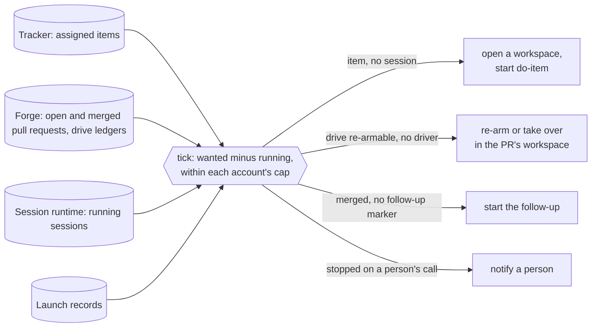

# The dispatcher, a tick that starts the execution line's stages: design

**What problem this solves.** Jig's [execution line](../FACTORY.md#execution-the-work-item-line)
has a skill for each stage: `do-item` picks an item up, `drive-pr` drives its
pull request through review, a follow-up settles what the merge owes. Each
of them starts only when a person types it. An item assigned to the team
waits until someone opens a session for it; a drive stopped by a usage
limit or by a parked question waits until someone re-arms it, though
`drive-pr` already admits that re-arm on a mechanical state; a merge waits
for someone to remember its follow-up. With nobody at the keyboard (at
night, in a meeting, on a phone) the line stops at the first stage boundary.
With this built, a small program on the machine that runs the agent
sessions looks at the tracker, the pull requests and the running sessions
every few minutes, starts each stage that should be running and is not,
and tells a person when a stage stops on something only a person can
settle. It never merges: that stays a person's
([ADR-0003](../docs/adr/ADR-0003-a-person-merges.md)).

This is the design of [plan.md](plan.md) item 33. Nothing of it is built
yet. It builds on item 32 (driving any pull request from anywhere): the
[drive ledger](../plugin/skills/drive-pr/README.md#where-its-state-lives)
on each pull request, the re-arm of a stopped drive and the takeover of a
wedged one are in `drive-pr` today; item 32's framed park (a park that
carries the question, the options and the recommended one) and its morning
report are still being built. M0 names the service this is: a
[control plane](../GLOSSARY.md), "a service that tracks an agent's job and
can reach a person". The dispatcher is the first one Jig ships, for the
execution line only. Its first [session runtime](../GLOSSARY.md) is Orca
([ADR-0011](../docs/adr/ADR-0011-the-dispatcher-targets-orca-first.md)).

## How it works

`jig dispatch` runs one **tick**: it reads records it does not own,
computes the stages that are wanted and not running, and, when told to,
starts each one as an agent session. A timer runs the tick every few
minutes. What is *wanted* is always derived from those records, never from
the dispatcher's memory; the dispatcher keeps only what it did: a launch
record per session it started (what, where, on which account, and how it
ended), a receipt per tick, and the account walls and repeat suppressions
those imply. Stopping it loses nothing, and there is no resident
process to supervise: the "daemon" is the timer.



### Guards against a second launch

A tick acts on facts that can go stale between its read and its launch,
and two ticks can overlap (the timer and a person's manual run). These
guards keep one stage from starting twice:

- **One tick at a time per machine.** A tick takes an exclusive lock under
  `~/.local/state/jig/dispatch/`; a second tick that finds it held exits at
  once and says so.
- **A fresh read before each launch.** With `--apply`, the tick reads the
  action's own facts again just before it starts it: the item still
  assigned and in a dispatch state, the ledger still re-armable, no running
  session for it.
- **The stages' own refusals.** `drive.ts` refuses a second driver by its
  lock and the ledger's claim, and admits a re-arm or takeover only on a
  mechanical state. `do-item` has no such refusal today: its start step
  moves the item to its in-progress state "if not already active" and goes
  on, so a person's manual pickup racing a dispatched one starts beside it.
  The pickup stage (build step 4) therefore depends on a change to
  `do-item`'s claim: it refuses an item already in its in-progress state or
  assigned to anyone but the session's own identity, and it re-reads the
  item after its transition and stands down when another claim landed
  first. A tracker offers no conditional write, so a race inside that
  re-read is narrowed, not closed, and when both claims come from the
  factory identity the item's state and assignee cannot tell them apart.
  The tick therefore checks the sessions instead: an item that more than
  one running session joins to (two workspaces, or a workspace beside a
  still-running launch record for another one) is reported as a double
  claim and notified once, and the tick starts nothing for it. A manual
  pickup on another host is not in this host's runtime report, so it stays
  invisible until it opens its pull request.
- **A marker on the pull request for the follow-up**, which has no claim of
  its own: the tick posts a hidden-marker comment
  (`<!-- jig-dispatch-followup -->`) on the merged pull request before it
  starts the follow-up session, carrying the launch record's id. The marker
  is trusted only as the drive trusts a ledger: written by the dispatcher's
  own login or by an owner, member or collaborator; a marker from anyone
  else is ignored and reported, and an unreadable marker leaves the pull
  request unplaced (reported, nothing started). A trusted marker is a
  claim, not a completion: the tick classifies a marked pull request by the
  launch record it names and by the follow-up's outcome record. Both must
  name that pull request and the follow-up action; a marker naming a
  record for anything else (one copied from another pull request) leaves
  the pull request unplaced (reported, nothing started). When a
  follow-up's launch record ends, the tick writes a compact outcome record
  for that pull request (done or failed, and the launch record's id), which
  the receipts' retention never removes (see Receipts), so a launch record
  that expires after a successful follow-up does not turn it into a
  failure. An outcome of done means the follow-up is done; a launch record
  still running holds it; a failed outcome, a launch record that died, or
  a marker that names neither a launch record nor an outcome on this
  machine is a failed follow-up, notified once and never relaunched by the
  tick. A person settles it by running the
  follow-up or by deleting the marker, which makes the follow-up wanted
  again. The marker lives on the forge, so a lost launch record does not
  start a second follow-up on this machine. It does not arbitrate between
  machines (two ticks can each read no marker and each post one), so one
  machine dispatches a repository: at most one machine file lists it (see
  Left out, several Orca hosts).

### The records it reads

| Record | Read through | What the tick takes from it |
| --- | --- | --- |
| The tracker | the [tracker interface](../GLOSSARY.md) (`plugin/skills/do-item/scripts/lib/tracker/port.ts`), Linear and GitHub Issues today | the items assigned to the repository's [factory identity](../GLOSSARY.md): in a dispatch state (`todo` by default), the pickups wanted; in the in-progress state, the claimed pickups to watch |
| The forge | the open pull requests and their drive ledgers; the pull requests merged since the follow-up stage was switched on, and their follow-up markers | the drives to re-arm, take over or report; the follow-ups wanted, running or failed |
| The session runtime | in Orca, `orca worktree ps --json` | which workspace holds which item or pull request, and whether an agent in it is working or waiting |

**The tracker.** The interface gains one read, `assignedIssues(identity,
states)`: the issues assigned to that user in those states, in the pool
form whose fields (`assignee`, `state`) the interface already returns. Both
adapters answer it natively. It is a new read rather than a change to
`openIssues`, which keeps refusing an empty label list. The trigger needs no
label in any repository's taxonomy.

Only an assignment a person with write access made starts a pickup: for an
item in a dispatch state, the tick reads who made its current assignment
from the tracker's history and requires a member of the team (Linear) or an
owner, member or collaborator of the repository (GitHub), as the drive
requires of a ledger or an answer. The check gates pickups only. A claimed
item's current assignment is the claim's own, made by the factory
identity, so the stalled and double-claim reports below read claimed items
without it; they start nothing, so an unauthorized assignment gains
nothing from them. The
item's text is untrusted data: the tick passes the session the item's key
and nothing else, and `do-item` reads the item as it reads any issue.

A dispatched session uses the factory identity's tracker credentials, so
`do-item`'s claim (moving the item to its in-progress state and assigning
it to itself) keeps the item assigned to the factory identity. The tick
then finds claimed items with the same read over the in-progress state: one
with no running session and no launch record still running for longer than
`dispatch.stalled_after` (30 minutes by default) is reported as stalled and
notified, never relaunched, since a relaunch would start a second
implementer on a claimed item. One with more than one running session is
a double claim (see Guards against a second launch). A repository with no factory identity
configured has no pickups; its other stages still run.

**The forge.** The tick lists the repository's open pull requests and reads
each one's comments for the ledger's marker, as the drive itself does; it
does not rely on the forge's search to find the marker. It trusts only a
ledger the drive trusts: written by the drive's own login or by an owner,
member or collaborator. Each ledger is classified from its driver's state
and exit code, first match wins. The exit is the one `drive.ts` returned,
which the driver writes into its ledger as it stops, not the status
reporter's: `drive.ts` maps convergence to `0`, where `drive-status.ts`
reports `3`
([terminal states](../plugin/skills/drive-pr/references/terminal-states.md)).
A stopped ledger with no exit has no known origin: `drives.ts --stop`
records one, and so does the driver's own recovery after a crash, a thrown
refusal or a signal, so the tick cannot read a person's decision into it.

| Ledger says | Class | The tick |
| --- | --- | --- |
| running, heartbeat inside the lease window | driven | nothing |
| running, heartbeat past the lease window | silent | takes it over only when this machine's launch record started that driver; otherwise reports it |
| stopped `0` (converged), `5` (merged or closed), `20` (taken over) | done | nothing; a merge is the follow-up's |
| stopped `18` or `19` (a mailbox stop or pause) | stopped by a person | nothing: a person's stop is never re-armed |
| stopped with no exit | stopped, origin unknown | never re-armed, since it may be a person's stop; notifies once per stop, with the drive's handoff |
| stopped `16` (quota-parked) | re-armable | re-arms on an admitted account other than the one its launch record names, when one does, or after the wall's reset |
| stopped `8` (parked), every parked item answered | re-armable | re-arms on any admitted account |
| stopped `4` (not judgeable yet: a converged drive that left the Ready mark to another driver, or whose final CI witness did not arrive) | re-armable | re-arms on any admitted account, as `drive-pr` asks an unattended wrapper to |
| stopped `8`, an item unanswered | parked | notifies once per park |
| stopped `11` or `13` | refused | nothing; another driver holds it |
| stopped on any other exit (`1`, `2`, `6`, `7`, `9`, `12`, `14`, `15`, or one this table does not know) | needs a person | notifies once per stop, with the exit and the drive's handoff |

The tick reads every pull request merged after the date the follow-up
stage was switched on for the repository (`followup_since` in the machine
file, written when that stage is turned on), marked or not. One with no
follow-up marker is a follow-up wanted; one with a marker is classified by
it (see Guards against a second launch), so a marker whose launch record
this machine no longer has is still found and reported. A merge
the cap keeps from starting at once stays wanted until a later tick starts
it; nothing about it depends on a time window between ticks.

**The session runtime.** Each workspace is joined to an item or a pull
request by the pull request the runtime links to it, by the issue it links
where the runtime links issues of that tracker (Orca links Linear issues),
and otherwise by its branch: the branch carries the item's key in the
adapter's branch form (the [issue key](../GLOSSARY.md)'s `eng-123-…` or
`123-…`), and the pull request's head branch names the pull request. An
agent counts as running when the runtime reports it working or waiting; a
finished agent does not hold the stage, and the report shows its state as
evidence. A headless drive started in a terminal is not an agent the
runtime reports, so its running state comes from its launch record (below)
and from the ledger's heartbeat. These answers are unknowns, never "no
session": a host the runtime's answer marks as not covered, a page cut
short by its row limit, and a workspace on a branch that matches the item
or pull request but whose agents the runtime does not report. The tick
plans nothing for an item or pull request it cannot place, and reports why.

### The tick reports by default and acts only with `--apply`

```sh
jig dispatch [--repo <path>]... [--json]          # report: what it would start, and why
jig dispatch --apply [--repo <path>]...           # start what the machine file enables
jig dispatch install [--interval 5m] --yes        # the timer
jig dispatch receipts                             # past ticks
jig dispatch result <record> done|failed          # an interactive session's answer
```

A tick without `--apply` prints every action it would take, each with the
record that wants it and the evidence (the item's state and assignee, the
ledger's class and heartbeat, the session's state), and starts nothing.
This is the same contract as [resource collection](../plugin/gc/README.md):
report first, act only when told, and fail closed: a record that cannot be
read leaves the actions that depend on it out of the plan and names the
failure. `--apply` starts only the stages the machine file enables for each
repository (`stages: [rearm, pickup, followup, notify]`); a stage it does
not enable is reported as with no `--apply`. The timer always runs with
`--apply`, so the machine file alone decides what it starts, and a
repository is switched on one stage at a time once its report has been read
for a while. An item or pull request gets at most one action per tick.

### Launch records: how a stage's answer comes back

A launched stage runs for minutes or hours in its session, long after the
tick that started it has ended, so the tick never sees its exit directly.
Each launch therefore goes through a small wrapper, `plugin/dispatch/run.ts`,
which writes a launch record under `~/.local/state/jig/dispatch/launches/`
before it starts the stage (the action, the item or pull request, the
account, and its process identity: host, boot id, process id and the
process's start time, the identity `drives.ts` captures for a driver so
that a reused process id is never read as the same process) and records the stage's exit when it ends. The next
tick reads the records: a record whose process is alive under that same
identity holds its stage; one that ended carries the stage's answer; one
whose identity cannot be checked (another boot, an unreadable process
table) is an unknown, reported, holding its stage and its account slot
until a person clears it. The one exception to "alive holds its stage" is
a takeover: a drive whose ledger is `silent` and whose driver this
machine's launch record started is planned for takeover although that
record is alive, since a wedged driver stays alive by definition; whether
the takeover is admitted stays `drive.ts --take-over`'s decision. The
takeover runs in that record's slot rather than needing a free one (see
Admission by account). A refusal (`drive.ts`
exiting `11`, `13`, `16` or `20`; `do-item` finding the item already
claimed) is recorded as the stage's own answer and never fought: an action
whose facts have not changed since the refusal is reported, not launched
again. A record whose process is gone without an exit is a launch that
died, reported with its last state.

The wrapper is the command a headless pass runs. An interactive session
(`do-item`, the follow-up) is started as the runtime's agent, which runs
no wrapper, and an agent's state says that it finished, not whether its
stage succeeded. Its launch record is therefore written by the tick at
launch, and the prompt the tick composes ends by asking the session to
record its result: `jig dispatch result <record> done|failed`, which writes
the stage's answer into that launch record. A record that has a result
ended with it. A record whose agent the runtime reports finished or gone
with no result recorded ended as failed, since a session that stopped on a
question or a crash records none; a pickup's record is read beside the
item's state, and a follow-up's result is what its outcome record keeps.

### The session runtime interface

The tick reaches the runtime only through these methods:

| Method | What it does |
| --- | --- |
| `sessions(repo)` | the workspaces and their agents, joined to items and pull requests, with each agent's state and each workspace's comment and unread mark |
| `activeAccount()` | the account the host's interactive sessions run on, or an unknown when it cannot be read |
| `openWorkspace(...)` | a workspace for an item (a new branch) or a pull request (its head branch), reused when one exists |
| `launch(workspace, stage, account)` | a session in the workspace that runs the stage, billed to the account |
| `notify(target, message)` | a message that reaches a person; its receipt carries the target's comment as written |

Each returns the runtime's receipt. A launch whose answer is lost is
retried only through the runtime's own retry for that launch, never as a
fresh one. Orca is the first implementation:

- `sessions` from `orca worktree ps --json`; that it carries a workspace's
  comment and unread mark is checked when the notifications are built, and
  until it does, notifications are reported in the receipts and not sent;
- `activeAccount` from Orca's account roster (`orca account list`), the
  host's active account matched to an account the machine file lists by
  its configuration directory; that the roster's output names the active
  account is checked when the pickup stage is built, and until it does the
  answer is an unknown, so interactive sessions wait;
- `openWorkspace` as `orca worktree create` with the pull request or issue
  linked, called by the adapter itself in `plugin/dispatch/`: the
  [Orca workspace tool](../tools/orca/README.md) runs from a checkout of
  Jig, not from the plugin, so the installed dispatcher cannot call it.
  Its workspace rules (branch selection, an existing checkout of the
  branch first, branch correction and setup, which a bare `orca worktree
  create` does not do) move into the plugin in build step 3, the first
  step that opens a workspace, and the tool then calls the moved code, so
  the pickups in step 4 reuse it rather than a copy;
- `launch` for a **headless pass** (a drive re-arm or takeover) as
  `orca terminal create --worktree <selector> --title <stage> --command
  <wrapper>`, the account's configuration directory set in the command's
  environment (below); for an **interactive session** (a pickup, a
  follow-up) as `orca agent launch --agent <id> --worktree <selector>
  --prompt "<skill> <key>"`, with the model and effort from the item's
  route where the repository declares `routing`; a lost answer is retried
  with `--retry-launch`;
- `notify` as a workspace marked unread with the message as its comment,
  appended to the comment while the workspace is still unread (see
  Notifications), which Orca's phone app shows. A workspace's comment carries a kickoff
  prompt until its agent starts, so the tick never writes one on a
  workspace that may yet start an agent with it. The target is the item's
  or pull request's workspace when its agent has started; otherwise
  (a drive a person or another machine started, a pull request with no
  local workspace, a pickup whose agent never started) it is a
  notification workspace the dispatcher keeps per repository, on the
  default branch, into which it never launches an agent, its comment
  naming the item or pull request the message is about.

A second runtime is a second implementation of the same methods, with
nothing in the tick changed.

### Admission by account

The machine file lists the subscription accounts the dispatcher may bill
and a cap for each (`max_per_account`, 2 by default): the number of
sessions the dispatcher started on that account that are still running,
waiting ones included. Sessions a person started are not counted: the
runtime does not report their account, and a person who shares an account
with the dispatcher lowers its cap. A headless pass is admitted on an
account with a free slot and no wall in effect, the accounts taken in turn
starting after the account of the most recent launch record, so the turn
survives between ticks without state of its own.

A takeover is the exception to "a free slot": it replaces a driver whose
launch record holds a slot, and a wedged driver never gives that slot
back, so with every slot of the permitted accounts held by wedged drivers
nothing could replace them. A takeover is therefore admitted into the slot
of the launch record it replaces, on that record's account and only while
that account has no wall in effect (a walled account's takeover waits for
the reset, as any pass does). Its launch record names the record it
replaces, and the two count as one slot until the old one ends:
`drive.ts --take-over` stops the wedged holder through `drives.ts --stop`
before it drives, so the account never runs more than its cap of drivers
that work. A takeover `drive.ts` refuses ends its own record, and the old
record keeps its slot.

An interactive session (a pickup, a follow-up) runs on the host's active
account (below), which the launch cannot name and which can change under
it at any moment: a person switching accounts, even away and back between
two reads, leaves every read before and after the launch agreeing on an
account the session may not bill. No read proves the account, so an
interactive session's launch record names none and holds a slot on every
account the machine file lists until it ends. It is admitted only when
every listed account has a free slot and the host's active account, read
through the runtime interface's `activeAccount` before the launch, is a
listed account with no wall in effect; otherwise, or when the account
cannot be read, the session waits. With no account free, the
action waits for a later tick and the report names the full caps.

**Walls.** The dispatcher keeps its own record of each account's
usage-limit wall, under `~/.local/state/jig/dispatch/walls/`, keyed by the
account's name in the machine file. A launch record that ends with
`drive.ts`'s exit `16` writes the wall for the account the record names,
with the reset the drive printed, or, when the reset is unknown,
`dispatch.wall_backoff` (one hour by default) from the stop. The wall is
lifted at its reset; nothing else lifts it. The drive's own quota park
stays where `drive-pr` keeps it and still decides whether `drive.ts` admits
the re-arm. A wall an interactive session meets is not recorded in the
first stages: that session shows as waiting, holds its slot, and is
reported once it has waited past `dispatch.blocked_after` (30 minutes by
default).

**Binding a pass to its account.** A headless pass is bound to its account
through the configuration directory of that account's Orca profile, set in
the wrapper's environment (`CLAUDE_CONFIG_DIR` for Claude Code, `CODEX_HOME`
for Codex), so the drive's identity resolver and quota adapters see the
account the pass bills. Switching Orca's active account before a launch is
not used: it is host-wide and would move every other session's next pass
too. Whether an Orca launch can name the account of an *interactive*
session is not verified (Orca's command line selects accounts only for some
agents), so the first stages bind accounts for headless passes only:
pickups and follow-ups run on the host's active account, which must be one
the machine file lists, and hold a slot on every listed account's cap
(above). A runtime that names an interactive session's account at launch,
or reports it per session, lets its record name that account and hold one
slot.

**Sessions that wait.** Pickups and follow-ups are interactive skills, and
with nobody to answer a question they stop and state it, as every Jig skill
does without a person. An agent the runtime reports waiting for longer than
`dispatch.blocked_after` is reported and notified once; it keeps its slot
until it ends or a person ends it, so a cap full of waiting sessions is
visible in every report rather than silent.

### What it never does

- **Merge**, or arm a merge: a person merges
  ([ADR-0003](../docs/adr/ADR-0003-a-person-merges.md)).
- **Answer a park.** A parked question is a person's; the tick notifies and
  waits for the answer on the pull request.
- **Stop a driver that is making progress.** It takes over only a driver its
  own machine started, whose ledger heartbeat is past the lease window, and
  only through `drive.ts --take-over`, which admits it against a wedged or
  dead driver alone. A driver another machine or a person started is
  reported, never taken over.
- **Re-arm a drive a person may have stopped** (a mailbox stop or pause,
  or a stop with no exit), or relaunch a stalled pickup.
- **Pass the flags the skills reserve for a person**: `--window-reopened`
  and `clear-lease`.
- **Write to the tracker.** The item's own state is the claim, and `do-item`
  sets it. The one thing it writes to the forge is the follow-up marker.

### Notifications

A notification goes out once per cause, its launch record or receipt
naming what was sent: a drive parked with an item unanswered, carrying the
parked questions (item 32's framed decision once that is built); a drive
stopped on an exit only a person can settle, carrying the exit and the
drive's handoff; a drive stopped with no exit, carrying its handoff; a
stalled pickup or a double claim; a failed follow-up; a session waiting past
`blocked_after`.

A workspace holds one comment, so a message never replaces one a person has
not read. The tick joins every cause it notifies to one target in a tick
into one message, and when the target is still marked unread from an
earlier notification it appends the new causes to that comment rather than
overwriting it. Each cause's text carries its key (the facts its
suppression record is keyed by). A cause counts as sent, and its
suppression record is written, only once the runtime's receipt shows the
comment carrying its key, so a cause never delivered is never suppressed.
Before it notifies, the tick reads the target's comment, and a cause whose
key is already there is recorded as sent without being sent again, so a
tick that stopped between delivering and recording does not send a second
copy.

The answer to a park stays where the drive reads it, a
comment on the pull request, so the next tick re-arms the drive with
nothing from the phone but that comment.

### Receipts

Every tick writes one receipt under `~/.local/state/jig/dispatch/`, as
`jig gc` does: the records it read and from where, each planned action with
its reason, each launch with the runtime's answer, each notification. A
tick removes receipts and ended launch records older than the machine
file's retention, keeping the latest completed receipt. These records are
kept apart from them and do not expire. A follow-up's outcome record,
one per merged pull request, is what tells a done follow-up from a failed
one after its launch record has gone. What suppresses a repeat is a small suppression
record per cause (an unchanged refusal not to retry, a notification
already sent), keyed by the cause's own facts (the item and its state, the
ledger's generation and exit, the park), and dropped only when those facts
change or the item or pull request leaves every record the tick reads. `jig dispatch
receipts` lists them; once item 32's morning report is built, it lists the
launches, refusals and notifications since the last report beside the
drives' own.

### Where it lives

The dispatcher is machine tooling in the plugin, beside
[resource collection](../plugin/gc/README.md): `plugin/dispatch/`, reached
as `jig dispatch` through `plugin/jig.ts`, so it runs wherever the plugin
is installed rather than from a checkout of Jig. It is never a skill a
session runs. Its values are split as configuration always is:

- **The machine's**, in `~/.jig/dispatch.yaml`: the repositories it
  dispatches for and the stages enabled for each, with `followup_since`;
  the accounts it may bill, each with its configuration directory and cap;
  the interval, `wall_backoff` and the receipts' retention.
- **A repository's**, in a `dispatch` section of its `.config/jig.yaml`,
  documented in [CONFIGURATION.md](../plugin/CONFIGURATION.md): the factory
  identity per tracker (`identity`), the states that mean "ready to pick
  up" (`states`), the follow-up command (`followup_command`, `/followup` in
  Jig; a consumer repository names its own post-merge command),
  `stalled_after` and `blocked_after`.

A repository's `dispatch` section is read from its default branch as the
forge holds it, fetched afresh at every tick, never from a workspace's
checkout: the tick opens workspaces on pull requests' head branches, and a
section read there would let an unreviewed change choose the command a
timer launches. A change to the section therefore takes effect at the
first tick after it merges, and reverting it on the default branch
revokes it at the next. A tick that cannot read the default branch's
section plans nothing for that repository and says why.

### The installed timer

`jig dispatch install` writes a systemd user timer on Linux and a launchd
job on macOS, on the same scheduler and launcher code `jig gc install`
uses (`plugin/gc/scheduler.ts`, `plugin/gc/launcher.ts`): a preview first,
written only with `--yes`, the installed copy of the plugin found at each
run so an update reaches the timer without a new install. It runs on the
host that runs the sessions (with Orca, the Orca server's host). An event
from the tracker or the forge could only start a tick early; the timer
stays the reconcile, so a missed event would cost one interval, and no
route into the host is opened for events (see Left out).

## Build order

One pull request each, in this order; each is usable on its own.

1. **This design**, its plan item, ADR-0011 and the glossary terms.
2. **The tick as a report.** `jig dispatch` reads the records and
   prints every action it would take with its evidence; `--apply` is
   accepted and refused. `assignedIssues` in the tracker interface and both
   adapters, with the assigner check; the ledger classification; the
   session runtime interface with `sessions` from Orca and the join; the
   tick lock and the receipts; the `dispatch` configuration section. Tests
   run a tick over the adapters' fake tracker, the drive suite's fake forge
   and a fake `orca` command: one assigned item, one quota-parked pull
   request and one merged pull request give three actions, each naming its
   record; a running agent for the item removes its action; a ledger a
   person stopped gives none. Usable alone as a standing list of what is
   idle and why.
3. **Re-arms within account caps, and the timer.** With `--apply`, each
   re-arm, and each takeover of a driver this machine started, runs as
   `drive.ts <PR> [--take-over] -- <pass>` through the wrapper in a
   terminal of the pull request's workspace (created from the pull request
   when none holds it, through `openWorkspace` and the Orca workspace
   tool's rules, moved into the plugin in this step), on an admitted account bound through its
   configuration directory; launch records, walls, the machine file,
   `jig dispatch install`. Usable alone: drives that stop on a usage limit
   or an answered park restart without a person.
4. **Pickups.** `do-item`'s claim refusal (above) first; then, with
   `--apply`, a workspace and a `do-item` session per item assigned to the
   factory identity in a dispatch state, admitted while the account
   `activeAccount` reads (added to the runtime interface here) is listed
   and every listed account has a free slot, holding a slot on each, its result
   recorded through `jig dispatch result`; the fresh read at launch; stalled
   pickups, double claims and waiting sessions reported. Usable alone:
   assigning an item is the start button.
5. **Follow-ups and notifications.** The follow-up marker, the follow-up's
   outcome record, and a follow-up session per merged pull request with the repository's follow-up
   command; the notifications above through `notify`. The park's
   notification carries item 32's framed decision once that is built, and
   the receipts join its morning report then; a consumer repository's
   follow-up waits on its own post-merge command (item 17).

## Left out

- **A Herdr runtime.** Herdr stays the first runtime for workspace
  lifecycle ([ADR-0005](../docs/adr/ADR-0005-herdr-is-the-primary-workspace-runtime.md));
  the dispatcher needs an account roster, a headless server reachable from
  a phone and a session registry, which Orca has today; Herdr has no
  account roster
  ([ADR-0011](../docs/adr/ADR-0011-the-dispatcher-targets-orca-first.md)).
  A Herdr implementation of the session runtime interface comes when Herdr
  can supply one.
- **Webhooks.** The tick polls. An outbound wake-up channel (a relay that
  takes the tracker's and forge's events and that the host holds a
  connection to) can start ticks early later; the sources stay behind
  interfaces such a channel can replace, and no inbound route to the host
  is ever opened.
- **Pre-emptive quota pacing.** Admission reacts to walls already met;
  spreading load before a wall is reached needs usage telemetry Jig does
  not read yet.
- **Several Orca hosts.** One tick dispatches on the host it runs on, and
  takes over only drivers that host started. A repository is listed in one
  machine's file only: nothing arbitrates two dispatchers on one
  repository, the follow-up marker included, until a forge-side claim is
  designed.
- **Interactive sessions on a chosen account**, until an Orca launch that
  names the account is shown to work.
- **The merge**, which stays a person's
  ([ADR-0003](../docs/adr/ADR-0003-a-person-merges.md)); delegated merge is
  item 9, decided on its own.

## Review

Reviewed 2026-10-30 at commit `c2c8083e` by a fresh-context subagent.
