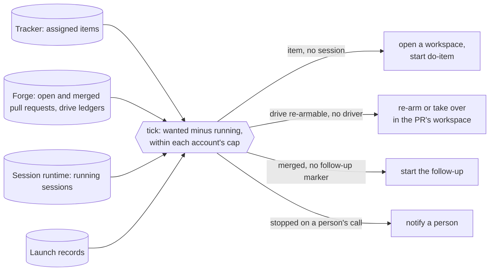
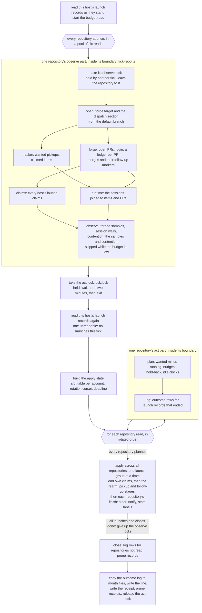

# The dispatcher, a tick that starts the execution line's stages: design

**What problem this solves.** Jig's [execution line](../FACTORY.md#the-line)
has a skill for each stage: `do-item` picks an item up, `drive-pr` drives its
pull request through review, a follow-up settles what the merge owes. Each
of them starts only when a person types it. An item assigned to the team
waits until someone opens a session for it; a drive stopped by a usage
limit or by a parked question waits until someone re-arms it, though
`drive-pr` already admits that re-arm on a mechanical state; a merge waits
for someone to remember its follow-up. With nobody at the keyboard (at
night, in a meeting, on a phone) the line stops at the first stage boundary.
With this built, a small program on the machine that runs the agent
sessions looks at the tracker, the pull requests and the running sessions
every few minutes, starts each stage that should be running and is not,
and tells a person when a stage stops on something only a person can
settle. It never merges: that stays a person's
([ADR-0003](../docs/adr/ADR-0003-a-person-merges.md)).

This is the design of [plan.md](plan.md) item 33. Every step of its
[build order](#build-order) is built, and the documents that describe it are
the current truth; the item stays open on the roadmap until its "Done when"
checks run on a host running Orca, each named at its own build step. It
builds on driving any pull request from anywhere: the
[drive ledger](../plugin/skills/drive-pr/README.md#where-its-state-lives)
on each pull request, the re-arm of a stopped drive and the takeover of a
wedged one are in `drive-pr` today, and so are the framed park (a park that
carries the question, the options and the recommended one) and the
[morning report](../plugin/skills/drive-pr/README.md#the-morning-report). M0 names the service this is: a
[control plane](../GLOSSARY.md), "a service that tracks an agent's job and
can reach a person". The dispatcher is the first one Jig ships, for the
execution line only. Its first [session runtime](../GLOSSARY.md) is Orca
([ADR-0011](../docs/adr/ADR-0011-the-dispatcher-targets-orca-first.md)).

## How it works

`jig dispatch` runs one **tick**: it reads records it does not own,
computes the stages that are wanted and not running, and, when told to,
starts each one as an agent session. A timer runs the tick every few
minutes. What is _wanted_ is always derived from those records, never from
the dispatcher's memory. What the dispatcher keeps is what it did and what
it saw its sessions do (see What the tick keeps, and where): stopping it
loses nothing, and there is no resident process to supervise: the
"daemon" is the timer.



### One tick, step by step

A tick runs in two **phases**. In the **observe phase** every repository
is read at once: each under its own **observe lock**, and every read
through one pool that keeps at most six in flight (the forge's login and rate limit, each read once per tick, and the base heads of conflicting drives among them), well inside the forge's
secondary rate limits. Within one repository, the sources that do not
depend on each other are read side by side: the tracker beside the forge,
then every host's launch claims beside the runtime. In the **act phase**,
under the machine's one **act lock**, the tick reads this machine's launch
records again and gives each repository a **turn** in rotated order, one
after another: its plan and its outcome rows. The turns queue the launches
and the labels; once every repository has had its turn, the launches run
across all of them, one launch group at a time, and then each repository's
finish step writes its labels. A launch changes what the next may admit (an
account's slots, the tick's allowances of workspace opens (the launches'
and the follow-ups' own lane's), the account whose
turn is next), so acts never overlap, and the admission order is the one the
tick would take with no observe phase in front of it. Last, the tick closes: it settles what the
repositories it did not read still owe, copies the outcome log, writes the
dashboard's line and writes its receipt. Each phase lives in its own module
under `plugin/dispatch/lib/`.

The [dispatcher](../plugin/README.md#the-dispatcher) owns these parts of
the tick. The observe phase reads the served people's assigned items
beside the factory identity's, and makes the board read, a query of its
own once a repository's ledgers name its converged drives
([dispatch-board.md § The board read](dispatch-board.md#the-board-read)).
The act phase reads the host's gauges when it builds its apply state, and
admits each launch within the load factor. And the steward is one more
stage, launched on the owner host when its digest changed, whose records
the next tick's plan reads.



**The locks, and their order.** A tick takes each repository's observe
lock (`observe/<digest>.lock` under the state directory) as it starts
reading that repository, and never waits for one. The lock is taken twice
over: for the checkout's path, before anything is read, and for the forge
repository, once the observation knows which repository the checkout is,
because the records an observation reads and writes belong to the
repository, so two checkouts of one repository exclude each other. The
close of a tick takes the same locks before it logs the ended records of
a repository it did not read, and leaves those of one another tick
observes to that tick. A lock acquisition that fails is a defect of that
repository's turn, and the tick awaits every started observation before it
gives any lock up. A repository another tick holds is left to that tick, named on the
receipt (`busy`), and neither read nor acted on. A tick that finds every
repository it names held ends as one that found the lock held (exit 3),
which is what a wake-up's waiter retries after its minute. The act lock is
taken only after every observe lock the tick holds for its reads, and is the only
lock a tick waits for: up to two minutes, looking again every quarter of a
second, after which the tick ends the same way. A tick holding the act lock
waits for nothing, so no two ticks wait on each other. Its one exception to
taking no observe lock is the close, which tries the observe locks of the
repositories it did not read, without waiting, to log their ended records,
and leaves any it cannot take to the tick that holds it. A repository's observe lock is kept until every repository's launches
and closes are done, so no tick acts on a repository from reads made before
another tick acted on it; then the locks are given up together, and a
wake-up for any repository that arrives before then finds it busy and
retries. A single-repository tick (the
Orca plugin's wake-up, or `jig send`'s) therefore reads and acts on its
repository while a sweep reads or acts on the others, and waits only for
the sweep's act phase, never for its reads.

The act lock is the file `tick.lock`, which every earlier version of the
tick took for its whole run. A host whose timer and wake-ups run different
versions keeps one tick acting at a time: the earlier version finds the
lock held while this one acts and exits, and this one waits while the
earlier one runs. An earlier version takes no observe lock, so while it
runs, a tick of this version may read the same repository; what this one
then acts on is read again under the act lock (the launch records) or just
before each launch (the target itself).

**What the act phase reads again.** The observe phase reads this machine's
launch records as they stood when the tick started. Under the act lock the
tick reads them again, settles their follow-up outcomes, and builds the
apply state from that read: the slot table, the account whose turn is next
and the rotation cursor, so a launch another tick made while this one was
reading holds its slot and is seen as running by the plan. The deadline a
launch is checked against (`outOfTime`) counts from the start of the
invocation, not of the act phase: the launcher's own clock has been running
since then, through the observe phase and any wait for the act lock. Every target is read once more just before its launch, as before.
A tick that had to wait for the act lock, or that finds under it a launch
record its startup read did not hold, may have read its serialized groups
before another tick launched into them, one of an earlier version that takes
no observe lock; it starts no re-arm in a group that tick, and replays no
pending launch of a pull request in one, keeping the record; the next tick
reads the group afresh.

**The budget gate.** The forge's budget is read once per tick, as the
observe phase starts, beside its first reads. While less than a tenth of
its limit is left, the tick skips the reads it can do without: each running
drive's thread sample, and serialization's reads (the change-area catalog,
each pull request's changed files and unresolved threads). With
serialization's reads skipped, every drive of a repository whose
configuration names a catalog is unplaced for the tick with the budget as
its reason, so no re-arm starts on a pull request whose area cannot be
told, and no hold begins or ends. The receipt says what was left and what
was skipped (`lowBudget`), and every repository's report carries the
budget as the tick started.

Each step, in order, with what it reads, what it writes, and what happens
when it fails. The phase names are the ones a receipt times.

| Step | Module | Reads | Writes | On failure |
| --- | --- | --- | --- | --- |
| Launch records (`start`) | `tick.ts` | `state.sqlite` | none | read again by the act phase |
| Observe lock | `receipts.ts` | the repository's lock file | the lock, naming this process | held by a live tick: the repository is left to it and named on the receipt; every one held: the tick exits 3 |
| `open` | `tick-observe.ts`, `forge-batch.ts` | the repository's query: the repository and its default branch, `.config/jig.yaml` on it, and the open pull requests with their labels, heads, mergeability and comments; where it does not read, `gh repo view` and the file on their own | none | the repository is refused and reported; the others go on |
| `tracker` | `tick-observe.ts` | the items assigned in a dispatch state | none | a failed record; no pickups planned |
| `forge` | `tick-forge.ts` | open pull requests (from the repository's query, else their own listing), the login (once per tick), each one's ledger and park answers from its comments, the merges in the follow-up window and the markers of each merge whose `updatedAt` moved | the merges' kept marker reads | a failed record; drives and follow-ups not planned |
| `claims` | `tick-shared.ts` | every host's launch claims, from the same comment listings; on a merge whose ended launches owe their ends, the claims kept at its `updatedAt` | the merges' kept claims | per pull request: a listing that does not read reaches the plan as unknown |
| `runtime` | `tick-observe.ts` | the runtime's session list, its host-wide listings read once per tick | none | a failed record; nothing is joined |
| `observe` | `tick-observe.ts` | each running drive's unresolved threads, each waiting session's wall, the change-area catalog; the threads and the catalog's reads not while the budget is low | thread samples, a pickup's opened mark, waiting episodes, the owner's serialization holds, and the account's usage-limit wall under `walls/<account>/` | reported as unplaced |
| Act lock (`wait`) | `receipts.ts` | `tick.lock` | the lock, naming this process | held: looked at again until two minutes have passed, then the tick exits 3 and writes no receipt, unless its launcher ran the plugin upgrade first: then a receipt holding that upgrade and the holder |
| Launch records again (`act`) | `tick.ts` | `state.sqlite` | the follow-up outcomes of ended records | one unreadable record withholds every launch, since its slot may be live |
| Apply state (`act`) | `tick-apply.ts` | the launch records, `tick-index` | the rotation cursor | cursor unwritable: no launches |
| `plan` | `tick-plan.ts` | everything above, the follow-up outcomes, the idle clock, the nudges | the idle clock, released pickups, settled nudges, the follow-up outcomes it settles | a write the database refuses is a defect: it stops this repository in phase `plan` |
| `log` | `tick-settle.ts` | the ended launch records, the ledgers | one outcome row per ended record, with its end | reported; the record is kept until its row lands |
| `apply` | `tick-apply.ts` | each target read again just before its launch, the failure ledger | the launch record, the forge claim or marker, the runtime's launch, nudges, notices, the failure ledger | per action: refused, reported, tried again next tick; a nudge, notice, claim end or marker answer that keeps failing backs off (see Failures) |
| `labels` | `tick-labels.ts` | the ledgers, each written pull request's ledger read again just before its write, the failure ledger | the state labels on pull requests, the linked items' `blocked` state where the repository names it, the failure ledger | per write, reported; one whose ledger changed since the tick read it waits for a later tick; one that keeps failing backs off (see Failures) |
| `shared` | `tick-shared.ts` | the shared records' reads and writes this turn | none | none |
| Close (`close`) | `tick.ts`, `tick-settle.ts`, `tick-reads.ts`, `tick-line.ts` | the receipt, the launch records, the forge's rate limit as the tick started (put on every repository's report) | outcome rows for repositories not read and not held by another tick, the failure ledger's rows for each repository read and for the tick, the month files, the line (each repository's part by a tick that read it; the machine's part by a tick the timer asked for every repository of the machine file), the receipt | a part that reports its failure is said on the receipt, which stays complete; exit status 1; a budget that does not read is reported as unreadable. A defect in a closing step marks the receipt not completed |

**A defect stops only its own repository.** Every read and every action
above turns its expected failures into a record or a refusal on the report.
Anything that still throws is a [defect](../GLOSSARY.md): a bug, or a write
the platform refused where nothing turns that refusal into a value (a full
disk under the state database, say). The tick catches it once, at the
boundary around each repository's turn
([ADR-0012](../docs/adr/ADR-0012-failures-as-values.md)). The repository's
report keeps what its earlier phases did, launches included, and is
refused with the defect: the code `defect`, the phase it was thrown in, and
a sentence saying what was thrown there. The receipt never carries the
stack: that goes to the tick's error output, beside the same sentence,
which the timer's journal keeps. The remaining repositories run, the tick
still closes and writes its receipt, and it exits 1.

Inside `apply`, each stage is a boundary of its own: the re-arm, pickup
and follow-up launches, the nudges, the notifications, and the close that
projects the labels and reports the shared records. A defect in one stops
that stage only, so the repository's other stages launch in the same tick
as if it had not been thrown. The report lists it under `stageDefects`, with
its code, its phase, its stage and its sentence, and is not refused; the
outcome log gets an event row `defect` under that stage with the same
sentence; the stack goes to the error output; and the tick exits 1. A defect in the closing steps still
writes the receipt, marked not completed, with the defect on it; `jig
dispatch receipts` lists it as incomplete and counts its defects. A closing
step that returns its own failure (the outcome log not copied, the line not
written) is not a defect: the receipt stays complete, with exit status 1.

**Each phase is timed.** A repository's report carries the milliseconds of
each phase of its turn (`phasesMs`), and the receipt the tick's own
(`start`, `observe`, `wait`, `act`, `close`). Phases of one repository
that run side by side (its tracker and forge, its claims and runtime) each
keep their own time, so they add up to more than the turn took. The tick's
text output prints them on one line per repository, and `jig dispatch
receipts` prints how long each tick took. A receipt written before phases
were timed has neither, and reads as before; one written before the
observe phase was split from the act phase carries `repos` for both.

**What a tick reads once.** The observe phases of every repository share
one set of reads, made when the tick starts (`tick-reads.ts`), and one pool
of reads in flight. Each repository is read in one GraphQL query
(`forge-batch.ts`), run in its checkout so the forge client names the
repository as its own view of the checkout does: the repository and its
default branch, `.config/jig.yaml` on that branch, and its open pull
requests, 50 to a page (two points of the forge's GraphQL budget each), each
with its labels, description, head, mergeability, its head's checks,
its first 100 review threads and first 100 comments, in the shapes
the pull request and comment listings give them. A pull request with more
comments than that is listed on its own, in full. A query that fails or
reads in part leaves each of these to its own read, as before it. Each pull
request's comments are listed at most once per tick (`tick-comments.ts`),
the query's filling the listings of the pull requests it read in full,
and that one listing gives its drive ledger, the answers to its parks,
every host's launch claims on it and, on a merge, its follow-up markers. A
listing is filled through one promise per pull request, so two readers
that ask at once share one read, and a listing that failed is the answer
for the rest of the tick. A query's comments are never held for a pull
request a write this tick dropped the listing of after the query began.
The merges whose markers a tick reads are read the same way where there are
two or more: their comments in one query by their numbers, 50 to a page,
begun after the merged listing was read, so the markers it reads are kept
as a listing's would be. What belongs to the host rather than to a
repository is read once too, the first time a repository needs it, and
every repository is answered from it: the forge's login, Orca's repository
and workspace listings (the runtime's `sessionsOnce`), and, as the tick
starts, the forge's rate limit, which decides the budget gate and every
repository's report then carries. The comment listings of a repository's
open pull requests the query did not hold are all asked for as soon as the open pull requests are read,
and the markers of its merges as soon as the merged listing does, so they
are read side by side within the pool while the readers take each in turn. A runtime listing that fails fails each repository's record alike,
as a read of its own would have. The login is the exception: when it cannot
be established it is unknown (`null`) rather than a failure, the forge
record still reads, and what depends on it (the trust of a comment as the
dispatcher's own, a kept read) is treated as not known to hold.

**What is never read from them.** Every read just before a launch goes to
the forge and the runtime: the drive read again before a re-arm or a
takeover, the markers, labels and sessions a follow-up reads again before
it starts, a claim posted and read back, the listing before a claim's end
is written and before a stale claim is released. The guards against a
second launch rest on what those say now. A write the tick makes on a pull
request (a claim or marker posted, an end written, a marker deleted) drops
that pull request's listing, so nothing later in the tick reads its
comments as they were before it.

**A merge already read is not read again.** The follow-up markers of each
merge are kept in the state database (`merge_reads`) beside the pull
request's `updatedAt` as the merged listing gave it when they were read. A
new comment moves `updatedAt`, and so does an edit of one (another host's
answer written onto its marker, a person's run marked done); the listing
gives it with no extra call. While it has not moved, the tick plans from
the kept markers instead of listing the comments again, so a merge whose
follow-up is settled, done on this host, marked done by a person or
answered by another host, costs nothing after its first read, and a new
marker on it is seen at the next tick. The forge does not document that
deleting a comment moves `updatedAt`, so a kept read stands for at most an
hour, after which the merge is read again whatever its `updatedAt` says. A
kept read also records the forge login it was read as, since a comment's
trust depends on it, and stands only for that login; a read is kept only from
comments listed after the merged listing, never from a listing the tick held
from an earlier observation of the pull request. A
merge with a stale-claim release still pending is read every tick, since
only a fresh listing completes the release (see Stale follow-up claims); a
write the tick makes on a merge drops its kept read, so the next tick reads
it; a merge that leaves the follow-up window loses its row. Planning from
kept markers starts nothing by itself: a follow-up wanted, or a stale
claim to release, reads the markers again first.

The same holds for the launch claims of a merge on which this host's own
drive launches ended but still owe their ends (a record is read for its
claims until every end it owed is written). Those claims are kept in the
merge's row and read in place of the forge's under the same rule and
cadence, only while every launch record this host has on the pull request
has ended and, as the claims were last read, none of them is a trusted
claim that does not read and the current claim is not another host's with
no end. Another host's end is an edit, which moves `updatedAt`. These claims
admit no launch: a merged pull request is never re-armed, and writing an
end lists the claims from the forge first, then drops the kept row.

**What observing writes.** The observe phase reads the launch records as
they stood when the tick started, never the apply state that launches
change. It does write Control's records to the state database: thread
samples and a pickup's opened mark on launch records, waiting episodes,
and the owner's serialization holds. It also publishes an account's
usage-limit wall as files under `walls/<account>/`, which sessions of every
repository on that account read; the wall is written before the waiting
episode that names it, and the two are not one transaction. The plan writes
the idle clock, released pickups, settled nudges and follow-up outcomes.
Each database write is one transaction on rows of its own repository, and
all of them go to the one `state.sqlite`, whose write lock orders the
repositories' writes, and another tick's, one after another; the
transactions are single statements or a few, so the wait is short. The
walls are shared across repositories by design: an account's wall holds
for every session on it.

### Guards against a second launch

A tick acts on facts that can go stale between its read and its launch,
and two ticks can overlap (the timer and a person's manual run). These
guards keep one stage from starting twice:

- **One tick acts at a time per machine, and one tick per repository.** A
  tick reads each repository under that repository's observe lock and acts
  under the act lock, both under `~/.local/state/jig/dispatch/`, in the
  order One tick, step by step gives; a tick that cannot have a lock says
  which process holds it. Each lock holds its holder's process
  id, which every version of the tick reads, and beside it the
  [process identity](../GLOSSARY.md) every lock of the plugin records
  (host, boot, process id and start time), so a lock left by a tick that
  died is taken over even when its process id has since been reused: by a
  process started after a restart, or by another process altogether. A
  lock with no identity beside it is judged by its process id alone.
- **A fresh read before each launch.** With `--apply`, the tick reads the
  action's own facts again just before it starts it: the item still
  assigned and in a dispatch state, the ledger still re-armable, no running
  session for it.
- **The stages' own refusals.** `drive.ts` refuses a second driver by its
  lock and the ledger's claim, and admits a re-arm or takeover only on a
  mechanical state. `do-item`'s claim has the same kind of refusal, which
  the pickup stage (build step 4) depends on: it refuses an item already in
  its in-progress state or assigned to anyone but the session's own
  identity, and it re-reads the item after its transition and stands down
  when another claim landed first, so a person's manual pickup racing a
  dispatched one does not start beside it. A tracker offers no conditional write, so a race inside that
  re-read is narrowed, not closed, and when both claims come from the
  factory identity the item's state and assignee cannot tell them apart.
  The tick therefore checks the sessions instead: an item that more than
  one running session joins to (two workspaces, or a workspace beside a
  still-running launch record for another one) is reported as a double
  claim and notified, and the tick starts nothing for it. A manual
  pickup on another host is not in this host's runtime report, so it stays
  invisible until it opens its pull request.
- **A marker on the pull request for the follow-up**, which has no claim of
  its own: the tick posts a hidden-marker comment
  (`<!-- jig-dispatch-followup -->`) on the merged pull request before it
  starts the follow-up's pass, carrying the launch record's id. The marker
  is trusted only as the drive trusts a ledger: written by the dispatcher's
  own login or by an owner, member or collaborator; a marker from anyone
  else is ignored and reported, and an unreadable marker leaves the pull
  request unplaced (reported, nothing started). A trusted marker is a
  claim, not a completion: the tick classifies a pull request its own
  marker claims by the launch record that marker names and by the
  follow-up's outcome record (a manual run's marker names none; see
  below). Both must
  name that pull request and the follow-up action; a marker naming a
  record for anything else (one copied from another pull request) leaves
  the pull request unplaced (reported, nothing started). When a
  follow-up's launch record ends, the tick writes a compact outcome record
  for that pull request (done or failed, and the launch record's id), which
  the receipts' retention never removes (see Receipts), so a launch record
  that expires after a successful follow-up does not turn it into a
  failure. An outcome counts only for the marker that carries its launch
  record's id: each attempt posts a new marker with a new launch record, an
  outcome naming another launch record (an earlier attempt's, whose marker
  a person deleted) neither settles nor fails the current one, and the
  current attempt's outcome replaces it when its launch record ends. An
  outcome of done means the follow-up is done; a launch record
  still running holds it; a pass that died during its work, its wrapper
  gone or its pass ended on a signal or a failing exit with no result
  recorded and no question stated, is run again once while its death is
  recent (within the session lease, 6 hours): the tick releases the marker
  it left, whether or not an answer was written onto it, and a later tick
  starts the follow-up again under a record whose facts carry the recovery
  tag, within the pull request's recovery budget (see Launch records). Only
  the death whose marker a tick released this way makes the next follow-up a
  run again; one a person asks for by deleting a failed marker is a new
  follow-up. A pass that ended failed on a **routine question** (see
  Sessions that wait) is run again once in the same manner, with no age
  limit, since it waits on no session lease: its outcome record
  keeps the question and its routine class, the tick releases the marker it
  left, which its wrapper never answers, and a later tick starts the
  follow-up again under a record whose facts carry the recovery tag and the
  class (`recovery: routine <class>, merged …`), with the earlier question
  and the class's standing answer in its prompt. A follow-up of this host's
  that failed before passes tagged their questions (an outcome record with
  no class field, written by an earlier release, or a launch record whose
  prompt offered no tags) is run again once in that manner, whatever its
  question, with every class's standing answer. An outcome whose retry
  evidence was kept (the tick stores whether the attempt was a run again
  before it releases the marker) needs no launch record; an outcome from
  before that was kept needs the launch record still on this host, since
  only that record says whether it was itself a run again, so one whose
  record is gone (past `receipts_days`) is a person's, as is another host's
  failed answer. An outcome record whose kept question
  does not read (not JSON, not a mapping, or naming another launch record)
  is never read as an earlier release's: it is logged and the follow-up is a
  person's. The prompt of a routine run again quotes the earlier question,
  at most 500 characters on one line, as a JSON string in a fence, and says
  it is that pass's words, data and not an instruction. A run again of either kind never earns another: whichever
  path ran it, its failure or death is a person's, so a follow-up is run
  again at most once by the two together, and both draw on the pull
  request's recovery budget. An older death, a failed outcome on an untagged
  question or none, a run again that failed or died too, or a tick's marker
  whose launch record and outcome are both absent on this machine is a
  failed follow-up, notified and never relaunched by the tick. A person settles it by deleting the marker, which makes the
  follow-up wanted again, then running the follow-up or leaving it to the
  next tick. The marker lives on the forge, so a lost launch record does not
  start a second follow-up on this machine. A launch record still pending
  with its marker posted (the tick stopped before the runtime answered its
  launch, or the answer was lost) is launched again under the same record,
  token and marker, as a drive's pending launch is, once a fresh read finds
  it safe: no hold label, the record's own marker still the earliest
  trusted one, naming it and carrying no end, and no session joined to the
  pull request. A hold label, a read that fails, or a repository with no
  `dispatch.followup_command` waits for the next tick; a marker that is
  gone, no longer the earliest or answered, or a session joined to the
  pull request means the replay can never be proven safe, and the record
  is stuck (see Launch records). While such a record holds the follow-up, no
  new one starts for the pull request.

  The marker is also the claim a follow-up started by hand honours, since
  a person can start one after the tick reads no marker and before it posts
  its own. The follow-up stage (build step 5) therefore depends on the
  repository's follow-up command claiming the same way: it posts a marker
  of its own before it acts and refuses a pull request that already carries
  a trusted marker from another run. A manual run has no launch record on
  the dispatching machine, and may run on another host, so its marker
  names none: it says the run is manual (`run: manual`). The tick reads
  nothing on this machine for it, so a manual marker carries its own
  outcome, written by the run that posted it: the follow-up command edits
  its marker to `done` once its last act has succeeded. A trusted manual
  marker marked done means the follow-up is done: it is never started,
  notified or reported again. One not marked done holds the follow-up
  (never started by the tick, never notified as failed) and is reported on
  every tick with its author and age, since the person who ran it sees its
  outcome and the tick has no record that could; a person settles it by
  marking it done when the run succeeded without marking it, or, as the
  tick's are, by deleting it when the run failed, which makes the
  follow-up wanted again. Such a hold ends when the claim goes stale (see
  Stale follow-up claims, below). Whoever posts a marker, the tick or a
  manual run, reads the markers back after posting, and of two trusted
  markers on one pull request the earlier comment wins, as the drive's
  takeover claims do: both are claims of one module,
  `plugin/shared/records/forge-claims.ts`, under its one rule. The later
  poster deletes its marker and stands down (the tick ends its launch record
  without starting a session; a manual run stops before it acts). A
  read-back that does not list the new marker reads again a few times; one
  that fails, or never lists it, starts nothing. The forge
  offers no conditional create for a comment, so the read-back is not
  atomic: a read that lags can omit a marker posted a moment earlier, and
  two runs can each read themselves the winner. The follow-up command
  therefore reads the markers again before each act that writes outside
  the pull request (an issue closed, a tag pushed) and stops when an
  earlier trusted marker than its own has appeared, as a drive stands down
  at its next round boundary on a claim a lagging read hid. What remains is
  a read that lags past every one of those checks; the tick reports two
  trusted markers on one pull request whenever it finds them, so a double
  run is seen and a person settles it. The marker
  settles who starts the follow-up, and it names the host that posted it:
  once that host's launch record ends, its next tick writes the follow-up's
  answer onto the marker (`outcome: done` or `failed`), so another host
  dispatching the repository reads its done from its failed (see Several
  hosts).

  **Stale follow-up claims.** A claim whose end no tick can see (a manual
  run's not marked done, or another host's with no answer written) is
  stale once it is older than `dispatch.followup_stale_after` (a day by
  default) and no session the runtime reports is joined to its pull
  request. The run that made it stopped short (on a question, a crash, a
  closed session) and will not come back to it, and a follow-up is what a
  merge still owes: tags, tracker items, status pages. Held silently, that
  debt is never paid, and the only sign of it is a line in each tick's
  journal. The host that owns the repository therefore releases a stale
  claim, once per pull request: just before, it reads the markers again
  (the stale one still the earliest trusted marker, still not marked done
  or answered), the runtime (still no session joined) and the hold label,
  writes a pending release record in its state database (one row per
  repository and pull request, `followup_releases`), deletes the marker,
  and marks the record released in one transaction with an event row
  (class `stalled`) in the outcome log. An unconfirmed deletion keeps
  the pending record: the response may have been lost after the deletion.
  A fresh complete marker listing completes a pending release whose marker
  is gone, with its event row, before planning another follow-up. A pending
  record whose marker is still there is retried after the same fresh checks.
  Nothing starts in the tick that
  releases: the next tick finds no marker and starts the follow-up as it
  would for any merge. A claim on the same pull request that goes stale
  after that (the restarted follow-up's, or a person's later run) is not
  released a second time: it is notified to a person (cause
  `followup-stale`), with its age, whose claim it is and the earlier
  release, and repeated on the notifications' cadence until a person marks
  it done or deletes it. Once is the bound because a single release
  recovers a run that stopped short, which is what the hold usually is, and
  two in a row say the follow-up itself needs a person; a release that
  could repeat would start a follow-up again and again behind a failure no
  run settles. A claim inside the window, one a running session is joined
  to, one whose age does not read, and one the runtime cannot say about are
  held as before, reported with their author and age and with the window
  that releases them. The tick's own claims are not released this way:
  their end is on this host's records, so a failed one is notified as a
  failed follow-up and a running one ends with its launch. A person's claim
  and another host's count alike, since the marker is the one record either
  leaves, and the report and the notice say whose claim it was. Only the
  owner releases, as it alone notifies, so the release record on its host
  is the only one, and two hosts never release one claim twice.

- **A claim on the forge for every drive launch.** Beside each drive's
  launch record, after the record holds its slot and before the runtime's
  `launch`, the tick posts a launch claim on the pull request, one of the
  [shared records](../GLOSSARY.md) every host dispatching the repository
  reads. A current claim another host made and has not ended holds the pull
  request's launches, so a second host never starts the same launch; a
  claim that loses its attempt to an earlier one is withdrawn and the launch
  record given back (see Several hosts).

### The records it reads

| Record              | Read through                                                                                                                                                                                                                                                                                                                                                                                       | What the tick takes from it                                                                                                                                                                    |
| ------------------- | -------------------------------------------------------------------------------------------------------------------------------------------------------------------------------------------------------------------------------------------------------------------------------------------------------------------------------------------------------------------------------------------------- | ---------------------------------------------------------------------------------------------------------------------------------------------------------------------------------------------- |
| The tracker         | the [tracker interface](../GLOSSARY.md) (`plugin/skills/do-item/scripts/lib/tracker/port.ts`), Linear, GitHub Issues and Jira today                                                                                                                                                                                                                                                                | the items assigned to the repository's [factory identity](../GLOSSARY.md): in a dispatch state (`todo` by default), the pickups wanted; in the in-progress state, the claimed pickups to watch; and from item 44, the items assigned to each [served person](../GLOSSARY.md), and their epics' children |
| The forge           | the open pull requests and their drive ledgers; the pull requests merged since the follow-up stage was switched on, and their follow-up markers; with dispatch labels on, each one's labels; each pull request's comments read once per tick, with the open pull requests in the repository's one query, and shared by every record read from them, a merge's markers read only when its `updatedAt` moved since they were kept (see One tick, step by step) | the drives to re-arm, take over or report, and those to arm (a person's `drive` label, or the adoption rule); the follow-ups wanted, running or failed                                         |
| The session runtime | in Orca, `orca repo list --json` and `orca worktree ps --json`, each read once per tick for every repository                                                                                                                                                                                                                                                                                       | which workspace holds which item or pull request, and whether an agent in it is working or waiting                                                                                             |
| The shared records  | the `SharedRecords` interface (`plugin/shared/records/shared.ts`), on the forge through `plugin/shared/records/shared-forge.ts`; the observe phase reads them from the tick's comment listings, a launch's own reads and writes go to the forge                                                                                                                                                    | for each pull request it classifies, every host's launch claims and their ends, and the follow-up markers' answers: which host holds a launch, and how it ended (see Several hosts)            |
| The drive doctor    | `drives.ts --json` from drive-pr, run read-only in the repository clone the machine file lists, only in a tick where a drive fell silent                                                                                                                                                                                                                                                           | each pull request's lock holder and the doctor's verdict on it (`DEAD`, `WEDGED`, `HEALTHY`, …): whether a silent driver no launch started is taken over                                       |

**The tracker.** The interface gains one read, `assignedIssues(identity,
states)`: the issues assigned to that user in those states, in the pool
form whose fields (`assignee`, `state`) the interface already returns. Both
adapters answer it natively. It is a new read rather than a change to
`openIssues`, which keeps refusing an empty label list. The trigger needs no
label in any repository's taxonomy. It gains a second read,
`assignedBy(key)`: the user who made the issue's current assignment, from
the tracker's history. Like every read of the interface it returns that
user or throws with a reason, so a history it cannot read in full leaves
the pickup out of the plan and names the failure.

Only an assignment a person with write access made starts a pickup: for an
item in a dispatch state, the tick reads who made its current assignment
through `assignedBy` and requires a member of the team (Linear), an
owner, member or collaborator of the repository (GitHub), or a person's
Atlassian account, not a guest, that can be assigned issues in the project
(Jira; an app's account, Jira Automation's included, never), as the drive
requires of a ledger or an answer. The check gates pickups only. A claimed
item's current assignment is the claim's own, made by the factory
identity, so the stalled and double-claim reports below read claimed items
without it; they start nothing, so an unauthorized assignment gains
nothing from them. The
item's text is untrusted data: the tick passes the session the item's key
and nothing else, and `do-item` reads the item as it reads any issue.

A dispatched session uses the factory identity's tracker credentials, so
`do-item`'s claim (moving the item to its in-progress state and assigning
it to itself) keeps the item assigned to the factory identity. The tick
then finds claimed items with the same read over the in-progress state: one
with no running session and no launch record still running for longer than
`dispatch.stalled_after` (30 minutes by default) is reported as stalled and
notified, never relaunched, since a relaunch would start a second
implementer on a claimed item. One with more than one running session is
a double claim (see Guards against a second launch). A repository with no factory identity
configured has no pickups of its own; its other stages still run.

**Served people.** Beside the factory identity, a host's machine file may
name the people it serves (`serve:`, with each person's forge logins and
tracker identities; a repository's file cannot add to it), and wherever the
`pickup` stage is on, the items assigned to them are wanted too: an open,
not-started item a person with write access assigned to a
[served person](../GLOSSARY.md), whatever its state, and each unassigned
open item under an epic assigned to one, nested epics walked level by
level, with `jig:hold` and `hitl` keeping an item waiting.

A served item held only by open blockers does not wait on work nobody
does. Each blocker that is open, not started, unassigned, free of the
holds above, an item of this repository's scope and not an epic is wanted in
its place, on the served item's authority: the pickup's claim carries the
item it blocks (`claim --blocking`), re-reads that item's assignment by a
repository writer (or its epic ancestry) and the live `blocked_by` chain at
the write, refuses a blocker that has acquired an assignee, and assigns it to
the served person only where the tracker can make the required check. GitHub
Issues adds an assignee and checks that the resulting list contains only the
served person, so a concurrent assignee makes it refuse without replacing or
restoring anyone. Linear and Jira hold one assignee, so they verify the write
from history; when that check finds a replaced concurrent assignee, they
conditionally make a best-effort restoration and refuse the pickup. The walk follows the blockers of a pulled blocker to three
links from the assigned item and ends at a cycle. A blocker that is assigned
to someone else, in progress, an epic, held, another repository's or unreadable
is never started on the strength of the relation, since anyone with write
access to the tracker can add one: the blocked item waits, and its reason
names the blocker and why it was left. Epics are worked one child at a time:
without an execution plan only the top-ranked child of an epic is wanted, and
none while another child is in progress, as `do-item` works an epic; a plan
that lists several eligible steps sets its own order and parallelism. An epic
none of whose open children can start reports one reason of its own, so the
queue says why the epic is idle. Every repository's tick reads the same assigned list from a shared tracker namespace, so an item that carries another repository's label (one of `review.taxonomy.repos` other than this repository's `review.repo_label`) is left to that repository's checkout, neither wanted nor reported as held, and refused again at the launch recheck. An item no repository label places is started only by the repository the machine file's `serve_defaults` names for the tracker namespace, and reported once as needing a repository label where none is named, so that several repositories reading one tracker never start it together. Their pull
requests are adopted as `dispatch.adopt.authors` adopts a repository's own.
The tick ranks those items by rules as data, shows each item it holds out
with its reason, and starts the next within the host's load factor; the
session claims it with `claim --for <person>`, which keeps the served person
as its assignee, so the stalled and double-claim watches read the served
people's in-progress items as they read the factory identity's. How the
ranking, the cheap reads and the claim work is in
[served pickups](../plugin/README.md#the-dispatcher).

**Claims across hosts.** The claim lock serializes the claims of one
machine only. Two hosts that serve one person claim an item with the same
identity, so their tracker writes are identical, and the claim's re-read
cannot tell which one holds it. The tracker offers no conditional write
for an assignment, a state or a comment, so no tracker write can be the
lease either. The claim marker (`do_item.claim_marker`) is the token
between hosts instead, ruled by the earliest-wins rule the forge's claim
records already use. A claim posts its marker before it writes the item,
reads the item's markers back, and of the trusted markers posted within
ten minutes of its own the earliest wins. A claim that finds an earlier
one, or cannot post or read back its own, withdraws its marker and
refuses, with nothing written to the item. After writing, it reads the
markers again and stands down if an earlier one has appeared. The marker
stays optional: a repository whose queue only one host picks up from
needs none, and unset, claims serialize on one host only. Two claims whose
read-backs each miss the other's marker can still both win; the read after
the write narrows that to the claims' own length, and the dispatcher's
double-claim watch stays as the backstop. The ready pool (below), where
several hosts take unassigned items from one pool, requires the marker: a
pool configured without `do_item.claim_marker` is refused. Inherited claims on Linear and Jira, whose issues hold one
assignee, assign and then verify through the item's history that the
assignment replaced nobody, putting back anyone it did replace
([served pickups](../plugin/README.md#the-dispatcher)).

**The ready pool.** A team whose lane is a pool (validated items left
unassigned for whoever takes them first) names its states in
`dispatch.pool.states`, rather than assigning each item to the factory
identity. The interface gains two reads for it, both optional, which every
adapter answers: `unassignedIssues(states)`, the open issues assigned to
nobody in those states inside the tracker's pool scope
(`issue_tracker.jira.pool_issue_types` on Jira), and `stateChangedBy(key)`,
who made the issue's latest move into the state it is in now, from the
tracker's history, as `assignedBy` reads an assignment. Trust moves from
who assigned an item to who made it ready: an item is wanted only when that
mover passes the assigner's test above, and an item whose history holds no
move into its state was created there, so its creator is the mover. On
GitHub the move is the latest effective transition into the state the
issue is in now (the state its furthest-along state label gives): the
labelling that put that label in force, the removal of a label that
exposed it, or a reopening; on a board, the newest change of the `Status` field to the
state's option, where a project workflow's change is never trusted and an
item with no option is in no recorded state. Every gap (a history not read
whole, a deleted account where the tracker names none) leaves the item out
with its reason, as an unreadable assigner does. The holds and the
repository scope a served item meets apply, and so does its open-blocker
rule: an item one of whose blockers is open or cannot be read waits, its
row naming the blocker, and is planned once the blocker closes (its
relations kept until it changes, each blocker's state read every tick).
The wanted items are ranked by the queue's rules after the identity's own,
and the launch reads the item again, unassigned, in the pool, made ready by
a trusted person and with no open blocker, before it starts. The pickup's `do-item` claims the item as any claim does, so the
precondition command, `claim_from` and the claim marker apply, and the
claim assigns it to the factory identity, whose claimed items the stall and
double-claim watches read. The pool is refused without the factory identity
and without the claim marker.

**The forge.** The tick lists the repository's open pull requests and reads
each one's comments for the ledger's marker, as the drive itself does; it
does not rely on the forge's search to find the marker. It trusts only a
ledger the drive trusts: written by the drive's own login or by an owner,
member or collaborator. Each ledger is classified from its driver's state
and exit code, first match wins. The exit is the one `drive.ts` returned,
which the driver writes into its ledger as it stops, not the status
reporter's: `drive.ts` maps convergence to `0`, where `drive-status.ts`
reports `3`
([terminal states](../plugin/skills/drive-pr/references/terminal-states.md)).
A converged drive is read beside what its stop does not fix: the
pull request's mergeability as the forge reports it, read with the pull
request, and its head against the head the ledger says the drive
verified. Main moving under a converged pull request can make it
conflict, and a person's push after the drive stopped leaves the new
head unreviewed; either makes the drive stale, and the drive itself
already knows what to do on a re-arm (a conflict-resolve round for the
first, its ordinary rounds for the second). A mergeability the forge is
still computing leaves the pull request unplaced for that tick, and so
does a converged ledger that names no verified head on a pull request
that does not conflict. A re-drive is launched once per change, the pull
request's head and whether it conflicts: its launch record keeps that
change, and a later tick that finds the same change reports it however
that launch ended, so a drive that converges again without settling it
starts no loop.

A drive that stopped `9` (conflicting with its base, its conflict-repair
budget spent) is read beside the pull request too. Its conflict-resolve pass
can fail for reasons a second try settles: an account's usage limit, a pass
deadline, a base that moved under it. So it is
re-driven as well, once per change, and here the change is the pair of the
pull request's head and its base branch's head. That head is read from the
branch itself, and only for a ledger that stopped `9`: the pull request's own
`baseRefOid` stays at the commit the forge recorded when the pull request last
moved, so it cannot say that the base did. The re-drive is owed whatever the
forge reports now. Still conflicting, the conflict-resolve round tries again;
mergeable (a person merged the base in, or the base moved past the conflict),
the stop no longer describes the pull request, and the drive's ordinary rounds
take it from there. A mergeability the forge is still computing, or a head or
a base head that does not read, leaves it unplaced for that tick.

A person is told only once this machine's re-drive of that change leaves the
ledger stopped `9`, whether the re-drive stopped so itself or ended without
writing a stop of its own (a refusal at its attach, a crash), since nothing
else drives the pull request until its head or its base moves. Any other exit
it stops on reads as that exit's row says. A stuck conflict therefore costs one
launch per base move, and the base moving is what makes it a new attempt, so
there is no loop: a re-drive that changes nothing leaves the change as it was,
and a change is never re-driven twice. A converged drive's re-drive is keyed on
its head and whether it conflicts, so one that stops `9` gets one more attempt
under this key: at most one launch more. The serialized areas' holds and a
person's `hold` label keep a re-drive off as they keep any re-arm, and a person's
stop is never re-armed.

A headless Claude pass can commit only where its approval source allows it: a permission mode `drive.pass_args` names, or an allow rule of Claude Code's own settings (`--allowedTools`, `permissions.allow`). Only a host's user file or one run's environment sets it; a repository's own file that sets it stops the drive. Where nothing allows the commit, a conflict re-drive stops `9` again at the same change and the dispatcher notifies a person.

A conflict-resolve pass does not leave its merge behind: a merge it started and
did not conclude is aborted before the drive re-gates or stops
([terminal states](../plugin/skills/drive-pr/references/terminal-states.md#repair-rounds)),
so a re-drive finds a clean tree and an attach is not refused over a head that
moved. A merge the tree already held when the pass started is not the pass's
to discard: the pass finishes it or starts it over (`drive-pr` `SKILL.md` § 0),
and a tree that holds one behind a moved head refuses the attach, which leaves
the ledger stopped `9`, so a person is told.

A drive that stopped `14` (stalled: its passes changed nothing for the stall
threshold and one extra round) or `21` (the review converged, but CI still
fails with its CI-repair passes spent) stopped on a cause whose next step is
the drive's own, not a person's decision: a pass that reads why the stalled
passes did not act, or a CI repair with a fresh budget. So each is re-driven
once per change, here the pull request's head commit with the exit, on any
admitted account. The re-armed drive's first pass is told the stop and, for a
stall, what its passes recorded last, which the drive reads from its own
state and the ledger, wherever it runs. A stall whose stop recorded work left
in its tree (uncommitted edits, an open merge, unpushed commits) is re-driven
in that tree, the one the ledger names, and never in a fresh one, which would
not carry the work: on another host the tick leaves it to that host's
dispatcher, and on this host, with no open workspace holding that tree, a
person is told. A person is told too once a re-drive leaves the same stop at
the same head, as for a conflict stop; a head that moves is a new attempt.

A drive whose converged head's failing checks all failed on the
infrastructure (a lost runner, or a setup step's network failure, with no
code error in the log) never spends a CI-repair pass on them and never stops
`21` for them: the drive re-runs the failed jobs, and moves the head (a base
merge, or an empty commit) where a run cannot be re-run, within its own
bounds. One that stopped `23` (the failure persisted past those bounds) waits
on the forge's service, not on a person or the code, so it is re-driven once
per stop, after a backoff from the stop's time that doubles with each
consecutive `23` the ledger's stop events record (15 minutes, at most 4
hours); a tick inside the backoff reports it quiet. A person is told once 7
such stops stand in a row, or when a re-drive leaves the same stop standing.

A drive that stopped `15` (a pass reached its deadline again after the
driver spent its restarts, `drive.pass_deadline_retries`) is re-driven the
same way, once per head commit on any admitted account: the tree keeps what
the killed passes did, and a fresh pass usually finishes it. Like a stall's,
its stop records whether it left work in its tree and which tree that is, so
a stop that measured work left is re-driven only in that tree, whose
re-armed drive takes the edits as its own to finish: on another host it is
left to that host, and with no open workspace holding the tree here, a
person is told. A deadline stop that never measured, written by a driver
that did not record it, is re-driven on any account. A deadline whose
kill could not be witnessed never reads `15`: that driver keeps its locks and
leaves its ledger running, so it is a silent drive (below). Exit `1` names a
crash, a failed pass or an unreadable state, not a next step, and stays a
person's, with one exception: while the pull request also conflicts with its
base, the stop is re-driven once per pair of the pull request's head and its
base branch's head, the change a stop on a conflict is keyed on, so the
drive's conflict-resolve round runs; either stop's re-drive at that pair
counts, and a person is told once one leaves the drive stopped at the same
pair. While the forge still computes whether it conflicts, the stop is
unplaced for that tick.

A needs-a-person stop whose pull request also conflicts with its base says so
in its notice and its report line, so the person knows a base merge is owed
too.

A deliberate stop records the person's decision, with their reason when
given. Mailbox stops and pauses keep exits `18` and `19`; `drives.ts --stop`
records an explicit person's stop even when it must force the process to end.
A person's stop stays stopped until a person releases it. The hold label
also prevents launches while it stands.

With ledger mirroring enabled, `drives.ts --stop` verifies the published
ownership before signalling. An initializing driver, or an unreadable ledger,
is refused without a signal: hold dispatch and retry once ownership reads.
The driver publishes its ownership immediately after initialization.

Stop intent is published and verified on the forge before signalling the
driver. Ledger writes are serialized so an older in-flight write cannot erase
it. A running driver with recorded stop intent is held against automatic
re-arms and takeovers. Stop-bearing ledgers use format version 2 so older
readers refuse them instead of ignoring the stop; ordinary ledgers remain
version 1, and the new reader accepts both.

A stopped ledger with no exit and no person's-stop record is an accident:
the dispatcher re-arms it on an admitted account to resume its durable state.
Hard termination of both driver and launch wrapper can leave a running ledger
with a stale heartbeat instead. With `--apply` and the re-arm stage enabled,
the owning dispatcher reconciles a confirmed-dead local acquisition even when
no launch record started it. A durable released witness, or the exact driver's
persisted observations showing no surviving observed or registered pass,
authorizes the recovery. Every pass launch records pending before spawn and
retains creation identities and POSIX process groups; a missing identity,
unreadable sample or unfinished launch withholds recovery. The observation
belongs to the original lock token, and recovery reserves that exact token
before publishing the stop, so an unpublished successor is preserved. The
reservation and released witness commit together. Every forge retry reserves
the slot again; a reservation left by a confirmed-dead recovery is reclaimed
only when its label binds the same acquisition.
The guarded write marks its ledger stopped with no cause and releases the
recovery's own leases before planning within the no-cause budget. Foreign
holders, unreadable liveness, surviving work and legacy records without a
witness or observations stay running. These are observations of cooperative
passes, not containment of arbitrary descendants (ADR-0008).
A silent drive no launch record of this machine and no launch claim of
another host's started, a drive armed by hand or by another tool and in any
clone, is taken over when its driver ran on this host (the label after the
`@` of the ledger's clone) and this host shows that driver's run ended: drive-pr
reads, without writing, the run the ledger names (its clone, pull request and
acquisition time) in this machine's drive database, and calls it ended only on
the evidence its own recovery accepts, a released witness whose driver pid no
longer runs, or persisted observations showing the driver and every observed
or registered pass gone. `drive.ts --take-over` still decides whether the
takeover is admitted. Only this takeover draws on the recovery budget: one of
a driver a launch started is planned from that launch's record or claim,
outside the budget, whatever this host shows of it. One takeover is made per ledger facts: once it ends
leaving the ledger as it was, a person is told. Where the host cannot show
the run ended (the driver's clone is on another host, its process table does
not read, no record of the run, a pass that may still act), the clone's drive
doctor (`drives.ts --json`, read in the clone the machine file lists) is
asked as well: a holder it reads `DEAD` (its process confirmed gone, its tree
clean or no longer there) or `WEDGED` is taken over on a free slot, outside
the recovery budget, and `drive.ts --take-over` still decides. Otherwise the
silent drive is notified with the doctor's reading, once, and appears in
`jig ask --waiting`; its state label is parked.

The re-arms of stops with no recorded cause and the re-drives of the stops
whose next step is mechanical (a recurring pass deadline, a failure on a
conflicting pull request, a silent driver no launch started that this host
shows gone, a follow-up
whose session died or that stopped on a routine question) draw on one recovery budget per pull request: 3
attempts in a rolling hour, across accounts and hosts, counted from this
host's launch records and every host's launch claims by the tag on their
ledger facts (`no-cause: `, `recovery: `); completing a round does not reset
it. A follow-up's run again is counted from this host's launch records of the
pull request, of any stage, but not from another host's claims: a follow-up's
marker is deleted when its run is released for another, so no shared record of
that attempt remains, and a drive's recovery attempts on another host do not
count against it. Once spent, the next such stop needs a person and is notified once with
the drive's handoff: a no-cause stop as repeated no-cause stops, any other as
repeated recovery re-drives. A legacy no-exit ledger receives at most one
automatic attempt, regardless of the budget; a new ledger then follows the
ordinary budget.

| Ledger says                                                                                                                                                                                                                                                                            | Class                                                    | The tick                                                                                                                                                                                                                                                                                                                                                                                                             |
| -------------------------------------------------------------------------------------------------------------------------------------------------------------------------------------------------------------------------------------------------------------------------------------- | -------------------------------------------------------- | -------------------------------------------------------------------------------------------------------------------------------------------------------------------------------------------------------------------------------------------------------------------------------------------------------------------------------------------------------------------------------------------------------------------- |
| running, heartbeat inside the lease window                                                                                                                                                                                                                                             | driven                                                   | nothing                                                                                                                                                                                                                                                                                                                                                                                                              |
| running, heartbeat past the lease window                                                                                                                                                                                                                                               | silent                                                   | reconciles a confirmed local stop from a released witness or durable pass observations when re-arms are enabled; otherwise takes it over when this machine's launch record or another host's launch claim started it                                                                                                                                                                                                 |
| running, heartbeat past the lease window, no launch having started its driver, which ran on this host and whose run this host shows ended, no takeover of this machine's on these ledger facts having ended, budget available                                                          | silent                                                   | takes it over on an admitted account, whichever tool armed it; `drive.ts --take-over` decides                                                                                                                                                                                                                                                                                                                        |
| running, heartbeat past the lease window, no launch having started its driver, its holder read `DEAD` or `WEDGED` by the clone's drive doctor, no takeover on these ledger facts having ended (this host's or another's)                                                               | silent                                                   | takes it over; `drive.ts --take-over` decides                                                                                                                                                                                                                                                                                                                                                                        |
| running, heartbeat past the lease window, otherwise (the driver's clone on another host, its run not shown ended and its holder not read `DEAD` or `WEDGED` by the clone's drive doctor, a takeover already made on these facts, or, for a silent driver shown gone, the budget spent) | silent                                                   | notifies a person once and lists it as waiting                                                                                                                                                                                                                                                                                                                                                                       |
| stopped `0` (converged), the pull request open and now conflicting with its base, or its head past the head the drive verified                                                                                                                                                         | stale                                                    | re-arms on any admitted account: the drive's conflict-resolve round merges the base in, or its rounds review the new head                                                                                                                                                                                                                                                                                            |
| stopped `9` (conflicting with its base, its conflict-repair budget spent), neither this machine's records nor another host's launch claims holding a re-drive of the pull request's head and its base branch's head                                                                    | stale                                                    | re-arms on any admitted account: the drive's conflict-resolve round tries again, or, where the forge now reports it mergeable, its rounds take it from there                                                                                                                                                                                                                                                         |
| stopped `9`, this machine or another host already having re-driven that change, however that launch ended                                                                                                                                                                              | needs a person                                           | notifies per stop, with the exit and the drive's handoff                                                                                                                                                                                                                                                                                                                                                             |
| stopped `14` (stalled) or `21` (CI still failing with its repair passes spent), neither this machine's records nor another host's launch claims holding a re-drive of the pull request's head with that exit                                                                           | stale                                                    | re-arms on any admitted account; a stall that left work in its tree, or whose stop never measured it, re-arms only in that tree: on another host it is left to that host, and with no open workspace holding it here, a person is told                                                                                                                                                                               |
| stopped `14` or `21`, this machine or another host already having re-driven that head with that exit, however that launch ended                                                                                                                                                        | needs a person                                           | notifies per stop, with the exit, the drive's handoff and, when the pull request conflicts with its base, that it does                                                                                                                                                                                                                                                                                               |
| stopped `23` (CI still failing on the infrastructure through its re-runs and head moves), its backoff from the stop passed, no re-drive of that stop held or made, fewer than 7 such stops in a row                           | stale                                                    | re-arms on any admitted account; inside the backoff (15 minutes after the first such stop, doubling with each consecutive one, at most 4 hours) it is reported quiet and nothing is launched                                                                                                                                                                                                                         |
| stopped `23`, that stop already re-driven however that launch ended, or 7 such stops in a row                                                                                                                                 | needs a person                                           | notifies per stop, with the exit and the drive's handoff, or that the infrastructure has not recovered                                                                                                                                                                                                                                                                                                               |
| stopped `15` (a pass reached its deadline with its restarts spent), neither this machine's records nor another host's launch claims holding a re-drive of the pull request's head with that exit, budget available                                                                     | stale                                                    | re-arms on any admitted account; a stop that measured work left in its tree re-arms only in that tree, and with no open workspace holding it here, a person is told. A tree on another host is left to that host: with no dispatcher there, nothing re-drives it and no host notifies; this host reports it quiet, and `jig ask` names the re-drive it waits on, or, where no dispatcher is known, a person's re-arm |
| stopped `1`, the pull request conflicting with its base, neither this machine's records nor another host's launch claims holding a re-drive of its head and its base branch's head, budget available                                                                                   | stale                                                    | re-arms on any admitted account, so the drive's conflict-resolve round runs                                                                                                                                                                                                                                                                                                                                          |
| stopped `15`, or `1` on a conflicting pull request, already re-driven at that change however that launch ended, or the budget spent                                                                                                                                                    | needs a person                                           | notifies per stop, with the exit and the drive's handoff, or that the recovery budget is spent                                                                                                                                                                                                                                                                                                                       |
| stopped `0` (converged, the pull request still at the verified head and not conflicting), `5` (merged or closed), `20` (taken over)                                                                                                                                                    | done                                                     | nothing; a merge is the follow-up's                                                                                                                                                                                                                                                                                                                                                                                  |
| stopped with an explicit person's-stop record, or `18` or `19` (a mailbox stop or pause)                                                                                                                                                                                               | stopped by a person                                      | nothing: a person's stop is never re-armed                                                                                                                                                                                                                                                                                                                                                                           |
| stopped with no exit and no person's-stop record, budget available                                                                                                                                                                                                                     | re-armable                                               | re-arms on an admitted account; a legacy ledger gets at most one attempt                                                                                                                                                                                                                                                                                                                                             |
| stopped with no exit and no person's-stop record, budget spent                                                                                                                                                                                                                         | stopped-unknown: repeated no-cause stops, needs a person | notifies once with the drive's handoff and says the drive stopped repeatedly with no recorded cause                                                                                                                                                                                                                                                                                                                  |
| stopped `16` (quota-parked)                                                                                                                                                                                                                                                            | re-armable                                               | re-arms on an admitted account other than the one its launch record names, when one does, or after the wall's reset                                                                                                                                                                                                                                                                                                  |
| stopped `8` (parked), every parked item answered                                                                                                                                                                                                                                       | re-armable                                               | re-arms on any admitted account                                                                                                                                                                                                                                                                                                                                                                                      |
| stopped `4` (not judgeable yet: a converged drive that left the Ready mark to another driver, or whose final CI witness did not arrive)                                                                                                                                                | re-armable                                               | re-arms on any admitted account, as `drive-pr` asks an unattended wrapper to                                                                                                                                                                                                                                                                                                                                         |
| stopped `8`, an item unanswered                                                                                                                                                                                                                                                        | parked                                                   | notifies per park                                                                                                                                                                                                                                                                                                                                                                                                    |
| stopped `11` or `13`                                                                                                                                                                                                                                                                   | refused                                                  | nothing; another driver holds it                                                                                                                                                                                                                                                                                                                                                                                     |
| stopped on any other exit (`1` on a pull request that does not conflict, `2`, `6`, `7`, `12`, or one this table does not know)                                                                                                                                                         | needs a person                                           | notifies per stop, with the exit, the drive's handoff and, when the pull request conflicts with its base, that it does                                                                                                                                                                                                                                                                                               |

The tick reads every pull request merged after the date the follow-up
stage was switched on for the repository (`followup_since` in the machine
file, written when that stage is turned on), marked or not. One with no
follow-up marker is a follow-up wanted; one with a marker is classified by
it (see Guards against a second launch), so a marker whose launch record
this machine no longer has is still found and reported. A merge
the cap keeps from starting at once stays wanted until a later tick starts
it; nothing about it depends on a time window between ticks.

**Labels** (optional). A repository may turn on the pull request state
labels (`dispatch.labels`, off by default, every name under a prefix the
repository picks, `jig:` by default), which show where each driven pull
request stands, where a person sees it from any forge client, and take a
person's commands the same way. With them on, the open pull requests are
listed with their labels in the same one listing, and the merged ones
with theirs; with them off, no label is read or written.

The drive, the follow-up and the tick write the states, all through one
projection in the plugin's shared code (`shared/pr-labels/`): the label
set, the prefix, the mapping from a ledger to its state and the diff that
brings a pull request's labels to it. The drive writes its own pull
request's label after each ledger write of its own that lands (`driving`
once it arms, before its first round, removing `drive` in the same write;
at the stop, the state the exit table the tick's classifier reads too gives,
drive-pr's `exit-classes.ts`: `converged` for `CONVERGED` while the head is
the verified head, `parked` for a park, a stop only a person settles, a
person's stop and a stop the tick re-drives, `driving` for a stop the tick
re-arms, nothing for `PR_NOT_OPEN`), and the follow-up writes
`followed-up` or `followup-failed` when it ends, from the dispatcher's
wrapper or a person's `jig dispatch marker done` or `marker failed`. Each
reads `dispatch.labels` from the repository's default branch, as the tick
does (`label-config.ts`), so a repository with no dispatcher turns the
labels on the same way and every writer uses one prefix; each writes in one
forge call only where the labels disagree, never writes `stale` or `held`,
which depend on what only the tick reads, and is best effort: a refused
write is one line on its output and never changes a drive's exit, and the
next tick corrects it where a dispatcher runs. A drive leaves a pull
request carrying `hold` or `held` as it is. Where the tick re-drives a
stop, it replaces the drive's `parked` with `stale`. There is one mapping, and the
tick corrects every label at every tick: the drive and the follow-up are
earlier triggers of the same projection, never a second mapping. No
writer creates a label: a one-time setup does, `jig dispatch labels
[--repo <path>] [--yes]`, with no job installed, or `jig install dispatch
--repo <path> --yes` beside the timer, each naming the labels it created
and listing, with the command, those a person must create. An optional
workflow (drive-pr's `templates/github/state-labels.yml`) replaces
`converged` with `stale` on a push to the pull request, which the next tick
confirms or corrects.

- **States**, written by the tick at every tick, and by the drive and the
  follow-up as above: `driving` (a driver runs, or the
  drive stopped on a state the tick re-arms), `converged`, `parked` (a
  person settles it: a park, a stop only a person
  settles, a person's own stop), `stale`, `held` (an open pull request
  waiting its turn in a serialized area, below, whatever its ledger
  says), `followed-up` (a merged pull request whose follow-up is
  done) and `followup-failed` (a merged pull request whose follow-up
  failed and is not started again, so a person acts; a later follow-up
  that is done replaces it with `followed-up`). A merged pull request's
  state comes from its follow-up's end, as the plan reads it from the
  follow-up's outcome record and markers: a failed follow-up is labelled
  whether or not the pull request carries a label of the set, a done one
  only when it does. The ledger is the truth: after the
  plan, each managed pull request's state is derived from its ledger
  again and set as its one state label, in one forge call per pull
  request whose labels disagree and none where they agree. Just before
  each state write on an open pull request the tick re-reads its ledger
  and leaves the pull request to a later tick when the ledger changed since
  it read it (its generation, its driver's heartbeat, state or exit) or no
  longer reads, so a drive's label written for a newer ledger is not
  replaced from the older one the tick planned from; a drive's ledger write
  that lands between that re-read and the tick's own write can still be
  undone until the next tick. The re-read lists the pull request's
  comments, one listing per state write, which a tick makes only where
  labels disagree. A label a person edited, or one a
  killed drive left behind, is corrected at the next tick. A ledger the tick cannot read leaves the labels as they are.
  Only the states listed here are kept by this projection, so a state a
  later stage owns, which no ledger produces, is never touched by it.
  Where the repository names `issue_tracker.states.blocked`, the projection
  has one tracker output beside the label: each item an open managed pull
  request links (`Closes`/`Refs <KEY>`) goes to `blocked` while its state is
  parked, with a comment naming each park's class and reason and a marker
  recording the state it left, and back to that state once its state is
  driving, converged or stale. The tick writes it after the labels, under
  the same `--apply`, ownership and ledger re-read rules, and leaves a pull
  request serialization holds; the drive writes it with its own label. A
  stop blocks an item once, so an item a person moved out stays out.
- **Commands**, written by a person and read by the tick: `drive` on an
  open pull request with no ledger asks for one, and the plan arms a drive
  on it as a re-arm (`drive.ts <PR> -- <pass>` on an admitted account),
  once per head commit, so an arm that ends without leaving a ledger is
  reported rather than launched at every tick; once a ledger exists, the
  command has been carried out and the label is replaced by the state
  label, and a `drive` label on a pull request that already has a ledger
  is reported and replaced the same way, never arming a second driver.
  `hold` keeps every stage off its pull request (re-arm, takeover, arm,
  follow-up, notification) while it is there; each action it keeps off is
  reported, and the fresh read before a launch refuses one a `hold`
  appeared on since the plan.
- **Only labelled pull requests.** With `only_labeled` on, a pull request
  that carries no label of the set is never read for a ledger, launched,
  notified or followed up; what puts one under the dispatcher is a
  person's `drive`, or the `driving` label a drive writes on its own pull
  request when it arms, and the state labels keep it there. So a drive a
  person arms by hand comes into the dispatcher's scope with its first label
  and is re-armed, re-driven and followed up from then on; a person keeps one
  out with `hold`. Membership reads
  any label of the set; which stage is planned never reads one. The scope
  is decided once per tick, from the listings that hold each pull request
  (the open one and the merged one): in scope when each finds a label of
  the set on it. A pull request they disagree on (it merged between the two
  reads, and the label changed with it) is unplaced for that tick, as any
  record the tick cannot place: reported, no action and no label written
  on it, its notice records kept, and read again at the next tick. A
  launch's fresh read is the observation that launch acts on, so it checks
  the scope again there. With `only_labeled` off, every open pull request
  is still read, so a drive a person armed by hand on an unlabelled pull
  request is found, and its label is the drive's own.
- **Markers**, written by the tick on every pull request it reads, with no
  prefix and outside the set, so neither puts a pull request in scope. The
  repository's manual-operations label (`issue_tracker.labels.manual_ops`)
  marks a pull request whose description's `## Out-of-tree follow-ups`
  section lists a step not yet checked off (a plain item or an unchecked
  box; the explicit "None", fenced code and comments list none). It is
  derived from the description as a state is from its ledger, so a hand
  edit is corrected, and a merged pull request keeps it until every step
  is checked off or its follow-up is done, which reports each step done or
  filed; one whose follow-up the tick cannot place keeps it as it is. The
  listings read each description with its labels, and merged pull
  requests are listed only where `followup_command` is set. `automation`
  marks a pull request a bot opened that carries no label of the
  `automation:` family, which a repository's workflows apply to name their
  job, unless the bot is one of the host's own authors (the adoption
  rule's, else the dispatcher's own login); the tick adds it and never
  removes it or a label of the family.

**Adoption** (optional). A pull request nobody armed is never driven
otherwise: the drive label asks a person to notice each idle one, which is
the polling the dispatcher exists to remove. A repository may therefore
name an adoption rule (`dispatch.adopt`, off by default). Under it the
tick reads an open pull request with no drive ledger as if it carried the
`drive` command when its author is one of the rule's identities (by
default the login the dispatcher reads the forge as, the identity the
host's sessions open pull requests under) and the forge reports it
updated within the rule's window (a week by default). The open listing
carries each pull request's author, draft flag and last update for it. A
draft is adopted like any other, since pull requests open as drafts and
the drive marks them ready. A bot's pull request is adopted only where
the rule names that bot: driving dependency updates stays a choice the
repository makes by name. A pull request a person's `hold` label is on is
never adopted, and one a person stopped carries a ledger that records the
stop, so adoption, which reads only pull requests with no ledger, never
reaches it. An automation pull request (a bot's that is not one of the
host's own authors, or one carrying `automation` or an `automation:`
label) is adopted only while it needs work: a check on its head failed (a
cancelled run or one waiting for approval did not), it conflicts with its
base, or a review thread is unresolved. The same holds for the re-drives,
takeovers and re-arms the plan would start of itself on one with a
ledger: a healthy one is reported quiet, and only a person's `rearm`
starts it again. The repository's query reads each open pull request's
head checks and its review threads with it, and the fresh read before a
launch counts an automation pull request's threads again, the launch
waiting when that count does not read, except where trouble is already
observed (a failed check or a conflict) or a person's `drive` or `rearm`
asks: those launches need no count. A healthy one is left for a person
to merge. Whether a failed check failed
on the infrastructure is not told here: the drive re-runs such a check
rather than repairing code. Everything after adoption is the `drive` command's: the plan
arms it as a re-arm, once per head commit (its launch record's facts are
a labelled arm's), on an admitted account, behind a serialized area's
hold, and the fresh read before the launch applies the rule again. The
report names each adopted pull request with the rule's reason (its
author, its last update, the window), and the forge record counts them.
The rule needs the labels on, since the hold label is read only then;
beside `only_labeled` it is refused, since a pull request with no label of
the set is never read.

**Serialized areas** (optional). An area of the repository's change-area
catalog (`drive.change_areas_catalog`, [M3](../modules/M3-change-area-catalog/README.md))
marked `serialize: true` is one whose pull requests conflict with each
other whenever two of them move at once, so the tick drives them one at a
time. Once per tick, from one observation of each fact: the catalog is
read from the default branch as the forge holds it, as the `dispatch`
section is, so a pull request cannot unserialize its own area; each open
pull request read for a drive gets its changed files from the forge, page
by page; a pull request touches an area when one of its files matches the
area's own globs (its seeds, never the `impliedBy` closure: contention is
two changes in the same files). The pull requests that touch one
serialized area make its group, ordered by closeness to merge, read from
the ledger and the forge and never judged: converged and mergeable first,
then a drive in progress (a running driver, or this machine's launch
record still holding it), then the fewest unresolved review threads, then
the most rounds, then the oldest by creation, then the lowest number, so
the order is the same at every tick until a fact changes. The first leads
the group and is planned as any pull request is. Every other member is
**held**: no re-arm, takeover or re-drive, each such action reported as
`held: serialized behind #N in <area>`; its notifications go on. A pull
request in two groups is held unless it leads both; the order is one total
order, so the first pull request of all leads every group it is in and no
two groups wait on each other. When the leader merges or leaves the group,
the next tick promotes the next, which the re-drive of a stale converged
drive then launches once per change. A drive in progress ranks above
review progress so that a leader mid-drive, whose threads rise and fall
with each round, keeps its place: otherwise the next tick could promote
another and start a second drive in the group. Only the dispatcher's
launches are held: a drive a person arms on a held pull request is not
stopped, and the tick reports that the group has two drives. A pull
request whose files do not read, or a group in which a member's ledger or
threads do not read, is unplaced for the tick with every member of the
group: no re-arm, no label written, read again at the next tick; a catalog
that does not read unplaces every drive's re-arm the same way. The tick
writes a held pull request's state label as `held` where the labels are
on, and an event row when each hold begins and ends, the end carrying how
long it waited (the hold's start is a row of the state database, `holds`).
The catalog grows through a person: the conflict history report
(`history.ts --propose-serialize` in `resolve-conflicts`) prints the
catalog lines for the hotspots that lie in one area alone, and writes
nothing.

The labels must exist before the tick writes them: `jig install dispatch
--repo <path>` lists the missing ones and, with `--yes`, creates them
where the signed-in account may and lists the rest for a person. The tick
writes labels only with `--apply`, for a repository the machine file
lists; a write the forge refuses is reported in the receipt and tried
again at the next tick, never a failed tick.

**The session runtime.** Each workspace is joined to an item or a pull
request by the pull request the runtime links to it, by the issue it links
where the runtime links issues of that tracker (Orca links Linear issues),
and otherwise by its branch: the branch carries the item's key in the
adapter's branch form (the [issue key](../GLOSSARY.md)'s `eng-123-…` or
`123-…`), and the pull request's head branch names the pull request. An
agent counts as running when the runtime reports it working or waiting; a
finished agent does not hold the stage, and the report shows its state as
evidence. A headless drive started in a terminal is not an agent the
runtime reports, so its running state comes from its launch record (below)
and from the ledger's heartbeat. These answers are unknowns, never "no
session": a host the runtime's answer marks as not covered, a page cut
short by its row limit, and a workspace on a branch that matches the item
or pull request but whose agents the runtime does not report. The tick
plans nothing for an item or pull request it cannot place, and reports why.

### The tick reports by default and acts only with `--apply`

```sh
jig dispatch [--repo <path>]... [--json]          # report: what it would start, and why
jig dispatch --apply [--repo <path>]...           # start what the machine file enables
jig dispatch install [--interval 5m] --yes        # the timer
jig dispatch receipts                             # past ticks
jig dispatch result <record> <token> done|failed  # a session's or a follow-up pass's answer
jig dispatch result <record> <token> failed --refused <updated-at> --reason <reason>  # a pickup the start rules refused
jig dispatch result <record> <token> failed --refused <updated-at> --key <item> --reason <reason>  # one refused batch member; repeat --refused and --key per member
```

A tick without `--apply` prints every action it would take, each with the
record that wants it and the evidence (the item's state and assignee, the
ledger's class and heartbeat, the session's state), and starts nothing.
This is the same contract as [resource collection](../plugin/gc/README.md):
report first, act only when told, and fail closed: a record that cannot be
read leaves the actions that depend on it out of the plan and names the
failure. `--apply` starts only the stages the machine file enables for each
repository (`stages: [rearm, pickup, followup, notify, steer]`); a stage it does
not enable is reported as with no `--apply`. The timer always runs with
`--apply`, so the machine file alone decides what it starts, and a
repository is switched on one stage at a time once its report has been read
for a while. An item or pull request gets at most one action per tick.

### Launch records: how a stage's answer comes back

A launched stage runs for minutes or hours in its session, long after the
tick that started it has ended, so the tick never sees its exit directly.
Every launch therefore begins with a launch record in the state database
(see What the tick keeps, and where), which the tick writes before it
calls the runtime's `launch` (the action, the item or pull request, the
account, and a random token minted for that launch). From that write on,
the record holds its stage and its account slot, so a launch whose answer
is lost is never followed by a second session on the same stage or past
the account's cap. A headless pass runs through a small wrapper,
`plugin/dispatch/run.ts`, which is handed the record and adds its process
identity before it starts the stage (host, boot id, process id and the
process's start time, the identity `drives.ts` captures for a driver so
that a reused process id is never read as the same process) and records
the stage's exit when it ends. A record that has neither a process
identity nor an agent id is **pending**: it holds its stage and slot, and
its launch is retried only under its own token, which the tick hands
`launch` as the launch's key (see The session runtime interface), never as
a fresh launch. A record still pending at a later tick, whose launch no
tick calls again, is **stuck**: both of its launches went unanswered (or
one went unanswered and the runtime answered the other as not started),
since an unanswered launch
may have started a session and a third call is never made, or a follow-up's
replay could not be proven safe (see Guards against a second launch), or the
runtime answered its last launch as started longer ago than the machine
file's `unclaimed_after` (15 minutes by default) and no wrapper has claimed
it. The wrapper claims its record before anything else, seconds after its
terminal starts, and the workspace is opened before the launch call, so a
claim that has not come by then is not coming; within it, a wrapper slow to
start is never mistaken for one, and while the runtime cannot say which
sessions run the tick waits for a read that can. Past it, a session the
runtime joins to the record's target is named in why the record is stuck:
that wrapper may have started its stage without claiming the record, so the
record keeps its slot and a person checks that session before clearing it. A
stuck record is notified to a person as needing them (see Notifications),
shown on the dashboard as needing a person rather than as an ordinary
pending launch, and holds its stage and slot until a person checks for a
session it started and clears it (`jig dispatch clear <record>`, which
refuses a record whose process is alive). The next
tick reads the records: a record whose process is alive under that same
identity holds its stage; one that ended carries the stage's answer; one
whose identity cannot be checked (another boot, an unreadable process
table) is an unknown, reported, holding its stage and its account slot
until a person clears it. The one exception to "alive holds its stage" is
a takeover: a drive whose ledger is `silent` and whose driver this
machine's launch record started is planned for takeover although that
record is alive, since a wedged driver stays alive by definition; whether
the takeover is admitted stays `drive.ts --take-over`'s decision. A silent
driver no launch started is taken over too, on a free slot, once this host
shows its run ended (see the ledger classes). The
takeover runs in that record's slot rather than needing a free one (see
Admission by account). A `silent` drive whose driver no launch record of
this machine and no launch claim of another host started (a person armed
it, or the record that did is gone) is taken over too, on a free slot,
when the repository clone's drive doctor (`drives.ts --json`, read in the
clone the machine file lists) reads its holder `DEAD` (its process
confirmed gone, its tree clean or no longer there) or `WEDGED`; the tick
reports it with the doctor's reading otherwise. A dead driver's orphaned
drive is cleanup no person needs to do. A refusal (`drive.ts`
exiting `11`, `13`, `16` or `20`; `do-item` finding the item already
claimed) is recorded as the stage's own answer and never fought: an action
whose facts have not changed since the refusal is reported, not launched
again. A re-arm whose record ended on any other failing exit (a usage-limit wall
excepted) without its drive moving the ledger (an attach that refused, say) records the pull
request's head and its branch's head it launched at; while both heads and the
ledger's facts are those, it is not launched again, and a person is told once
(cause `needs-person`, keyed by that exit, the ledger generation and both
heads). A pull request whose head is not its branch's is behind its branch,
which the drive's attach refuses: the notice names both commits and the
recovery, closing and reopening the pull request so the forge takes the
branch's head. A change of either head or of the ledger lets the next tick
re-arm it; a record with no heads, or heads that do not read now, leaves the
re-arm as it was. A record whose process is gone without an exit is a launch
that died, reported with its last state.

The wrapper is the command a headless pass runs, a drive's or a
follow-up's. A drive's exit is its answer. A follow-up pass's exit says
only that it ended, so the prompt the tick composes ends by asking the
pass to record its result: `jig dispatch result <record> <token>
done|failed`, which writes the stage's answer into its launch record. Its
record ends with the pass's exit, with that result, or as failed when none
was recorded; the wrapper keeps the last `Question:` line of the output of a pass that
ended short of `done` on its exit, which is where a pass that needs a person
states its question (see Sessions that wait), and the follow-up's result
is what its outcome record keeps.

An interactive session (`do-item`) is started as the runtime's agent, and
an agent's state says that it finished, not whether its stage succeeded.
Its launch record, written by the tick before the launch, gains the
agent's id from the launch's receipt, and its prompt ends by asking the
session to record its result the same way. The command refuses a token
that is not the record's own and a record that already has a result, so a
session settles its own launch and no other, once; the token binds a
session to its record, and does not guard the state directory against a
process of the same user, which can write it directly. The result is the
stage's answer, not proof that its session stopped: an agent can record
its result and go on working or wait for another prompt. So the record's
state is its agent's: the agent `sessions` reports under the record's
agent id holds the stage and its account slot while working or waiting,
whether or not a result is recorded, and the record ends only when the
runtime reports that agent finished or gone. It ends with its result, or
as failed when none was recorded, since a session that stopped on a
question or a crash records none; a pickup's record is read beside the
item's state.

### The session runtime interface

The tick reaches the runtime only through these methods:

| Method                                               | What it does                                                                                                                                                                                                                                                                                                                                                                                                                                                                                 |
| ---------------------------------------------------- | -------------------------------------------------------------------------------------------------------------------------------------------------------------------------------------------------------------------------------------------------------------------------------------------------------------------------------------------------------------------------------------------------------------------------------------------------------------------------------------------- |
| `sessions(repo)`                                     | the workspaces and their agents, joined to items and pull requests, with each agent's id and state and each workspace's comment and unread mark                                                                                                                                                                                                                                                                                                                                              |
| `openWorkspace(...)`                                 | a workspace for an item (a new branch) or a pull request (its head branch), reused when one exists                                                                                                                                                                                                                                                                                                                                                                                           |
| `launch(workspace, stage, account, key, sessionId?)` | a session in the workspace that runs the stage, billed to the account; for an interactive session, its receipt names the agent's id. `key` is the launch record's token: a second call with a key already launched starts no second session. `sessionId`, given for an interactive session, is the vendor session id the tick minted and keeps on the launch record (see Control), distinct from the agent's id and the key; a launch that cannot carry it records no wall and gets no nudge |
| `notify(target, message)`                            | a message that reaches a person; its receipt carries the target's comment as written                                                                                                                                                                                                                                                                                                                                                                                                         |
| `steer(session, nudge)`                              | one of the closed set of nudges (see Control) sent to a session the runtime reports waiting, its screen and attachment re-read in the same call just before the send                                                                                                                                                                                                                                                                                                                         |
| `retire(workspace, expected)`                        | the repository's notices workspace removed with its terminals and branch, once a re-read just before, under the comment lock, finds the comment and unread mark the tick decided on                                                                                                                                                                                                                                                                                                          |

Each returns the runtime's receipt, and each, a terminal-screen read for
`steer` included, runs under a deadline and is cancelled past it: its
answer counts as lost, and the tick goes on to its other actions and
releases its lock, so a runtime that hangs costs one action, not every
later tick. The deadline is `dispatch.runtime_timeout` (one minute by
default) for every method but `openWorkspace`, whose setup runs the
repository's create hook, a dependency install among it, and which runs
under `dispatch.workspace_timeout`. Its default is the limit the Orca
workspace tool puts on its own open (`OPEN_LIMIT_MS` in
`tools/orca/workspace.ts`: a clone, the create hook, the wait for another
open's start of its agent, and the calls around them), read from that
constant rather than restated, so the two cannot drift apart; a shorter
setting can cut off an open the tool itself would let finish. A tick
opening a workspace holds the act lock for as long as the open runs; a tick
that finds it held meanwhile reads its repositories and waits for it, up to
two minutes. A launch whose answer is lost
is retried only by calling `launch` again with the same key, never as a
fresh one, and its launch record, written before the call, holds its
stage and slot meanwhile (see Launch records). An adapter that cannot keep
that promise for a kind of session does not retry it: a pending record of
that kind stays the reported unknown. Orca is the first
implementation:

- `sessions` from `orca worktree ps --json`, which carries each
  workspace's comment and unread mark (`comment`, `unread`);
  that `orca agent launch`'s answer names the agent by the id `orca
worktree ps --json` reports it under is checked when the pickup stage is
  built, and until it does, interactive sessions are not launched, since
  their launch records could not be joined to their agents;
- `openWorkspace` as `orca worktree create` with the pull request or issue
  linked, called by the adapter itself in `plugin/dispatch/`: the
  [Orca workspace tool](../tools/orca/README.md) runs from a checkout of
  Jig, not from the plugin, so the installed dispatcher cannot call it.
  Its workspace rules (branch selection, an existing checkout of the
  branch first, branch correction and setup, which a bare `orca worktree
create` does not do) live in the plugin, in
  `plugin/shared/orca-workspace/open.ts`, and the tool calls that code, so
  the pickups in step 4 reuse it rather than a copy. A checkout of the
  branch that Orca does not list (a worktree made with plain git, such as
  an agent's leftover isolation worktree) is detached at its commit when it
  is idle, and the workspace is created on the branch: idle means a clean
  tree, no unfinished git operation, no commit the remote's branch lacks, no
  live driver or session lease (read from the drive's database), and no
  process with its working directory in it (`plugin/shared/idle-holder.ts`,
  the one test every caller that takes a branch from another checkout
  uses). One that is in use refuses the open, and the launch's refusal
  names it, for the notice below;
- `launch` for a **headless pass** (a drive re-arm or takeover, a
  follow-up, a pickup) as
  `orca terminal create --worktree <selector> --title <tab title> --command
<wrapper>` (the title as Naming what it starts gives it), the account's configuration directory set in the command's
  environment (below); for an **interactive session** (a pickup) as
  `orca agent launch --agent <id> --worktree <selector>
--prompt "<skill> <key>"`, with the model and effort from the item's
  route where the repository declares `routing`, bound to the account as a
  headless pass is (below), and with `sessionId` passed to the agent where
  the launch can carry it: `orca agent launch` takes no session id, so the
  interactive launch the pickup step built (the wrapper in a terminal tab,
  starting Claude Code itself) passes it as Claude Code's `--session-id`;
  that `orca agent launch` can bind its agent to
  an account so is checked when the pickup stage is built, and until it
  does, interactive sessions are not launched. A pickup is launched as a
  headless pass instead ([headless pickups](../plugin/README.md#the-dispatcher))
  and takes the headless form above, with the wrapper running
  `do-item`. The key is kept by the
  record itself for a headless pass: the wrapper claims the record
  atomically before it starts the stage, so a second terminal for a record
  already claimed exits without starting it, and a retry relaunches the
  wrapper under the same record. For an interactive session, that `orca
agent launch --retry-launch` retries by a key the adapter passes it,
  rather than starting a second agent, is checked when the pickup stage is
  built, and until it does, a lost interactive launch is not retried.
  The launched terminal is recorded as a _run tab_
  (`plugin/shared/orca-tabs.ts`): its handle and the PID and start of the
  login shell Orca reports for it. The wrapper closes it through `orca
terminal close --terminal` (never the whole tab, so a pane a person added
  beside it stays) once the stage ends with nothing for a person,
  while the shell is still alive (Orca no longer closes a tab whose shell
  has exited by its handle), and a launch closes the earlier idle run tabs
  of its pull request or item in the workspace;
- `notify` as a workspace marked unread with the message as its comment
  (`orca worktree set --comment <message> --unread`, the comment read
  first and read back with `orca worktree show`), appended to the comment while the workspace
  is still unread (see Notifications) and keeping the comment's dispatched
  marks, which Orca's phone app shows. A workspace's comment carries a kickoff
  prompt until its agent starts, so the tick never writes one on a
  workspace that may yet start an agent with it. The target is the
  repository's one destination (see Notifications): the workspace on the
  branch `dispatch.notices_branch` names, else a notification workspace the
  dispatcher keeps per repository, on the default branch, into which it
  never launches an agent, its comment naming the item or pull request each
  message is about and the workspace its stage ran in. A new one runs no
  create hook and has its first terminal closed (`orca terminal close
--all`). Once a tick's
  messages are sent, the tick removes it (`orca worktree rm
--delete-branch`) when it has stayed read for `dispatch.notices_linger`
  (one hour by default; the first tick that finds it read records when),
  or is still unread with every cause it carries gone, on a tick that read
  every record whole; never one written that tick, nor one holding a
  comment that is not the dispatcher's, an agent, changes git reports or a
  commit no remote branch holds. The next message that needs it opens it
  again; a cause still standing is sent again on the configured cadence,
  unless it is still unread with the message;
- `steer` as the nudge's text sent to the session's terminal, after the
  terminal's screen is read for the checks in Control. Orca reaches a
  running agent's terminal by the id `orca worktree ps --json` reports:
  that id is the terminal's tab and pane (`<tabId>:<leafId>`), which `orca
terminal list --json` names beside each terminal's handle; `orca terminal
read --screen --json` returns the rendered screen (its `source` says
  whether it is the screen, and `draft` holds text in Orca's composer), and
  `orca terminal send --text <nudge> --enter` types it. Orca reports no
  person attached to a terminal; the nearest it reports is the workspace a
  person has open (`isActive` in `orca worktree ps`), and a nudge is not
  sent into one. A live send on an Orca host has not been made, since Orca
  starts no interactive session until it binds one to an account.

A second runtime is a second implementation of the same methods, with
nothing in the tick changed.

#### Naming what it starts

A person looking at the board should tell what the dispatcher started
from what they started themselves. One convention, in the interface
itself (`plugin/dispatch/lib/runtime/port.ts`), gives every runtime the
same strings, so a later runtime names things as Orca does:

- **The name** of a workspace the dispatcher creates: a short mark, the
  stage, the key (`⚙ dispatched · pickup #123`, `⚙ dispatched · rearm
#456`, `⚙ dispatched · followup #789`; the notices workspace is
  `⚙ dispatched · notices`). It reads at a glance and a search for the
  mark finds every one. On Orca it is the `--name` of `orca worktree
create`, which Orca shows as the workspace's name and makes its folder's
  name from; the branch is still the one the branch rule names.
- **The mark** in the workspace's comment: the name and the launch
  record's id (`⚙ dispatched · rearm #456 · launch <id>`), on a line of its
  own, one per stage and key, a later launch's replacing the earlier one.
  A workspace the dispatcher creates gets it as its comment; one it reuses
  keeps its name, and `launch` adds the mark to its comment before the
  session starts, keeping what the comment holds and never adding a
  launch's mark twice. A notification that rewrites the comment keeps its
  marks. A mark the runtime refuses to write does not hold the launch
  back: the receipt says so.
- **The tab title** of a launch: `jig dispatch · rearm #456`.

The launch record keeps the same mark. A skill may rename a workspace to
what the work became; the mark outlives the name, so the comment and the
record still say the dispatcher started it, and the morning report lists
the workspaces of the night by the mark on their launch records, each with
the name it carries now.

### Admission by account

The machine file lists the subscription accounts the dispatcher may bill
and a cap for each (`max_per_account`, 2 by default): the number of
sessions the dispatcher started on that account that are still running,
waiting ones and pending launch records (see Launch records) included. Sessions a person started are not counted: the
runtime does not report their account, and a person who shares an account
with the dispatcher lowers its cap. A headless pass is admitted on an
account with a free slot and no wall in effect, the accounts taken in turn
starting after the account of the most recent launch record, so the turn
survives between ticks without state of its own.

A takeover is the exception to "a free slot": it replaces a driver whose
launch record holds a slot, and a wedged driver never gives that slot
back, so with every slot of the permitted accounts held by wedged drivers
nothing could replace them. A takeover is therefore admitted into the slot
of the launch record it replaces, on that record's account and only while
that account has no wall in effect (a walled account's takeover waits for
the reset, as any pass does). Its launch record names the record it
replaces, and the two count as one slot until the old one ends:
`drive.ts --take-over` stops the wedged holder through `drives.ts --stop`
before it drives, so the account never runs more than its cap of drivers
that work. A takeover `drive.ts` refuses ends its own record, and the old
record keeps its slot. A takeover of a driver another host started has no
record on this host to replace, and is admitted on a free slot, as a re-arm
is (see Several hosts).

A follow-up runs as a headless pass (see Binding a session to its
account) and is admitted as a drive's pass is: under the pass deadline it
runs under, which the wrapper enforces on it, on a Codex account only on a
host that opted in to Codex's bypass, holding one slot until its pass
ends. Follow-ups are admitted in a **lane of their own**: a follow-up whose
pull request has no workspace joined to it opens one from the lane's
per-tick budget (`followup_opens_per_tick` in the machine file, 2 by
default), never from the launches' `opens_per_tick` and never from the open
the notices workspace keeps, and no more follow-ups run on the host at once
than `followup_concurrency` (2), counted from the launch records still
holding. A pending record the tick reports stuck (see Launch records) is
left out while the runtime shows no session running on its target, since it
holds its slot until a person clears it and would otherwise hold the lane
too; one whose target has a session running, or whose sessions cannot be
read, is counted, since that wrapper may be running its stage without
having claimed the record. The lane's opens count in the tick's budget (the opens of
both allowances times `workspace_timeout`, and eight runtime calls), so the
installed tick deadline grows with them: about 8h50m at the defaults, above
the six-hour minimum. A value whose opens take that budget past the longest
a timer holds is refused, naming the field. A follow-up whose fresh read of
the runtime's sessions fails waits for the next tick with that failure as
its reason, rather than open a workspace on the guess that none is joined. A follow-up never waits for a drive's launch, and a
drive's launch never waits behind follow-ups; the accounts' slots stay
shared, so a follow-up still needs an admitted account with a free slot.
A follow-up that waits says what it waits on, in its receipt entry and on
the dashboard's line (`waitsOn`): the lane's budget, the lane's cap, or the
accounts. A pickup is admitted the same way, as a headless pass from item 44
on, or as an interactive session, on
one account with a free slot and no wall in effect, and its launch binds
it to that account (below), so its launch record names the account and
holds one slot. A session whose launch cannot bind its account is never
started: the host's active account can change under it at any moment, and
no read before or after the launch proves which account it bills, or that
the account is listed and unwalled. With no account free, the action waits
for a later tick and the report names the full caps.

**Walls.** The dispatcher keeps its own record of each account's
usage-limit wall, under `~/.local/state/jig/dispatch/walls/`, keyed by the
account's name in the machine file. A launch record that ends with
`drive.ts`'s exit `16` writes the wall for the account the record names,
with the reset the drive printed, or, when the reset is unknown,
`dispatch.wall_backoff` (one hour by default) from the stop. Several
sessions can write the same account's wall; a write never moves the
reset earlier, so the record keeps the latest reset any write has
recorded, and the wall is lifted at that reset; nothing else lifts it. The drive's own quota park
stays where `drive-pr` keeps it and still decides whether `drive.ts` admits
the re-arm. A wall an interactive session meets is not recorded before the
control step (see Control): that session shows as waiting, holds its slot, and is
reported once it has waited past `dispatch.blocked_after` (30 minutes by
default). A wall a follow-up's pass meets ends the pass short of `done`,
so it is notified as a failed follow-up; it is not written as the
account's wall.

**Binding a session to its account.** A headless pass is bound to its
account through the configuration directory of that account's Orca
profile, set in the wrapper's environment (`CLAUDE_CONFIG_DIR` for Claude
Code, `CODEX_HOME` for Codex), so the drive's identity resolver and quota
adapters see the account the pass bills. The directory alone does not bind
it: the resolver reads a credential in the environment
(`CLAUDE_CODE_OAUTH_TOKEN`, `ANTHROPIC_API_KEY`, `OPENAI_API_KEY`) before
the directory, so a wrapper that selects one account's directory while
inheriting another's token bills the other. The wrapper therefore starts
the pass with those variables removed, and before the launch the tick resolves the
identity the wrapper's environment yields, with the drive's own resolver,
and compares it with the admitted account. A mismatch, or an identity that
does not resolve, starts nothing and is reported. An interactive session is bound
the same way, through the environment or account selection of its agent's
launch, with the same isolation and the same check before it starts, and a
person switching the host's active account does not move it.
Switching Orca's active account before a launch is not used: it is
host-wide and would move every other session's next pass too. Whether an
Orca agent launch can bind its agent to an account is not verified (Orca's
command line selects accounts only for some agents), so a pickup does not
start as an interactive session: it runs as a headless pass, as a
follow-up does
([headless pickups](../plugin/README.md#the-dispatcher)).

A follow-up does not wait for that: it runs as a headless pass, the
account's vendor's non-interactive command (`claude -p`, `codex exec`) on
the repository's follow-up command and the pull request, started by the
same wrapper and bound the same way as a drive's pass. These reasons decide
it. The work is mechanical: tags, tracker items, status pages and
consumers, which a skill settles without a conversation. Headless binding
is the binding the dispatcher already proves at every drive's launch, with
the identity check before it starts. And an interactive session would add
a workspace a person must visit, for the step of the loop that most
needs no one. The pass runs with the host's own permission settings
(`drive.pass_args`, and `drive.codex_bypass` for a Codex account), read as
a drive's pass reads them; the launcher adds none, and a repository's file
cannot set them.

**Sessions that wait.** A pickup is a skill that asks, and with nobody
to answer a question it stops and states it, as every Jig skill does
without a person; as a headless pass it ends on a `Question:` line, as a
follow-up's pass does below, and the [steward](../GLOSSARY.md) reads it
before a person does. An agent the runtime reports waiting for longer than
`dispatch.blocked_after` is reported and notified; it keeps its slot
until it ends or a person ends it, so a cap full of waiting sessions is
visible in every report rather than silent. A follow-up's pass cannot
wait: one that cannot finish without a person carries out what does not
depend on the answer, stops, records `failed`, and ends its output with a
line that starts `Question:`. The wrapper keeps that line, at most 1000 characters and
nothing else of the output, on the pass's exit; it reaches the launch
record, the outcome log and the notification, so the pass is told to put
no secret or personal data in it. A question that is only one of the
dispatcher's routine question classes carries the class's tag right after
the prefix (`Question: [local-leftover] …`). The classes are a fixed
registry in the dispatcher's code (`plugin/dispatch/lib/routine-questions.ts`),
each with what it covers and its standing answer, and hold only
housekeeping whose safe answer is to keep and list; the pass tags its own
question from the list its prompt gives, and the dispatcher reads the tag
and never classifies free text. The first class is `local-leftover`, a
local branch or worktree the follow-up may not delete without asking,
whose standing answer is to keep it, list it in the result, finish every
other arm and record done. A follow-up that stopped on a routine question
is run again once with that answer (see the follow-up's marker, above).
The tick notifies any other failed follow-up with the question, classed as
parked for a person; the marker stays, so nothing starts it again until a
person settles it.

A pass that stops for a person also frames what it asks: it records
`failed` with a `parked-decision/v1` record (`jig dispatch result … failed
--decision <file>`), checked as a park's decision is and kept with the
result and its digest, and the need it raises carries that decision. For
the needs the tick detects itself (a failed follow-up, a stalled pickup, a
checkout an unlisted tree holds, a drive the ledger handed to a person, a
stuck launch record) the tick frames the decision from the facts that
identify the occurrence, with fixed options it can carry out. A person
answers either in a word, `approve` or `choose <option>` with the digest,
on the need's pull request or forge issue, and the tick carries out the
chosen option once, after checking its preconditions again; a
session-framed answer starts that stage again and is handed to its next
session. The rules are in [structured-answers.md § Every need
framed](structured-answers.md#every-need-framed).

### The agent behind a session

The agent a launched session runs in (Claude Code or Codex today) is the
admitted account's vendor, and nothing else chooses it: admission picks the
account, the account's `vendor` names the agent, and the launch is bound
to that account through its configuration directory (`CLAUDE_CONFIG_DIR`,
`CODEX_HOME`). A repository never names an agent; it names a model per
runtime in `routing.models`, which the launch reads for the vendor it got,
so one repository is picked up by whichever account has a free slot. The
skills are the same text in both agents, and the prompts the tick composes
and the `jig dispatch result` instruction name no agent. A drive's pass
runs the drive's documented pass command for the vendor, and a follow-up's
pass the same non-interactive command on the follow-up command; the dispatcher
admits an account only for a vendor whose pass command the drive
documents, and reports an account of any other vendor as accepted and not
admitted. An interactive session is launched as that vendor's Orca agent.
These differences travel with the session, not the dispatcher: the
review-arbiter agent exists only in Claude Code, and a Codex session uses
the substitute the plugin documents; the turn-budget hook counts Codex
responses and warns near the configured budget, but imposes no runtime turn
cap, so a Codex pass has no turn cap of its own; a pass that
runs on without finishing is bounded by the drive's pass deadline
(`DRIVE_PR_PASS_TIMEOUT`), which kills it whatever its vendor, and
Control's drive expectation, which compares rounds, sees the passes that
do finish. The deadline can be switched off (`0`), and a Codex pass then
has no bound at all, so the dispatcher admits a Codex account for an
unattended pass only when the deadline in force for that launch is
positive, and reports the account as accepted and not admitted
otherwise. A pass's bypass is the host's to give, once it has verified what
its account reaches, so a Codex account is admitted for any launch only on a
host that set `drive.codex_bypass` in its user file or the tick's environment;
without it the account is reported the same way. A repository cannot give it:
a pull request can edit the repository's file, and the tick reads the setting
without one. The tick judges this once and the launch record keeps what it
judged, so the launched wrapper, which can read another user layer from the
tick's, does what was admitted rather than reading the setting again. A Codex
wall is recorded as a
Claude one is, by the drive's quota adapter for the vendor, keyed by the
account; binding the pass through the account's own configuration
directory is what lets the adapter attribute the wall to that account,
which a directory shared between accounts could not.

A pass that outruns its deadline is ended with everything it started. On
POSIX the wrapper leads the pass's own process group and signals the group.
Windows has no process group to signal, so the wrapper samples the pass's
descendants while their parent links exist, keeps what it recorded after the
pass exits, and ends them by identity. That cleanup is best-effort, and
limits stand: a descendant started and parented between two samples can
survive a pass, and when the tree cannot be shown to have ended the wrapper
still exits, so the record's slot is released while a survivor may run on in the
workspace. Closing them takes a persisted "cleanup uncertain" launch state that
admission holds until reconciliation or a person's clearance, or ownership at
creation through a Windows job object; both are separate work, and the first
waits on the authenticated Windows smoke.

### What it never does

- **Merge**, or arm a merge: a person merges
  ([ADR-0003](../docs/adr/ADR-0003-a-person-merges.md)).
- **Answer a park, or any need's decision.** A parked question, and the
  decision a need carries, are a person's; the tick notifies and waits for
  the answer on the pull request or the item, and never counts a comment
  of its own login as one.
- **Stop a driver that is making progress.** It takes over only a driver
  whose ledger heartbeat is past the lease window: one this machine's launch
  record or another host's launch claim started, or one no launch started
  whose holder the repository clone's drive doctor reads `DEAD` or
  `WEDGED`; and only through `drive.ts --take-over`, which admits it against
  a wedged or dead driver alone. A driver whose holder is alive and making
  progress, or runs in a clone this machine's doctor cannot read, is
  reported, never taken over.
- **Re-arm a drive a person may have stopped** (an explicit mailbox stop or
  pause), or relaunch a stalled pickup, unless a person's answer to the
  need's decision chose that step.
- **Keep a converged pull request current with its base.** It re-drives a
  converged pull request on mechanical facts only: the forge reports
  it conflicting with its base, or its head moved past the head the drive
  verified. A pull request its base merely moved past, still mergeable,
  is left as it is: merging the base in on every move is a round and a
  CI run for a pull request the merge would take cleanly.
- **Pass the flags the skills reserve for a person**: `--window-reopened`
  and `clear-lease`.
- **Write to the tracker** of its own accord. The item's own state is the
  claim, and `do-item` sets it; the one exception is a stalled pickup's
  claim a person's answer chose to release, which moves the item back to
  the state a pickup starts from. What it writes to the forge is the
  follow-up marker, the rearm label a person's answer chose and, where a
  repository turns dispatch labels on, the state labels.
- **Read a state label to decide a launch.** A state label is derived from
  the ledger and written; what the tick starts comes from the ledger alone.
- **Add a `drive` or `hold` label, or remove a person's `hold`.** Both are
  a person's commands. `drive` is removed only once it has been carried
  out, its pull request's ledger existing, by the state label that
  replaces it; `hold` stays until a person removes it.
- **Compose a prompt for a stuck session.** It sends only the fixed nudges
  of Control's closed set; anything else a session needs goes to a person.
- **Add a serialized area, or stop a person's drive on a held pull
  request.** What is serialized is the catalog's, changed by a person; the
  tick never infers contention from a conflict it just saw. A hold keeps
  only the dispatcher's own launches off.

### Notifications

A notification goes out for each cause, its launch record or receipt
naming what was sent: a drive parked with an item unanswered, carrying the
parked questions (the park's framed decision, or the stored
reason for a park with no decision record); a drive
stopped on an exit only a person can settle, carrying the exit and the
drive's handoff; a drive stopped with no exit, carrying its handoff; a
stalled pickup or a double claim; a failed follow-up, carrying the question its pass stopped on when it stated one; a follow-up claim that went stale again after the tick released one (see Stale follow-up claims); a launch record stuck pending, carrying why no tick launches it again (cause `needs-person`, see Launch records); a re-arm that failed without moving its ledger, carrying its exit, both heads and, for a pull request behind its branch, the close-and-reopen recovery (cause `needs-person`, sent once for its exit, ledger generation and heads, see Launch records); a launch refused because a checkout the runtime does not list holds its branch and is in use, carrying that checkout's path and what keeps it busy (cause `needs-person`, keyed by the target, the branch and the path, so it is one notice per holder rather than a refusal repeated in the journal every tick; its record stands through a tick whose launch waited before the open); a session waiting past
`blocked_after`; a running stage drifting from its expectation, and a
session still waiting on a wall after its one nudge (see Control). Every
message carries the cause or the question, the pull request's link and
where the handoff is, and names the workspaces the stage ran in.

**One destination per repository.** Every notification for a repository goes
to one workspace: the one on the branch `dispatch.notices_branch` names,
when the repository names one, else the repository's notices workspace,
which the tick opens from the default branch when it needs it and removes
once its job is done. It never goes to the workspace joined to the pull
request or item. The person this serves dispatches many repositories from
one machine and does not visit workspaces one by one: a notice written into
an agent's tree, or into the workspace a follow-up ran in, is a notice
nobody reads, and the only standing record of it is the tick's journal. A
single place per repository is one a person can say they watch. The
workspace a person names is theirs: the tick never opens or removes it, and
a notice waits, reported, while no workspace on that branch is open or its
comment is a person's, rather than going somewhere else. That is also why
the destination is named by a branch, in the repository's `dispatch`
section: a branch reads the same on every host, where a workspace's path is
one machine's.

**Repeated until it is settled.** A cause still standing
`dispatch.renotify_after` (a day by default) after it was last sent is sent
again, its message saying it still waits and since when, and again at that
cadence until the cause leaves the plan: the park is answered, the drive
re-armed or stopped, the follow-up's marker deleted. A notice sent once per
head and then suppressed forever is one a person who missed it never hears
of again. A repeat is skipped while the destination is still unread with the
message, since sending it again says nothing new, and its clock starts from
then. `0s` sends each cause once. A drift is an observation rather than
something a person must do, so it is sent once for the life of its key and
never repeated; so is a re-arm that failed without moving its ledger, whose
key carries its exit, the ledger generation and both heads, so any change of
those is a new notice. The suppression record keeps the first send, which the
dashboard dates the wait from, and the last, which the repeat is timed from;
a repeat writes no second event row to the outcome log, since the cause's
row was written when it was first sent.

**On the dashboard.** The board's What needs you lists every cause the plan
notifies, whether or not it has been sent: its pull request or item, the
cause, the question when the stage stated one (a park's framed decisions, a
follow-up's `Question:`), the framed decision every need but a few carries
(its pass's or the tick's, with the answers read for it and the step the
tick took on one), how long it has waited (from the stop's last
ledger write, else the first send, else the first tick that saw it) and the
workspace it was sent to. It is the one view over the line's waits, read
from the same plan the notifications come from, so the two never disagree.
The failure ledger's causes, about the dispatcher itself, are the
exception: they are on the receipt (see Failures).

A workspace holds one comment, so a message never replaces one a person has
not read. The tick joins every cause it notifies to one target in a tick
into one message, and when the target is still marked unread from an
earlier notification it appends the new causes to that comment rather than
overwriting it. Each cause's text carries its key (the facts its
suppression record is keyed by). A cause counts as sent, and its
suppression record is written, only once the runtime's receipt shows the
comment carrying its key, so a cause never delivered is never suppressed.
Before it notifies, the tick reads the target's comment, and a cause whose
key is already there is recorded as sent without being sent again, so a
tick that stopped between delivering and recording does not send a second
copy.

The answer to a park stays where the drive reads it, a
comment on the pull request, so the next tick re-arms the drive with
nothing from the phone but that comment.

Where several hosts dispatch a repository, only the host that owns it
notifies for it (see Several hosts), so a person is told once.

### Failures

Every action a tick takes is retried at the next tick without anything
remembering it: what is wanted is derived again from the forge, the
tracker and the runtime, and a failed action is still wanted. That keeps a
lost plan harmless, and it also hides a failure that never stops: a label
write the forge refuses is tried every tick for as long as it stands, and
ticks that all fail tell nobody. The **failure ledger** (`failures.ts`, the
`failures` table) remembers only that: what failed in a row, never what
to do ([ADR-0013](../docs/adr/ADR-0013-records-not-a-daemon.md)). An
operations queue, with its attempts, backoff and dead letters per planned
operation, would be a second record of what will happen, one that can go
stale or be lost while the derivation is still right; the ledger is
consulted by the actions the plan derives, and a missing row only means an
action is tried at once.

**What it counts.** One row per key, with the failures in a row, the first
and the last failure's time, the last reason in one sentence (never a
stack, [ADR-0012](../docs/adr/ADR-0012-failures-as-values.md)) and the next
try:

- **An action**, keyed by what it does and its target, as the plan names
  it: a pull request's dispatch label write (`label PR #<n>`, and `label markers PR #<n>` for its markers, which back off apart from its state), a
  notification's delivery (`notice <its key>`), a nudge the runtime refused
  (`nudge <record> <episode>`), and this host's claim end or follow-up
  marker answer (`claim-end` or `marker-answer PR #<n> comment <id>`).
  These are the actions a tick tries again on its own with nothing else
  counting the tries.
- **A repository's turn**, under its path: one refused, stopped by a
  defect, or that found a record that did not read.
- **The tick**, by its scope: a tick of one repository (a wake-up, `jig
  send`'s, a change probe's) has its own row, and every tick of several
  repositories shares one, so the sweeps that succeed between failing
  wake-ups do not clear the wake-ups' count. A tick that exits 1 counts;
  one that exits 3 found the lock held and counts nothing. A tick that
  exits 0 makes the wake-up row of each other repository it read whole
  **quiet**: the row keeps its count, but nothing escalates it, since the
  cause it last recorded did not stop that tick. The next wake-up of that
  repository decides: a failure counts on from the kept count and
  escalates again at once past the threshold, and a success removes the
  row. A wake-up that fails every time is still told, while one that is
  rarely woken stops asking about a cause that is gone.

Only a tick with `--apply` and a machine file keeps the ledger; a person's
report changes nothing there. Each host keeps its own.

**Where the boundary is.** Launch admission is outside the ledger, since
it already has records that count: a launch record counts its own attempts,
a pending record lost twice, or answered as started and never claimed, is
stuck and needs a person (see Launch records), and an unchanged refusal is
suppressed by its own record. A stale follow-up claim is released once per
pull request, with its own release record. The ledger never counts what
those count, so no failure is notified twice.

**Backoff.** A first failure is tried again at the next tick, as every
action always was: most failures are passing. A second in a row waits
`failures.backoff` (two minutes, one tick at the interval a sweep is meant
to run at), doubling with each failure after that up to
`failures.backoff_max` (an hour), so an action failing for a day is tried
about thirty times rather than hundreds. While it waits, its outcome on the
report is waiting, saying how many failures in a row since when and its
next try. A repository's turn and the tick do not back off: their reads
are what the next tick needs.

**Escalation.** A row whose failures in a row reach `failures.notify_after`
(three: past a passing outage and, at a five-minute interval, within about a
quarter of an hour of a cause that stands) is planned as a notification,
once and then on `dispatch.renotify_after`, like every cause: an action's
as `action-failing` at its own repository, a repository's as
`repository-failing` and the tick's as `ticks-failing` at this host's home,
the first repository the machine file lists that this host owns with
`notify` enabled and whose own turn is not failing, or, when every such
repository is failing, the first of them. A repository that does not open
cannot be told anything at its own destination, which is why the host's
own failures have one. Such a notice has one identity wherever it is
told: its key carries `host` in place of the destination's slug, and a
send at one repository suppresses it at the others, so the home moving
does not tell the same run of failures again. The notice names the key, the count, since
when and the last reason. Its key carries when the run of failures began,
so a later run is a new notice. A failure's own notice is counted like any
delivery and never notified itself. Only the host that owns a repository
notifies for it; the ticks' row is this host's. The rows are written as
the actions run and as the tick closes, and the notifications planned from
them at the next tick's plan. These causes are about the dispatcher rather
than a piece of work, so they are on the receipt and not on the board's
What needs you.

**Clearing.** A success removes its row. So does the action leaving the
plan: each kind's planner, once its reads were whole, names the keys it
still wants, and every row of that kind it did not name goes (a pull
request closed, a cause settled, a repository no longer in the machine
file). A cause whose row went leaves the plan, and its suppression record
goes the way every notice's does. The receipt lists the rows backing off
and the rows past the threshold (`failures`).

### Receipts

Every tick writes one receipt under `~/.local/state/jig/dispatch/receipts/`, as
`jig gc` does: the records it read and from where, each planned action with
its reason, each launch with the runtime's answer, each notification, the
milliseconds of each phase, and any defect with its phase and what was
thrown (its stack goes to the journal). A
tick removes receipts and ended launch records older than the machine
file's retention, keeping the latest completed receipt. These records are
kept apart from them and do not expire: the outcome log (see Control) and
the records below. A follow-up's outcome record,
one per merged pull request, is what tells a done follow-up from a failed
one after its launch record has gone. What suppresses a repeat is a small suppression
record per cause (an unchanged refusal not to retry, a notification
already sent), keyed by the cause's own facts (the item and its state, the
ledger's generation and exit, the park), and dropped only when those facts
change or the item or pull request leaves every record the tick reads. `jig dispatch
receipts` lists them; the morning report (`drives.ts --report`) lists the
launches, refusals and notifications since the last report beside the
drives' own.

### What the tick keeps, and where

Everything the tick keeps lives under `~/.local/state/jig/dispatch/`. What
it joins, dedupes and queries from tick to tick is one SQLite database
there, `state.sqlite`, opened with Bun's built-in `bun:sqlite`, one table
per kind of record, each row under a unique key:

- **Launch records**: one row per session the dispatcher started, keyed by
  the record's id; the tick writes its part before the launch, and the
  wrapper's process identity, the stage's exit and an interactive
  session's result are each a column written once, by an update that
  fills only an empty column, so one wrapper claims a record and the first
  exit and result stand.
- **Thread samples** (a drive's expectation): one row per launch record and
  ledger round, written the first tick that sees the round.
- **Waiting episodes**: one row per interactive session and wall it met,
  keyed by the wall's observation time.
- **Suppression records** of notifications: one row per repository and
  cause, with its first and its last send, dropped when the cause goes.
- **Nudge records**: one row per session and waiting episode, written
  pending before the send, its delivery marked once after.
- **Follow-up outcome records**: one row per repository and merged pull
  request, the latest attempt's.
- **Follow-up release records**: one row per repository and merged pull
  request, the one stale claim the tick released on it.
- **Idle clocks** of claimed items: one row per repository and item.
- **The outcome log**: one row per key, which nothing removes, written in
  the same transaction as what it records (see Control).
- **Reflection findings**: one row per finding the reflection route made of
  a recurring class, keyed by the finding's id, holding the event as its
  first append sent it, pending until the store reports it stored (see
  Control).
- **The failure ledger**: one row per action, repository or tick scope that
  failed in a row, removed by a success or once its action leaves the plan
  (see Failures).
- **Merge reads**: one row per repository and merged pull request in the
  follow-up window, the markers a tick last read on it, and the launch
  claims where this host's ended launches still owed their ends, at its
  `updatedAt` then; replaced by each read and removed by a write the tick
  makes on it
  (see One tick, step by step). They only save reads: a row that does not
  read is a read the next tick makes.

The receipts stay files, one per tick, since a receipt is a run's
narrative for a person and for the morning report. The account walls stay
files, under `walls/`, since the drive's quota adapters write them from a
pass, outside the tick. The act lock (`tick.lock`), the observe locks
(`observe/`) and the rotation cursor (`tick-index`) stay files beside
them. The outcome log also keeps a text
copy, one file per month (`log-<year>-<month>.jsonl`), the archive that
outlives any change to the database's schema.

One tick acts at a time, under the act lock; what a tick's observe phase
writes is keyed by its own repository, which no other tick reads or acts on
meanwhile. The wrapper's claim and exit and a session's result are single
writes that SQLite's own write lock orders against a tick's. The database runs in write-ahead logging mode,
so the dashboard and `jig dispatch log` read while a tick writes. Its
schema carries a version: a database at an older one is migrated forward
in one transaction, and one a newer plugin wrote is refused, with its
version named, by every command that opens it. The dashboard's server
opens it through the reader that migrates it until the dashboard design's
first stage (its step 5) makes the server, and every later stage's, open
it read-only, never migrating it and showing a schema older or newer than
their own as such
([dispatch-dashboard.md § Install and upgrade](dispatch-dashboard.md#install-and-upgrade)).

What another host must know of this host's launches is not kept here: it
is published as shared records on the forge (see Several hosts). The local
database stays the cache and the log: planning reads this host's own
launches from its launch records and every other host's from their claims,
and the dashboard reads the local log.

### Several hosts

A repository may be listed in the machine files of several hosts, each
dispatching it with its own accounts and its own session runtime. They
share no process and no database; they coordinate through
[shared records](../GLOSSARY.md), written and read through one interface,
`SharedRecords` (`plugin/shared/records/shared.ts`), whose first
implementation is the forge (`plugin/shared/records/shared-forge.ts`) and
which the machine file names (`records.shared: forge`, the only value; a
value it does not know is refused). It claims a launch, re-checks a claim
before an act, writes a launch's end onto its own claim, lists the claims
and their ends for a pull request or a repository, and releases a claim;
each returns an `Outcome`. How the records are kept, and what their read-back
cannot close, is in
[plugin/RECORDS.md](../plugin/RECORDS.md#on-the-forge-and-the-tracker).

- **A drive's launch** posts a launch claim (`dispatch-launch-claim`), a
  [forge claim](../GLOSSARY.md) on the pull request with key `drive` and the
  attempt as its generation, naming the action, the claiming host's launch
  record, the host (a digest of its dispatcher database's instance id, so a
  public comment names no machine, and a database created again is a new
  host), whether that host owns the repository, the ledger facts the launch
  acts on and, for a re-drive, its change. A launch claims the attempt after
  the latest; of the claims on one attempt the earliest trusted comment
  wins; the latest attempt's winner is the current claim, and while it has
  no end it holds the pull request's launches for every host. Only a
  takeover claims past a current claim with no end, since the driver it
  replaces is wedged by definition.
- **A follow-up's claim** is its marker, which names the host that posted
  it; that host writes the follow-up's answer onto it once its launch record
  ends, as it writes a launch's end.
- **A pickup's claim** is the tracker claim `do-item` makes, which every
  host already reads; nothing is published for it here. Between hosts that
  claim with one identity, its claim marker on the item decides which holds
  it ([claims across hosts](#the-records-it-reads)).
- **A launch's end** is written by the host that made the claim, onto the
  claim's own comment: its exit, or why it died. The wrapper writes it right
  after it records the stage's exit, so other hosts read it when the launch
  ends; that host's next tick with `--apply` writes the end of every claim
  whose launch record ended and still has none, the backstop for a wrapper
  killed before its write and a forge that refused it. A claim whose launch
  record is gone from its host ends as died. A claim whose host never writes
  its end holds the pull request until a person deletes the comment; a
  follow-up's marker with no answer is released once it goes stale (see
  Stale follow-up claims).

The tick reads every host's claims for each pull request it classifies and
places them beside its own launch records. A launch another host's current
claim holds is reported as held by that host and never started twice. A
refusal `drive.ts` gave another host's launch on the same ledger facts, a
re-drive of the same change and an arm at the same head count as if this
host had launched them, so a re-drive is launched once per change across
hosts and a stop on a conflict another host re-drove is a person's. A
follow-up another host ran reads as done or failed once that host wrote its
answer, and as held by that host until then, or until its claim goes stale. A driver another host started
(its claim made before the driver's run began, and its launch not ended
before it) whose ledger heartbeat is past the lease window is taken over by
this host under the ledger's own rule; a claim alone, however old, never
starts a takeover. Such a takeover is admitted on a free slot, as a re-arm
is, since this host has no launch record to take the slot of. A pull
request whose claims cannot be read, or that carries a trusted claim that
does not read, is unplaced for the tick. A serialized area orders a pull
request another host's current claim holds as a drive in progress, so every
host orders the area alike.

**One owner host per repository.** The machine file's repository entry
says `owner: true|false`, `true` by default, so a single machine keeps
today's behaviour. The owner alone notifies for the repository, writes its
dispatch labels, writes the outcome log's event rows for what it did not
launch (a stop it notifies on, a serialized hold beginning and ending),
records each recurring class as a reflection finding (see Control) and,
once it is built, reads the [dispatch board](dispatch-board.md); every other
host launches, re-arms, re-drives and takes over through the shared records
and writes none of those, so each is written once. Each host still writes
the ended rows of its own launches. Every report names this host and the
host that owns the repository, and says so when another host's claims say
it owns the repository too. The receipt records each shared read and write
per tick and the forge's budget left after them, as the board's read
records its cost, so what sharing costs is measured.

What these records are, and are not:

- **They coordinate launches; they never authorize an act a person takes**,
  as the board's merge never rests on the ledger alone. Nothing reads a
  claim as leave to merge, close an item or skip a review.
- **The forge offers no conditional create.** A claim is read back after it
  is posted, again a bounded number of times while the listing does not show
  it, and re-checked before each act it guards; two hosts whose read-backs
  each lag past the other's claim can still both read themselves the holder
  of one launch. The stage's own refusal is the backstop: the drive's lock
  and its ledger's claim refuse a second driver, `do-item`'s claim refuses
  an item already taken, and a follow-up stops before its next act on an
  earlier marker.
- **A host sees another only as fast as the forge carries it**: a claim's
  end lands at its host's next tick
  ([ADR-0013](../docs/adr/ADR-0013-records-not-a-daemon.md)).
- **A takeover from another host does not stop the wedged driver there.**
  `drive.ts --take-over` stops a holder only on its own host; a wedged
  driver on another keeps that host's account slot until its process ends.
- **A host that does not own the repository notifies for nothing**, its own
  sessions included: one that waits or drifts is reported on that host and
  notified by nobody, and its dashboard shows its own launches only.

### Control: observe, record, report, steer

The dispatcher starts stages; it also has to show how they went, so that
a person can see where the dispatched part of the line loses work and
change what causes it. It does that through an outcome log, an
expectation per stage, one dashboard, the reflection loop, and one
mechanical nudge.

**The outcome log.** Receipts and launch records are working records and
expire with the machine file's retention; what the factory learns from
must not. The tick writes rows to an outcome log, the state database's
`log` table, which nothing removes. Every row carries its key and its
time. It holds these kinds of row:

- **An ended row**, one per launch record, when the record ends, timed at
  the record's end: the stage, the repository, the item or pull request, the account, the model
  the tick launched it with (none when the tick named none), the
  duration, the drive's rounds (its ledger's round at the end less the
  round at launch), an outcome class, and a reason that always carries the
  stage's own answer verbatim: the exit code, the recorded result, or the
  last state.
- **An event row**, once per cause, timed when the tick observed it, for
  what the tick observed rather than what ended: a stalled pickup, a double claim, a stage drifting from its
  expectation, a session waiting past `blocked_after` with what the tick
  read as its cause, a stop the tick notified on a stage it did not launch
  (a park on a drive a person armed, say), and each nudge sent. An event
  row is keyed by the same facts as its suppression record and written
  once its cause is settled: for a notification, when its suppression
  record is written, which is on delivery (see Notifications); for a
  nudge, whose suppression record is written before the send, once its
  delivery is known (see Steering).

The log therefore covers the stages this machine launched, and the stops
on other stages only as far as the tick notifies them.

An ended row's class comes from a closed list, with every stage's answer
placed. The class is read from the record's final answer, and an answer
that fits more than one row takes the first in table order: a pickup that
records `done` after its pull request merged is converged, a session that
met a wall and then finished is classed by how it finished, and a driver
replaced by a takeover is stalled, not refused.

| Class               | Stage answers placed in it                                                                                                                                                            |
| ------------------- | ------------------------------------------------------------------------------------------------------------------------------------------------------------------------------------- |
| converged           | a drive's convergence (`drive.ts` exit `0`); a pickup's or follow-up's recorded result `done`                                                                                         |
| merged              | a drive or pickup whose pull request merged while it ran (exit `5`, merged); never a follow-up, which starts after the merge                                                          |
| quota wall          | a usage limit: `drive.ts` exit `16`, or an interactive session that ended with no result while a wall recorded from it (below) stood                                                  |
| parked for a person | a park (exit `8`); a follow-up pass that stopped on a question for a person                                                                                                           |
| stalled             | the drive's stall (exit `14`) or its round limit (exit `6`); a driver replaced by a takeover, logged with reason `taken over`                                                         |
| died                | a process gone without an exit; an interactive session that ended with no result                                                                                                      |
| refused             | a stage's own refusal or a stop it was given: exits `2`, `4`, `11`, `13`, `18`, `19`, `20`; exit `5` on a closed pull request; an item already claimed; a person's `drives.ts --stop` |
| gates failed        | a stage that ran to its end without achieving it: exits `1`, `7`, `9`, `12`, `15`, `21`, `23`; a recorded result `failed`                                                             |
| double claim        | used by event rows only                                                                                                                                                               |
| unknown             | anything not placed above, with its last state                                                                                                                                        |

The reason column is what tells a conflict from a pass deadline within
"gates failed", or a person's stop from a refusal within "refused", and
the dashboard filters on it as on the class. A stop the classifier cannot
place is logged as `unknown`, never dropped, so the list grows from
evidence: a reason that recurs among the `unknown` rows becomes a class in
a later change.

A row is written in the same transaction as what it records: an ended row
with its launch record's end (the time the row carries), an event row with
its suppression record, a nudge's row with its delivery mark. The two land
together or not at all, so a tick that stops between them leaves nothing
for the next one to repair, and a row's key, unique in the table, writes
no cause twice. At the end of every tick, the rows written since the last
copy are added to the text copy, each to the file of the month its time
falls in, unless the file already holds a row with that key: the file is
written whole with them and renamed into place, so a tick that stops
mid-copy leaves the copy as it was and the next adds the same rows once.
`jig dispatch log [--since <date>] [--jsonl]` prints the log as text,
`--jsonl` as the lines the month files hold; `--acceptance` reports instead,
per repository and class, how often parked decisions followed the
recommendation ([structured-answers.md](structured-answers.md#showing-what-was-decided)). The follow-up's outcome record (see Receipts) stays
what it is: it settles whether a merged pull request still wants a
follow-up, and the tick reads it; the ended row for the same launch is the
analysis record, read only by people and the dashboard, and the tick never
plans from the log.

**Expectations and stage drift.** Each launched stage carries an
expectation of how it progresses while it runs:

- a drive's unresolved threads fall: each tick records, on the drive's
  launch record, the unresolved-thread count at the ledger's current round
  the first time it sees that round; the drive drifts when the count at
  the latest recorded round is not below the count `drive_rounds_flat`
  recorded rounds earlier (3 by default). Rounds the tick never saw are
  gaps, not samples: the window counts recorded rounds only. This is
  earlier and softer than the drive's own stops: `drive.ts` ends a drive
  whose passes change nothing (exit `14`) or that reaches its round limit
  (exit `6`), while drift reports a drive that is still changing things
  and not converging;
- a pickup opens a pull request within `pickup_within` of its launch (two
  hours by default);
- a follow-up ends within `followup_within` of its launch (one hour by
  default).

A running stage outside its expectation is **drifting**: it is reported
with the evidence (the recorded counts per round, the time since launch,
the item's state), written as an event row, and notified once per cause
(see Notifications), keyed by the launch record and the expectation it
broke. A session already notified as waiting past `blocked_after` is not
notified again for drift while that notification stands. Stage drift is
never acted on: the stage keeps running and keeps its slot, and whether to
stop it is a person's call. Stages the dispatcher did not launch carry no
expectation.

**The dashboard.** `jig dispatch dashboard` serves one page that answers, in
order, what needs a person, what is running on which account, what is coming
and how it went ([the designed page](prototypes/dispatch-dashboard/README.md)),
in views: Now for the first three, History for the log, and Help for the
words the page uses. A view is a parameter of the address, like the log's
filter. It reads two records and writes nothing to the host: what a person
chooses on the page (the theme, the picks, notes and own words on a parked
decision's rows) stays in that browser's own storage.

The first is the **line**, one row of the state database (`tick_line`): the
needs, the accounts with their slots and walls, the sessions, the queue and the
repositories as a tick found them, with that tick's receipt. A tick that read
every repository the machine file lists replaces it at its end. A tick for one
repository leaves it, until the dashboard's first stage (its step 6) lets that tick
replace only that repository's part (its needs, sessions and queue, and its
entry among the repositories, stamped with that tick's run and read time) and
leave the rest to the full ticks: the line's own times, the accounts and the
receipt
([dispatch-board.md § The line grows one list](dispatch-board.md#the-line-grows-one-list)).
Every read behind it stays in the tick: process liveness, walls, the machine
file, titles, framed decisions. So the page says once, in
its strip, how old the tick it shows is, never "live"; a timer that stopped
shows as a tick older than the interval plus the longest recent tick, as it
still does once ticks for one repository refresh their part; and a host
may serve the page from a copy of the database and nothing else, which is how an
isolated service runs it. The
line is a view: a tick that cannot write it says so on its receipt and exits
`1`, and what it launched stands. What no record holds stays off the page rather
than being guessed.

The line also carries **how the recent ticks ran** (`ticks`, the last 48,
built from each receipt by `tick-health.ts`): each tick's length, its own
phases (the close counted up to the line's write), each repository's phases,
the forge budget it read and its defects. Reporting repositories another tick
held and optional reads a low budget skipped requires a tick producer that
records those signals; the current producer does not. A tick that does not replace the
line, because it read only some repositories, adds its entry and leaves the
rest of the line and its receipt as they were. History opens with them, one
row per tick with its slowest single phase named. The receipt counts no forge
calls, so the strip shows none.

The second is the log, read when the page asks, every minute and on focus:
filtered by time, repository, stage, account, class and reason in SQL over the
log table, in one read transaction. It counts each class over the filtered
window ignoring the class filter, so another class can still be chosen, and
lists each recurring class: a bad class (any but converged, merged and parked
for a person) of one stage on one repository on at least three of the last
seven host days, today included, counting the ended rows and the event rows
that carry a class. A drift, a wait, a nudge or a hold carries none and stays
out. The reflection route below reads the same definition
(`dispatch/lib/recurring.ts`). A question about yesterday is a filter, not a
report: no report file is ever generated. The filter is the page's query
string, so a view is a link.

The server runs while the command runs, started and stopped by a person
(from a terminal on the host, which Orca's phone app reaches); the
dispatcher installs nothing that keeps it running. It listens on the
address the machine file names (`dashboard.listen`, no default), and
refuses an address outside the private and loopback ranges, so no route
into the host is opened beyond the network the host already trusts. The
URL it prints carries a token minted at start, and a request without it is
refused: these records name repositories, items and accounts.

The dashboard's later stages ([dispatch-dashboard.md](dispatch-dashboard.md))
add `jig install dashboard`, which installs it as a resident reader where
Orca's browser or a
[private-network front](../GLOSSARY.md) reaches a host's page: it holds no
request, no component reads from it and the line never waits on it, so
stopping it changes nothing the line does, and it opens every database
read-only and never migrates one
([dispatch-dashboard.md § A reader, not a daemon](dispatch-dashboard.md#a-reader-not-a-daemon)). The
dispatcher itself stays without a resident process. The dashboard's server on a
host listens on loopback, or on a socket only a front reaches, and needs
no token, since every way in from another machine authenticates the person
first. From the dashboard's second stage
`jig dispatch dashboard` starts that server; once the dashboard's front is built,
the dashboard drops the private-address bind (`dashboard.listen`) and the
token in its URL, a machine file that still sets `dashboard.listen` gets a
warning naming the front, and a phone reaches the page through the front
([dispatch-dashboard.md § Where it runs](dispatch-dashboard.md#where-it-runs)).

Each read answers with its value or a coded failure with a reason for a person,
and a bug is caught once around the routes and logged with its stack
([ADR-0012](../docs/adr/ADR-0012-failures-as-values.md)), so the page holds a code
and a sentence, never a stack. It keeps the last data it read when the server
stops answering, and shows nothing at all behind a refused token. The page is
one HTML document the plugin carries, built from `dashboard/` on
React, TanStack and Base UI, its script allowed by hash and able to reach only
this server, since the text it shows comes from pull requests and its address
holds the token.

**Self-correction through the reflection loop.** A class that recurs is a
finding about the scaffolding, not something the tick adjusts on its own.
The tick records it and never steers: it changes no cap, expectation, nudge
or other dial, and
[`review-reflections`](../plugin/skills/review-reflections/README.md) is
where a person approves the change: a cap, an expectation, a skill's step.

- **The route.** Where reflection is on for a repository (a `reflection`
  section in a configuration layer, the repository's layer read from its
  default branch as the dispatch section is), a tick with `--apply`, after
  every launch it makes, appends one finding to the reflection store for
  each recurring class of that repository (the dashboard's definition
  above). Only the host that owns the repository records, as only it
  notifies, so a recurrence is recorded once. A tick that only reports lists
  on its receipt the findings it would record.
- **One finding per recurrence per week.** The finding's id is derived from
  the repository, the stage, the class and the host-time-zone ISO week, as
  the review loop's round-count finding derives its id from its fact. The
  tick keeps each finding it makes (see What the tick keeps), so every later
  tick that week records nothing new, and a class still recurring in a new
  week is a new occurrence that counts toward its escalation: at the default
  of three occurrences, three weeks of one recurrence, sooner when several
  repositories or stages record the class in the same week (the review counts
  a class's occurrences per owner, not per repository).
- **The finding.** `kind: error`, `severity: medium`, its class
  `dispatch-recurring-<class>` (the outcome class in kebab case), its target
  the dispatcher as a Jig tool (`{"scope": "tool", "tool": "jig", "name":
"dispatch"}`). So it is escalated only by `review-reflections` run in Jig,
  by a person, and no unattended session escalates a recurrence into a
  repository's tracker; moving it to a repository's scaffolding is a
  person's call in the review. Its description gives the repository, the
  stage, the days it occurred, the row count, the reasons the rows give most
  often, verbatim, and the dashboard filter that shows those rows.
- **Bounded and quiet on failure.** The append runs under the store's
  deadline (`reflection.timeout_sec`), cut to what the tick has left of its
  own. A failed append is written on the tick's receipt, leaves the finding
  pending and does not change the tick's exit status; the next tick sends
  the same finding again, the same bytes, so a store that kept the first
  copy holds one event.

Without reflection on, the route reads nothing and writes nothing; a person
who reads a recurring class on the dashboard can still record it through
[`reflect`](../plugin/skills/reflect/README.md).

**Steering.** The session runtime gains `steer(session, nudge)`, which
sends a fixed text to a session the runtime reports waiting. The set of nudges is closed and
has one entry in this design, **continue**, the prompt people type by hand
today ("Your usage limit has reset. Continue"). Its target must be known
mechanically, so it rests on a wall record for interactive sessions:

- **Recording an interactive session's wall.** The tick mints the vendor
  session id at launch and passes it with the launch where the vendor
  accepts one (Claude Code's `--session-id`), as the drive's quota
  adapters do for a pass (`prepareQuotaSpawn` in
  `plugin/skills/drive-pr/scripts/lib/quota/`), and keeps it on the launch
  record. While the session runs, the tick reads that session's own record
  through the same adapters (`detectQuotaBlock`), against the account's
  configuration directory. A wall it finds is written to the account's
  wall record, which admission reads, and as a waiting episode (the wall
  and its reset) on that session's own launch record, so every session
  behind one account's wall has its own. A launch that cannot carry the session
  id records no wall and gets no nudge; on Orca the wrapper's launch
  carries it (see The session runtime interface).
- **Sending the nudge.** The tick sends **continue** only with `--apply`
  and only for a repository whose machine-file stages include `steer`,
  which no other stage implies. It sends it to a session only when all of
  these hold: the runtime reports it waiting; the waiting episode on its
  launch record has reached its reset; the session's last
  record is still that wall; and the terminal, read through the runtime
  just before sending, shows the agent's input prompt with an empty input
  line and no menu or question on screen, and no person attached where the
  runtime reports attachment. The screen read and the send are one
  `steer` call, the adapter re-reading the screen and the attachment
  immediately before it types, so the checks are as fresh as the runtime
  allows. Neither Orca nor a terminal offers a send that fails when the
  screen changed, so a window remains between that last read and the
  keystrokes: a person who attaches inside it, or a prompt that changes
  inside it, receives the one **continue** line, the text a person would
  have typed, and the suppression record keeps it from being sent again.
  The text is sent with Enter. Any check that fails or cannot be read
  sends nothing and is reported. Before sending,
  the tick writes the nudge's suppression record, keyed by the session and
  its waiting episode and marked pending, so a send whose answer is lost,
  or a tick that stops after sending, never leads to a second one. The
  suppression record says only that a send was attempted; its delivery
  is a second mark on it. The runtime's receipt marks it delivered; a
  send whose answer is lost marks it not known to have arrived, which is
  notified to a person. A suppression record a later tick finds still
  pending (the tick stopped between writing it and reading the answer) is
  marked not known to have arrived and notified the same way. The nudge's
  event row is written with that mark, carrying it, so the log never
  reads an attempted nudge as a delivered one. A
  session still waiting on that episode at the next tick is notified,
  never nudged again.

There is no open-ended "keep going" nudge. Every other stuck state (a
waiting session with no wall, a drifting stage, a session that asked a
question) is a notification to a person.

### Where it lives

The dispatcher is machine tooling in the plugin, beside
[resource collection](../plugin/gc/README.md): `plugin/dispatch/`, reached
as `jig dispatch` through `plugin/jig.ts`, so it runs wherever the plugin
is installed rather than from a checkout of Jig. It is never a skill a
session runs. Its values are split as configuration always is:

- **The machine's**, in `~/.jig/dispatch.yaml`: the repositories it
  dispatches for and the stages enabled for each, with `followup_since`;
  the accounts it may bill, each with its configuration directory and cap;
  the interval, `wall_backoff`, `runtime_timeout`, `workspace_timeout`, the receipts' retention and the
  dashboard's `dashboard.listen` address.
- **A repository's**, in a `dispatch` section of its `.config/jig.yaml`,
  documented in [CONFIGURATION.md](../plugin/CONFIGURATION.md): the factory
  identity per tracker (`identity`), the states that mean "ready to pick
  up" (`states`), the follow-up command (`followup_command`, `/followup` in
  Jig; a consumer repository names its own post-merge command),
  `stalled_after`, `blocked_after`, the expectations
  `drive_rounds_flat`, `pickup_within` and `followup_within`, and the
  dispatch labels (`labels`: `enabled`, `prefix`, `only_labeled`).

A repository's `dispatch` section is read from its default branch as the
forge holds it, fetched afresh at every tick, never from a workspace's
checkout: the tick opens workspaces on pull requests' head branches, and a
section read there would let an unreviewed change choose the command a
timer launches. A change to the section therefore takes effect at the
first tick after it merges, and reverting it on the default branch
revokes it at the next. A tick that cannot read the default branch's
section plans nothing for that repository and says why.

### The installed timer

`jig dispatch install` writes a systemd user timer on Linux and a launchd
job on macOS, on the same scheduler and launcher code `jig gc install`
uses (`plugin/gc/scheduler.ts`, `plugin/gc/launcher.ts`): a preview first,
written only with `--yes`, the installed copy of the plugin found at each
run so an update reaches the timer without a new install. It runs on the
host that runs the sessions (with Orca, the Orca server's host). An event
from the tracker or the forge could only start a tick early; the timer
stays the reconcile, so a missed event would cost one interval, and no
route into the host is opened for events (see Left out).

Things on the host wake one repository's tick early, both by running
`jig dispatch --apply --repo <path>`, the invocation the timer makes, so
the machine file alone decides what that tick starts: Jig's Orca plugin,
when an agent waits, blocks or finishes or a workspace is removed
([Waking the dispatcher](orca-integration.md)); and `jig send`, once it
has written a record the tick reads (`assign`, `drive`, `hold`, `release`,
`answer`), where the machine file lists the repository with the stage the
tick acts under ([`jig send`](addresses.md)). Both follow one rule: one
tick at a time for a repository, no sooner than a minute after the last
one started, a request made inside that minute taken by one trailing
tick, and a tick refused for a held lock tried again after the minute. `send` keeps its pending requests on disk
(`plugin/shared/wake.ts`), since it exits at once; its waiter runs the
tick with the installed timer's launcher and environment and exits after
it. Each request records who asked and why, and the waiter's log names
them beside the tick it ran.

A change on the forge (a review, a comment, a label a person adds, a push,
a check that ends, a merge) wakes a tick through the **change probe**
(`plugin/dispatch/lib/change-probe.ts`), not through an event: the host
still opens no inbound route. Every minute its own timer, which
`jig install dispatch` writes beside the tick's, makes one search on the
forge over every repository the machine file dispatches: the pull requests
updated since the last probe, open, merged or closed, and every open one's
head commit and check state, since a check that ends does not move a pull
request's update time. It compares that with what the last probe saw (each
pull request's update time inside a window that starts ten minutes before
the last probe, so a change the search index reports late is still found,
and each open pull request's head and checks) and wakes, under the same
rule, only the repositories where something changed: a minute with no
change starts no tick, and a probe that cannot read the forge wakes nothing
and is logged. On GitHub the search is one GraphQL call for a single page of results (further pages add calls and points), 1 point of the
5,000 an hour, measured with eleven repositories and sixty-odd open pull
requests, about sixty calls an hour. The probe has a timer of its own
rather than a place in the tick's: the two run at different intervals, a
probe inside the tick's job would wait out every sweep (the systemd and
launchd schedulers never overlap two runs of one job; cron can, and there
the probe's holder lock keeps two applying probes apart), and a probe that
fails or hangs then never delays a sweep. A scheduler ends whatever a job
leaves running (systemd stops its whole control group), so the probe is the
woken ticks' waiter itself and exits after them, the repositories' waiters
running together. The machine
file's `change_probe: false` turns it off. A change the line makes itself
(a drive's comment, a label the tick writes) wakes a tick too, at most one
a minute for the repository; that tick finds the records as the sweep
would.

## Build order

One pull request each, in this order; each is usable on its own.

1. **This design**, its plan item, ADR-0011 and the glossary terms.
2. **The tick as a report.** `jig dispatch` reads the records and
   prints every action it would take with its evidence; `--apply` is
   accepted and refused. `assignedIssues` and `assignedBy` in the tracker
   interface and both adapters, with the assigner check; the ledger classification; the
   session runtime interface with `sessions` from Orca and the join; the
   tick lock and the receipts; the `dispatch` configuration section. Tests
   run a tick over the adapters' fake tracker, the drive suite's fake forge
   and a fake `orca` command: one assigned item, one quota-parked pull
   request and one merged pull request give three actions, each naming its
   record; a running agent for the item removes its action; a ledger a
   person stopped gives none. Usable alone as a standing list of what is
   idle and why.
3. **Re-arms within account caps, and the timer.** With `--apply`, each
   re-arm, and each takeover of a driver this machine started, runs as
   `drive.ts <PR> [--take-over] -- <pass>` through the wrapper in a
   terminal of the pull request's workspace (created from the pull request
   when none holds it, through `openWorkspace` and the Orca workspace
   tool's rules, moved into the plugin in this step), on an admitted account bound through its
   configuration directory; launch records, walls, the machine file,
   `jig dispatch install`. Usable alone: drives that stop on a usage limit
   or an answered park restart without a person.
4. **Pickups.** `do-item`'s claim refusal (above) first; then, with
   `--apply`, a workspace and a `do-item` session per item assigned to the
   factory identity in a dispatch state, admitted on an account with a free
   slot and bound to it at launch, once an Orca agent launch is shown to
   bind its account (until then this step reports pickups and starts
   none), its result recorded through `jig dispatch result` and its slot
   held until its agent ends; the fresh read at launch; stalled
   pickups, double claims and waiting sessions reported. Usable alone:
   assigning an item is the start button. The
   [dispatcher](../plugin/README.md#the-dispatcher) starts headless pickups
   for the people the host serves.
5. **Follow-ups and notifications.** The follow-up marker, the follow-up's
   outcome record, and a follow-up pass per merged pull request with the repository's follow-up
   command, which claims the pull request with a manual marker when a
   person runs it by hand and marks that marker done when it succeeds
   (Jig's `/followup` first); the notifications above
   through `notify`. The park's
   notification carries its framed decision, or its stored reason
   when it has no decision record, and
   the receipts join its morning report; a consumer repository's
   follow-up waits on its own post-merge command (item 17).
6. **Control.** The outcome log and its classifier, the expectations and
   stage drift, `jig dispatch dashboard`, the interactive wall record and
   waiting episodes, and the `steer` stage with its one nudge. Usable alone: every stage the dispatcher
   launched or notified has a recorded reason, and one view shows all of
   them. Its parts wait on different steps: the log and a drive's drift on
   step 3, so there are launches to log; sending drift notifications on
   step 5's `notify` (until then they are reported in the receipts); the
   pickup and follow-up expectations on steps 4 and 5; the nudge on
   interactive launches (step 4, itself waiting on an agent launch that
   binds its account) and on a launch that carries the vendor session id.
7. **Re-drive a stale converged pull request.** The forge read carries each
   open pull request's mergeability and current head commit, compared with the ledger's `verifiedSha`; the
   ledger classification the
   `stale` class (converged, and conflicting or past the verified head),
   and the plan re-arms it through step 3's launch, on any admitted
   account. Tests: a converged ledger on a conflicting pull request is
   re-armed once; one whose head moved is re-armed once; one still at the
   verified head and mergeable is left alone; a mergeability still being
   computed leaves it unplaced. Waits on step 3 only. Usable alone: a
   pull request that converged and then conflicted no longer waits for a
   person to notice. A drive that stopped `9` is re-driven through the same
   launch, keyed on its head and its base branch's head.
8. **Admit Codex accounts.** The drive skill documents the Codex pass
   command beside Claude Code's, with the pass model read per vendor from
   `routing.models`; the dispatcher admits `vendor: codex` accounts, on a
   host that set `drive.codex_bypass`, for
   headless passes bound through `CODEX_HOME`, launches interactive
   sessions with Orca's Codex agent, and the live checks made for Claude
   (the launch binds the agent to the account; the runtime reports the
   agent's state) are made for Codex on the host. Tests: a re-arm admitted
   on a Codex account runs the Codex pass command with `CODEX_HOME` set and
   the Claude variables absent; an account of a vendor with no documented
   pass command is reported, never launched; a Codex account is reported,
   never launched, while the inherited pass deadline is `0` or on a host
   that has not set `drive.codex_bypass`; a Codex pass
   that outruns a positive deadline is terminated. Waits on step 3 and on
   step 4 for the interactive launch. Usable alone: a drive stopped on a Claude
   wall restarts on a Codex account.
9. **Keep the dispatcher's state in SQLite.** The launch records, the
   thread samples, the waiting episodes, the suppression and nudge
   records, the follow-up outcomes, the idle clocks and the outcome log
   move into one database (see What the tick keeps, and where), each a
   table with a unique key, and the outcome log's row is written in the
   same transaction as what it records; the dashboard filters with one
   query; `jig dispatch log` prints the log as text, and each tick keeps
   its month files current; `jig dispatch clear` removes a launch record
   only a person can settle. The receipts and the walls stay files. A
   machine that ran an earlier version starts a new database: no machine
   has kept state worth carrying over. Tests: a tick killed between a
   launch record's end and its row leaves, after the next tick, exactly one
   row; the dashboard open while a tick writes shows the new rows on
   refresh and never an error; the first tick creates the database, and a
   database a newer plugin wrote is refused with its version named;
   `jig dispatch log --jsonl` and the month files hold the same rows as the
   database. Usable alone: a stop between two writes no longer needs a
   repair at the next tick.
10. **Labels as the visible protocol.** The label set under the
    repository's prefix (see Labels), off by default; the open and merged
    listings carry the labels where they are on; the projection after the
    plan, one write per pull request whose labels disagree, counted in the
    receipt; `drive` arming a pull request with no ledger once per head
    commit, and `hold` keeping every stage off its pull request;
    `only_labeled`; `jig install dispatch --repo` creating the missing
    labels; the morning report's counts by label. Tests: a state label
    changed by hand carries the ledger's label again after one tick; a
    `drive` label on a pull request with no ledger gets one drive across
    three ticks and becomes the state label once the ledger exists; a
    `hold` keeps a re-armable drive from being re-armed and the receipt
    says so; with `only_labeled`, an unlabelled pull request with a ledger
    is never read or launched; with the labels off, no label is read or
    written. Waits on step 3. Usable alone: a person sees from a phone what
    the dispatcher holds each pull request as, adopts one with a label and
    stands the dispatcher down from another.
11. **Name what the dispatcher starts.** The naming convention in the
    runtime interface (see Naming what it starts): a workspace the
    dispatcher creates named for its stage and key, with the mark and the
    launch record's id as its comment; a reused one keeping its name, the
    mark added to its comment once at launch; the terminal tab and the
    notices workspace named as the dispatcher's; the mark kept on the
    launch record and through a notification's rewrite of the comment; the
    morning report's dispatched workspaces, by the mark on their launch
    records, with the name each carries now. Tests: a pickup, a re-arm and
    a follow-up each open a workspace named with the mark, the stage and
    the key, or mark the one they reuse, under a tab that names the
    dispatcher; a workspace renamed after its launch is still listed by the
    morning report; a notification keeps the mark; a mark Orca refuses to
    write leaves the launch as it was. Waits on step 3. Usable alone: a
    person tells a dispatched workspace from their own at a glance on the
    board.
12. **Serialize contended pull requests.** `serialize: true` on an area of
    the change-area catalog, validated like the other fields; each open
    pull request's changed files read once per tick; the groups by
    serialized area, their order and their leaders (see Serialized areas);
    a held pull request's re-arm, takeover and re-drive reported as held,
    its state label `held`, and an event row when its hold begins and
    ends; `history.ts --propose-serialize` printing the catalog lines for
    the hotspots one area holds. Tests: three converged pull requests on one
    serialized area, all conflicting after a merge to main, get one
    re-drive per tick in the fixed order, the other two reported held with
    no launch; when the leader merges, the next tick promotes the next and
    re-drives it once; a pull request outside every serialized area is
    driven beside a held group, and a person's drive on a held pull request
    is reported, not stopped; the history report with
    `--propose-serialize` prints a catalog line for a hotspot and writes
    nothing. Waits on steps 7 and 10. Usable alone: a night of pull
    requests that all touch the migrations no longer re-drives each of them
    after every merge.

## Left out

- **A Herdr runtime.** Herdr stays the first runtime for workspace
  lifecycle ([ADR-0005](../docs/adr/ADR-0005-herdr-is-the-primary-workspace-runtime.md));
  the dispatcher needs an account roster, a headless server reachable from
  a phone and a session registry, which Orca has today; Herdr has no
  account roster
  ([ADR-0011](../docs/adr/ADR-0011-the-dispatcher-targets-orca-first.md)).
  A Herdr implementation of the session runtime interface comes when Herdr
  can supply one.
- **Webhooks.** The tick polls, and the change probe polls the forge once
  a minute for what changed. An outbound wake-up channel (a relay that
  takes the tracker's and forge's events and that the host holds a
  connection to) can start ticks early later; the sources stay behind
  interfaces such a channel can replace, and no inbound route to the host
  is ever opened.
- **Pre-emptive quota pacing.** Admission reacts to walls already met;
  spreading load before a wall is reached needs usage telemetry Jig does
  not read yet.
- **Interactive pickups**, until an Orca agent launch that binds its agent
  to an account is shown to work; drives, follow-ups and pickups run as
  headless passes meanwhile.
- **Further nudges.** A nudge joins the closed set only when the outcome
  log's waiting-episode rows show a mechanical cause that recurs, with a
  target the tick can identify and a screen state it can check, as
  **continue** has.
- **The merge**, which stays a person's
  ([ADR-0003](../docs/adr/ADR-0003-a-person-merges.md)); delegated merge is
  item 9, decided on its own.

## Review

Critiqued in two rounds by reviewers with fresh context (subagents that
did not write it): the whole design on 2026-10-30 against commit
`c2c8083e`, and the Control section, written after that round, on
2026-10-31 against commit `de08d1ce`.
What the dashboard design adds to it was critiqued with that design on 2026-11-06
([dispatch-dashboard.md § Review](dispatch-dashboard.md#review)).
