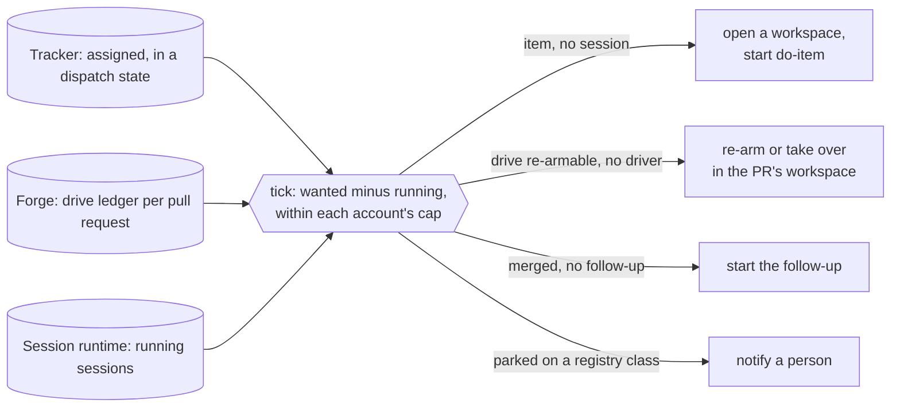

# The dispatcher, a tick that starts the execution line's stages: design

**What problem this solves.** Jig's [execution line](../FACTORY.md#execution-the-work-item-line)
has a skill for each stage: `do-item` picks an item up, `drive-pr` drives its
pull request through review, a follow-up settles what the merge owes. Each
of them starts only when a person types it. An item assigned to the team
waits until someone opens a session for it; a drive stopped by a usage
limit or by a parked question waits until someone re-arms it, though
`drive-pr` already admits that re-arm on a mechanical state; a merge waits
for someone to remember its follow-up. With nobody at the keyboard (at
night, in a meeting, on a phone) the line stops at the first stage boundary.
With this built, a small program on the machine that runs the agent
sessions looks at the tracker, the pull requests and the running sessions
every few minutes, starts each stage that should be running and is not,
and reaches a person only for the decisions that are theirs. It never
merges: that stays a person's
([ADR-0003](../docs/adr/ADR-0003-a-person-merges.md)).

This is the design of [plan.md](plan.md) item 33. Nothing of it is built
yet. It builds on item 32, which makes one drive resumable from any clone,
on any machine and account, and records its state on the pull request in
the [drive ledger](../plugin/skills/drive-pr/README.md#where-its-state-lives);
the dispatcher is what starts those resumptions. M0 names the missing
service: a [control plane](../GLOSSARY.md), "a service that tracks an
agent's job and can reach a person". The dispatcher is the first one Jig
ships, for the execution line only. Its first
[session runtime](../GLOSSARY.md) is Orca
([ADR-0011](../docs/adr/ADR-0011-the-dispatcher-targets-orca-first.md)).

## How it works

`jig dispatch` runs one **tick**: it reads three records it does not own,
computes the stages that are wanted and not running, and, when told to,
starts each one as an agent session. A timer runs the tick every few
minutes. The tick keeps no state of its own beyond a receipt per run, so
stopping it loses nothing and the next tick finds the same facts. There is
no resident process to supervise: the "daemon" is the timer.



Rolling it out one stage at a time is safe because every stage already
refuses a duplicate on its own: `do-item` claims an item by moving it to
its in-progress state and assigning it, the
[Orca workspace tool](../tools/orca/README.md) sends a first prompt once per
key, and `drive.ts` admits a re-arm or a takeover only on a mechanical state
and refuses a second driver by its lock and the ledger's claim. A tick that
acts on facts that went stale between its read and its launch is refused
by the stage, not duplicated, and the refusal goes into the receipt.

### The three records

| Record | Read through | What the tick takes from it |
| --- | --- | --- |
| The tracker | the [tracker interface](../GLOSSARY.md) (`plugin/skills/do-item/scripts/lib/tracker/port.ts`), Linear and GitHub Issues today | the items assigned to the repository's [factory identity](../GLOSSARY.md) in one of its dispatch states (`todo` by default): the pickups wanted |
| The forge | the drive ledger comment on each open pull request, and the pull requests merged since the last receipt | the drives stopped on a mechanical state: the re-arms and takeovers wanted; the merges: the follow-ups wanted |
| The session runtime | in Orca, `orca worktree ps --json` | which workspace holds which item or pull request, and whether a session in it is running, on which account |

**The tracker.** The interface's pool query (`openIssues`) selects issues
by label today, and the issues it returns already carry their assignee and
state. It gains a filter by assignee and by state, which both adapters
answer natively, so the trigger needs no label in any repository's
taxonomy. An item leaves the pool the moment `do-item` moves it to its
in-progress state, and that move is the claim: the tick writes nothing to
the tracker. A repository with no factory identity configured has no
pickups; its other stages still run.

**The forge.** The tick finds the open pull requests that carry a ledger
by searching for the ledger's hidden marker, and classifies each ledger
the way `drives.ts --doctor` classifies a driver: *driven* (a heartbeat
inside the lease window), *re-armable* (quota-parked with a known reset
that has passed or another account free, every parked item answered, or a
heartbeat past the lease window with no driver alive), *parked* (an item
unanswered) or *terminal* (converged, closed, or a stop the drive does not
admit a re-arm from). It trusts only a ledger the drive itself trusts:
written by the drive's own login or by an owner, member or collaborator.
Merged pull requests come from the forge's list of merges since the
previous receipt's start; a merge with no ledger (a pull request nobody
drove) still wants its follow-up.

**The session runtime.** Each workspace is joined to an item or a pull
request by the issue and pull request the runtime links to it, then by the
branch name. A session counts as running only when the runtime reports its
agent working or waiting; a finished session in the workspace does not
hold the stage, and the report shows its state as the evidence. A host the
runtime's answer marks as not covered, or a page cut short by its row
limit, is an unknown, never "no session": the tick plans nothing for an
item or pull request it cannot place, and reports why.

### The tick reports by default and acts only with `--apply`

```sh
jig dispatch [--repo <path>]... [--json]          # report: what it would start, and why
jig dispatch --apply [--repo <path>]...           # start it
jig dispatch install [--interval 5m] --yes        # the timer
jig dispatch receipts                             # past ticks
```

A tick without `--apply` prints every action it would take, each with the
record that wants it and the evidence (the item's state and assignee, the
ledger's verdict and heartbeat, the session's state), and starts nothing.
This is the same contract as [resource collection](../plugin/gc/README.md):
report first, act only when told, and fail closed: a record that cannot be
read leaves the actions that depend on it out of the plan and names the
failure. With `--apply`, the tick reads each action's own facts again just
before it starts it (the item still assigned and in a dispatch state, the
ledger still re-armable), launches it, and records the stage's answer. An
item or pull request gets at most one action per tick.

A stage the tick launched may refuse: `drive.ts` exits `11` against a live
driver, `13` and `16` against an admission it does not grant, `20` when
another clone holds the drive. The tick records the exit as the stage's own
answer and does not retry it in that tick or fight it in the next one: the
next tick reads the records afresh, and an action whose facts have not
changed since a refusal is reported, not launched again.

A pickup that `do-item` claimed but whose session is gone (the item in its
in-progress state, no running session for longer than
`dispatch.stalled_after`, 30 minutes by default) is reported as stalled and
never relaunched: a relaunch would start a second implementer on a claimed
item, so it is a person's call.

### The session runtime interface

The tick reaches the runtime only through four methods:

| Method | What it does |
| --- | --- |
| `sessions(repo)` | the workspaces and their sessions, joined to items and pull requests, with each session's state and account |
| `openWorkspace(...)` | a workspace for an item (a new branch) or a pull request (its head branch), reused when one exists |
| `launch(workspace, command, account)` | a session in the workspace running the command, billed to the account |
| `notify(target, message)` | a message that reaches a person |

Each returns the runtime's receipt, and a launch that does not answer is
retried only by a later tick that finds no session for it, never inside
the same tick. Orca is the first implementation: `sessions` from
`orca worktree ps --json`, `openWorkspace` through the
[Orca workspace tool](../tools/orca/README.md) (`orca worktree create` with
the issue or pull request linked), `launch` through `orca agent launch` in
the workspace, and `notify` as the workspace marked unread with the message
as its comment, which Orca's phone app shows. A second runtime is a second
implementation of the same four methods, with nothing in the tick changed.

### Admission by account

A machine that runs sessions for several subscription accounts gives each
account a cap on the sessions the tick starts for it
(`max_per_account`, 2 by default). An action is admitted on an account with
a free slot and no recorded usage-limit wall, chosen round-robin among the
accounts that qualify; with none free the action waits for a later tick and
the report says which caps are full. The walls are the ones `drive-pr`'s
quota adapters already record, read against each account's own home.

A headless pass is bound to its account through the configuration
directory of that account's Orca profile (`CLAUDE_CONFIG_DIR` for Claude
Code, `CODEX_HOME` for Codex), so the drive's identity resolver and its
quota adapters see the account the pass bills, and a quota-parked drive is
re-armed on another account as `drive.ts` already admits. Switching Orca's
active account before a launch is not used: it is host-wide and would move
every other session's next pass too. Whether an Orca launch can name the
account for an *interactive* session is not verified (Orca's command line
selects accounts only for some agents), so the first stage binds accounts
for headless passes only: drive re-arms and takeovers. Pickups and
follow-ups start interactive sessions on the host's active account and
count against its cap, until a launch that names its account is shown to
work.

### What it never does

- **Merge**, or arm a merge: a person merges
  ([ADR-0003](../docs/adr/ADR-0003-a-person-merges.md)).
- **Answer a park.** A parked question is a person's; the tick notifies and
  waits for the answer on the pull request.
- **Stop a driver that is making progress.** It starts takeovers only
  through `drive.ts --take-over`, which admits one against a wedged or dead
  driver alone.
- **Pass the flags the skills reserve for a person**: `--window-reopened`
  and `clear-lease`.
- **Write to the tracker.** The item's own state is the claim, and `do-item`
  sets it.

### Receipts

Every tick writes one receipt under `~/.local/state/jig/dispatch/`, as
`jig gc` does: the records it read and from where, each planned action
with its reason, each launch with the runtime's answer, each refusal with
the stage's exit, each notification. The next tick reads the latest
completed receipt for its "since" (the merges to follow up, the refusals
not to repeat, the parks already notified), and `drives.ts --report`
lists the receipts' launches, refusals and notifications in the morning
report. A tick removes the receipts older than the machine file's
retention, keeping the latest completed one. A missing or unreadable receipt costs at most a
repeated report line: every stage refuses a duplicate launch on its own.

### Where it lives

The dispatcher is machine tooling in the plugin, beside
[resource collection](../plugin/gc/README.md): `plugin/dispatch/`, reached
as `jig dispatch` through `plugin/jig.ts`, so it runs wherever the plugin
is installed rather than from a checkout of Jig. It is never a skill a
session runs. Its values are split as configuration always is:

- **The machine's**, in `~/.jig/dispatch.yaml`: the repositories it
  dispatches for, the accounts it may use and each one's cap, the interval,
  the receipts' retention.
- **A repository's**, in a `dispatch` section of its `.config/jig.yaml`,
  documented in [CONFIGURATION.md](../plugin/CONFIGURATION.md): the factory
  identity per tracker (`identity`), the states that mean "ready to pick
  up" (`states`), the follow-up command (`followup_command`, `/followup` in
  Jig; a consumer repository names its own post-merge command), and
  `stalled_after`.

### The installed timer

`jig dispatch install` writes a systemd user timer on Linux and a launchd
job on macOS, on the same scheduler and launcher code `jig gc install`
uses (`plugin/gc/scheduler.ts`, `plugin/gc/launcher.ts`): a preview first,
written only with `--yes`, the installed copy of the plugin found at each
run so an update reaches the timer without a new install. It runs on the
host that runs the sessions (with Orca, the Orca server's host). The timer
runs report-only until the machine file turns `apply` on, repository by
repository and stage by stage, so each stage is switched on once its
report has been read for a while.

A wake-up from the tracker's or the forge's events would only start a tick
early; the timer stays the reconcile, so a missed event costs one interval.
No route into the host is opened for it (see Left out).

## Build order

One pull request each, in this order; each is usable on its own.

1. **This design**, its plan item, ADR-0011 and the glossary terms.
2. **The tick as a report.** `jig dispatch` reads the three records and
   prints every action it would take with its evidence; `--apply` is
   accepted and refused. The pool query's assignee and state filter, the
   ledger classification, the session runtime interface with `sessions`
   from Orca, the receipts, the `dispatch` configuration section. Tests run
   a tick over the adapters' fake tracker, the drive suite's fake forge and
   a fake `orca` command: one assigned item, one quota-parked pull request
   and one merged pull request give three actions, each naming its record,
   and a running session for the item removes its action. Usable alone as a
   standing list of what is idle and why.
3. **Re-arms within account caps, and the timer.** With `--apply`, each
   re-arm or takeover runs as `drive.ts <PR> [--take-over] -- <pass>` in
   the pull request's workspace (created from the pull request when none
   holds it), on an account admitted as above, bound through its profile's
   configuration directory; `openWorkspace` and `launch` for Orca; the
   machine file; `jig dispatch install`. It waits on the drive running in a
   session of its own rather than inside the implementing session, so a
   re-arm is a launch, not a message to a busy session. Usable alone: drives
   that stop are restarted without a person.
4. **Pickups.** With `--apply`, a workspace and a `do-item` session per
   item assigned to the factory identity in a dispatch state, the model and
   effort from the item's route where the repository declares `routing`;
   the claim re-check at launch; stalled pickups reported. Usable alone:
   assigning an item is the start button.
5. **Follow-ups and notifications.** A follow-up session per merged pull
   request with the repository's follow-up command; a drive parked on a
   human-in-the-loop registry class becomes one notification carrying item
   32's framed decision, sent once per park, and the answer, a comment on
   the pull request, re-arms the drive at the next tick; the receipts in
   `drives.ts --report`. Waits on item 32's framed park; a consumer
   repository's follow-up waits on its own post-merge command (item 17).

## Left out

- **A Herdr runtime.** Herdr stays the first runtime for workspace
  lifecycle ([ADR-0005](../docs/adr/ADR-0005-herdr-is-the-primary-workspace-runtime.md));
  the dispatcher needs an account roster, a headless server reachable from
  a phone and a session registry, which Orca has today
  ([ADR-0011](../docs/adr/ADR-0011-the-dispatcher-targets-orca-first.md)).
  A Herdr implementation of the session runtime interface comes when Herdr
  can supply them.
- **Webhooks.** The tick polls. An outbound wake-up channel (a relay that
  takes the tracker's and forge's events and that the host holds a
  connection to) can start ticks early later; the sources stay behind
  interfaces such a channel can replace, and no inbound route to the host
  is ever opened.
- **Pre-emptive quota pacing.** Admission reacts to the walls the quota
  adapters recorded; spreading load before a wall is reached needs usage
  telemetry Jig does not read yet.
- **Several Orca hosts.** One tick dispatches on the host it runs on.
- **The merge**, which stays a person's
  ([ADR-0003](../docs/adr/ADR-0003-a-person-merges.md)); delegated merge is
  item 9, decided on its own.
