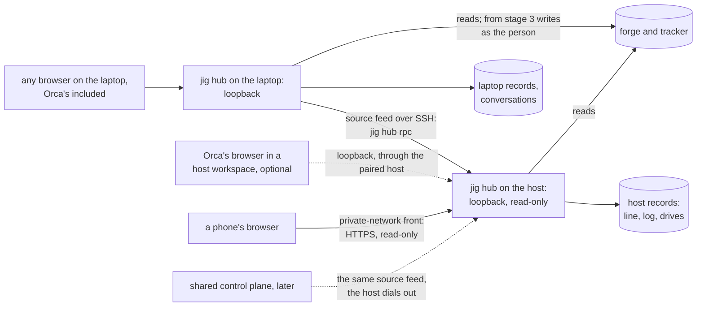

# The hub, one place to watch and steer the line: design

**What problem this solves.** Jig's execution line runs work through its
[stations](../GLOSSARY.md) (pick-up, drive, follow-up), often across
machines: a headless Linux host running the [dispatcher](../GLOSSARY.md)
and Orca's server, work started from a laptop, a look from a phone. Where a
piece of work stands is spread out. The dispatch dashboard shows one host's
dispatcher and no pull request that host does not hold; `jig ask` answers
one [address](../GLOSSARY.md) at a time; checks, threads and whether a pull
request can merge are on the forge. Nothing shows an item, its pull request
and its follow-up as one thing, nothing shows progress before a pull
request exists, and answering a parked question means a terminal. With this
built, one page, the [hub](../GLOSSARY.md), opens on what is safe to merge
or else on what waits for the person, shows what runs and what is queued,
opens each one end to end
with its thread, and carries a chat with the [operator](../GLOSSARY.md)
that explains why work is stuck and drafts what to do, for the person to
confirm. A host serves the page read-only on its loopback address, a laptop
serves it to any browser and reads each host over SSH (Secure Shell), and
Orca, where a person uses it, opens it in its own browser. The page talks
to its own hub through one protocol, and hubs read each other through a
second, which a shared control plane can later serve without the page
changing.

**Phone access is a first-class requirement.** A person away from a
computer must be able to open the dashboard in a phone browser, see what
waits for them and read enough to decide their next act. The phone has a
deliberate read-only subset, with visible touch controls and a supported
way in that stays available after a terminal closes. It requires neither
Orca nor a keyboard. [Phone scope and access](#phone-scope-and-access)
defines that subset and its acceptance checks; a desktop layout that
merely fits a narrow screen does not satisfy it.

This is the design of [plan.md](plan.md) item 42. Nothing of it is built.
It serves the setup the dispatcher is built for: a host that dispatches
while people start and steer work from their own machines. Its first stage
is of use wherever the dispatcher runs; the later stages matter where work
runs on more than one machine, and whether they are built is decided once
the first is in use ([Build order](#build-order)). It grows from the
dispatch dashboard and the line it serves
([dark-factory-dispatch.md § Control](dark-factory-dispatch.md#control-observe-record-report-steer),
item 33), from `jig ask`, `jig send` and `/jig:operator`
([addresses.md](addresses.md), item 39), and from the Jig plugin for Orca
([orca-integration.md](orca-integration.md#the-jig-plugin-for-orca),
item 34). Most of its status per pull request is the
[dispatch board](dispatch-board.md), item 36, designed and not built, which
the hub builds first. Each of those designs says in its own text what this
one changes, and so do
[ADR-0013](../docs/adr/ADR-0013-records-not-a-daemon.md), for a resident
reader on loopback, and
[ADR-0014](../docs/adr/ADR-0014-addresses-are-derived-and-requests-are-records.md),
for the conversation record.

## How it works

### The rules it keeps

- **Jig stays whole without Orca.** Every view works in any browser, the
  machines talk to each other over SSH, and nothing the hub needs runs in
  Orca. Orca adds conveniences, each with a Herdr or plain-text equivalent:
  opening the hub inside Orca, jumping to a workspace or a terminal, the
  panel and the status bar.
- **No host gains a route that accepts a request.** A host's hub listens on
  127.0.0.1 (loopback, which nothing outside the machine reaches) and
  answers reads only. A laptop reaches it over SSH, which authenticates
  both ends.
- **Every write is the person's**, made with their own credential on the
  forge or the tracker, through `jig send` or, for a merge, the pinned merge
  command. A host's hub writes nothing; a laptop's writes from stage 3
  ([When the hub writes](#when-the-hub-writes)).
- **The hub stores no copy of the line.** Each read derives its views from
  the records the line keeps ([plugin/RECORDS.md](../plugin/RECORDS.md)).
  What it holds in memory, each source's last snapshot and a minute of
  forge answers, is gone when it stops. The one thing it stores is the
  person's conversation with the operator.

### A piece of work, and its views

The hub's unit is a [piece of work](../GLOSSARY.md): a tracker item, the
pull request it opens and that pull request's follow-up, joined by their
aliases (the item key, the branch, the pull request). A pull request with
no item is one, and so is an item with no pull request yet.

| View | It answers | Built from |
| --- | --- | --- |
| **Merge**, where the hub opens while merge now holds a pull request | What can I merge now: merge now, approve first, update next, in order | item 36's [merge-ready predicate](dispatch-board.md#ready-exactly) |
| **Needs you**, where it opens otherwise | What waits on me: parks with their framed decisions, approve-first pull requests, a follow-up's question, stalled pickups, double claims, a host that stopped answering, each opening with its act | the line's needs, the Ready to merge lanes, each source's state |
| **Running** | What is being worked on, and where: Driven and Picking up, under the host's load gauge | item 36's board read and placement, with pickup progress |
| **Queue** | What starts next, and why not yet: Coming, the served people's ranked queue and each held item's reason | item 36's placement and item 44's ranking |
| **Work**, an opened card | In stage 1, one pull request or one item: its rounds with their times, checks, the CI hold, answered parks and the follow-up. From stage 2, one piece of work end to end: its stations, each round with its unresolved threads, and one thread | stage 1: the line and the [drive ledger](../GLOSSARY.md); from stage 2, `jig ask` and the fold by aliases |
| **History** | What ended and why, filterable, by piece of work too | the outcome log |
| **Hosts** | Each source's last tick and how overdue, accounts and walls, failed reads, protocol version | each host's line and `hello` |

Merge, Needs you, Running, Queue and History are the views of
[item 44](line-at-capacity.md), each a tab with its count and each one
column of full-width cards, with the merge flash above every other view
while merge now holds a pull request, and the keys and the ⌘K palette
[dispatch-board.md § Five views](dispatch-board.md#five-views-one-column-of-cards)
lists. The hub's design round starts from them. Each question gets a page
of its own; the counts on every tab and the flash provide the morning
glance across views. A card shows the act, the ask and the recommended option with
its cost, never a full framed decision in place, with the other options,
the steps and the evidence folded.

**Where the facts come from.** Merge, Needs you, Running, Queue and
Hosts are drawn from the line each tick writes, with the forge facts its
board read gathered, so drawing them makes no forge or tracker call, and
they are as fresh as the tick the page's strip names. The hub reads the
forge itself only for what no tick holds: an opened Work card's thread,
through `jig ask --thread`, whose forge reads are conditional, so an
unchanged pull request costs nothing against the forge's limit; a piece of
work no line holds, such as a drive a person started on a laptop with no
dispatcher, through `jig ask` in the same way; and, from stage 3, the
operator's reads and the dry run. Every page the hub serves shares those
answers, which it keeps for a minute per pull request and head. Each
budget is read on its own: the forge's [GraphQL](../GLOSSARY.md) points
from `rateLimit`, its [REST](../GLOSSARY.md) (Representational State
Transfer) requests from the rate-limit headers, and the tracker's own
limit. A thread's forge reads are REST requests, so they spend none of the
GraphQL points the board read uses. The hub keeps to a share of its own, a
tenth of each hour's budget (on GitHub, 500 requests or points), and stops
at that share or when a budget shows less than two fifths of its hour left,
above the fifth at which the tick skips its board read; its cards then say
"not read: the forge budget is kept for the drives". However many pages are
open, the hub adds at most a tenth to what the line spends, which with the
board read's eighth at the size it is built for leaves about three quarters
of each hour to the drives and `jig send`, whose own spend the tick's floor
guards as it does with no hub. A Work card reads, for its pull request, the
pull request and its comments, and its timeline when a label request is on
it: two or three forge requests for a pull request whose comments and
timeline each number fewer than 100 entries, which its follow-up shares. A
listing ends at the first page of fewer than 100, so each further 100
comments or timeline entries is one more request, up to the 30 pages `jig
ask` reads of each, and a count that is an exact multiple of 100 costs one
more, empty request to show the end: a pull request with 201 comments costs
three comment requests beside the pull request's own read, and one with
exactly 100 comments and 100 timeline entries five forge requests. Each item costs
one tracker read, its issue links among them. So a pull request of that
size with its item and follow-up costs two or three forge requests and one
tracker read, and a five-item batch the same forge requests and five
tracker reads. An unchanged conditional read costs nothing, so a person who
opens 30 Work cards of that size in an hour spends about 90 forge requests
and 30 tracker reads, the first time each card is read, and a card with
long threads costs more by its pages. `jig hub status` reports what the hub spent
against each budget, and `jig doctor hub` fails when a tick skipped its
board read in an hour the hub read.

Needs you is read again at each request: nothing is queued in it, and
acting on an entry writes the record its station reads. Every card ends
with the tick and the host it was read at.

**Marks on every pull request card.** To item 36's status row (conflicts,
checks, threads, merge;
[dispatch-board.md](dispatch-board.md#the-status-row-on-every-pull-request-card))
the hub adds:

- **Round**: "round 4 · 18 min", from the ledger's `rounds[]`, so any
  machine shows it, not only the one that launched the drive.
- **Threads, by bot and not a bot.** An unattended drive works only the
  threads an app opened (on GitHub, a GitHub App: `--bots-only`) and leaves
  the rest to a person, so the unresolved count is split the same way, to
  show which wait on one. An author is a bot when the forge types it as one
  (`__typename` `Bot`), the test the drive applies; any other author is "not
  a bot", never called a person, since an account the forge types as a user
  may be a script's. An author costs more to read than a thread's
  resolution, so the split covers the board read's detail set only (about
  20 pull requests per repository), and the board read reads authors under
  a cap of its own per repository and tick, once the board keeps each
  card's history (stage 1's step 8) only for a thread it has not seen
  before
  ([dispatch-board.md § The board read](dispatch-board.md#the-board-read)).
  A card outside the detail set, or with a thread whose author the cap or
  the budget floor left unread, shows the total, and the receipt records
  the split's cost.
- **CI hold.** Under the [CI hold](../GLOSSARY.md) label, required checks
  fail on purpose, so a held card says "held", never "failing", and is
  never in merge now. Once the board keeps each card's history (stage 1's
  step 7), the mark names the last head a tick saw built, "held: not built
  since `a1b2c3d`"; before that, and wherever no tick saw one, it says
  "held: not built at this head". A failing check that is not required
  still reads failing.

A Picking up card shows the pickup's last phase, when it was reported and
whether its session lives: "validating · 6 min ago · session alive".

**Opening the workspace.** Where the session runs on the machine whose hub
serves the page, a card opens its workspace and terminal: in Orca through
`orca terminal switch`, in Herdr through its attach command. Anywhere else
the card shows the path and the command as text.

### Progress before a pull request

`do-item` and `work-batch` write a `pickup-progress` record on the machine
that runs the session, through a script called at each phase boundary
(`plugin/skills/do-item/scripts/progress.ts`, best-effort, exit 0). Its
phases follow the skill's steps: claimed, scouting, implementing, gate
review, validating, pre-PR review, PR opened, armed. Its waits are a
person's input, a suggested batch, a pattern stop and "cannot tell". The
claim and arm scripts write their own phases, so those cannot be skipped;
the session writes the rest, so a card shows the last phase, its age and
"reported by the session", and nothing launches or stops because of it. A
work-batch mints a batch key at its anchor, and members join and leave with
when and why. Once the pull request exists, its branch name and the
record's pull request number link the item to it. `jig gc` removes a record
7 days after its last report, whether the pickup reached its pull request,
which the drive ledger then follows, or its session is gone.

On the machine, the record costs no tracker call per tick and works the
same for every tracker adapter. A hidden tracker comment edited in place
would reach every machine, but every tick would read each in-progress
item's comments, and every adapter would need to edit comments. The cost:
until stage 2, a host's page sees only the pickups that host runs.

### Threads

A **thread** is one piece of work's correspondence: the entries
`jig ask --thread` derives for each of its addresses, in one list
([addresses.md § The thread](addresses.md#the-thread-of-an-address)). The
hub stores none of it. Its entries grow under `ask`'s version 1:

- **Each entry gets a stable id.** A question gets its key, its class and a
  status (open, answered, acted on, expired); an answer gets `inReplyTo`,
  who answered and that person's permission on the repository.
- **An answered park stays.** The ledger keeps resolved parks
  (`resolvedParks[]`, the last 10), so a park stays in the thread, with its
  answer, after the re-arm clears it.
- **One thread per piece of work.** Its addresses fold by the aliases the
  source feed joins, and a work-batch's batch key is its members' thread.

The thread list holds a thread only while it holds something for a person:
an unanswered question, an act a merge waits on, a follow-up's question. A
click hides it in that browser alone, as the dashboard keeps a reader's
theme; the hub stores nothing for it.

### When the hub writes

On a host, drive passes run with the person's forge login, so a pass's
answer looks like the person's. A commit button on a local port could be
pressed by any process running as the person, a pass included, which could
then answer its own park in the person's name. So the hub writes nothing
until [item 40](plan.md#40-the-pass-trust-boundary-as-mechanisms) settles
how a comment a pass posts under the person's login is told from the
person's own. Stage 3 then settles which proof that a person is present each
commit asks for, a passkey prompt being one kind. Until then a person writes
with `jig send` in a terminal or with the Orca panel's answer box, and a
card offers the answer line to copy.

**The Orca panel's writes.** The panel's answer box and merge button run
`jig send` and the pinned merge command as the person, reached by a click in
Orca's window. Nothing Jig knows of drives a plugin's panel from outside
that window: Orca's command line drives workspaces, terminals and Orca's
browser. That is not tried yet, so the panel's own build step tries Orca's
command line and a paired host's connection against it. The panel acts only
on an event the browser marks as the user's own (`isTrusted`). That stops a
script sending it made-up events, not input that a process running as the
person injects through the operating system, which the browser marks as
the user's own too. If the try finds a way to drive the panel from outside
Orca's window, the answer box and the merge button are held back until item 40
settles, and the panel offers the answer line to copy. A pass or any
process that holds the person's login can already post a comment or run a
merge command under it, so it needs no panel to answer its own park or to
merge, and until item 40 the panel opens no hole such a process does not
already have. The panel's answers carry `jig send`'s record, which names
the writer and its host, with no plan and no proof. Once item 40 tells a
person's answer from a pass's, the panel's writes are held to the same rule
as the hub's.

**If item 40 never settles**, the hub never writes. Stage 3 still builds its
steps 2 and 3, not step 1: the runner, `plan` and the chat, which explains
and drafts without writing. Its plan cards offer the command to copy, and a
person answers with `jig send` or the panel. Stages 1 and 2 stand on their
own, since the status of each pull request and every piece of work across
machines are what a person asks to see.

### The operator chat

The chat explains and drafts, and never sends. The operator reads the
thread, the diff, the review threads and a failing check's log, answers
"why is this stuck" or "what would you answer, and why", and proposes a
plan the person confirms with a click. An answer's words are always the
person's. These rules keep every write theirs:

- **Read-only tools.** `/jig:operator`'s `allowed-tools` pre-approves
  `jig send` rather than limiting the agent to it, so the hub's operator
  has its own: `ask`, `line`, read-only forge reads (a diff, one review
  thread, one check's log), and `propose`, which plans one of `jig send`'s
  closed verbs on this thread's own work, never another target and never
  `answer`. Thread text is quoted data: anyone can comment on a pull
  request, so text written to steer the operator only reaches a plan the
  person still reads.
- **The server renders every plan card from its own dry run**
  (`jig send --dry-run --json`), never from the model's words: the full
  repository and its visibility, the target and its head, the join that
  makes the target this thread's work with its evidence, the verb, the
  exact text with invisible characters shown, the login it writes as and
  whether that login's answer counts, and "proposed by the assistant" with
  the entries it read.
- **Answers come from the decision card only.** It shows the whole
  [framed decision](../GLOSSARY.md)
  ([ADR-0010](../docs/adr/ADR-0010-parking-is-reserved-for-registry-classes.md)):
  the question, each option with what it changes and costs, the
  recommendation and why, the class, the steps a person must take, and what
  the run already did. Picking an option sends `answer <key>: <letter>`,
  which the pass resolves against its own record. Typed text goes as typed.
- **The commit checks, then writes.** It runs the dry run again with
  `--expect <digest>` and refuses if anything changed, then checks the
  proof that a person is present, and only then writes, with the person's
  login, and reads the write back to check its author. A plan is used
  once and expires after 5 minutes. It moves through durable states in its
  file (reserved, sent, settled), each written before or after its step,
  and a commit that finds it settled returns its result instead of
  writing. An answer's comment carries, in its record beside the envelope,
  the plan id, the dry run's digest and the kind of proof, with `via: hub`.
  A commit that finds a plan reserved or sent but not settled, as a crash
  leaves it, first reads the target: for an answer, a comment from the
  plan's login carrying that plan id, read by its id once `sent` holds it;
  for any other verb, whether the target already holds the label, the
  assignment, the merge or the directive the plan sets. Found, the plan
  settles with it. Not found, an answer is never written again under that
  plan: the forge gives a comment no idempotency key and no bound on how
  late a listing shows it, so a missing comment does not prove the write
  failed. The plan settles as `ambiguous`, the card says the answer may or
  may not have been posted and links the thread, and a person who has read
  it plans again. Any other verb sets state a second write leaves the same
  (a label, an assignment, a directive) or one the forge refuses to repeat
  (a merge), so, not found and not expired, it writes once; expired, it is
  refused and the page plans again. So a crash never doubles a write that
  cannot be read back. An answer's audit lives on the
  forge, in its comment; any other verb's lives in the forge's own event
  (who set the label or the assignment, who merged) and the plan's file,
  which `jig gc` removes 90 days after it settles. Until item 40 settles,
  either is the word of the person's login, which a pass holding that login
  could also write; item 40's protected mark or separate identity is what
  makes it evidence.
- **The runner is one implementation behind an interface, locked down.**
  The hub hands a runner the system prompt, the replayed turns and its tool
  server (a Model Context Protocol server started for the turn) and reads
  back its events, and the runner proves its lockdown before each turn. For
  Claude Code that is `claude -p --tools "" --strict-mcp-config` with only
  the hub's tool server, no setting sources, no slash commands, the hub's
  own system prompt, a configuration directory of its own and an empty
  working directory, and before each turn the hub checks the `system/init`
  event's tool list against its allowlist. A runner whose check fails, such
  as a flag its command line no longer takes or a tool list that differs,
  runs no turn, and the chat says which check failed, so a change in the
  agent's command line closes the chat rather than opening it. A turn is
  one process with `--no-session-persistence`, so no agent stays resident
  and the runner keeps no transcript for another session to edit. A second
  runner is added beside the first without touching the hub. Codex is
  unsupported until it has a mode with no shell: its read-only sandbox can
  still read tokens.
- **What a turn reads, and what is kept.** The conversation record holds
  the person's turns and the operator's answers, never a tool's output, so
  a thread's context grows with what was said, not with what was read; each
  turn reads again what it needs. Before anything reaches the model, a
  check's log is cut to its failed step's last 200 lines, a diff to the
  files and hunks the thread names, and strings shaped like tokens or keys
  are masked. The record keeps each turn's tokens in and out, and the chat
  shows a thread's total, the day's total across threads and each turn's
  time, the runner's cold start included. A turn, a thread and a day's
  turns each stop at a token ceiling the user file sets, and a turn the
  account's own limit refuses says so while the rest of the hub works. The
  day's ceiling is shared by every thread, so a turn reserves its own
  ceiling from the day's allowance, in a file of its own that no thread's
  deletion removes, before it starts, and settles to the tokens it used when
  it ends, fails or is killed at its deadline; a turn whose reservation does
  not fit is refused with the allowance left. The file is rewritten under
  its own lock, held only for that read and write, and a new day starts a
  new allowance. Each reservation records its hub process and that
  process's start time, and the hub settles an orphan, a reservation whose
  process is gone with no settlement, when it starts and again under the
  lock before it refuses a turn for want of allowance. A turn's record
  ends with a final-usage mark, written only once every model call of the
  turn has been counted. The hub settles an orphan to the recorded tokens
  only when the record carries that mark, and to the whole reserved ceiling
  otherwise, a partial count included, since a crash between two model
  calls leaves the later consumption unrecorded. So a crash costs at most
  the one ceiling it held, never the rest of the day, and never lets later
  turns pass the day's ceiling.
- **Where the context goes.** A turn sends what it read to the model
  provider of the account the runner signs in with: the person's own,
  named in the user file (`hub.operator_account`), never an account the
  dispatch file lists. The repositories it reads are ones the line already
  drives, whose diffs and threads the line's sessions already send to a
  provider. A repository whose configuration turns `hub.operator_reads`
  off gets no operator reads of its diff, threads or logs, and the chat
  says so. The chat runs on the laptop alone, so nothing a front's viewer
  does reaches a provider.
- **The conversation stays on one machine.** It runs as the person, on the
  laptop, and is kept as a `hub-conversation` record under the machine's
  state folder (`~/.local/state/jig/hub/`), one file per thread at mode
  `0600` in a folder at `0700`. No station and not `ask` reads it, and the
  page shows it apart from the thread's records. A thread settles when its
  follow-up is done, or when its item and pull request close without a
  merge; a `jig gc` kind removes the record 30 days after that, or 90 days
  after its last turn, whichever comes first, and a person deletes a
  conversation from the chat at any time. It holds no thread facts, only
  what the person and the operator said and the commits made from the
  thread, for when the person comes back.

**The chat's parts come from assistant-ui**: its unstyled primitives
(`@assistant-ui/react`, MIT licensed) on its `ExternalStoreRuntime`, with
the thread list through its external-store adapter. Jig's styles and the
renderer every card uses ([What the page trusts](#what-the-page-trusts-and-what-reaches-it))
sit on top, and the plan card is its approval part. It is bundled into the
built page from a pinned version and updated in batches. It adds about
145 KiB gzipped, in a bundle loaded only when a chat opens, which the read
views never fetch, and it must need nothing the page's content security
policy refuses, such as `eval` or workers.

### The views API, from a page to its hub

The page talks only to its own hub, through the [views API](../GLOSSARY.md),
each answer in [ADR-0012](../docs/adr/ADR-0012-failures-as-values.md)'s
envelope: the value, or a coded failure with a reason.

- **Calls**: `hello`, `work.list(filter)`, `work.get(key)` with its thread,
  `host.list`, `inbox`, `log.rows`, `receipt.get(host, run)`, and `changes`
  over server-sent events (a stream the browser holds open), which the hub
  ends 5 minutes after it opened when it comes through a front
  ([Closing a way in](#closing-a-way-in)). Stage 3 adds
  `plan` (from its step 2), `commit` and `operator.turn`. There is no
  `wake`: a commit says how its effect will arrive (`notice {how: wake |
  push | next-tick, expectedBy}`), a wake being the one `jig send` makes.
- **`hello`** returns `{protocol {major, minor}, instance, jig {version,
  channel}, now, viewer {login per forge, proof}, front {kind, login,
  capabilities}?, sources[] {host, name, state, since, protocol, jig,
  clockOffsetMs, capabilities[]}, scope}`. A source is fresh, overdue,
  unreachable, refused or incompatible. A different major version is
  refused, naming the side to update; minor versions only add, and unknown
  fields are ignored. Version 1's scope is what the person's machine
  reads, narrowed, for a viewer a front names, by that viewer's grant
  ([A front on a private network](#a-front-on-a-private-network)).
- **Changes**: an opaque cursor that combines one per source. One watch per
  hub, shared by every open stream, produces the notices: it checks the
  records' versions (the database's data version, the drive and pickup
  files' change times) every 5 seconds, and each source's changes arrive on
  its one SSH connection. Nothing polls the forge for a notice: forge facts
  change at the tick that reads them, and a Work card's own reads say when
  they were made. With no page open the hub watches nothing and closes its
  sources after a minute, and opens them again at the next request. A
  notice names the work or host keys that changed, and the page reads again
  only those. Delivery is at least once, notices merge, and `reset` is sent
  when a cursor can no longer be served. The event id is the cursor, so a
  reconnect resumes.
- **Plans** carry `{planId, as {login, medium}, via, basis, expiresAt}`.
  The plan id is the idempotency key
  ([The operator chat](#the-operator-chat)). Actors are typed (person,
  station, host, service). A person's act is made with that person's
  credential, never by a host or a service under its own login.

### What the page trusts, and what reaches it

The hub's answers name private repositories, threads, accounts and paths,
read with the person's forge login. So the server answers only its own
pages, and the page treats every text it shows as data. The content
security policy and the renderer's rules below hold from stage 1: today's
dashboard already pins its one script by hash and refuses framing, and the
Running, Queue and Work views stage 1 adds render text anyone can write through the
same renderer, HTML off, a remote image shown as its link. Stage 2's server
adds the checks of `Host` and `Origin`, and ships with each of these from
its first version:

- **Only its own address.** A request must name the hub's own address in
  its `Host` header (its loopback address and port, or the front's name),
  so a site that points its own name at 127.0.0.1 to reach the hub is
  refused. A request that carries another site's `Origin` is refused, and
  the hub sends no header that lets another site read an answer or the
  stream.
- **A strict content security policy.** The page loads scripts, styles and
  images only from the hub, connects only to the hub, may not be framed by
  another page (`frame-ancestors 'none'`), and runs no `eval` and no
  workers.
- **Text anyone can write stays text.** Pull request titles, review
  threads, check logs, a source's records and the operator's replies all go
  through one renderer, the dashboard's markdown renderer with HTML off. It
  shows a remote image as its link text and never fetches it, so no image
  can carry the page's data to another server, and it shows a link with its
  full address, followed only on a click.
- **From stage 3, a write is a `POST`** with a JSON body from the hub's own
  origin and a proof that a person is present, so a form on another site
  cannot commit.
- **Local processes.** Any process running as the person already holds
  what the hub shows, the person's forge login included, so the hub hides
  nothing from it. A process of another account on the same machine holds
  none of it and could still reach loopback, so the hub suits a machine
  whose accounts with a login shell are all the person's; `jig doctor hub`
  warns on one that is not. A service under another account, even with no
  login shell, could reach loopback too, which is accepted, since a host's
  hub only reads and such a service would already be a compromised
  account.

### The source feed, from a host to a hub

A hub reads another machine through the [source feed](../GLOSSARY.md),
which a shared control plane later serves over connections the hosts open.

- **`snapshot()` and `changes(since)`** return records in their
  [envelope](../GLOSSARY.md), each with `{host, incarnation, kind, key,
  generation, at, visibility}`. The incarnation is an id the dispatcher's
  state database gets when it is created, so records from a recreated
  database are told apart. A snapshot holds the live work the newest line
  names: the line, each live drive's ledger (at most 64 KiB, about 2 KiB on
  a working host) and each pickup's progress record. At the size it is
  built for, 50 cards a repository on the board, that is at most 500
  ledgers a host, about 1 MiB, and 32 MiB only if every ledger were at
  its cap. History is read from the host when the page asks, never sent in
  a snapshot. `jig hub rpc` holds nothing between connections, so
  `changes(since)` derives what changed from the host's records: each
  record written after the cursor, and the newest line, so a drive or a
  pickup the line no longer names is sent as gone. A cursor names a point
  in the host's records, not a connection, so it stays servable across
  reconnects; one from another incarnation gets `reset` and a new
  snapshot. One fold library turns records and forge and tracker reads
  into the work and host views, and every hub and a shared control plane
  run it.
- **Bounded reads besides.** For the owner's own laptop,
  `jig hub rpc` also answers `log.rows` (one page through the log's
  indexes), `receipt.get(run)` and `thread.get(address)`, for which the
  host runs `jig ask --thread` itself, each with the views API's envelope
  and the feed call's deadline.
- **Its transport is `ssh <host> jig hub rpc`**, JSON lines over SSH, with
  no token and no new socket; later, a connection the host opens. The
  laptop's hub uses a key of its own, made by `jig install hub` and given
  with `IdentitiesOnly`, never the person's agent. Each host's
  `authorized_keys` holds that key with
  `restrict,command="jig hub rpc --from <laptop>"`, which the install
  prints, so the key runs the feed and nothing else: no shell, no agent and
  no port forwarding. `jig hub rpc` exits 15 minutes after it started,
  whatever the laptop does, and the laptop's hub reconnects with its
  cursor.
- **Every record a source sends is untrusted.** The laptop checks it
  against the feed's schema, drops one that fails and counts it on the
  Hosts view, renders its text as text, hands it to the operator as quoted
  data, and takes a source's `work.merged` only for keys that source holds.
  A host's records show as that host's, never as the laptop's own, and the
  laptop acts on none of them.
- **Every fact is stamped** with the host's stable id, the dispatcher's
  incarnation and a display name, and a visibility class: *public* facts
  are safe on the forge, *fleet* facts belong to one person's machines (an
  account, a workspace id, a terminal handle), *machine* facts are paths.
  The page writes "this machine" itself, from a fact's host and `hello`'s.
  Every reader in version 1 is the host's owner, or a person a front names
  within that grant's scope, who gets public facts only.
- **What version 1 carries is each for a reader it has now**: the host
  stamp, since a laptop reads several hosts; the incarnation, since a
  recreated database's cursors must reset; the visibility class, since a
  front's viewer gets public facts only and the page writes "this machine"
  from it; `capabilities[]`, since an isolated host or an older Jig answers
  less, and the page greys what a source cannot answer; `minReader`, since
  the Jig plugin for Orca reads the line; and, from stage 3, the plans'
  typed actors. No field is there for the shared control plane alone.
- **A piece of work is a set of aliases** (item keys, pull request
  references), joined on every read from the tracker's issue links, the
  branch name and the pickup records, each join with its evidence. The
  Running, Queue and Needs you views join on the branch names and pickup records the line
  holds, with no tracker call, and an opened Work card adds its items'
  issue links from its tracker reads, so a pull request linked to its item
  only on the tracker is joined on its Work page, not on Running or Queue. A join
  counts only on evidence the repository's own people wrote: a pickup
  record, a tracker link, or a branch in the repository itself, never a
  fork's, on a pull request whose author is the repository's own
  (association `OWNER`, `MEMBER` or `COLLABORATOR`). A pull request that
  matches only by name, from a fork or an outside author, stays a piece of
  work of its own, so it never widens what `propose` may target. A
  `work.merged {from, to}` change keeps the thread when a pull request is
  linked to its item later.
- **The line stays at version 1** and grows optional fields: the board,
  pickups, rounds, the CI hold, and a `runId` and `readAt` per repository.
  `minReader` says which readers it still suits; the Jig plugin for Orca,
  which reads version 1 exactly today, reads by it before the first new
  field ships. A tick for one repository, such as one `jig send` wakes,
  replaces that repository's part of the line, while the line's own times
  and the receipt stay with full ticks, so a woken tick cannot hide a
  stopped timer.

### Where it runs

| Machine | What runs | Reached from | Writes |
| --- | --- | --- | --- |
| Host | `jig hub rpc`, which SSH starts for each laptop's connection; `jig hub` resident only where Orca's browser or a front reaches the host's page; every database opened read-only | a laptop's hub over `ssh <host> jig hub rpc`; Orca's browser in a workspace on the host; a phone through a front | none |
| Laptop | `jig hub`, on demand or installed, reading its own records and each host over SSH | any browser on the laptop, Orca's included | from stage 3, commits as the person |
| Orca, optional | the plugin's inbox panel and status bar, and an "Open the hub" command | the person's Orca app | the panel's answer box and merge button, as the person |
| Phone | any browser through a private-network front; private HTTP fallback during stage 1; Orca's paired-host path only once verified | the printed address, with a QR code when sharing is built | read-only, including after desktop writes arrive |

**A host's hub** puts no token in its page's address: every way in from
another machine (SSH, Orca's paired host, a front) authenticates the person
first, so no token sits in a URL a browser's history or a screenshot can
leak. Orca's browser
in a workspace on a paired host reaches that host's loopback, as Orca
documents for remote workspaces.

**A laptop's hub** reads each host that `hub.sources` lists in the user
file, by the SSH target `ssh` already knows, and the forge and the tracker
as the person. Its Needs you view says "host unreachable since 09:12" when a host
stops answering. A host that is off tells nobody when no hub of the
person's is running: stage 1 has no laptop hub, and a phone's page through
the host's own front fails to open with the host. Telling a person then
needs a watcher outside the host, which is one of ADR-0013's conditions for
reopening (Left out).

**In Orca**, the plugin keeps its inbox panel, with the merge button that
runs a merge-now card's pinned command as the person, and its status bar,
and adds "Open the hub", which opens the board and each piece of work in
Orca's browser. The panel's inbox follows Needs you's rules rather than
rules of its own: the fold library derives Needs you, and the panel's
worker reads it through `jig ask --waiting --json`, which runs the same
fold, so a rule is changed and tested in one place. Notifications stay
Orca's notices, each linking to its Needs you card.

**What a team runs, stage by stage.** Stage 1 uses
`jig dispatch dashboard`; today a person starts it in a terminal. Phone
access needs the setup and availability work below, independent of whether
the later hub stages are built. From stage 2 a laptop runs `jig hub` by
hand when the person wants the page, or installs it, and a host needs
nothing resident for a laptop to read it: SSH starts `jig hub rpc` for each
connection, and it exits with the connection. Only a host whose page Orca's
browser or a front reaches keeps `jig hub` resident, through
`jig install hub`; a front adds the socket's install and the serve
command, both run by a person with root. A hub that fails costs only the
page: the line does not depend on it, its job restarts it, and
`jig hub status` and `jig doctor hub` say what is wrong.

### Phone scope and access

This is the phone contract for stage 1 and the later hub. A view becomes
available when its underlying stage ships; phone support is part of that
view's acceptance, not a later polish step. The same records, readiness
rules, timestamps and failure states serve desktop and phone.

| On the phone | Scope and reason |
| --- | --- |
| Merge, Needs you, Running, Queue and History | Read the next act, progress and recent outcomes while away. Repository selection and History's time window are the basic filters; pagination keeps long lists bounded. |
| An opened Work card and its decisions | Read the status, ask, recommended option, costs, alternatives and evidence. Stage 1 shows one item or pull request; stage 2 adds the joined thread. Expand details with a visible control. |
| Copy the pinned merge command or an answer line | Carry the proposed act to the person's terminal without executing it. Copy success must be confirmed; when browser clipboard access fails, select the complete text for manual copying. |
| Open the pull request or issue | Follow an explicit link to the forge or tracker, which owns its login and any action there. The dashboard itself remains read-only. |
| A failed or stale read | Show the last successful read and its age while the page is open; after a reconnect, read again before displaying readiness as current. A failed connection never means the queue is empty. |

The phone excludes operator chat, command palettes and advanced filter
composition: reading and deciding have priority over composing and
investigating on a small screen. It excludes session chat and steering,
which need the workspace and its context. It offers no hub merge, answer,
request or other write, even when desktop writes arrive: those need a
separate phone design and proof of presence. Before #399, no surface gains
a write by this work. Copying text is not sending it. All supported acts
have visible buttons or links; no hover or keyboard shortcut is required.

**First run, using today's dashboard.** On the host, start
`jig dispatch dashboard` with `dashboard.listen` set to its private address
literal in the dispatch file, and leave token checking on. Join the same
private network on the phone, transfer the printed token-bearing URL by a
private channel, and open it in any browser. Treat that address as a
credential: it can remain in browser history, synced history and
screenshots; restarting the dashboard invalidates it. It exposes every
repository in that dashboard's state root, as
[the board's reader boundary](dispatch-board.md#who-reads-it) describes.
Closing the terminal stops availability today. This is the interim
fallback, not completion of the phone requirement.

**Recommended setup to build: private HTTPS.** A private-network front
provides an HTTPS (HTTP with transport encryption) address and authenticates
the reader before the hub sees the request. Tailscale Serve is the first
implementation; a reverse proxy with an identity provider is the browser
path without Tailscale or Orca. Setup must:

1. Complete Stage 1's resident-dashboard availability item before installing
   the front: extend the existing dashboard job machinery to keep
   `jig dispatch dashboard` running, restart it after failure and update,
   and check that it returns after logout and host reboot. This item is a
   prerequisite of phone availability and ships independently of Stage 2;
   it does not introduce the hub's new `resident` job kind, install a second
   reader, or change the dispatch timer. Stage 2's `jig install hub` later
   takes over the same availability contract.
2. Establish the private route and certificate, then check from another
   device that authentication is required, the intended repositories alone
   are visible, and a forged identity header cannot widen that scope.
   Before the hub's scoped socket front exists, a dashboard front is
   owner-only and authenticates the owner itself; its loopback upstream
   may use `dashboard.require_token: false`. It must not trust viewer
   headers on that port or promise per-repository grants. When the front
   preserves its public `Host` header, add that hostname to
   `dashboard.allowed_hosts` as
   [the dashboard configuration](../plugin/CONFIGURATION.md#dashboard) requires;
   alternatively configure the upstream to send an allowed host. Do not
   widen the allowlist beyond the front names in use.
3. Print the token-free HTTPS address and a QR (quick response) code for
   that same address, with the address as text when scanning is unavailable.
   The code transfers an address, never grants access; no credential is
   embedded in it. A new share flag is not required by this design.
4. Open it on the phone in an ordinary browser, verify the host and read
   time, open a decision, copy its answer line and follow its issue link.
   Bookmark the address. Home-screen installation, where the browser
   supports it, is a convenience, not the access path.

The HTTPS page is a [secure context](../GLOSSARY.md), enabling the browser's
clipboard API where permission allows. It is also a prerequisite for a
service worker and later web push, neither of which this design ships.
A plain HTTP private-network address still supports reading, links and
manual copying; it loses secure-context APIs and cannot promise app
installation or push. An encrypted private network alone does not give
the browser a secure context. SSH forwarding to a browser's own loopback
address remains an alternative for a person with an SSH client; phone
access must work without one.

A resident reader cannot make an off host reachable. A phone connected to
that host's front gets a connection error; an already open page marks its
facts stale and offers Retry. It cannot notify while closed. A watcher
outside the host remains ADR-0013's reopening condition, not a hidden
requirement of the install.

**Phone acceptance.** At 390 × 844 and 320 × 568 CSS pixels, every supported
view and an opened decision work without horizontal page scrolling. Touch
targets are at least 44 × 44 CSS pixels; long commands wrap or scroll within
their copy field. Browser suites use touch input with hover absent and
cover navigation, folded alternatives, links, successful and refused
clipboard access, stale reads, a failed host and reconnecting after the
phone resumes. The key bar is absent and no action depends on it.

The initial page-size ceiling is 700 KiB (716,800 bytes), counting the
uncompressed HTML, CSS and JavaScript needed for the read views, including
inline assets. The current built dashboard document measured 676,191
bytes on 2026-11-09; splitting it into files must not evade the total.
Before the first Stage 1 view implementation, measure actual transfer bytes
and first paint at phone width, with a cold cache and a named network
profile. Record the measurements and set the first-paint and transfer
ceilings in an acceptance fixture before that implementation begins; every
view implementation must fail its browser checks above the uncompressed
page-size, transfer, or first-paint ceiling. No phone chat bundle is loaded.
Data is budgeted separately:
History reads at most 100 rows per page and decision details load on open.
An unset ceiling is an unmet acceptance check, not an unlimited budget.

**Access probes, before stage 2 is planned.** A throwaway loopback page
must open in Orca's phone app through a paired host, with its origin and
copy behavior recorded; `orca terminal switch` must also be checked from
the host to the paired laptop. Separately, Serve must reach the protected
Unix socket and supply the identity and capability headers while removing
client-supplied copies. Record denied readers as well as the owner case.
Neither path is needed to use the ordinary browser fallback.

Probe status on 2026-11-09: the installed Serve CLI advertises Unix socket
upstreams and `--accept-app-caps`; this establishes CLI support only. The
host already has active Serve routes, so no route was changed for this
check. End-to-end socket/header behavior and the paired-phone and terminal
checks remain unverified. Stage 2 planning waits on those results under
[the phone-access issue](https://github.com/jig-harness/jig/issues/688).
A failed paired-phone probe leaves the ordinary browser path required; a
failed socket probe requires a revised front design before stage 2, rather
than silently making phone support optional.

### A front on a private network

A *front* ([private-network front](../GLOSSARY.md)) is the recommended layer
that publishes the loopback hub to a private network, with a certificate
and the viewer's identity. Tailscale Serve is its first implementation; a
reverse proxy with an identity provider, or an SSH tunnel, does the job
without Tailscale. Local browser and SSH readers need no front; phone
access has the explicit fallback above. This is checked
against
[Tailscale's Serve documentation](https://tailscale.com/kb/1312/serve) and
its 1.104 command line, not yet with the hub.

- **A real HTTPS address for the phone.**
  `sudo tailscale serve --bg --https=443 unix:/run/jig-hub/front.sock`
  publishes the host's hub at `https://<host>.<tailnet>.ts.net`, on the
  tailnet (the private network Tailscale runs), with a certificate
  Tailscale obtains.
  The page is then a secure context, one a browser trusts with passkeys,
  the clipboard and, with the required browser support and page assets,
  installing the page on a phone and later web push, which
  a plain tailnet address over HTTP is not. The tailnet decides who
  reaches the hub, so no Jig token is needed. The machine's name lands in
  public certificate logs.
- **A socket only the front reaches.** The machine's service manager
  creates the socket at install, owned by root at mode `0600` in a folder
  only root writes, and hands it to the hub's service, which runs as the
  person. Tailscale's daemon, running as root, reaches it; no process of
  the person's does, which is why installing it needs root. The hub trusts
  the identity headers on that socket alone. On its loopback port it
  ignores them: every request there is the machine's own person and sees
  the owner's view, which a header neither narrows nor widens. A serve that
  targets the loopback port would show every viewer the owner's view, so
  `jig doctor hub` fails on it.
- **Who is looking.** Serve adds `Tailscale-User-Login` to each request and
  strips any copy a client sent; `hello` names that viewer, with
  `tailscale-serve` as its proof. The host's owner is the login that owns
  the host's node in `tailscale status --json`. A tagged device, which the
  tailnet's policy names by a tag (as servers usually are) rather than by a
  person's login, sends no login, so a request from one sees nothing. A
  host that is itself tagged has no owner, so there every viewer needs a
  grant.
- **What each person may see.** A grant in the tailnet's policy carries an
  app capability under `jig-harness.dev/cap/hub`, such as
  `{owners: ["org-a"]}`. Serve with `--accept-app-caps` forwards it as
  `Tailscale-App-Capabilities` (Tailscale 1.92 or later), and it becomes
  the viewer's scope per repository. Without a grant only the host's owner
  sees anything. Scope ships with the first front because a front exists
  to let a person other than the owner read, and the grant carries scope
  with no account in Jig. An owner-only front would leave out the filter
  and its tests, `--accept-app-caps`, doctor's listing of the logins grants
  name, the 5-minute end of a stream through a front and the risk of a
  wrong grant, and no reader other than the owner is named yet.
- **Scope is applied in one place.** The server filters every answer and
  every notice by the viewer's scope before it leaves: `work.list`,
  `work.get`, `inbox`, `log.rows`, `host.list`, `receipt.get` and the keys
  `changes` names alike. A viewer other than the owner gets the public
  facts of the repositories the scope names, never a fleet or machine fact
  (an account, a wall, a workspace, a terminal, a path) and never a
  receipt, which are the owner's. A test of each call and of the stream
  holds it, and another that the stream ends at its 5 minutes.
- **A grant shows what the owner can read.** A host's hub reads every
  repository with the owner's forge login, or the read-only token the user
  file names, so a grant shows its viewer what the owner reads in the
  repositories it names. The grant is the tailnet's
  policy, written by whoever administers the tailnet; `jig doctor hub`
  lists each login the grants name with the repositories it would see, so
  a wrong grant can be seen. Jig cannot check a viewer's own forge access,
  since tying a tailnet login to a forge login would need accounts Jig
  declines to keep, so a wrongly written grant shows its viewer what the
  owner reads in the repositories it names until someone reads doctor's
  listing; that risk is accepted, since the grant is the tailnet
  administrator's act and doctor shows it. A front's viewer only reads: the
  chat runs on the laptop alone.
- **Laptop to host.** Tailscale SSH can carry `ssh <host> jig hub rpc`,
  with tailnet identity in place of SSH keys. Its rules grant a login
  rather than one command, so the restricted key
  ([The source feed](#the-source-feed-from-a-host-to-a-hub)) stays the
  default.
- **It does not unblock writes.** Tailscale says who is looking, not whose
  forge login writes. Phone access remains read-only; desktop
  writes still wait for item 40.
- **Derived, not declared.** `jig doctor hub` reads `tailscale serve status
  --json` and fails on Tailscale Funnel, which publishes to the open
  internet; on `--tcp` mode, which passes the encrypted connection through
  with no identity; and on a serve that targets the hub's loopback port.
  Serving a Unix socket needs root, so the serve command runs with root,
  and `jig install hub --front tailscale` prints both commands, the
  socket's install and the serve command, for a person with root.

### The size it is built for, and its deadlines

Per laptop hub, 5 hosts. Per host, the size the board is built for
([dispatch-board.md § The size it is built for](dispatch-board.md#the-size-it-is-built-for)):
10 repositories, with 100 open pull requests in each. Per hub, 10 pages
open at once, on the person's own devices and those of the people a front
names. The outcome log grows by one row per ended launch, and nothing
removes a row. The fixtures of the hub's tests are built at that size, and
a test fails a view that answers slower than its target:

- **A view drawn from the line** (Merge, Needs you, Running, Queue,
  Hosts) answers within 1 second, since it folds records read on its own
  machine or already held from a source, and makes no forge or SSH call.
- **An opened Work card** shows what the line holds at once and its thread
  within 5 seconds. It reads one thread per address of the piece of work,
  4 at a time, each read conditional. A thread read that misses the target
  shows what the line holds and "still reading" with the time it started.
- **History** reads one page of 100 rows within a time window, the
  dashboard's default one, through the log's indexes by time and by
  repository and target, so a filtered read stays under a second at a year
  of rows.
- **The page a phone loads** is the read views alone, with no chat bundle.
  Its transfer bytes and first paint must meet the measured ceilings in
  [Phone acceptance](#phone-scope-and-access), at both phone widths.

The outcome log's row count at a year is set from what stage 1 measures.
The phone page's size, transfer and first-paint ceilings are fixed by stage
1's measurement and acceptance fixture before its view implementation lands.
The unhealthy
values for memory, streams, reconnects and the write-ahead log are set by
stage 2 from its server's own figures, and from then `jig doctor hub`
fails past each. The operator's cost per turn and per day, and the
ceilings' defaults, are set by stage 3 from the turns its tests measure.

Its deadlines keep one slow call or source from holding the rest, and its
own figures say when it is slow:

- **Every child ends at its deadline.** SSH connects within 10 seconds and
  checks the connection every 15 (`ServerAliveInterval`, two misses
  allowed), so a host that stops answering shows unreachable within about
  45 seconds, and a feed connection ends 15 minutes after it opened. Each
  feed call ends within 10 seconds, each forge read within
  15, `jig send --dry-run` within 30 and an operator turn within 2 minutes.
  A source that fails is tried again after 5 seconds, then after twice the
  last wait, up to 5 minutes, each wait lengthened by up to a fifth at
  random.
- **One source never holds the page.** A request answers at once from what
  the hub holds of each source. A source that stopped answering shows its
  work as of its last answer, marked stale with that time, and every other
  source's work is unchanged. A test hangs one source and finds every view
  still within its target.
- **The hub's own figures.** `jig hub status` prints each view's last and
  slowest answer time of the last 100, what the hub spent against each
  forge and tracker budget in the last hour, the operator's tokens of the
  day, its open streams, each source's reconnects, its resident memory
  and, on a host, each running `jig hub rpc` with the laptop its key names
  and when it started. `jig doctor hub` fails when
  a view's slowest answer is past twice its target, or when a tick skipped
  its board read in an hour the hub read.

### Install and upgrade

- **`hub` is a component** of the `jig` command beside `dispatch` and `gc`
  ([plugin/README.md](../plugin/README.md#the-jig-command)), with
  `install`, `uninstall`, `status` and `doctor`. Its job is of a new
  `resident` kind: on systemd a simple service restarted on failure but not
  on exit `2`, with a start limit, and lingering (so it runs with nobody
  logged in) checked at install; on launchd `KeepAlive` with a throttle.
  Cron is refused with "run `jig hub` by hand"; Windows is out of scope, as
  for every installed job.
- **The hub never upgrades itself.** The launcher's resident mode has no
  deadline, resolves the installed copy every minute and restarts the hub
  when it is new, so the timers stay the only upgraders. A restart drops
  every stream and source: pages reconnect and get `reset`, since their
  cursors lived in the hub's memory, and each source is opened again after
  a random wait of up to 30 seconds, so a laptop reading several hosts that
  upgraded together does not reopen them all at once. A snapshot is the
  newest line plus each live drive's ledger and each pickup's progress
  record, so a reset costs one snapshot per host, about 1 MiB at the size
  it is built for.
- **It runs with what the dispatcher resolves**: the dispatcher job's
  `PATH` and the forge command line's configuration, so both resolve the
  same Jig, and none of the rest of the dispatcher's environment. A host's
  hub, which never writes, reads the forge with a read-only token for the
  repositories its dispatch file lists (on GitHub, a fine-grained token)
  when the user file names one (`hub.forge_read_token`, a path), and
  otherwise with the dispatcher's login, which `jig doctor hub` reports as
  a warning. `doctor` flags a mismatch, and any variable the hub was given
  and does not read.
- **It never migrates a database.** Every read opens read-only, the Hosts
  view shows `source-too-new` or `source-too-old`, and a test fails if the
  hub imports an open that migrates.
- **An isolated host stays supported.** A hub run as a service user with no
  network and a copy of the database shows the views from the line alone,
  and threads as not read.
- **The Orca plugin installs from released copies**: on laptops from a
  Jig-owned Orca catalog of pinned releases, which Orca keeps current (Orca
  has no command-line install verb); on a host as an immutable folder per
  version, staged by `jig` and dev-loaded. The catalog is how the plugin's
  own releases reach Orca, not a channel for the hub: the plugin already
  ships from its own repository, and its release step adds each release to
  the catalog, while the hub's page ships with Jig alone, at one version.
  Dev-loading on laptops too would leave each one on the version a person
  last loaded. A version asking for new access is reported as "Orca plugin
  update needs review", never approved by `jig`; `doctor` fails when a
  dev-loaded and a catalog copy run at once. Jig's maintainers keep the
  catalog in the plugin's release step, and it lists only tagged releases a
  person merged; Jig adds no signing beyond what Orca checks when it
  installs, a risk accepted for that reason. The plugin stays worth
  keeping for the launch guard, the wake-up and the status bar, which the
  hub does not replace.

### Closing a way in

Each way in is closed where it is granted, and the hub mints no credential
of its own (its read-only token is one the person issues and revokes on
the forge), so it notices at its next read:

- **A laptop**: remove its key's line from each host's `authorized_keys`.
  The laptop's next connection is refused, and its Hosts view says refused.
  The host's `jig hub rpc` exits 15 minutes after it started, whatever the
  laptop does, so a removed key takes effect within 15 minutes. Removing it
  at once also means ending that key's running `jig hub rpc` on the host,
  which the host's `jig hub status` lists.
- **A front's viewer**: remove the grant from the tailnet's policy, or the
  login or device from the tailnet. Serve sends the capability with each
  request, so the next request sees the narrower scope. The hub ends a
  `changes` stream through a front 5 minutes after it opened, and the page
  reconnects with a new request, which carries the viewer's current grant,
  so a narrowed grant takes effect within 5 minutes.
- **The forge login a hub reads with**: revoke it on the forge and replace
  it in the file `hub.forge_read_token` names or, without one, in the forge
  command line's configuration, which the hub's job copies from the
  dispatcher's with its `PATH` and nothing else. The hub's next read fails,
  its cards say not read, and `jig doctor hub` names the failure.
- **The operator's account**: sign it out of the runner's configuration
  directory, or revoke its key. The next turn fails with its reason, and
  the rest of the hub is unchanged.
- **A host that may be compromised**: remove it from `hub.sources`. Until
  then its records show as that host's and are acted on by nothing on the
  laptop.

### A reader, not a daemon

[ADR-0013](../docs/adr/ADR-0013-records-not-a-daemon.md) keeps Jig's
components on records with no resident coordinator. The hub coordinates
nothing: it holds no request, no component reads from it, and the line
never waits on it, so stopping it changes nothing the line does. Where it
is resident, it is the dashboard grown, so Jig still has one kind of
listening server, on loopback or on a socket only a front reaches. This
design adds a condition for reopening ADR-0013: a second person who acts
through a host's hub, or who needs a scope Jig itself keeps rather than one
a front's grant carries.

[ADR-0012](../docs/adr/ADR-0012-failures-as-values.md) reopens its choice
of programming model when Jig holds a resident process with real
concurrency, and the hub stays below that line. A request reads its
records in one short read transaction and closes it before it folds them
with forge facts, so no forge, tracker or SSH call is awaited inside one,
and a `changes` stream holds its cursor between notices, not a
transaction. A test serves the page through a tick and finds the tick's
checkpoint of the write-ahead log completes, and `jig doctor hub` reports
that log's size. A source is an `ssh` child whose lines the hub parses; an
operator turn is a child process it only pipes; each child ends at its
deadline. Its only shared state is the cursors and, from stage 3, the plans
it issued and each thread's conversation, both settled on the file system,
not in the hub's memory. One turn or commit runs at a time per thread,
under a lock file per thread: a turn or commit from a second page waits
for the lock within its own deadline, and is refused with "a turn is
running" if the lock is not free by then. The thread's token count is
updated inside that lock. The day's allowance is the one state threads
share: it is reserved and settled under a lock of its own
([The operator chat](#the-operator-chat)), so two turns on different threads
cannot each admit what only one fits. A plan's states sit in its file
([The operator chat](#the-operator-chat)), so a commit that finds one
reserved or sent after a crash reconciles it with the target before it
writes. No request cancels another's work, and no two requests
write the same state at once, each file being written under its own lock. A step that needs either, such as a turn
that outlives its request, crosses the line, and ADR-0012 is reopened
before that step is built.

### Where it lives

`jig hub` is `plugin/hub/`, registered in `plugin/jig.ts`: `jig hub` serves
the page on loopback and prints its address, and `jig hub rpc` speaks the
source feed on standard input and output. The page grows from the
dashboard's (`plugin/dispatch/dashboard-page/`), and from stage 2
`jig dispatch dashboard` starts the same server, read-only, on loopback.
The fold library is in `plugin/shared/`, for the dispatcher, `ask` and the
hub alike. `pickup-progress` and `hub-conversation` are registered records
on the machine medium.

The configuration it adds, each documented in `plugin/CONFIGURATION.md` by
the step that adds it: `hub.sources`, `hub.operator_account` and
`hub.forge_read_token`, the hosts a laptop's hub reads, the runner's
configuration directory and the path of a host hub's read-only forge
token, in the user file (`$JIG_HOME/jig.yaml`) only;
`hub.operator_turn_tokens`, `hub.operator_thread_tokens` and
`hub.operator_day_tokens`, the token ceilings of a turn, of a thread and of
a day's turns, in the same file, with defaults stage 3 sets from the turns
its tests measure; and `hub.operator_reads` in a
repository's `.config/jig.yaml`, on unless set to `false`. The capability
`jig-harness.dev/cap/hub` lives in the tailnet's policy, not in Jig.

### Toward a shared control plane

The glossary calls each host's dispatcher Jig's first
[control plane](../GLOSSARY.md). The [shared control plane](../GLOSSARY.md)
is one service that reads the forge and the tracker once for many hosts,
hands them work and serves the source feed through connections the hosts
open, so neither the page nor a host's records change. Handing out work
goes past ADR-0013, so it needs a decision record of its own, which stages
1 to 3 do not. These are written down now so nothing before it closes the
way:

- **A host keeps authority over what it did.** The control plane stores
  records and derives columns and threads when it reads them, and keeps no
  phase column of its own: a mirror of a pull request's state drifts from
  the pull request.
- **No launch without the winning claim on the one medium that decides.**
  A tick's plan or the control plane's offer is only a proposal. Which
  medium decides is a setting on the repository's entry that every host
  dispatching the repository agrees on. During a migration the control
  plane posts the forge claim for each grant, and a grant counts only once
  the forge's read-back shows it winning.
- **A person's act is made with that person's credential.**
- **Hosts connect out; nothing connects in.** A host dials out and pulls
  work when a slot frees, and its reports carry an idempotency key, so one
  sent twice counts once.
- **A nudge carries no content and is safe to lose.** Correctness comes
  from the records and a periodic reconcile.
- **Seam: the tick's world view apart from its machine view.** The world
  view is the forge's and the tracker's facts, with
  `fresh(target, notOlderThan)` for the re-check before each act; the
  machine view is the runtime's sessions, the launch records and the walls,
  and is never remote. The tick's observe phase mixes the two and writes
  records, so the split follows the tick's split into observe, plan and
  apply.
- **Seam: pickups get a shared claim before anything hands them out.** A
  pickup has no claim before its session starts, so it is the stage most
  likely to launch twice. `SharedTarget` widens to a work key and a pickup
  claim is added; until then, dispatching one repository's pickups from
  several hosts is unsupported.

None of this is built before the control plane's own stage: version 1
carries no field for it alone, and the seams are built just before it, so
a control plane that takes another shape costs nothing already built. A
parked decision is then one card that every surface shows. Waiting for the
decision record: hosting and the database; webhook intake and reconcile;
host enrollment, a device grant that yields a per-host credential; how
people sign in; whether it stores references only or comment text too; the
assignment policy; the owner host's duties (notices, labels) moving to it.
Its trigger is one of ADR-0013's conditions for reopening, the one this
design adds among them. Where it lives is a person's decision.

## Build order

One pull request per step, each shippable alone, so a stage's size is its
list of steps.

**What decides stages 2 and 3.** This design commits to stage 1. Stages 2
and 3 are planned in detail, and built or not, by the person who asked for
the hub, after stage 1 has been in use for four weeks. That person decides
from the waiting loss measured since stage 1 shipped (its steps 3 and 4
record it) against item 36's baseline, and from a list of what they still
pieced together outside the page in those weeks, from terminals and the
forge. The call and its reason are recorded in the plan item, and the parts
of this design for a stage not built are dropped. No figure of the loss
decides it, because the later stages answer more than the waiting loss:
where a piece of work stands across machines, and what a person still
pieces together. Jig's own maintainers are the first team in the setup the
hub serves, a host that dispatches while people work from their own
machines; no second team is named yet, which is why the gate exists, and
whether that first team's need alone is reason enough to build a stage is
part of the call and its reason. Item 36's measurement of the waiting loss
is a baseline for stage 1, not a gate: the board is what a person asked
for, so its placement, the design round and the Running and Queue views are built
whatever the counts show.

**Stage 1: the per-pull-request status, on the dashboard that exists.** It
is most of what a person asks to see, every later stage needs it, and using
it shows what the later stages must add. It adds no server, no write route
and no chat. Steps 1, 2, 6 and 7 can start at once; 3 needs 1 and 2; the
phone measurement and acceptance fixture follows 3 and precedes 5; 5 needs
that fixture; 8 needs 3, 6 and 7; 9 needs 8's fixtures; 10 needs 9.

1. **Rounds and resolved parks in the drive ledger**, under its current
   version, the last 10 of each, cut first as the ledger nears its
   65,536-byte cap. A reader takes a missing field as unknown, never as zero
   rounds, and the previous release's takeover keeps the drive running.
2. **The Orca plugin reads any line whose `minReader` it meets**, ignoring
   fields it does not know, and otherwise says to update the plugin.
3. **The board read, with the marks**: item 36's step 2
   ([its build order](dispatch-board.md#build-order)) with the round, the
   threads by bot and not a bot, and the CI hold, which reads "held: not
   built at this head" until step 8 keeps each card's history.
4. **Phone measurement and acceptance fixture**: before any Stage 1 view
   implementation, measure transfer bytes and first paint at both phone widths
   with a cold cache and named network profile. Record the resulting transfer
   and first-paint ceilings alongside the existing uncompressed page-size
   ceiling; an unset ceiling fails acceptance.
5. **Ready to merge on today's dashboard**: item 36's step 3 with the marks,
   its server opening every database read-only, so serving the page leaves
   a database one schema behind unchanged byte for byte.
6. **The line refreshed from one repository's tick**, with `runId`,
   `readAt` and `minReader`, a stopped timer still shown overdue.
7. **A pickup's progress before its pull request**: the record, its script
   and calls, its `jig gc` kind, and the tick's and `jig ask pickup@`'s
   reads of it.
8. **Every card on the board**: item 36's step 4, with Picking up fed by
   step 6 and the CI hold naming the last head a tick saw built.
9. **The hub's design round**, in place of item 36's step 5: one brief from
   [`design-brief-builder`](../plugin/skills/design-brief-builder/SKILL.md),
   from the fixtures of steps 3 to 8, for the whole hub with the chat,
   starting from item 44's five views and their keys
   ([§ A piece of work, and its views](#a-piece-of-work-and-its-views)): Merge,
   Needs you, Running, Queue and History, the Work page with its thread,
   and the plan and decision cards, at desktop, Orca's browser pane and phone
   width, light and dark. It keeps item 36's scenarios and adds a park with
   three decisions, a thread from pickup to follow-up, a CI hold beside a
   broken build, a batch of five items mid-pickup, an unreachable host and
   a laptop with two sources. It draws stage 3's cards and the chat now,
   because one round is one person's session and the layout (where the
   cards sit at phone width and chat sits on desktop) is what a second
   round would redo; if item 40 changes what a write asks for, a card is redrawn inside
   that layout. The earlier round forbade any control that looks like a
   write, so the cards that write are drawn as stage 3. The round itself is
   a person's; it lands under [`prototypes/`](prototypes/rubric.md) with
   its scorecard.
10. **The Running, Queue and Work views** as the round designed them, item 36's step
   6 among them, with the Help view explaining the columns, the Ready
   conditions, the marks and what `only_labeled` leaves out. This Work view
   is one pull request or one item: its rounds with their times, checks,
   the CI hold, answered parks and the follow-up, from the line and the
   ledger. The fold of a piece of work's addresses into one page and one
   thread arrives with stage 2's step 1.

**Phone access alongside stage 1.** The supported view subset is part of
steps 9 and 10; its phone budgets are set by step 4 before implementation.
Once this design and its access probes
settle the contracts, file separate implementation items under the hub epic
for URL/QR sharing, the resident dashboard install and secure-context front
guidance. They must not wait on the decision to build stages 2 and 3; the
existing owner-only dashboard can support them without the hub protocol.

**Stage 2: each piece of work across machines.** Before it is planned, the
[access probes](#phone-scope-and-access) have recorded results. The paired
Orca path is an added convenience; the ordinary phone browser path remains
a requirement whatever that result.

1. `jig ask`'s thread additions, the fold by aliases with its rule for
   joins, and the thread list.
2. `jig send --json` with `--expect`.
3. The `jig hub` server: the views API with its checks of the address, the
   origin and the content security policy, the source feed over
   `jig hub rpc` with its restricted key, and the fold library.
4. The views the server adds to stage 1's: Needs you across every source,
   derived by `jig ask --waiting`, Hosts, and History by piece of work.
5. The `resident` job kind and `jig install hub`, with
   `jig dispatch dashboard` starting the hub's server on loopback.
6. The private-network front: the socket the service manager hands the
   hub, the scope filter on every call and notice, and `jig doctor hub`'s
   checks of Tailscale Serve. With it, `jig dispatch dashboard` drops the
   private-address bind (`dashboard.listen`) and the token in its URL, and
   a dispatch file that still sets `dashboard.listen` gets a warning naming
   the front.
7. The Orca plugin's "Open the hub", and opening a workspace from a card,
   for Orca and for Herdr; the panel's inbox read through
   `jig ask --waiting --json`.
8. The Orca catalog and the host's staged install.
9. A link from each notice to its Needs you card.

**Stage 3: the chat, and writes once item 40 settles whose write is a
person's.** Steps 2 and 3 need nothing from item 40. Step 1 waits for
item 40 and commits the plans step 2 renders; until it is built, a plan
card offers its command to copy.

1. Proof that a person is present, `commit` with the plan's durable states,
   its file's `jig gc` kind and the plan id beside the answer's envelope,
   and the merge button with the pinned command.
2. The runner interface, Claude Code's runner and the hub's tool server,
   with its token ceilings and its lock per thread, and `plan`: read-only,
   rendered by the server from `jig send --dry-run --json`, offering the
   command to copy.
3. The assistant-ui chat, the `hub-conversation` record and its `jig gc`
   kind.

**The shared control plane, last**: its decision record, once its trigger
holds. Before it, the tick splits its world view from its machine view,
after its split into observe, plan and apply, and pickups get a shared
claim.

## Left out

- **A merge button outside the Orca panel, until stage 3's proof of
  presence.** The page gives the link and the
  [pinned merge command](dispatch-board.md#the-merge-command); the panel's
  button runs that command as the person, with no route into a host.
- **A forwarded dashboard per host, or the forge's own views, in place of
  stages 2 and 3.** Forwarding a host's dashboard over SSH (`ssh -L`) is
  how a laptop reads stage 1's page; it shows one host per tab and joins
  nothing across machines. The
  forge's pull request and notification views show no pickup, no framed
  decision and nothing the dispatcher read. Whether that is enough is what
  stage 1 in use shows, and stages 2 and 3 are built only if it is not.
- **A watcher for a host that stopped.** Telling a person that a host
  stopped, when nothing of theirs is running, needs a watcher outside the
  host, which is one of ADR-0013's conditions for reopening. Until then a
  laptop's Needs you view says so while its hub runs.
- **Free text to a running session.** The hub composes no prompt for a
  session, as `jig send` does not; a person who wants to talk to one opens
  its workspace.
- **A mailbox directive to a driver on another machine.** The mailbox
  belongs to one working tree; stopping a drive elsewhere stays that
  machine's act.
- **A wake on the page.** A page that starts a tick is a route into the
  host; a commit's notice says how its effect arrives instead.
- **A thread store held by the hub.** Threads are derived from records at
  each read; the conversation record is all the hub keeps, and nothing
  reads it as a thread.
- **The hub inside the Orca plugin.** A panel has no network, so it would
  mean bundling Jig's page into the plugin's repository: a second release
  channel for the page, version skew, and the hub's main surface tied to
  Orca.
- **A tailnet address with a token per device as the way in.** It needs
  pairing, rotation and revocation, and every token holder sees every
  repository the host dispatches, across organizations.
- **Funnel.** A front publishes the hub to a private network only.
- **The shared control plane itself.** It waits for its decision record
  and its trigger.

## Review

Critiqued on 2026-11-06 by reviewers with fresh context: the red-team
skill's personas (a critical chief technology officer, a security auditor,
a performance engineer and a cost optimizer), each in a new session that
saw only its brief and this design, read as an architecture document; and
a consistency review that read it beside the designs and decision records
it amends. Each read the draft in the working tree on commit `2b5b8991`,
written before the design's first commit, which no commit holds; the
red-team's report names the SHA-256 of the draft it read, which begins
`3de973889674`. Each finding was then checked against `6ac1ec5c`, the
design's first commit. The reports are in the pull request that adds this
design.
