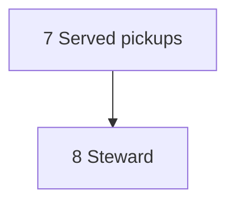

# The line at capacity: design

**What problem this solves.** The [dispatcher](../GLOSSARY.md) keeps the
execution line moving, but it runs well below what its host can carry and
asks a person for more than only a person can settle. Each tick measures
the host (memory, the processors, the disk, and the machine-wide test lock
every `bun run gates` queues on) and reports what a launch would cost, but
it still admits work by account [slots](../GLOSSARY.md) alone, two per
account by default, until a person sets `load.enforce`. A host with room to
spare idles, and a host near its limit takes one more session and slows
every drive on it. Pickups currently serve only a repository's
[factory identity](../GLOSSARY.md). On Orca, account-bound headless passes
start those pickups without an interactive session; serving people the host
is configured to serve remains step 7 below. And the stops that reach a
person mix real decisions with stops an agent could have recovered: a second
stop at the same change, a spent
[recovery budget](../GLOSSARY.md), an exit no rule re-drives. With this
built, each tick measures the host and starts work while every gauge stays
under its line, picks up the work assigned to the people the host serves
as headless passes on the model its complexity calls for, and every 20
minutes a [steward](../GLOSSARY.md) pass reads what is stopped and waiting
and proposes what the next tick should do about it. What still reaches a
person opens with the one act it asks of them.

This is the design of [plan.md](plan.md) item 44. The dashboard groups needs
by the person's act, shows the recommended option's changes and costs and
filters by person; `jig ask` names the same act. Ready to merge, the
keyboard-driven views, headless pickups, complexity tiers and the load
factor, reporting only, are built.
The remaining work is in the build order below.
It changes the following designs, each of which says in its own text what this one
changes: [the dispatcher](dark-factory-dispatch.md) (item 33), whose tick
gains the load factor, headless pickups, served people and the steward;
[the dispatch board](dispatch-board.md) (item 36), whose page becomes five
views of one column each, every need opening with its act;
[the hub](hub.md) (item 42), whose design round starts from those views;
and [routing](agent-routing.md) (item 31), whose route gains three
[complexity tiers](../GLOSSARY.md) with a model per tier per vendor
([ADR-0009](../docs/adr/ADR-0009-routes-are-derived-by-rules-as-data.md)).
The page is designed in [dispatch-board.md](dispatch-board.md#five-views-one-column-of-cards);
this design holds the tick's parts.

## How it works

### The host's load factor

Each tick reads the **gauges** of its host when the act phase builds its
apply state under the act lock, and starts a
launch only while every gauge stays under its **line** with that launch
counted. The **load factor** is the fullest gauge's fill against its line,
shown with the gauge that binds: "82% · memory binds". Account slots and
walls still apply as they do today; the load factor is one more limit
beside them, never a replacement.

| Gauge        | Read once per tick from                                                                                                                                                                                                       | Line (default)                                                                    |
| ------------ | ----------------------------------------------------------------------------------------------------------------------------------------------------------------------------------------------------------------------------- | --------------------------------------------------------------------------------- |
| Memory       | `MemAvailable` in `/proc/meminfo` on Linux, the free memory the platform reports on Windows; not read on macOS, whose free pages count reclaimable caches as used (the resource lock's reading, `plugin/shared/host-load.ts`) | 15% of the total kept free after the launch's reservation                         |
| Processors   | the 1-minute load average divided by the cores (`os.loadavg`, `os.availableParallelism`)                                                                                                                                      | `load_per_core`: 0.9; not read on Windows, which has no load average              |
| Test lock    | the holders of the machine-wide resource lock's slots (`plugin/shared/resource-lock.ts`) and the runs that announce beside it that they wait for one                                                                          | `lock_waiters`: 2 waiters; no new pickup or drive pass                            |
| Disk         | free space on the filesystems that hold the running workspaces and the repositories, the least of them (`statfs`)                                                                                                             | `disk_free_gb`: 10 GB                                                             |
| Forge budget | the rate limit the tick already reads at its start                                                                                                                                                                            | the tenth of the core limit below which the tick already skips its optional reads |
| Accounts     | free slots and walls, as today                                                                                                                                                                                                | no free slot                                                                      |

A gauge the host cannot read is left out of the load factor and named on
the receipt ("processors not read on Windows"); it never reads as empty.

**Reservations are measured.** A launch is counted against the memory gauge
by its kind's **reservation**, the memory a session of that kind is
expected to take. Each tick sums the memory of the processes running in
each of its sessions' workspaces (Linux shows a process's working directory
under `/proc`; elsewhere the defaults stand), and records one sample per
running workspace per tick and kind. A kind's reservation becomes the 90th percentile
of its recent samples once it has enough. Until then the defaults hold: a
pickup 2 GB, a drive pass 1.5 GB, a follow-up or a steward pass 1 GB. The
samples are the one thing the load factor keeps between ticks, in the
dispatcher's state database beside its launch records.

**The order stays; pickups keep a reserve.** Which launch goes next is
decided as today: drive launches and the other stages take turns leading
the tick (`plugin/dispatch/lib/apply-order.ts`), with their rotations
across repositories and stages, so no stage starves. The load factor adds
one rule: **a new pickup keeps room for a drive or follow-up.** After a
pickup, the remaining memory above the free-memory floor must fit the
larger reservation of the drive and follow-up kinds, whether either is
currently waiting or not. With the initial defaults, that reserve is
1.5 GB. Other gauges must also permit one launch of either protected kind
after the pickup; if a gauge cannot express that reservation, it must at
least remain below its line. The accounts' gauge expresses it as a slot: a
pickup leaves one account slot free. New work therefore
cannot crowd out the drives and follow-ups that turn earlier work into
merges. The gauges are read when the act phase builds its apply state,
under the act lock, so two ticks never spend the same headroom.

**It reports before it holds.** The load factor ships with
`load.enforce: false`. Every tick then reports, on its receipt and the
line, what it _would_ have held and which gauge would have held it, and
starts what it starts today. Turning enforcement on is a person's call,
made after a week of receipts, like every setting that ships off and
changes what the line starts.

### Pickups run headless

A pickup runs as a [headless pass](../GLOSSARY.md) of `do-item`, through
the wrapper a follow-up already runs through. The wrapper binds the pass to
its admitted account through that account's configuration directory, with
the credential variables removed, and the tick checks the identity the
wrapper's environment yields before it starts, as it does for a drive's
pass ([dark-factory-dispatch.md § Admission by account](dark-factory-dispatch.md#admission-by-account)).
The wrapper session keeps the orchestrator's model and effort; only its
implementer delegate takes the route's model and effort
([Complexity tiers](#complexity-tiers)), as agent-routing.md specifies.
The wrapper session has its own deadline,
`dispatch.pickup_deadline` (3 hours by default), since an implementation
outruns a review pass's 90 minutes.

A pickup pass has nobody to answer it. One that cannot go on without a
person does what does not depend on the answer, stops, and ends its output
with a `Question:` line, as a follow-up's pass does; the wrapper keeps that
line on the launch record, and it reaches the steward's digest and, if the
steward leaves it a person's, the person.

Orca's interactive launch cannot be bound to an account, so until it can,
no pickup starts as an interactive session; the headless pass is what
starts. An interactive pickup in an Orca tab, started by the wrapper, can
come later, once it is shown to bind and Codex's folder-trust prompt no
longer stops it.

### Serving named people

A host's machine file, `~/.jig/dispatch.yaml`, may name the people it
**serves**: each a name, the forge logins they use and their identity on
each tracker. A repository's own file cannot add to the list, so a pull
request cannot widen whom a host works for.

```yaml
serve:
  - name: maintainer
    forge: [maintainer-login, maintainer-work-login]
    tracker: { github: maintainer-login, linear: maintainer@example.com }
```

Wherever the `pickup` stage is on, a [served person](../GLOSSARY.md)'s
assigned work is wanted beside the factory identity's:

- an open item that is not started and is assigned to a served person, when
  a person with write access to the repository made the assignment (the
  `assignedBy` check the factory identity's pickups already make);
- each unassigned open item under an epic assigned to a served person,
  nested epics walked level by level, the epic's assignment checked the
  same way;
- their open pull requests, adopted the way `dispatch.adopt.authors` adopts
  a repository's own today, with the served person's forge logins added to
  the authors.

**Assignment alone starts the work.** An item needs no dispatch state: a
served person's open, not-started item is wanted whatever its state, and
`jig:hold` or the `hitl` label keeps one waiting. `dispatch.states` keeps
gating the factory identity's pickups only.

**The ranking.** Wanted items are ranked by rules kept as data in
`plugin/dispatch/lib/queue-rank.ts`, and each item the ranking holds out of
the queue is shown with its reason:

| Held out                                             | Shown as                                                                 |
| ---------------------------------------------------- | ------------------------------------------------------------------------ |
| an open `blocked_by` relation                        | "waiting on #N"                                                          |
| `hitl`, a `hitl:*` facet, `manual-ops` or `jig:hold` | "needs a person to start" (`do-item` would only scout and wait on these) |

The rest are ordered by priority (urgent first, then high, medium, low, and
an unset priority after low), then items that unblock others, then an
epic's own order (the eligibility of its execution plan,
`plugin/skills/do-item/scripts/lib/execution-plan.ts`), then the smaller
size, then the oldest. Small unblocked items of one change area are started
as one `work-batch` launch.

**Cheap reads.** The served people's assignment lists are read on a tick
with headroom, and every 15 minutes regardless so the Queue view stays
current. An item's `assignedBy`, its relations and an epic's children are
kept per item until the item's `updatedAt` moves, as the tick keeps its
merge reads. The change probe adds one `issues?since=` read per repository
a minute, and a new assignment wakes the tick. A tick with no assignment
change makes no `assignedBy` or relations read.

**The claim keeps the person.** `do-item`'s claim, run as
`claim --for <person>`, accepts an item assigned to that served person,
keeps them as its only assignee and moves it to the in-progress state.
For an unassigned child, the claim also accepts inherited assignment:
the tick supplies the ancestor epic's identifier and the served person.
Immediately before claiming, the tracker adapter re-reads the child and
the ancestry up to that epic, verifies that the child is still unassigned,
open and not started, and verifies that the epic is still assigned to the
served person by a repository writer. Every intervening epic must still
be in that ancestry and have no conflicting assignee. A missing or
unreadable link, changed assignment or new hold refuses the claim and
refreshes the queue. Only after these checks does it assign the child to
the served person and move it in progress. The adapter must serialize
competing Jig claims and recheck assignment at the write; it must never
replace a new assignee, and must report a race it cannot safely settle.
Without `--for`, the claim is unchanged: it assigns the item to the
credential's own user and refuses an item someone else holds. The stalled
pickup and double claim watches read the served people's in-progress items
beside the factory identity's.

### The steward, every 20 minutes

The **steward** is a headless pass of a `steward` skill that the owner host
starts every 20 minutes, and only when its input changed. It reads a digest
the tick writes: every need on the line, every stopped drive with its
handoff and logs, every pass that ended on a `Question:` line, and the
served people's queue. It writes **records** the next tick reads and
carries out, under the guards and the recovery budget the tick already
keeps. The steward itself launches nothing.

Its records come from a closed list:

- **Re-arm once.** A stop the rules now leave to a person (a second stop at
  the same change, an exit no row re-drives) is re-armed when the drive's
  handoff and logs show a transient cause, counted on the pull request's
  recovery budget. A spent budget stays a person's, with the steward's
  Investigate summary. A class of stop the steward re-arms three times in a
  week becomes a [reflection](../GLOSSARY.md) finding proposing the rule,
  so that work moves into the tick over time.
- **An act and an ask for each need that stays a person's.** A
  registry-class park stays a person's, with its act
  ([What each need asks of a person](#what-each-need-asks-of-a-person)).
  A pickup or follow-up pass that ended on a question outside the registry
  and offered a recommended option is resumed once with one fixed line:
  "Take the option you recommended and record it as a decision taken
  unattended", the rule
  [ADR-0010](../docs/adr/ADR-0010-parking-is-reserved-for-registry-classes.md)
  gives for decisions outside the classes. One with no options stays a
  need, with the steward's one-sentence summary. A session a person started
  is only reported.
- **A missing facet.** An empty priority, size or type on an assigned item
  is set, with a comment naming the steward and the reason. A value a
  person set is never changed.
- **The queue's order** where the ranking leaves items tied.

**What it never does.** It never merges, answers a registry-class park,
re-arms a drive a person stopped or held, changes configuration, writes
code, sends a session free text, names a model or writes a tier on an item.

**What it costs.** At most three runs an hour, and none while the digest's
hash matches the last run's. Each pass has a 15-minute deadline, runs on
the complex tier's model of the admitted account's vendor, and is counted
under the load factor as one more launch. Its records stay on the owner
host, in the state database, as the outcome log does; other hosts see its
re-arms through the launch claims.

### What each need asks of a person

Every need on the line opens with one **act** from a closed list, then the
ask in one sentence, then the recommended option with what it changes and
what it costs. The act comes from the park's registry class through a table
in `plugin/shared/acts.ts`, and the HITL registry template
(`modules/M7-pr-lifecycle-review/templates/HITL-REGISTRY.md`) gains an Act
column so a repository's own classes name theirs. A class with no act reads
Decide, never hidden. The options, costs and steps are already in the
framed park; the line carries them through to the card.

| Act         | The person                                               | From                                                                                                                         |
| ----------- | -------------------------------------------------------- | ---------------------------------------------------------------------------------------------------------------------------- |
| Merge       | merges what the forge and its reviewer witness as ready  | Ready to merge's merge now, on a view of its own; a `merge` park                                                             |
| Decide      | chooses among framed options                             | `scope`, `next-item`, `reopen-or-waive`, `escalated`, `human-decision`, `hitl`                                               |
| Authorize   | allows what only a person may                            | `ready`, `release`, `destructive`, `legal`, `copy`, `dark-dial`, `rules`, `reviewer-posture`; Ready to merge's approve first |
| Reply       | answers a person's thread or a waiting session           | `human-thread`; a session's question                                                                                         |
| Do          | performs steps outside the line                          | a park's steps for a person; an assignment only a writer can make                                                            |
| Investigate | looks at what the line and the steward could not recover | a stalled pickup, a double claim, a spent recovery budget, a stuck launch                                                    |

`jig ask` and the card name the same act for the same need, and the card
names the person the need waits on.

### Complexity tiers

A pickup's route takes one of three complexity tiers, **simple**,
**standard** or **complex**, from the item's type, its size and the flags a
repository marks complex at any size (`routing.complex_flags`). Each tier
maps to a model per vendor, with Claude's and OpenAI's defaults built in:
simple and standard run on `sonnet` or `terra`, complex on `opus` or `sol`.
The tiers, the table and the defaults are in
[agent-routing.md § Complexity tiers](agent-routing.md#complexity-tiers).
No model is asked to route and no tier or model is written on an issue; the
steward only fills a missing size or type, from which the rules derive the
tier.

### Configuration

| Field                                                                              | Where        | Default                                                            |
| ---------------------------------------------------------------------------------- | ------------ | ------------------------------------------------------------------ |
| `load.enforce`                                                                     | machine file | `false`: the tick reports what it would hold and holds nothing     |
| `load.memory_free`, `load.load_per_core`, `load.lock_waiters`, `load.disk_free_gb` | machine file | 15%, 0.9, 2, 10 GB                                                 |
| `serve[]`                                                                          | machine file | none: only the factory identity's items are picked up              |
| `steward.enabled`, `steward.every`                                                 | machine file | off; `20m`                                                         |
| `dispatch.pickup_deadline`                                                         | repository   | `3h`                                                               |
| `routing.complex_flags`, `routing.models.<runtime>.<tier>`                         | repository   | [agent-routing.md § Configuration](agent-routing.md#configuration) |

## Build order

One pull request per step, each shippable alone, filed under the item 44
epic with its order recorded as blocking relations. The open steps retain
their original numbers; each waits on the steps whose files it shares.



#### 7. Served pickups

([#638](https://github.com/jig-harness/jig/issues/638)): `serve:`, the served
reads, the ranking, `claim --for` and the Queue view. Done when an item a
writer assigns to a served person starts within one interval when there is
headroom, and the served person is still its only assignee after the claim.

#### 8. The steward

([#639](https://github.com/jig-harness/jig/issues/639)): the skill, its digest
and records, the tick's stage and the once-only resume. Done when no steward
pass starts while nothing changed, and no steward record re-arms a drive a
person stopped.

## Left out

- **Pacing an account by its remaining usage window.** No vendor exposes
  what is left of an account's window: the quota adapters see a wall only
  once a session hits it. A load factor that guessed at it would be a dial
  no measurement set.
- **A state gate for served people.** Jig's own tracker has no `todo`
  state, so `dispatch.states` as a second gate would start nothing there;
  `jig:hold` and `hitl` keep an assigned item waiting instead.
- **A steward that launches.** The steward could run `drive.ts` and the
  repair scripts itself, one tick sooner, but it would then be a second
  actor with launch powers beside the tick. It writes records; the tick,
  with its guards and budget, acts on them.
- **A steward that names models.** The tier comes from the rules over the
  item's facets; the steward fills a missing facet and the rules do the
  rest.
- **Interactive pickups on Orca**, until an Orca launch is shown to bind
  its agent to an account ([Pickups run headless](#pickups-run-headless)).

## Review

Reviewed on 2026-11-08 at commit `54663d73`, by a fresh-context agent
session acting as an adversary, before the first pull request that builds
it.
