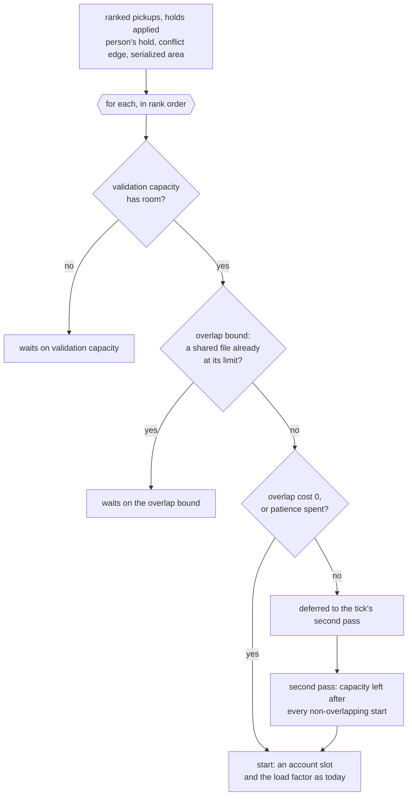

# Overlap-aware admission: design

**What problem this solves.** The [dispatcher](../GLOSSARY.md) starts work
when a slot is free, but it cannot tell work that will collide from work
that will not. Two pickups that edit the same files both open pull requests,
and whichever merges second meets a conflict: another agent session to
resolve it and another full validation run. Inside an epic without an
execution plan, the only bound on parallel work is a fixed width per epic,
which holds back children that touch nothing in common and lets through
children that touch the same file. Admission also ignores how many
validation runs the host can finish. On 2026-11-14 the machine-wide test
lock (`heavy`) ran full validation one suite at a time across every
workspace; with about 25 passes in flight, six passes spent their time
waiting for it, first the lock's one-hour wait ("could not acquire lock
'heavy' within 3600s") and then the three-hour pass limit. With this built,
each item carries a [footprint](../GLOSSARY.md), the paths it is expected to
touch; the dispatcher compares it with the files of every open pull request
and the footprints of every running pickup, starts the work that collides
least first, still starts colliding work when nothing else is ready, and
starts no more passes than the host can validate in time. A person sees,
for each item that waits, what it waits on.

This is the design of [plan.md](plan.md) item 56. Nothing of it is built.
It builds on the change that lets a plan-less epic's ready children start
in parallel up to a width per epic (#1178), and on that change's decision
record: admission is parallel by default, and overlap is a cost weighed
against waiting, never an absolute. The width is the bound this design
replaces.

## How it works

Admission today, in one repository's act phase
([dark-factory-dispatch.md § One tick, step by step](dark-factory-dispatch.md#one-tick-step-by-step)):
the tick ranks the wanted pickups by rules as data, drops what a hold keeps
out, and starts each next one on an account with a free slot, within the
host's [load factor](../GLOSSARY.md). This design adds three facts and two
rules to that walk:



- **Facts:** each item's footprint, each open pull request's changed files,
  and the host's validation capacity.
- **Rules:** the [overlap cost](../GLOSSARY.md) orders colliding work
  behind work that does not collide, and the **overlap bound** caps how many
  pieces of work in flight may share one file. Neither ever leaves a free
  slot unused while ready work waits only on overlap.

### The footprint record

A **footprint** is the set of paths an item is expected to touch, with how
it was predicted. It is a fact about one item, not a relationship between
items, so it is a record, not a tracker relation
([ADR-0015](../docs/adr/ADR-0015-relationships-live-in-the-tracker.md)).

**Where it is kept.** On the tracker item, as a marked comment through the
tracker interface, registered in [RECORDS.md](../plugin/RECORDS.md) as
`tracker-footprint`:

```text
<!-- jig:footprint {"v":1,"key":"footprint","source":"scout","at":"<commit>","paths":["plugin/dispatch/lib/load.ts","plugin/dispatch/lib/sources/"],"areas":["dispatch"]} -->
Predicted footprint (scout, at <commit>): 2 paths in area dispatch.
```

The tracker is the medium because every host's tick must read it, it must
outlive the worktree of whoever wrote it, and every adapter (Linear, GitHub
Issues, Jira) has comments while not every one has a custom field. The
issue's description is not used: anyone who can edit the item edits it, and
it is a person's text. The record carries the envelope every record carries
(`plugin/shared/records/envelope.ts`); it is read from trusted authors only,
as the claim marker is, and the newest record of the strongest source
stands.

**What it holds.**

| Field | Meaning |
| --- | --- |
| `paths` | Files, and directories ending in `/`, inside the repository |
| `areas` | Areas of the [change-area catalog](../GLOSSARY.md) the item reaches |
| `source` | Who predicted it: `planner`, `scout`, `pickup`, `catalog` |
| `at` | The commit of the default branch the prediction read |

A path is the precise form, an area the coarse one: an area expands to its
own globs (its seeds, never the `impliedBy` closure, as serialized areas
read them).

**Who writes it**, strongest source first:

1. **The pickup itself** (`pickup`). Once `do-item` has claimed the item and
   read the code, before it delegates, it writes the footprint of the change
   it is about to make. This is what makes a running pickup's footprint
   good: the work that is already in flight is the work every later
   admission compares against.
2. **A `do-item` scout** (`scout`). The scout form (`/jig:do-item scout
   <KEY>`) gains a footprint scout that reads the code and writes the
   record beside its findings comment, without claiming the item.
3. **The planner** (`planner`). When it decomposes an epic, the planner
   that #1180 moves into Jig writes a footprint for each child it files, from
   the code it read to plan the split.
4. **`file-issue` from the catalog** (`catalog`). Filing already derives
   the change's areas to choose labels; it writes those areas as the
   footprint, and the paths when the person filing names them.

With no record, the tick derives a coarse footprint from the item's area
labels through the catalog, writes nothing, and reports the source as
`labels`. With no area label either, the footprint is **unknown**.

No model is asked anything inside the tick: predicting a footprint is
judgment, made upstream, and it reaches the tick as a record
([ADR-0009](../docs/adr/ADR-0009-routes-are-derived-by-rules-as-data.md)).

**Reading it.** The tick reads an item's footprint once and keeps it until
the item's `updatedAt` moves (reuse before sending,
[ADR-0021](../docs/adr/ADR-0021-outbound-calls-are-governed.md)). Where an
adapter's `updatedAt` does not move when a comment is added, the adapter
declares it, and its footprints are read again on the scheduled full read
of the tracker scope. A footprint that does not read is treated as unknown
for the tick and says why.

### Open pull requests' changed files

The work in flight is the open pull requests and the running pickups. A
pull request's changed files are the truth about it, so its footprint is
those files, whoever opened it: a person's pull request collides as surely
as the dispatcher's. A running pickup with no pull request yet is
represented by its footprint record. A pickup that opened its pull request
is represented by the pull request alone.

The tick already reads changed files for the pull requests in a
[serialized area](../GLOSSARY.md) (`pullRequestFiles` in
`plugin/dispatch/lib/forge.ts`, page by page, cut short at the forge's
listing limit). This design widens that read to every open pull request of
the repository, through the forge's governed transport (item 55), with the
obligations ADR-0021 sets:

- **Reuse.** A pull request's files are kept under its head commit, so a
  pull request whose head did not move costs nothing; the same reading
  serves serialization and overlap.
- **Bound.** Pages of 100 files, at most 3,000 files a pull request (the
  forge's own listing limit), and at most a declared number of pull
  requests read fresh in one tick; the rest keep their last reading, with
  its age, until a later tick.
- **Cost.** One request a page for each pull request whose head moved since
  the last tick, recorded in the cost ledger under the operation
  `pr-files`.
- **No answer.** A pull request whose files do not read, and was never
  read, is treated as an unknown footprint for the tick, with the failure
  class as its reason.

### The overlap cost

The overlap cost of starting a candidate item is the number of conflict
resolution rounds it is expected to cause or meet with the work already in
flight. The unit is chosen so that it can be weighed against waiting and
against validation capacity: each round is one more session and one more
validation run.

For a candidate `C` and one piece of work in flight `W`, the chance of a
round is

```text
P(C, W) = 1 − ∏ over the paths p that C and W share of (1 − rate(p))
```

and the overlap cost of `C` is the sum of `P(C, W)` over all work in
flight, the items this tick has already started included.

- **Shared paths.** A file in both footprints is shared. A directory or an
  area in one footprint shares every file under it in the other. Two
  footprints that are both only areas share the area.
- **`rate(p)`** is how often a merge that touched `p` conflicted, from the
  conflict history report (`resolve-conflicts`' `history.ts`) over its
  window, once at least 5 merges touched the path. Below that it is
  `dispatch.overlap.file_rate` (0.5) for a file match and
  `dispatch.overlap.area_rate` (0.2) for a match through a directory or an
  area, which is a weaker prediction. A [conflict hotspot](../GLOSSARY.md)
  therefore weighs more than a file that has never conflicted.
- **An unknown footprint** costs `dispatch.overlap.unknown_cost` (0.5),
  once, whatever is in flight, so that an item with a known footprint that
  collides with nothing starts before an item nobody predicted.

**Weighed against waiting.** The tick walks the ranked queue twice:

1. **First pass.** Each candidate in rank order whose overlap cost is 0 is
   started, if the account slots, the load factor and validation capacity
   admit it, exactly as today. A candidate whose cost is above 0 is
   deferred, unless it has already waited on overlap longer than its
   patience: `dispatch.overlap.patience` for its priority (urgent `0`, high
   `30m`, medium `2h`, low and none `6h`), multiplied by its overlap cost.
   A candidate whose patience is spent is started at its rank in this pass.
2. **Second pass.** Capacity left after the first pass goes to the deferred
   candidates in rank order.

So overlap reorders work only when capacity is short. When a slot is free
and only overlapping work is ready, that work starts and a round of
conflict resolution is accepted. The waiting time is measured from the
first tick that deferred the item on overlap, kept in the state database
beside the other holds (`holds`), and ends when the item starts or stops
being wanted.

### The overlap bound

The cost orders work; the **overlap bound** limits a pile-up. Branches that
all edit one file conflict with each other at every merge, so the rounds
grow with the square of their number. A candidate waits while starting it
would put more than `dispatch.overlap.max_per_file` pieces of work in
flight (4 by default, the per-epic width's default) that share one of its
files. A shared area or directory does not count against the bound, since
it names no file; only file matches do. A value of `0` turns the bound off.

The bound replaces the per-epic width: it applies across all work, inside
an epic, across epics, across served people, the ready pool and the
factory identity's own queue, and it holds only work that really shares a
file. Once it is built, the width key that #1178 adds is read as a
deprecated alias for one release and then refused, naming this key.

### Hard holds stay declared

The cost and the bound are weighed; three holds are not, and they apply
before either:

- **A conflict edge** that an epic's execution plan sets between two steps.
- **A serialized area** of the change-area catalog. Today it holds only the
  drives of the pull requests in the area. It also holds a pickup whose
  footprint names a file of the area while another piece of work in flight
  touches the area, reported as `held: serialized behind #N in <area>`.
- **A person's hold** (`jig:hold`, `hitl`).

### Merge evidence for a plan's conflict edges

An execution plan's conflict edge holds the later step until the earlier
one's change has merged (`completion: merged`). The dispatcher reads no
merge evidence today, so such a step is held until a person moves it
(#725). The tick verifies the evidence as `do-item`'s Step 4b does: the
earlier step's linked pull request (`linked-pr.ts`: the do-item comment
marker, or a `Closes`/`Refs` line), merged (`mergedAt` set), into the
integration branch, and changing at least one of the edge's
`conflictFiles` where the edge lists them. The tick already reads the pull
requests merged since the follow-up stage was turned on and keeps each read
(`dispatch-merge-read`), so a verified edge costs one read of that pull
request, kept with the merge. Evidence that does not read, or is ambiguous
(two linked pull requests, one still open), keeps the edge held and says
which.

### Validation capacity

**The case.** On 2026-11-14 about 25 passes were in flight on one host. The
test stage runs under the machine-wide resource lock
(`plugin/shared/resource-lock.ts`), which admits a run only while the host
has room for it; under that load it admitted one at a time. Each pass
reached its validation an hour or more after it started, joined a queue
that only grew, waited out the lock's hour (`LOCK_TIMEOUT`, 3600 seconds in
`scripts/test.ts`), retried, and hit the pass limit of three hours. Six
passes ended that way.

The load factor already has a gauge for the lock, `load.lock_waiters`, but
it counts the runs waiting at the moment of the tick. A pass spends its
first hour implementing, not waiting on the lock, so at admission time the
queue looked short, and the tick admitted passes whose validation would
come due together an hour later. A snapshot cannot see work that is
already committed to arrive.

**The measure.** **Validation capacity** is how many passes the host can
take through validation within the time a pass can afford to wait for it:

```text
capacity = runs at once × wait window ÷ run time
```

- **Run time** is the 90th percentile of how long one validation run holds
  the lock, from samples the lock records on release (a new machine record,
  `resource-lock-sample`: the lock's name, how long the run waited and how
  long it held, newest kept for 7 days).
- **Runs at once** is how many runs the lock let hold at once while others
  waited, the median over the same samples: the lock admits by load, so the
  number is measured, not configured.
- **The wait window** is the shorter of the lock's wait (`LOCK_TIMEOUT`)
  and the pass deadline less the 90th percentile of the time a pass of that
  kind takes to reach validation (from the launch records and the samples).

For example, with one run at a time, runs of 12 minutes and an hour to
wait, the capacity is 5.

**The gauge.** Validation capacity joins the load factor as one more gauge,
`validation`, whose fill is the passes in flight that will validate
(pickups and drive passes not yet past their validation; follow-ups and the
steward do not run the test stage) against the capacity. It holds only
pickups and drive passes, as the lock gauge does, and a new pickup keeps
room for one drive pass after it, as it keeps memory and an account slot
today. Like every gauge it reports first: with `load.enforce: false` the
receipt lists the launches it would hold, and a person turns enforcement on
after reading them. Replayed on the 2026-11-14 receipts and lock samples,
the gauge must show the launches it would have held before the six passes
timed out; that replay is a test of the step that builds it.

The lock's own waiting order and how it reports its holder are #608's. A
lock that admits in arrival order makes this estimate hold for each pass
rather than on average; the gauge does not depend on it.

### The reason a person sees

Every item that waits says why, in the receipt, the dashboard's queue and
the tick's report, as a structured reason the overview renders: a relation
word, the item, the work it waits on (each with its kind, pull request or
pickup, its link and its state) and a count. The texts:

| Waits on | Reason |
| --- | --- |
| Overlap | `waits on overlap: shares plugin/dispatch/lib/load.ts (+2) with #123 (pull request) and #456 (pickup); 0.8 rounds expected; starts when a slot is free after work that does not overlap, or by 16:40` |
| The overlap bound | `waits on the overlap bound: 4 in flight already change plugin/dispatch/lib/load.ts (#123, #456, #789, #790)` |
| Validation capacity | `waits on validation capacity: 9 passes validate ahead of it, about 1 h 50 min at 1 run at a time of 12 min; capacity 5` |
| A serialized area | `held: serialized behind #123 in dispatch` |
| A conflict edge | `waits on conflict edge #12 → #14: #12's pull request #20 has not merged` |

An item whose footprint is unknown, or only derived from labels, says so
beside its rank (`footprint unknown: no footprint record and no area
label`), whether or not it waits, so that a missing footprint shows as a
missing fact a person or the steward can supply.

### The conflict history report feeds it

`resolve-conflicts`' `history.ts` already replays the repository's merges
and, with `--propose-serialize`, prints catalog lines for hotspots that lie
in one area. Two outputs reach admission:

- **Rates.** A new `--rates` output prints, for each path that merges
  touched in the window, how many merges touched it and how many of those
  conflicted (`merge-conflict-rates/v1`, JSON). The tick refreshes the
  file under the dispatch state directory at most once a day, after its
  act phase, so a slow replay never delays a launch; the replay reads git
  only and sends nothing outside the machine. A refresh that runs past its
  deadline keeps the previous file, and a missing or stale file leaves
  every rate at its default and says so in the receipt.
- **Serialized areas.** `--propose-serialize` stays a proposal a person
  applies to the catalog. The receipt adds a pointer to it when the same
  file has held work on the overlap bound in at least 3 ticks of a day:
  the bound is the weighed answer, and a serialized area the declared one a
  person chooses.

## Build order

One pull request each, in this order. Each step ships alone and changes
nothing a person sees until it is built.

1. **The footprint record.** `tracker-footprint` in the records registry
   and RECORDS.md; `plugin/shared/footprint.ts` to parse, render and choose
   the strongest record; `tracker.ts footprint <KEY>` to read and
   `tracker.ts footprint <KEY> --input <file>` to write, on every adapter;
   the glossary's Footprint entry points at it.
2. **Footprint writers.** `do-item` writes the `pickup` footprint after it
   reads the code and before it delegates; its scout form gains the
   footprint scout; `file-issue` writes the `catalog` footprint. The
   planner's writer comes with the planner's own move (#1180).
3. **Merge evidence for conflict edges.** The tick verifies a conflict
   edge's delivering pull request and releases the step (#725's third
   limit).
4. **Every open pull request's changed files.** Widen the serialized areas'
   read to every open pull request, kept by head commit, bounded and
   recorded through the forge's governed transport. Waits on item 55's
   GitHub budget step.
5. **Conflict rates.** `history.ts --rates`, the tick's daily refresh of
   the rates file, and its reader.
6. **Overlap, reported.** The tick computes each candidate's footprint,
   overlap cost and bound, and reports them with the reasons above in the
   receipt, the dashboard and `jig ask`, without changing what it starts.
7. **Validation capacity.** The lock's samples (`resource-lock-sample`), the
   `validation` gauge in the load factor, and the replay of 2026-11-14 as
   its test.
8. **Overlap admission.** The two passes, patience and the overlap bound
   replace the per-epic width; serialized areas hold pickups; the width key
   becomes a deprecated alias; every document that names the width says
   what is true after it.

## Left out

- **Ordering drives by overlap.** A drive's branch already exists; holding
  its re-arm avoids no conflict, it only delays one. Serialized areas stay
  the drives' declared form.
- **A model inside the tick**, to predict a footprint or weigh a cost. The
  tick reads records ([ADR-0009](../docs/adr/ADR-0009-routes-are-derived-by-rules-as-data.md)).
- **Reading an unpushed branch** of a running pickup. Its footprint record
  stands for it until its pull request opens; reading every workspace's
  working tree would tie the tick to one host's disk.
- **Raising the number of suites that may run at once**, the lock's
  waiting order and its holder reporting (#608).
- **Overlap across repositories.** Files collide only within one
  repository. Two repositories' passes still share a host's validation
  capacity when they share its lock, and the gauge counts them both.
