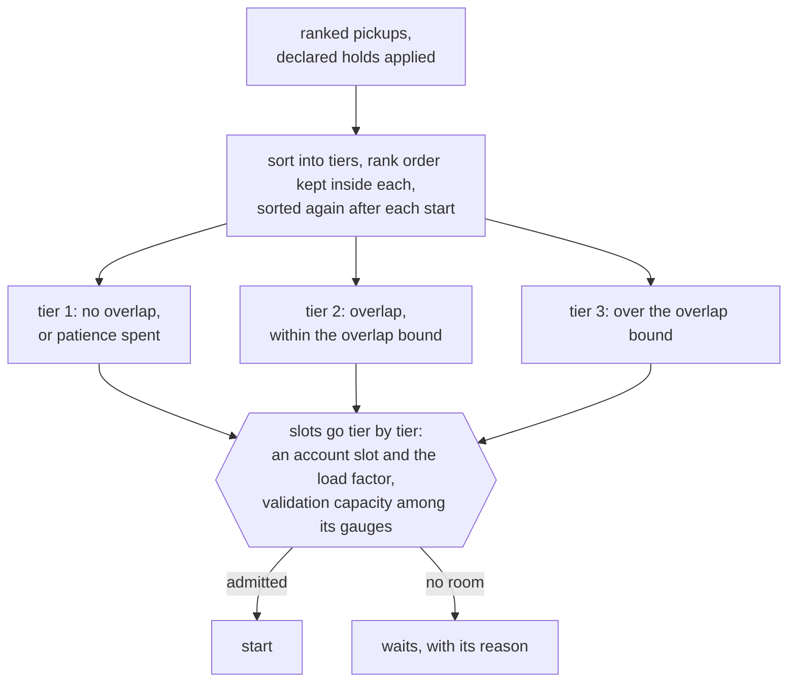

# Overlap-aware admission: design

**What problem this solves.** The [dispatcher](../GLOSSARY.md) starts work
when a slot is free, but it cannot tell work that will collide from work
that will not. Two pickups that edit the same files both open pull requests,
and whichever merges second meets a conflict: another agent session to
resolve it and another full validation run. Inside an epic without an
execution plan, the only bound on parallel work is a fixed width per epic,
which holds back children that touch nothing in common and lets through
children that touch the same file. Admission also ignores how many
validation runs the host can finish. On 2026-11-14 the machine-wide test
lock (`heavy`) ran full validation one suite at a time across every
workspace; with about 25 passes in flight, six passes spent their time
waiting for it, first the lock's one-hour wait ("could not acquire lock
'heavy' within 3600s") and then the three-hour pass limit. With this built,
each item carries a [footprint](../GLOSSARY.md), the paths it is expected to
touch; the dispatcher compares it with the files of every open pull request
and the footprints of every running pickup, starts the work that collides
least first, still starts colliding work when nothing else is ready, and
starts no more passes than the host can validate in time. A person sees,
for each item that waits, what it waits on.

This is the design of [plan.md](plan.md) item 57. The tracker footprint
record, its adapter interface, the pickup, scout and filing writers, the
merge evidence for conflict edges, the changed-files read of every open pull
request, the conflict rates with the tick's daily refresh and their reader,
overlap reported (each planned pickup's cost, tier, bound and reason, and
`overlap_waits`, in the receipt, the dashboard and `jig ask`), serialized
areas holding pickups, and admission are built. The planner's writer and the
remaining build steps are open. Admission is parallel by default, and overlap
is a cost weighed against waiting, never an absolute. The overlap bound now
replaces the retired per-epic width.

## How it works

Admission today, in one repository's act phase
([dark-factory-dispatch.md § One tick, step by step](dark-factory-dispatch.md#one-tick-step-by-step)):
the tick ranks the wanted pickups by rules as data, drops what a hold keeps
out, and starts each next one on an account with a free slot, within the
host's [load factor](../GLOSSARY.md). This design adds facts the tick
reads and rules that order the walk:



- **Facts:** each item's footprint, each open pull request's changed files,
  how often merges of each path conflicted, and the host's validation
  capacity.
- **Rules:** the [overlap cost](../GLOSSARY.md) puts colliding work behind
  work that does not collide, and the [overlap bound](../GLOSSARY.md) puts
  work that would pile onto one file behind both. The tiers only order:
  a free slot goes to the next candidate whatever its tier, so no slot is
  left unused while ready work waits only on overlap. What can hold work
  with a slot free is a declared hold, or a gauge of the load factor
  (validation capacity is one).

### The footprint record

A **footprint** is the set of paths an item is expected to touch, with how
it was predicted. It is a fact about one item, not a relationship between
items, so it is a record, not a tracker relation
([ADR-0015](../docs/adr/ADR-0015-relationships-live-in-the-tracker.md)).

**Where it is kept.** On the tracker item, as a marked comment written and
read through the tracker interface, registered in
[RECORDS.md](../plugin/RECORDS.md) as `tracker-footprint`:

```text
<!-- jig:footprint
{"kind":"tracker-footprint","v":1,"key":"#123","writer":{…},"at":"2026-11-14T17:30:00.000Z","source":"scout","base":"<commit>","paths":["plugin/dispatch/lib/load.ts","plugin/dispatch/lib/sources/"],"areas":["dispatch"]}
-->
Predicted footprint (scout, at <commit>): 2 paths in area dispatch.
```

The tracker is the medium because every host's tick must read it, it must
outlive the worktree of whoever wrote it, and every adapter (Linear, GitHub
Issues, Jira) has comments while not every one has a custom field. The
issue's description is not used: anyone who can edit the item edits it, and
it is a person's text. The record carries the record envelope
(`plugin/shared/records/envelope.ts`): its `key` is the item's key and its
`at` the time it was written. It is read from trusted authors only, as the
claim marker is.

**What it holds**, beside the envelope:

| Field    | Meaning                                                             |
| -------- | ------------------------------------------------------------------- |
| `paths`  | Files, and directories ending in `/`, inside the repository         |
| `areas`  | Areas of the [change-area catalog](../GLOSSARY.md) the item reaches |
| `source` | Who predicted it: `pickup`, `scout`, `planner` or `filing`          |
| `base`   | The commit of the default branch the prediction read                |

A path is the precise form, an area the coarse one: an area expands to its
own globs (its seeds, never the `impliedBy` closure, as serialized areas
read them).

**Who writes it:**

- **The pickup itself** (`pickup`). Once `do-item` has claimed the item and
  read the code, before it delegates, it writes the footprint of the change
  it is about to make. This is what makes a running pickup's footprint
  good: the work already in flight is what every later admission compares
  against.
- **A `do-item` scout** (`scout`). The scout form (`/jig:do-item scout
<KEY>`) gains a footprint scout that reads the code and writes the
  record beside its findings comment, without claiming the item.
- **The planner** (`planner`). When it decomposes an epic, the planner
  that #1180 moves into Jig writes a footprint for each child it files, from
  the code it read to plan the split.
- **`file-issue`** (`filing`), only when it files from a diff, whose files
  it already resolves against the catalog, or when the person filing names
  the paths. From a description alone it writes nothing: its labels already
  carry the areas, and the tick derives those itself.

**Which one stands.** Every footprint record of an item has the item's
key, so a new record never replaces an older one in place; the reader
chooses among them. While a pickup holds the item (its claim and a
running session), that pickup's newest record stands. Otherwise the newest
record stands, so a prediction made at a later commit replaces the
`pickup` record an abandoned attempt left. With no record, the tick derives
a coarse footprint from the item's area labels through the catalog, writes
nothing, and reports the source as `labels`. With no area label either, the
footprint is **unknown**.

No model is asked anything inside the tick: predicting a footprint is
judgment, made upstream, and it reaches the tick as a record
([ADR-0009](../docs/adr/ADR-0009-routes-are-derived-by-rules-as-data.md)).

**Reading it.** Footprints are read through the tracker adapter, the
tracker's governed transport
([ADR-0021](../docs/adr/ADR-0021-outbound-calls-are-governed.md)), with
its obligations:

- **Reuse.** An item's footprint is kept until the item's `updatedAt`
  moves. Where an adapter's `updatedAt` does not move when a comment is
  added, the adapter declares it, and its footprints are read again on the
  scheduled full read of the tracker scope. Items are read by key, many in
  one request, where the tracker allows it.
- **Admit and bound.** Each read asks the shared budget record, has a
  deadline and a page size, and the tick reads at most 20 items' footprints
  fresh in one tick, the wanted pickups first, then the claimed items in
  flight; with no pickup wanted it reads none.
- **Record.** Each read is recorded in the cost ledger under the operation
  `footprint`.
- **No answer.** A footprint that does not read keeps its last reading with
  its age; one never read is unknown for the tick, with the failure class as
  its reason.

### Open pull requests' changed files

The work in flight is the open pull requests and the running pickups. A
pull request's changed files are the truth about it, so its footprint is
those files, whoever opened it: a person's pull request collides as surely
as the dispatcher's. A running pickup with no pull request yet is
represented by its footprint record, on whichever host runs it: the
tracker's claimed items name every host's pickups, and this host's launch
records the ones not claimed yet. A pickup that opened its pull request (an
open pull request that links its item) is represented by the pull request
alone.

The tick reads changed files for every open pull request of the
repository (`plugin/dispatch/lib/sources/pr-files.ts`, page by page through
`pullRequestFiles` in `plugin/dispatch/lib/forge.ts`, cut short at the
forge's listing limit), through the forge's governed transport (item 55).
A [serialized area](../GLOSSARY.md) and overlap read the same files:

- **Reuse.** A pull request's files are kept under its head commit, its
  comparison base snapshot (the base branch's name and commit, as the listing
  reports them), and the live base-branch tip. When the listing supplies that
  live tip, an unchanged head, comparison snapshot and tip need no file-page
  requests; a retarget or either base commit that moved is read again. When
  the listing omits the live tip, the tick reads it before deciding whether it
  can reuse the cached comparison. The same file reading serves serialization
  and overlap.
- **Admit and bound.** Each page asks the shared budget record. Pages of
  100 files, at most 3,000 files a pull request (the forge's own listing
  limit), and at most eight pull requests of a repository read fresh in
  one tick; the rest keep their last reading, with its age, until a later tick.
- **Record.** One request a page for each pull request whose head moved
  since the last reading, recorded in the cost ledger under the operation
  `pr-files`.
- **No answer.** A pull request whose files do not read, and was never
  read, is an unknown footprint for the tick, with the failure class as its
  reason.

**Paths that do not count.** Some files change in almost every pull
request without being the work: derived files, and files a repository
keeps appending to. A path counts toward neither the cost nor the bound
when the catalog marks it generated, or when it matches a glob of
`dispatch.overlap.ignore`. A pull request with no update for
`dispatch.overlap.quiet_after` (14 days; its last update, as the listing of
open pull requests carries it, stands for its last push) counts toward the
cost but not toward the bound: it still conflicts when it moves again, but
it is not piling onto a file now.

### The overlap cost

The overlap cost of starting a candidate item is the number of conflict
resolution rounds it is expected to cause or meet with the work already in
flight. The unit is chosen so that it can be weighed against waiting and
against validation capacity: each round is one more session and one more
validation run.

For a candidate `C` and one piece of work in flight `W`, the chance of a
round is

```text
P(C, W) = 1 − ∏ over the shared units u of C and W of (1 − rate(u))
```

and the overlap cost of `C` is the sum of `P(C, W)` over all work in
flight, the items this tick has already started included. Each start
changes the work in flight, so after each one the tick computes the waiting
candidates' costs and tiers again: two candidates that overlap each other
never both start as if neither existed.

- **Shared units.** A file in both footprints is one unit, at that file's
  rate. A directory or an area in either footprint that holds a file or
  directory of the other is one unit for the whole match, however many
  files it covers, at `dispatch.overlap.area_rate` (0.2), since it is the
  weaker prediction. Units do not overlap: a match is counted once, at its
  most precise form. A directory or an area whose match holds a file match
  adds nothing beyond that file; the coarse matches that hold no file match
  are one unit together, so adding redundant paths or areas to a footprint
  never changes the cost. A coarse footprint can weigh more than a precise
  one that names the same files, when those files rarely conflict: that is
  the price of not knowing which files the work will change.
- **`rate(p)`** is the share of the merged pull requests that changed `p`
  in the window and met a conflict before they merged, once at least 5
  merged pull requests changed it. A merged pull request is one entry of the forge's list of merged pull
  requests, with the files it changed, the union over its commits (a rebase
  merge puts several first-parent commits on the integration branch, and
  they are one pull request). A first-parent commit the forge maps to no
  merged pull request is unknown. It met a conflict
  when the merge replay or a live conflict record names it, and merged
  cleanly when the replay reached its head and found none, as M11's
  conflict metric sorts them
  ([merge-conflicts.md § From measure to change](merge-conflicts.md#from-measure-to-change)).
  A pull request that is neither is unknown and left out of both counts,
  so the rate is not pulled down by what was not observed. Below 5
  observed pull requests, the rate is `dispatch.overlap.file_rate` (0.5). A
  [conflict hotspot](../GLOSSARY.md) therefore weighs more than a file that
  has never conflicted.
- **An unknown footprint** costs `dispatch.overlap.unknown_cost` (0.5),
  once, whatever is in flight, so that an item with a known footprint that
  collides with nothing starts before an item nobody predicted.

**Weighed against waiting.** A candidate whose overlap cost is above 0 goes
to tier 2, behind every candidate with no overlap, until it has waited on
overlap longer than its patience: `dispatch.overlap.patience` for its
priority (urgent `0`, high `30m`, medium `2h`, low and none `6h`),
multiplied by its overlap cost. Then it returns to tier 1 at its rank. The
higher the expected cost, the longer waiting is worth; the higher the
priority, the shorter. The wait is measured from the first tick that put
the item in tier 2 or 3, kept in the state database (`overlap_waits`, a new
table of `state.sqlite` registered as `dispatch-overlap-wait`), and ends
when the item starts or stops being wanted.

So overlap reorders work only when capacity is short. When a slot is free
and only overlapping work is ready, that work starts and a round of
conflict resolution is accepted.

### The overlap bound

The cost orders by expected rounds; the **overlap bound** guards against a
pile-up. Branches that all edit one file conflict with each other at every
merge, so the rounds grow with the square of their number. A candidate
goes to tier 3 when starting it would put more than
`dispatch.overlap.max_per_file` pieces of work in flight (4 by default) that change one of its files. Only file matches
count: an area or a directory names no file. Patience does not move a
tier 3 candidate forward; a slot reaches it only when no candidate of tiers
1 and 2 can take it. So that it cannot wait forever behind a stream of
other candidates, a candidate that has waited in tier 3 longer than
`dispatch.overlap.bound_patience` (24 hours) is promoted to tier 1, ahead
of every candidate that has not waited past its own patience or bound
patience, the longest waiter first, and may start past the bound once a
slot is free. A stream of new tier 1 work therefore cannot starve it: it
is served after at most the work already promoted before it. Its overlap
patience does not apply again; the promotion lasts until it starts or stops
being wanted. A value of `0` turns the bound off.

The bound replaces the per-epic width: it applies across all work, inside
an epic, across epics, across served people, the ready pool and the
factory identity's own queue, and it weighs only work that shares a file.
When a slot is free, overlapping work can take it. The dispatcher ignores
the retired `dispatch.epic_width` key. Each receipt and report that reads
the key names its replacement, `dispatch.overlap`, and points to execution
plan dependency edges or a serialized area for one child at a time.

### Hard holds stay declared

The cost and the bound are weighed. These holds are not, and they apply
before either:

- **A conflict edge** that an epic's execution plan sets between two steps.
- **A serialized area** of the change-area catalog. It holds the drives of
  the pull requests in the area, and a pickup whose
  footprint reaches the area while another piece of work in flight touches
  the area, reported as `held: serialized behind #N in <area>`. A footprint
  reaches the area when a file of it lies in the area, or when a directory
  or an area of it holds, or is held by, a glob of the area: the hold
  reads the coarse match conservatively. A footprint that is unknown, or only
  derived from labels that name no area, cannot exclude the area: the
  pickup is held while another piece of work in flight touches the area,
  reported as `held: serialized behind #N in <area>, footprint unknown`,
  as the drives of unplaced pull requests are held today. A footprint
  record, or the footprint scout, releases it. The rule is symmetric: a
  pickup in flight whose footprint is unknown, and a pull request whose
  footprint the tick could not read, occupy every serialized area their
  known part does not exclude, so a candidate whose footprint reaches such
  an area is held behind them, reported as
  `held: serialized behind #N in <area>, #N's footprint unknown`. The
  occupation ends when #N's footprint is known, or when #N's pull request
  merges or closes, or the pickup ends. A batch whose footprint is partly
  unknown is read as unknown on either side. The work in flight includes
  each pickup the tick plans ahead of the candidate, in rank order, and does
  not hold, since the tick may start it: two pickups in one area never start
  in one tick. A pull request that links the candidate's own item never
  holds it. The hold applies after the priorities ranking and before overlap
  weighs the pickups it leaves; a held pickup is reported among the
  serialized holds and gets no slot. Where the catalog is configured and
  serialization cannot be decided this tick (the catalog or the open pull
  requests did not read), no pickup is placed, as no drive is.
- **A person's hold** (`jig:hold`, `hitl`).

### Merge evidence for a plan's conflict edges

An execution plan's conflict edge holds the later step until the earlier
one's change has merged (`completion: merged`). The tick verifies the evidence as `do-item`'s Step 4b does: the
earlier step's linked pull request (`linked-pr.ts`: the do-item comment
marker, or a `Closes`/`Refs` line), merged (`mergedAt` set), into the
integration branch, and changing at least one of the edge's
`conflictFiles` where the edge lists them. The tick reads that pull request
directly, through the forge's transport, rather than from its listing of
recent merges, which reaches back only to the day the follow-up stage was
turned on and is absent where it is off. A verified merge does not change,
so the pull request's merged state and files are kept once read, in the
state database's immutable merge reads (`dispatch-conflict-merge-read`,
`merge_facts`), independent of the mutable follow-up marker reads
(`dispatch-merge-read`, `merge_reads`). Whether that merge
releases the edge is not kept: each tick it checks the predecessor's
current linked pull requests again, so a pull request opened for the
predecessor after the merge holds the edge. Evidence that does not read, or is ambiguous (two
linked pull requests, one still open), keeps the edge held and says which.

### Validation capacity

**The case.** On 2026-11-14 about 25 passes were in flight on one host. The
test stage runs under the machine-wide resource lock
(`plugin/shared/resource-lock.ts`), which admits a run only while the host
has room for it; under that load it admitted one at a time. Each pass
reached its validation an hour or more after it started, joined a queue
that only grew, waited out the lock's hour (`LOCK_TIMEOUT`, 3600 seconds in
`scripts/test.ts`), and hit the pass limit of three hours. Six passes ended
that way.

The load factor already has a gauge for the lock, `load.lock_waiters`, but
it counts the runs waiting at the moment of the tick. A pass spends its
first hour implementing, not waiting on the lock, so at admission time the
queue looked short, and the tick admitted passes whose validation would
come due together an hour later. A snapshot cannot see work that is
already committed to arrive.

**The samples.** The lock records each run on release, in a new machine
record, `resource-lock-sample`: the lock's name, the worktree the run held
it from, when it asked, how long it waited and how long it held, the newest
kept for 7 days. From them the tick reads:

- **Run time**: the 90th percentile of how long one run held the lock; 15
  minutes until there are samples. It is measured per repository, from the
  runs its passes made, once it has five of them, and each pass's runs are
  charged its repository's run time: a repository whose passes make short
  targeted runs is not charged the longest repository's full gate runs. A
  repository with no measure of its own (a new one, or one whose lock
  wrapper records no samples), a run at the lock now (it may have begun at
  any time) and the runs a tick admits are charged every repository's run
  time, which also counts the runs the lock recorded outside any pass.
- **Runs at once**: at least the slots the lock's own admission allows now,
  where the forecast can read them, and otherwise the most runs that held
  the lock together; with neither, 1. The lock admits by load: each run
  beyond the first only while the host's load, with one more run's cost,
  stays under its cores times the target and its memory above the floor,
  never past `LOCK_SLOTS` (`plugin/shared/resource-lock.ts`). The forecast
  asks the same check of the host's reading, in the environment the passes
  are launched with, with the cost of the runs holding the lock now taken
  out of the load: a slot they release goes to the next run only while the
  rest of the host leaves room for it, so a host other work has loaded
  admits one at a time however many runs hold the lock now. The peak the
  samples saw may stand above that count: a wait behind one holder on a day
  with few runs says when runs arrived, not how many the lock admits. It
  errs toward admitting: one moment of high overlap sets it for the
  samples' seven days, while the lock's own load check still decides each
  run. Where the slot count cannot be read (a lock setting the lock
  refuses, or a lock that does not read), the reason says so beside the
  peak that stands in.
- **Runs per pass**: for each kind of pass, the median number of runs a
  finished pass made, from the samples whose worktree is a pass's
  workspace, never under 1. A pass that made no run counts, so one pass of
  many short targeted runs does not set the figure for every pass. It is
  measured per repository once it has three finished passes, and charged
  to that repository's passes; a repository with no measure of its own (a
  new one, or one whose lock wrapper records no samples) is charged every
  repository's median. Passes of a repository whose runs the lock never
  recorded are left out of that median, as are passes that ended before
  the oldest kept sample. 1 until a kind has samples.
- **Time to validation**: for each kind, the median time from a pass's
  launch to its first run's request; one hour until a kind has samples.

The defaults are positive, so the gauge is never unread on a new host or
once the retention window empties the samples; the receipt names a figure
that is a default.

**The runs ahead.** Ahead of a new pass are:

- **At the lock now**: the runs holding or waiting on it, the dispatcher's
  and anyone else's (a person's run, another tool's).
- **Still to arrive**: each pickup or drive pass in flight that has not yet
  made its kind's runs per pass since its launch, counted by the runs it
  still has to make, less the one run its workspace holds or waits on at the
  lock now, which is counted at the lock. Follow-ups and the steward do not run
  the test stage.

**When each run reaches the lock.** A new pass reaches the lock after its
kind's time to validation, `T`. A pass in flight that has yet to make its
first run is placed the same way: its first run asks for the lock at its
launch plus its kind's time to validation, and its remaining runs follow one
another. Where the forecast cannot see, a pass has no estimate: its kind's
time to validation is still the default, its launch time does not read, that
time has passed without a run, or it has made a run already (nothing
measures the gap between a pass's runs). The runs of a pass without an
estimate, and the runs a tick admits, which reach validation together with
the new pass, are counted at the lock when the new pass arrives, as if due
with it.

**The measure.** The forecast serves the lock's requests in the order they
arrive, each on the slot that frees first, from the runs at the lock now
(a holder may have just begun) through every run with an estimate, until the
new pass's last run takes a slot. A run the
lock has released by the time the new pass arrives is served before
arrival and not ahead of it; a run still holding or waiting then is
ahead; a run that asks later queues behind the new pass's first run,
but can still be ahead of its later ones, and is counted only when its slot delays one of them. Passes launched
together arrive together and contend for the same slots, so those a slot
cannot take in time stay ahead rather than each being credited as served.
Once there, each of the new pass's
runs can wait at most the **wait window** `W`: the shorter of the wait the
pass's test stage gives the lock and the pass deadline less `T`. That wait
is the `LOCK_TIMEOUT` of the pass's launch environment: a process launch
keeps only what `process.env_keep` names, and an Orca launch is given the
dispatcher's own `LOCK_TIMEOUT`, `LOCK_ROOT` and `LOCK_NAME`, resolved. The
lock occupancy is read from that same environment. Unset, it is the test stage's own hour (3600 seconds in
`scripts/test.ts`), not the bare lock's minute, and the reason says that
default stands in. A pass makes its runs one after another, each asking for
the lock when the one before it has released, so its own earlier runs are
never a wait for its later ones; each run's wait for a slot is bounded by
`W` on its own, and the measure takes the longest of them. The pass deadline still bounds the
last of its sequential runs, so a pass whose later runs would ask for the lock
after the deadline waits. So the host can take a new pass
while

```text
validation capacity = runs at once × W ÷ run time
each of the new pass's acquisitions, after the runs ahead of it when it asks, falls within W
```

A measured concurrency is a whole number of slots; a fractional one (only a
hand-set figure) keeps the aggregate measure, which counts every run still to
arrive ahead and credits the runs at the lock with at most
`runs at once × T ÷ run time` of service.

For example, with nothing at the lock now, a negligible time to
validation, one run at a time, runs of 12 minutes, an hour to
wait and one run per pass, the capacity is 5 runs. Successive passes have
their first acquisitions at minutes 0, 12, 24, 36, 48 and 60, and a pass fits
while its first acquisition falls within the window: of 10 passes started
together, 6 are taken and 4 wait for a later tick, where on 2026-11-14 all of
them would have started and half would have run out their wait. With more runs
per pass the result differs, since each admitted pass reserves all its runs
ahead of the next candidate. The measure stays conservative where it
cannot see: a run without an estimate is counted ahead, and a pass admitted
this tick counts all of its runs ahead of the next candidate. The reason
names the runs served before arrival, and those arriving after its first run
that a later one waits behind, beside the runs ahead, so a person
can see why a pass was admitted or held. On a lock with nothing ahead and nothing arriving later that its later runs
wait behind, the new pass always fits, whatever its runs per pass, even with a
wait of zero; a wait window
shorter than one run admits a pass only while a slot is free, or about to
be, for its first run, and the reason says so with the window, its source,
the run time and the runs per pass.

**The gauge.** Validation capacity joins the load factor as one more gauge,
`validation`, whose fill is the longest wait of any of the candidate's runs
before it takes a slot, in runs of service, divided by the capacity; the gauge then
reads that fill as a share of `load.validation`. The launch's own runs
add nothing to the numerator: they follow one another, so only the runs
reserved ahead of later candidates (those of passes admitted this tick and
those still to arrive) make the first acquisition wait. It is set in the machine file's `load:` section
beside the other gauges, since the lock is the host's. It holds only
pickups and drive passes, as the lock gauge does, and a new pickup keeps
room for one drive pass after it, as it keeps memory and an account slot
today. Like every gauge it reports first: with `load.enforce: false` the
receipt lists the launches it would hold, and a person turns enforcement on
after reading them. Replayed on the 2026-11-14 receipts and launch records,
the gauge must show it would have held launches before the six passes timed
out; that replay, from fixtures built out of those records, is a test of
the step that builds it.

The lock's own waiting order and how it reports its holder are #608's. A
lock that admits in arrival order makes this estimate hold for each pass
rather than on average; the gauge does not depend on it.

### Where the settings live

The `dispatch.overlap` keys (`max_per_file`, `patience`, `file_rate`,
`area_rate`, `unknown_cost`, `ignore`, `quiet_after`, `bound_patience`) are a section of the
repository's `dispatch` configuration, read from the default branch as the
rest of that section is, so a pull request cannot loosen its own admission:
which files collide, and how often, is the repository's. The `validation`
gauge's line is the machine file's (`load.validation`, a fill share,
`1` by default), since the lock is the host's. Each key is documented in
`plugin/CONFIGURATION.md` and the audit's configuration schema in the step
that reads it.

### The reason a person sees

Every item that waits says why, in the receipt, the dashboard's queue and
the tick's report, as a structured reason the overview renders: a relation
word, the item, the work it waits on (each with its kind, pull request or
pickup, its link and its state) and a count. The texts:

| Waits on            | Reason                                                                                                                                                                                                 |
| ------------------- | ------------------------------------------------------------------------------------------------------------------------------------------------------------------------------------------------------ |
| Overlap             | `waits on overlap: shares plugin/dispatch/lib/load.ts (+2) with #123 (pull request) and #456 (pickup); 0.8 rounds expected; first when a slot is free after work that does not overlap, or from 16:40` |
| The overlap bound   | `waits on the overlap bound: 4 in flight already change plugin/dispatch/lib/load.ts (#123, #456, #789, #790); starts when no other work can take a slot`                                               |
| Validation capacity | `waits on validation capacity: 9 runs are ahead of it, about 1 h 50 min at 1 run at a time of 12 min; capacity 5 in a 60 min wait window (LOCK_TIMEOUT)`                                               |
| A serialized area   | `held: serialized behind #123 in dispatch`                                                                                                                                                             |
| A conflict edge     | `waits on conflict edge #12 → #14: #12's pull request #20 has not merged`                                                                                                                              |

An item whose footprint is unknown, or only derived from labels, says so
beside its rank (`footprint unknown: no footprint record and no area
label`), whether or not it waits, so that a missing footprint shows as a
missing fact a person or the steward can supply.

### The conflict history report feeds it

`resolve-conflicts`' `history.ts` already replays the repository's merges
and, with `--propose-serialize`, prints catalog lines for hotspots that lie
in one area. It reaches admission in two ways:

- **Rates.** A new `--rates` output prints, for each path, how many merged
  pull requests in the window changed it and how many of those met a
  conflict, by the definition above (`merge-conflict-rates/v1`, JSON). It
  reads git and the live conflict record, as the report does, and takes
  the merged-pull-request cohort, with each one's files and merge commits,
  from the forge through its governed transport: one listing of the window,
  kept by pull request and merge commit, bounded in count, recorded with
  its cost. A cohort that cannot be read, or a listing cut at its bound,
  keeps the previous file and says so; a commit mapped to no pull request
  is unknown, as above. The tick refreshes the file under the
  dispatch state directory at most once a day, after its act phase, so a
  slow replay never delays a launch. A refresh that runs past its deadline
  keeps the previous file, and a missing or stale file leaves every rate at
  its default and says so in the receipt.
- **Serialized areas.** `--propose-serialize` stays a proposal a person
  applies to the catalog. The receipt points to it when the same file has
  kept work in tier 3 in at least 3 ticks of a day, counted in the state
  database (`overlap_hotspots`, registered as `dispatch-overlap-hotspot`):
  the bound is the weighed answer, and a serialized area the declared one a
  person chooses.

## Build order

One pull request each, in this order.

1. **The footprint record.** `tracker-footprint` in the records registry
   and RECORDS.md; `plugin/shared/footprint.ts` to parse, render and choose
   the record that stands; `tracker.ts footprint <KEY>` to read and
   `tracker.ts footprint <KEY> --input <file>` to write, on every adapter,
   through the tracker's transport.
2. **Footprint writers.** `do-item` writes the `pickup` footprint after it
   reads the code and before it delegates; its scout form gains the
   footprint scout; `file-issue` writes the `filing` footprint from a diff.
   The planner's writer comes with the planner's own move (#1180).
3. **Merge evidence for conflict edges.** The tick verifies a conflict
   edge's delivering pull request and releases the step (#725's third
   limit).
4. **Every open pull request's changed files.** Widen the serialized areas'
   read to every open pull request, kept by head commit, bounded and
   recorded through the forge's governed transport. Waits on item 55's
   GitHub budget step.
5. **Conflict rates.** `history.ts --rates` with its governed read of the
   merged-pull-request cohort, the tick's daily refresh of the rates file,
   and its reader.
6. **Overlap, reported.** The tick reads footprints, computes each
   candidate's overlap cost, tier and bound, keeps `overlap_waits`, and
   reports the reasons above in the receipt, the dashboard and `jig ask`,
   without changing what it starts. The `dispatch.overlap` keys it reads
   are documented.
7. **Serialized areas hold pickups.** The declared hold extends from drives
   to pickups whose footprint reaches the area.
8. **Validation capacity.** The lock's samples (`resource-lock-sample`), the
   `validation` gauge in the load factor and its `load.validation` line,
   and the replay of 2026-11-14 as its test.

## Left out

- **Ordering drives by overlap.** A drive's branch already exists; holding
  its re-arm avoids no conflict, it only delays one. Serialized areas stay
  the drives' declared form.
- **A model inside the tick**, to predict a footprint or weigh a cost. The
  tick reads records ([ADR-0009](../docs/adr/ADR-0009-routes-are-derived-by-rules-as-data.md)).
- **Reading an unpushed branch** of a running pickup. Its footprint record
  stands for it until its pull request opens; reading every workspace's
  working tree would tie the tick to one host's disk.
- **Raising the number of suites that may run at once**, the lock's
  waiting order and its holder reporting (#608).
- **Overlap across repositories.** Files collide only within one
  repository. Two repositories' passes still share a host's validation
  capacity when they share its lock, and the gauge counts them both.
