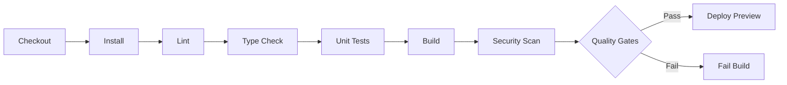

# Architecture Elements Library

Optional architecture sections to add to your core architecture document as they become relevant.

**Usage**: Cherry-pick sections from this library and add them to your `ARCHITECTURE.md` when needed. Don't include everything at kickoff — add sections when they're actually relevant to your project.

---

## Table of Contents

1. [Pipeline Automation](#pipeline-automation) - CI/CD, quality gates, code review
2. [Advanced Security](#advanced-security) - Encryption, compliance, threat modeling
3. [Monitoring & Observability](#monitoring--observability) - Metrics, logging, tracing, alerting
4. [Disaster Recovery](#disaster-recovery) - Backup, incident response, RTO/RPO
5. [Multi-Region Deployment](#multi-region-deployment) - Geographic distribution, data residency
6. [Advanced Data Architecture](#advanced-data-architecture) - Caching, replication, sharding
7. [Cost Optimization](#cost-optimization) - Resource efficiency, cost monitoring

---

## When to Use Each Section

| Section | Add When | Skip If |
|---------|----------|---------|
| Pipeline Automation | Setting up CI/CD, have quality gates | No automated deployment yet |
| Advanced Security | Handling PII, compliance requirements | Prototype/MVP stage |
| Monitoring & Observability | Production deployment | Development only |
| Disaster Recovery | Production system, critical data | Low-stakes internal tool |
| Multi-Region | Global users, data residency requirements | Single-region sufficient |
| Advanced Data Architecture | Scale issues, performance problems | Simple data model works |
| Cost Optimization | Budget constraints, scaling costs | Cost not a concern yet |

---

<a name="pipeline-automation"></a>
## 1. Pipeline Automation

**Add this section when**: Setting up CI/CD, implementing quality gates, or automating deployments

### ARCH-CI-1: Continuous Integration

**Platform**: [GitHub Actions | GitLab CI | Jenkins]

**Pipeline Stages**:


**Quality Gates** (all must pass):
- [ ] All tests pass (minimum 80% coverage)
- [ ] No lint errors
- [ ] Type checking passes
- [ ] Build succeeds
- [ ] No critical/high security vulnerabilities
- [ ] No secrets in code

**Trigger Events**:
| Event | Branches | Actions |
|-------|----------|---------|
| Push | main, develop | Full CI + deploy staging |
| Pull Request | any → main | Full CI + deploy preview |
| Tag | v* | Full CI + deploy production |

**Caching Strategy**:
| Resource | Key | Invalidation |
|----------|-----|--------------|
| Dependencies | lockfile hash | Lockfile changes |
| Build output | Source hash | Source changes |

**Benefits**: 50-70% faster builds

---

### ARCH-CD-1: Continuous Deployment

**Environment Strategy**:
| Environment | Purpose | Deploy Trigger | Approval | Data |
|-------------|---------|----------------|----------|------|
| Development | Local dev | Manual | No | Seed data |
| Preview | PR previews | PR creation | No | Anonymized subset |
| Staging | Pre-prod test | Merge to main | No | Prod-like |
| Production | Live system | Tag creation | Yes | Real data |

**Isolated Preview Environments**:
- URL pattern: `https://pr-{number}.preview.example.com`
- Isolated database per PR
- Auto-expire 7 days after PR close
- **Benefit**: QA can test features in isolation

**Deployment Process** (Production):
1. Create release tag (`v1.2.3`)
2. CI pipeline runs
3. Wait for manual approval
4. Blue-green deployment:
   - Deploy to green environment
   - Health check passes
   - Switch traffic
   - Keep blue for rollback (1 hour)

**Rollback Strategy**:
- Keep previous version running for 1 hour
- Health checks fail → automatic rollback
- Error rate spike → manual rollback button
- Rollback time: < 5 minutes

---

### ARCH-SEC-3: Secrets Management

**Platform**: [GitHub Secrets | AWS Secrets Manager | HashiCorp Vault]

**Secrets Organization**:
```
/production/
  /db/password
  /api-keys/stripe
/staging/
  /db/password
  /api-keys/stripe-test
```

**Rotation Policy**:
- Database credentials: Every 90 days
- API keys: When team member leaves
- JWT secrets: Every 180 days

**Access Control**: Production secrets = CI/CD + ops only

---

### ARCH-CODE-REVIEW-1: Automated Code Review

**Static Analysis**: [SonarQube | CodeClimate]
- Code smells, duplicates, complexity

**Security Scanning**: [Snyk | Dependabot]
- Dependency vulnerabilities
- Secret detection
- Container image scanning

**AI-Assisted Review**: [Sweep | PR Agent | CodeRabbit]
- Auto PR descriptions
- Code suggestions
- Test generation hints

**Review Checklist** (automated):
- [ ] No console.log/print statements
- [ ] No commented-out code
- [ ] No TODO without issue links
- [ ] No hardcoded secrets
- [ ] Bundle size impact < 10%

---

### ARCH-UP-1: Dependency Management

**Automation**: Use `/dependency-upgrader` skill
**Frequency**: Monthly
**Process**:
1. Scan manifests (package.json, requirements.txt, Cargo.toml, Dockerfile, .github/workflows)
2. Categorize: Patch, Minor, Major
3. Create separate PRs per category
4. Run full test suite
5. Auto-merge patches, review minors, careful with majors

**Critical Dependencies**:
| Dependency | Update Strategy | Reason |
|------------|----------------|--------|
| [Framework] | Manual review for major | Breaking changes |
| [Database] | Test thoroughly | Data layer critical |

---

<a name="advanced-security"></a>
## 2. Advanced Security

**Add this section when**: Handling PII, compliance requirements, or production launch

### ARCH-SEC-3: Data Protection

**Encryption at Rest**:
- Database: AES-256 encryption
- Object storage: Server-side encryption
- PII fields: Field-level encryption with KMS

**Encryption in Transit**:
- TLS 1.3 for all connections
- HSTS enabled
- Certificate auto-renewal (Let's Encrypt)

---

### ARCH-SEC-4: Compliance

**GDPR**:
- Data retention: [Policy]
- Right to deletion: Soft delete with 30-day grace
- Data export: API endpoint for user data export

**Additional Compliance**:
- [ ] CCPA (California)
- [ ] SOC 2 (Security)
- [ ] HIPAA (Healthcare)
- [ ] PCI DSS (Payments)

---

### ARCH-SEC-5: Threat Modeling

**STRIDE Analysis**:
| Threat | Risk | Mitigation |
|--------|------|------------|
| Spoofing | [Level] | [Strategy] |
| Tampering | [Level] | [Strategy] |
| Repudiation | [Level] | [Strategy] |
| Info Disclosure | [Level] | [Strategy] |
| Denial of Service | [Level] | [Strategy] |
| Elevation of Privilege | [Level] | [Strategy] |

---

<a name="monitoring--observability"></a>
## 3. Monitoring & Observability

**Add this section when**: Deploying to production, need operational visibility

### ARCH-OBS-1: Metrics

**Platform**: [CloudWatch | DataDog | Prometheus + Grafana]

**Key Metrics**:
| Metric | Target | Alert Threshold |
|--------|--------|----------------|
| API Response Time (p95) | <200ms | >500ms |
| Error Rate | <0.1% | >1% |
| CPU Utilization | <70% | >85% |
| Memory Usage | <80% | >90% |
| Cache Hit Rate | >90% | <70% |

**Dashboards**:
- Application Overview (requests, errors, latency)
- Infrastructure (CPU, memory, disk, network)
- Business Metrics (signups, transactions, revenue)

---

### ARCH-OBS-2: Logging

**Platform**: [ELK Stack | Splunk | CloudWatch Logs]

**Log Levels**: ERROR, WARN, INFO, DEBUG (dev/staging only)

**Structured Logging** (JSON format):
```json
{
  "timestamp": "2026-02-25T16:00:00Z",
  "level": "ERROR",
  "service": "api",
  "trace_id": "abc123",
  "user_id": "user-456",
  "message": "Payment failed",
  "error": "Insufficient funds"
}
```

**Retention**:
- Production: 30 days
- Staging: 7 days
- Development: 1 day

---

### ARCH-OBS-3: Distributed Tracing

**Platform**: [AWS X-Ray | Jaeger | Zipkin]

**Coverage**:
- All API requests
- Database queries
- External API calls
- Message queue operations

**Sampling Rate**: 10% (all errors + 10% success)

---

### ARCH-OBS-4: Alerting

**Alert Channels**:
- **Critical**: PagerDuty (wakes on-call)
- **High**: Slack + email
- **Medium**: Slack only

**Alert Rules**:
| Alert | Severity | Threshold | Action |
|-------|----------|-----------|--------|
| Service Down | Critical | 5xx errors >10/min | Page on-call |
| High Error Rate | High | Error rate >1% | Slack alert |
| Slow Response | Medium | p95 >500ms | Slack alert |
| High CPU | Medium | CPU >85% for 5min | Auto-scale + notify |

---

<a name="disaster-recovery"></a>
## 4. Disaster Recovery

**Add this section when**: Production system, business-critical data

### ARCH-DR-1: Backup Strategy

**Database Backups**:
- Frequency: Daily at 2 AM UTC
- Retention: 30 days
- Storage: S3 with cross-region replication

**Backup Types**:
- Full backup: Daily
- Incremental: Every 6 hours
- Point-in-time recovery: 5-minute granularity

**Testing**: Monthly restore test to staging

---

### ARCH-DR-2: Incident Response

**Severity Levels**:
| Level | Impact | Response Time | Escalation |
|-------|--------|---------------|------------|
| P0 | Service down | 15 minutes | Immediate |
| P1 | Degraded | 1 hour | If not resolved in 2h |
| P2 | Minor | 4 hours | If not resolved in 24h |
| P3 | Cosmetic | Next business day | None |

**Escalation Path**:
1. On-call engineer
2. Engineering manager
3. CTO

**Communication**:
- Status page updates
- Customer notifications (P0/P1)
- Post-mortem within 48 hours

---

### ARCH-DR-3: Recovery Objectives

**RTO** (Recovery Time Objective): 30 minutes
- Time to restore service from backup

**RPO** (Recovery Point Objective): 5 minutes
- Maximum acceptable data loss

**MTTR** (Mean Time To Recovery): Target <1 hour

**MTBF** (Mean Time Between Failures): Target >720 hours (30 days)

---

<a name="multi-region-deployment"></a>
## 5. Multi-Region Deployment

**Add this section when**: Global users, data residency requirements, high availability needs

### ARCH-MR-1: Multi-Region Strategy

**Deployment Model**: [Active-Active | Active-Passive]

**Regions**:
- Primary: [us-east-1]
- Secondary: [eu-west-1]
- DR: [ap-southeast-1]

**Data Residency**:
| Region | Data Stored | Compliance |
|--------|-------------|------------|
| EU | EU user data only | GDPR |
| US | US user data only | CCPA |

**Traffic Routing**:
- DNS-based: Route 53 geolocation routing
- Latency-based failover
- Health checks every 30 seconds

---

### ARCH-MR-2: Data Synchronization

**Database Replication**:
- Cross-region read replicas
- Async replication (< 1 second lag)
- Conflict resolution strategy: [Last-write-wins | Custom]

**Object Storage**:
- Cross-region replication enabled
- Replication time: < 15 minutes

---

<a name="advanced-data-architecture"></a>
## 6. Advanced Data Architecture

**Add this section when**: Scale issues, performance problems, complex data needs

### ARCH-DATA-3: Caching Strategy

**Cache Layer**: [Redis 7 | Memcached]

**Caching Patterns**:
- **Read-through**: [User profiles, configuration]
- **Write-through**: [Session data]
- **Cache-aside**: [Computed results, reports]

**TTL Strategy**:
| Data Type | TTL | Invalidation |
|-----------|-----|--------------|
| User sessions | 30 min | On logout |
| API responses | 5 min | On data update |
| Static content | 1 hour | On deploy |

**Cache Hit Rate Target**: >90%

---

### ARCH-DATA-4: Database Scaling

**Read Replicas**:
- 3 read replicas in different AZs
- Read/write split at application layer
- Replica lag monitoring (target < 1 second)

**Sharding** (when needed):
- Shard key: [user_id | tenant_id]
- Shard count: [4 | 8 | 16]
- Re-sharding strategy

**Connection Pooling**:
- Pool size: 20 connections per instance
- Max connections: 80% of database limit

---

<a name="cost-optimization"></a>
## 7. Cost Optimization

**Add this section when**: Budget constraints, scaling costs, cost-efficiency focus

### ARCH-COST-1: Resource Optimization

**Compute**:
- Right-sizing: Monthly review of instance utilization
- Reserved instances for baseline load
- Spot instances for batch processing
- Auto-scaling for variable load

**Storage**:
- Lifecycle policies: Hot → Warm → Cold → Archive
- Compression enabled
- Deduplicate backups

**Database**:
- Use read replicas vs scaling primary
- Connection pooling
- Query optimization

---

### ARCH-COST-2: Cost Monitoring

**Budget Alerts**:
- Warning at 80% of monthly budget
- Critical at 95%
- Forecast alerts

**Cost Allocation Tags**:
- Environment (dev, staging, prod)
- Team/project
- Cost center

**Monthly Cost Review**: First week of month

---

## Appendix: Section Combinations

### Common Combinations

**Startup MVP**:
- Core template only
- Maybe add basic Pipeline Automation

**Production SaaS**:
- Core template
- Pipeline Automation
- Monitoring & Observability
- Disaster Recovery

**Enterprise/Regulated**:
- Core template
- All sections (especially Advanced Security, Compliance)
- Multi-region if needed

**High-Scale Consumer App**:
- Core template
- Pipeline Automation
- Monitoring
- Advanced Data Architecture
- Cost Optimization
