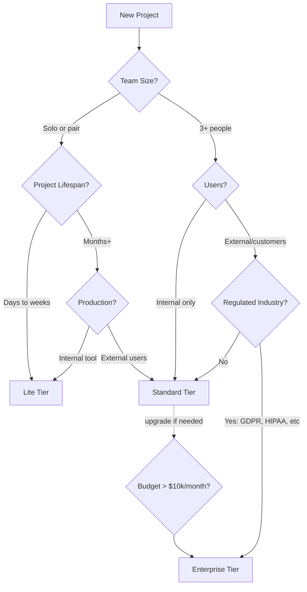
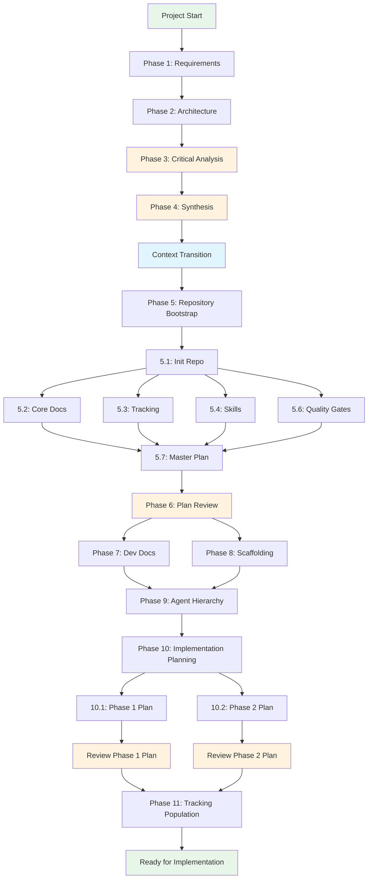

# Project Kickoff Methodology v2.0

A structured methodology for bootstrapping mid-to-large AI-assisted software projects with modular skills, standardized templates, and comprehensive automation. Designed for use with Claude (Opus, Sonnet) across Claude Desktop, Craft Agents, and Claude Code.

**What's New in v2.0**:
- Modular skills: `/critical-analysis`, `/plan-reviewer`, `/dependency-upgrader`, `/documentation-manager`
- IEEE 830-style requirement IDs (FR-001, NFR-001, ARCH-FE-1)
- Comprehensive pipeline automation in architecture
- Documentation lifecycle management
- Enhanced tracking options (DartAI)
- Parallelization guidance

---

## Core Principles

### Separation of Concerns
Keep functional requirements strictly separate from technical stack decisions. The PRD defines *what* the system does; the architecture defines *how*.

### Context Isolation
Use **new sessions** for critical analysis and synthesis phases. This prevents:
- **Confirmation bias**: The agent won't defend its own earlier decisions
- **Context pollution**: Fresh perspective without anchoring to previous outputs
- **Objective critique**: Red team analysis requires adversarial distance

### Iterative Refinement
Agents should ask qualifying questions rather than assume. Requirements emerge through dialogue, not dictation.

### Model-Appropriate Task Allocation

| Model | Use For |
|-------|---------|
| **Opus** | Requirements discovery, critical analysis, architecture decisions, plan review |
| **Sonnet** | Implementation, scaffolding execution, multi-file coordination |
| **Haiku** | Exploration, validation, file scanning, simple generation |

---

## Methodology Tiers

Choose your tier based on project scope, team size, and compliance requirements:

### Tier Comparison

| Tier | When to Use | Phases | Time Estimate | Key Differences |
|------|-------------|--------|---------------|-----------------|
| **Lite** | Weekend hack, internal tool, solo project, rapid prototype | 1, 2, 5, 8 | **4-6 hours** | Skip critique, synthesis, reviews, hierarchy |
| **Standard** | Team project, production service, public-facing application | All 11 phases | **12-18 hours** | Full methodology with single critique persona |
| **Enterprise** | Regulated industry, large-scale, compliance-critical, multi-team | All 11 phases + extras | **20-30 hours** | Multiple critique personas, compliance docs |

### Lite Tier (4-6 hours)

**Best for**: Solo developers, internal tools, proof-of-concepts, weekend projects

**Phases**:
1. **Requirements Discovery** → Create seed-PRD.md (or skip if requirements are clear)
2. **Technical Architecture** → Create seed-ARCHITECTURE.md (or skip if stack is predetermined)
5. **Repository Bootstrap** → Git init, AGENTS.md, README.md, master-plan.md (simplified)
8. **Project Scaffolding** → Run scaffolding command, commit skeleton

**What you skip**:
- Phase 3: Critical Analysis (no red team review)
- Phase 4: Document Synthesis (use seed documents directly)
- Phase 6: Master Plan Review (no formal plan validation)
- Phase 7: Developer Documentation (README is sufficient)
- Phase 9: Agent Hierarchy (flat AGENTS.md only)
- Phase 10: Implementation Planning (work directly from master plan)
- Phase 11: Tracking Population (optional, can use simple TODO list)

**When to graduate to Standard**: When project gains users, team grows beyond 2 people, or production stability becomes critical.

---

### Standard Tier (12-18 hours)

**Best for**: Team projects, production services, customer-facing applications, long-term maintained software

**Phases**: All 11 phases as documented below

**Key characteristics**:
- Full requirements and architecture documentation
- Single persona critical analysis (typically Critical CTO)
- Formal plan reviews with `/plan-reviewer`
- Developer documentation for team onboarding
- Nested AGENTS.md for module boundaries
- Full tracking system integration

**When to graduate to Enterprise**: When facing regulatory compliance, multi-region deployment, or security/audit requirements.

---

### Enterprise Tier (20-30 hours)

**Best for**: Regulated industries (healthcare, finance), large-scale systems, compliance-critical applications, multi-team coordination

**Phases**: All 11 phases + additional compliance work

**Additional requirements**:

**Phase 3 Enhancement** - Multiple critique personas:
- Run `/critical-analysis` 3-4 times with different personas:
  - **Critical CTO**: Architecture and technical decisions
  - **Security Auditor**: Security, compliance, data protection
  - **Cost Optimizer**: Resource efficiency, budget control
  - **Performance Engineer**: Scale, latency, throughput (if needed)
- Consolidate critiques into single `seed-critical-analysis.md`

**Phase 4 Enhancement** - Compliance documentation:
- **GDPR Compliance Plan** (if EU users):
  - Data retention policies
  - Right to deletion workflow
  - Data export mechanism
  - Consent management
  - Data residency strategy
- **Security Audit Report**:
  - Threat model (STRIDE analysis)
  - Security controls matrix
  - Penetration test plan
  - Incident response procedures
- **Privacy Impact Assessment**:
  - PII data flow mapping
  - Privacy risk analysis
  - Mitigation strategies
  - Legal review requirements
- Additional compliance as needed:
  - CCPA (California)
  - SOC 2 (Security)
  - HIPAA (Healthcare)
  - PCI DSS (Payments)

**Architecture Enhancement** - Add from elements library:
- Multi-region deployment (if global users)
- Advanced security architecture
- Disaster recovery with RTO/RPO
- Compliance monitoring and audit logging
- Data sovereignty controls

**Phase 6 Enhancement** - Multi-reviewer validation:
- Technical Architect review
- Security Architect review
- Compliance Officer review (if applicable)

---

### Decision Flowchart



**Key Decision Questions**:
1. **Is this throwaway code?** → Lite
2. **Will a team maintain this?** → Standard minimum
3. **Do we handle PII or payment data?** → Standard minimum, possibly Enterprise
4. **Are we subject to GDPR, HIPAA, SOC 2, or other compliance?** → Enterprise
5. **Multi-region deployment needed?** → Enterprise
6. **Infrastructure budget > $10k/month?** → Probably Enterprise

---

## Phase 1: Requirements Discovery

**Model**: Opus
**Environment**: Claude Desktop, Craft Agents, or Claude Code (if spinning off from existing project)
**Output**: `seed-PRD.md`

### Process
1. Engage in interactive dialogue with the reasoning agent
2. Agent should ask qualifying questions to clarify ambiguities
3. Define through conversation:
   - **Use case**: Core problem being solved
   - **User personas**: Who uses the system, their goals and pain points
   - **Roles & permissions**: Access levels and capabilities per role
   - **Scope**: What's in, what's explicitly out
   - **Functionality**: Feature list with concrete examples
   - **Capabilities**: System qualities (performance, scale, security needs)
   - **Future enhancements**: Ideas for later, marked as out-of-scope for MVP

### Key Rules
- Do NOT discuss technical stack
- Do NOT mention databases, frameworks, or infrastructure
- Focus purely on *what* the system does for users
- Provide concrete examples and user stories
- Think about edge cases and error states

---

## Phase 2: Technical Architecture

**Model**: Opus
**Environment**: Same session as Phase 1 (benefits from requirements context)
**Output**: `seed-ARCHITECTURE.md`

### Process
1. Based on requirements, propose technical stack options
2. Map the technical landscape:
   - Languages, frameworks, libraries
   - External services and APIs
   - Third-party subscriptions and tools
3. Create rough scale and cost estimates per project phase:
   - MVP / Phase 1
   - Growth / Phase 2
   - Scale / Phase 3
4. Define environment strategy:
   - Development setup
   - Staging environment
   - Production infrastructure

### Content Structure
```markdown
# Technical Architecture (Seed)

## Stack Selection
- Frontend: [choice + rationale]
- Backend: [choice + rationale]
- Database: [choice + rationale]
- Infrastructure: [choice + rationale]

## External Dependencies
| Service | Purpose | Pricing Model | Phase 1 Cost |

## Environment Strategy
### Development
### Staging
### Production

## Scale Estimates
### Phase 1 (MVP): [X users, Y requests/day]
### Phase 2 (Growth): ...

## Cost Projections
| Phase | Infrastructure | Services | Total/month |
```

---

## Phase 3: Critical Analysis (Red Team)

**Model**: Opus
**Environment**: **NEW SESSION** (critical for objectivity)
**Output**: `seed-critical-analysis.md`
**Skill**: `/critical-analysis`

### Why New Session?
Starting fresh prevents the agent from:
- Defending its previous decisions
- Being anchored to established context
- Pulling punches on critique

### Process
1. Start a **new session** (fresh context)
2. Invoke `/critical-analysis` skill
3. Provide `seed-PRD.md` and `seed-ARCHITECTURE.md`
4. Specify persona: **Critical CTO** (or Security Auditor, Performance Engineer, Cost Optimizer)
5. Receive adversarial analysis with prioritized recommendations

**Persona Options**:
- **Critical CTO** (default): Holistic business and technical critique
- **Security Auditor**: Security vulnerabilities, compliance gaps
- **Performance Engineer**: Scalability, bottlenecks
- **Cost Optimizer**: Budget risks, over-engineering

### Output Structure
```markdown
# Critical Analysis

## Executive Summary
[1-2 paragraph harsh but fair assessment]

## Requirements Critique
### Gaps
### Ambiguities
### Scope Concerns

## Architecture Critique
### Technical Risks
### Scalability Concerns
### Security Considerations
### Cost Risks

## Recommendations
### Must Address Before Proceeding
### Should Consider
### Nice to Have

## Alternative Approaches
[If fundamentally different approach might be better]
```

---

## Phase 4: Document Synthesis

**Model**: Opus
**Environment**: **NEW SESSION**
**Output**: `PRD.md`, `ARCHITECTURE.md` (final versions)
**Templates**: Use `template-prd.md` and `template-architecture.md`

### Process
1. Start a **new session** (fresh context, no anchoring to critique)
2. Provide all three seed documents: `seed-PRD.md`, `seed-ARCHITECTURE.md`, `seed-critical-analysis.md`
3. Use templates from `references/template-prd.md` and `references/template-architecture.md`
4. Request synthesis that **addresses** critical analysis findings
5. **Do not mention or reference** the critical analysis in final outputs

### Template Features
**PRD Template**:
- IEEE 830-style requirement IDs: `FR-001`, `NFR-001`, `EXT-001`, `INT-001`
- Traceability matrix linking requirements to architecture
- Comprehensive acceptance criteria
- User workflow documentation

**ARCHITECTURE Template**:
- Architecture IDs: `ARCH-FE-1`, `ARCH-BE-1`, `ARCH-DB-1`, `ARCH-SEC-1`, `ARCH-CI-1`
- Complete pipeline automation section (CI/CD, quality gates, code review)
- Secrets management strategy
- Isolated preview environments
- Dependency upgrade strategy
- Comprehensive monitoring and disaster recovery

### Quality Checklist
- [ ] All critical "must address" items resolved
- [ ] Ambiguities from Phase 1 clarified
- [ ] Architecture addresses scalability concerns
- [ ] Security considerations incorporated
- [ ] Scope is clear and achievable for MVP
- [ ] Requirement IDs used consistently
- [ ] Pipeline automation fully specified
- [ ] Documentation standards defined

### Final Step: Delete Seed Documents

**IMPORTANT**: Once you have final `PRD.md` and `ARCHITECTURE.md`, **DELETE all seed documents**:

```bash
rm seed-PRD.md seed-ARCHITECTURE.md seed-critical-analysis.md
```

**Rationale**:
- **Prevents confusion**: Only one source of truth (final docs)
- **Prevents drift**: No risk of divergence between seed and final versions
- **Clean repository**: Final docs are authoritative
- **Provenance preserved**: Critique and evolution captured in git history if needed

Keep only: `PRD.md`, `ARCHITECTURE.md`, and any compliance documents (for Enterprise tier).

---

## Context Transition

After Phase 4 (PRD and ARCHITECTURE finalized), the project is ready for implementation context.

### Recommended Workflow
1. **Complete Phases 1-4** in Craft Agents or Claude Desktop
   - Broad context ideal for document generation
   - Easy session management for context isolation
   - Conversations preserved for reference

2. **Complete Phase 5** to initialize the repository
   - Create repository structure
   - Place PRD.md and ARCHITECTURE.md in `/docs`
   - Set up initial infrastructure

3. **Transition** to Claude Code with working directory set to project repository
   - Project-specific AGENTS.md becomes active
   - Skills are co-located with code
   - Full codebase context available
   - Quality gates and tooling integrated
   - Natural workflow for implementation

4. **Complete Phases 6-11** in the project context
   - Review plans with codebase awareness
   - Implement with full project context
   - Test and iterate within repository

### Benefits of Transition
- **Active project context**: AGENTS.md, skills, and conventions automatically loaded
- **Integrated tooling**: Pre-commit hooks, linters, tests run naturally
- **Codebase awareness**: Agent can read, search, and understand existing code
- **Version control**: All changes tracked in git
- **Efficient iteration**: Rapid feedback loop with testing and building

### Exception
For exploratory or solo projects, you can continue in Craft Agents and use skills to interact with the repository remotely. This works well for documentation-heavy projects or when the repository is elsewhere.

---

## Phase 5: Repository Bootstrap

**Model**: Sonnet (execution), Opus (decisions)
**Environment**: Claude Code inside the repository
**Output**: Initialized repository with project infrastructure

### 5.1 Initialize Repository
```bash
git init
mkdir -p docs
# Place PRD.md and ARCHITECTURE.md in docs/
```

### 5.2 Create Core Documents

#### AGENTS.md
Define stereotyped agents for the project. **Minimum set**:

| Agent | Role | Model | When to Use |
|-------|------|-------|-------------|
| **Product Manager** | Requirements, prioritization, user stories | Opus | Feature definition, scope decisions |
| **Architect** | System design, technical decisions | Opus | Architecture review, API design, trade-offs |
| **DevOps Engineer** | CI/CD, infrastructure, deployment | Sonnet | Pipeline setup, environment config |

**Common additions**:
- Backend Engineer
- Frontend Engineer
- QA/Tester
- Security Reviewer
- Technical Writer

#### README.md
- Project overview
- Quick start for development
- Links to key documentation
- Contributing guidelines

### 5.3 Select Tracking Mechanism

| Tool | Best For | Free Tier | Considerations |
|------|----------|-----------|----------------|
| **DartAI** | Solo/small teams, AI-native planning | Generous | Modern, AI-integrated, good for AI-assisted projects |
| **Linear** | Team projects, structured sprints | Limited | Best integration, paid beyond basics |
| **Beads** | Persistent agent memory | Yes | Works alongside other tools |
| **taskmaster** | AI-native task management | Yes | Good for solo/small teams |
| **trackable-plan.md** | Simplest option | Yes | Just markdown, version controlled |
| **Jira** | Enterprise, existing tooling | Limited | Heavy, but familiar |

**Recommendation**:
- **AI-assisted projects**: DartAI or taskmaster (AI-native, generous free tiers)
- **Team projects**: Linear + Beads (best integration)
- **Solo/experiments**: trackable-plan.md + Beads (simple, free)

### 5.4 Create Custom Skills
**Required Dependency**: `/skill-creator` skill

Use the `/skill-creator` skill to create project-specific skills:

**Essential skills to consider**:
- `architect-review`: Critical review of plans and designs (Opus)
- `implementation-planner`: Break down features into tasks
- `code-reviewer`: Review PRs against project standards
- `test-generator`: Generate tests for implementations
- `doc-validator`: Validate documentation using `/documentation-manager` patterns

**Project-Specific Upgrader** (v2.1 pattern):

The generic `/dependency-upgrader` skill works across all tech stacks, but upgrade strategies differ significantly between ecosystems. For optimal results, **generate a project-specific upgrader skill** during scaffolding that's tailored to your tech stack.

**Why project-specific?**
- **npm/pnpm**: `npm outdated`, `pnpm up`, semver ranges, lockfile updates
- **Python/poetry**: `poetry show --outdated`, constraint files, virtual envs
- **Rust/cargo**: `cargo update`, `cargo-outdated`, edition migrations
- **Go modules**: `go get -u`, `go mod tidy`, minimal versioning
- **Gradle/Maven**: Version catalogs, BOM files, plugin updates

Each has different commands, file formats, and best practices.

**How to generate**:

Use `/skill-creator` to create a `{project-name}-upgrader` skill with:

```
Project: [your project name]
Tech Stack: [e.g., "Next.js 15, TypeScript, pnpm, Tailwind, PostgreSQL"]

Create a project-specific dependency upgrader skill that:
1. Scans package.json, pnpm-lock.yaml
2. Checks for outdated dependencies using pnpm
3. Categorizes updates: patch (auto), minor (review), major (careful)
4. Creates separate PRs per category
5. Includes changelogs and breaking change analysis
6. Updates package.json AND pnpm-lock.yaml correctly
7. Runs tests before committing

Model: sonnet
Triggers: "upgrade deps", "check outdated", "update dependencies"

Reference: Use `/dependency-upgrader` SKILL.md as a template
```

**Example result**: A skill that knows:
- `pnpm outdated --format json` (not `npm outdated`)
- Update pnpm workspace dependencies across packages
- Handle Tailwind major version upgrades with config migrations
- Test against PostgreSQL with proper fixtures

**When to generate**:
- During Phase 5.4 (skill creation) OR
- During Phase 8 (after scaffolding, when tech stack is finalized)

**Benefit**: 10x better upgrade experience — understands your exact tooling, conventions, and test requirements.

### 5.5 Define Stereotyped Agents
In AGENTS.md, define agent personas with:
- Role description
- Expertise areas
- Preferred model (Opus/Sonnet/Haiku)
- Skills they should invoke
- When to spawn them

### 5.6 Implement Quality Gates
Decide on and configure:
- **Pre-commit hooks**: lefthook, husky, or pre-commit
- **Type checking**: TypeScript strict, mypy, etc.
- **Linting**: ESLint, Biome, Ruff, etc.
- **Testing**: Jest, Vitest, pytest with coverage requirements
- **Formatting**: Prettier, Black, etc.
- **Dependency management**: Set up `/dependency-upgrader` skill for monthly updates
- **Documentation validation**: Use `/documentation-manager` for doc standards enforcement

### 5.7 Create master-plan.md
Structure in phases with trackable milestones:

```markdown
# Master Plan

## Phase 1: Foundation (MVP)
### Milestone 1.1: [Name]
- [ ] Task 1
- [ ] Task 2

### Milestone 1.2: [Name]
...

## Phase 2: [Name]
...
```

---

## Phase 6: Master Plan Review

**Model**: Opus
**Environment**: New session or current context
**Skill**: `/plan-reviewer`

### Process
1. Invoke `/plan-reviewer` skill
2. Provide `master-plan.md` (and PRD/ARCHITECTURE if available)
3. Review dimensions:
   - **Technical Feasibility**: Can tasks be executed as specified?
   - **Sequencing & Dependencies**: Is task order correct? Prerequisites identified?
   - **Completeness**: What's missing? Edge cases covered?
   - **Risk Areas**: What could go wrong? Mitigation strategies?
   - **Simplification Opportunities**: Can anything be removed or simplified?
   - **Effort Validation**: Are estimates realistic?
4. Receive structured review with:
   - Dependency diagram (Mermaid)
   - Critical issues (blockers)
   - Major concerns
   - Minor suggestions
   - Approval status

### Output
- Approval decision: Approved | Requires Changes | Blocked
- Actionable feedback for each finding
- Revised task sequencing if needed

---

## Phase 7: Developer Documentation

**Model**: Sonnet
**Output**: `development-guide.md`

### Required Sections
1. **Local Setup**
   - Prerequisites (Node version, tools, etc.)
   - Installation steps
   - Environment configuration
   - Running the development server

2. **Quality Gates**
   - How to run linting
   - How to run tests
   - Pre-commit hook behavior
   - CI pipeline overview

3. **Git Workflow**
   - Branch naming conventions
   - Commit message format
   - PR process
   - Review requirements

4. **Agent Usage**
   - When to use which agent
   - How to invoke skills
   - Multi-agent coordination patterns

5. **Skill Reference**
   - List of available skills
   - When to use each
   - How to create new skills

6. **Environment Configuration**
   - Environment variables
   - Secrets management
   - Per-environment differences

---

## Phase 8: Project Scaffolding

**Model**: Sonnet (with tool use) or manual
**Environment**: Claude Code in repository

### Process
1. Generate project structure using appropriate scaffolding tools
2. Examples:
   ```bash
   pnpm create next-app@latest my-app --yes
   pnpm create vite@latest my-app --template react-ts
   cargo new my-app
   ```
3. **Critical**: Use latest stable, mutually compatible versions
4. Verify scaffolding works before proceeding:
   ```bash
   pnpm install && pnpm dev  # or equivalent
   ```

---

## Phase 9: Agent Hierarchy

**Model**: Sonnet
**Environment**: Claude Code in repository

### Process
1. Identify areas that need specialized agent context:
   - `/apps/web/` - Frontend-focused AGENTS.md
   - `/apps/api/` - Backend-focused AGENTS.md
   - `/packages/shared/` - Library conventions

2. Create nested AGENTS.md files with:
   - Area-specific conventions
   - Relevant skills for that domain
   - Testing patterns for that area

3. Update root AGENTS.md:
   - Reference nested files
   - Remove specifics now in nested files
   - Keep high-level orchestration guidance

---

## Phase 10: Implementation Planning

**Model**: Sonnet (drafting), Opus (review)
**Environment**: Claude Code in repository

### Process
For each phase in master-plan.md:

1. **Create Implementation Plan**
   - Break phase into epics
   - Break epics into specific tasks
   - Identify dependencies between tasks
   - Estimate effort (S/M/L/XL)
   - Assign relevant skills and agents

2. **Architect Review (New Session)**
   - Invoke `architect-review` skill or start new session with Architect persona
   - Review for:
     - Technical feasibility
     - Correct sequencing
     - Missing tasks
     - Risk areas
   - Iterate until approved

3. **Output**: `docs/plans/phase-N-implementation.md`

---

## Phase 11: Tracking Population

**Model**: Sonnet
**Environment**: Claude Code with tracking integration

### Process
1. Populate chosen tracking mechanism from master-plan:
   - Create epics/projects for phases
   - Create issues/tasks for individual items
   - Set up dependencies and relationships

2. For each item, include:
   - Reference to implementation plan section
   - Relevant skills to invoke
   - Suggested agent for the work
   - Acceptance criteria

3. Set up first sprint/cycle with Phase 1 tasks

---

## Phase Parallelization Guide

Many phases and sub-tasks can run in parallel to accelerate project kickoff.

### Parallelization Map



**Legend**:
- 🟢 Green: Start/end milestones
- 🟠 Orange: Review/critique phases (new session recommended)
- 🔵 Blue: Context transition point
- ⚪ White: Sequential dependencies
- Parallel branches: Can execute simultaneously

### Parallel Execution Opportunities

**Phase 5 Sub-tasks** (after 5.1):
- 5.2, 5.3, 5.4, 5.6 can all run in parallel
- All must complete before 5.7

**Phase 7 and 8**:
- Can run in parallel after Phase 6
- Both must complete before Phase 9

**Phase 10 Plans**:
- Different phase plans can be drafted in parallel
- Each needs independent architect review

**Critical Path** (longest dependency chain):
1 → 2 → 3 → 4 → Trans → 5.1 → 5.7 → 6 → 9 → 10 → 11

**Total Time Estimate**:
- Sequential execution: 20-30 hours
- With parallelization: 12-18 hours

---

## Version History

| Version | Date | Changes |
|---------|------|---------|
| 1.0 | 2026-02-09 | Initial methodology |
| 2.0 | 2026-02-24 | Modular skills, templates, pipeline automation, documentation standards, DartAI tracking, parallelization guide |
