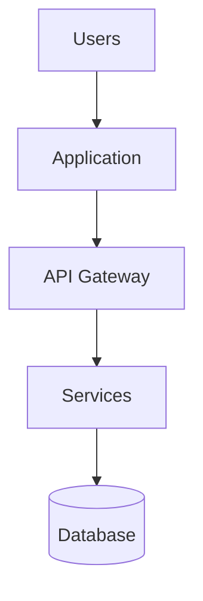
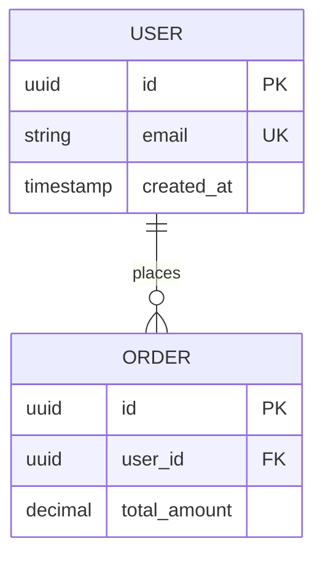

# Technical Architecture: [Project Name]

## Document Control

| Version | Date | Author | Changes |
|---------|------|--------|---------|
| 1.0.0 | [Date] | [Author] | Initial version |

---

## 1. Architecture Overview

### 1.1 System Context

**Architecture Principles**:
- [Principle 1: e.g., API-first design]
- [Principle 2: e.g., Microservices for scalability]
- [Principle 3: e.g., Security by default]

---

## 2. Stack Selection

### 2.1 Frontend

#### ARCH-FE-1: Frontend Framework
**Choice**: [Framework - e.g., React 18, Vue 3]
**Version**: [X.Y.Z]

**Rationale**:
- [Reason 1]
- [Reason 2]
- [Reason 3]

**Alternatives Considered**:
| Alternative | Pros | Cons | Why Not Chosen |
|-------------|------|------|----------------|
| [Framework B] | [Pros] | [Cons] | [Reason] |

**Satisfies Requirements**: [FR-001, FR-005, NFR-001]

---

### 2.2 Backend

#### ARCH-BE-1: Backend Framework
**Choice**: [Framework - e.g., NestJS, Django]
**Version**: [X.Y.Z]

**Rationale**:
- [Reason 1]
- [Reason 2]
- [Reason 3]

**Satisfies Requirements**: [FR-002, FR-003, NFR-002]

---

### 2.3 Database

#### ARCH-DB-1: Primary Database
**Choice**: [Database - e.g., PostgreSQL 15]
**Version**: [X.Y.Z]

**Rationale**:
- [Reason 1: e.g., ACID compliance]
- [Reason 2: e.g., Relational data model]

**Satisfies Requirements**: [FR-010, NFR-005]

---

### 2.4 Infrastructure

#### ARCH-INF-1: Cloud Provider
**Choice**: [AWS | GCP | Azure | Self-hosted]

**Services**:
- Compute: [EC2, Lambda, etc.]
- Database: [RDS, managed service]
- Storage: [S3, Cloud Storage]
- CDN: [CloudFront, Cloudflare]

**Satisfies Requirements**: [NFR-007 (availability), NFR-005 (scalability)]

---

## 3. External Dependencies

### Service Dependencies

#### EXT-001: [Service Name - e.g., Stripe]
**Purpose**: [Payment processing]
**Pricing Model**: [2.9% + $0.30 per transaction]
**Phase 1 Cost Estimate**: [$500/month]

**Integration**: [REST API, Webhooks, SDK]
**Alternatives**: [PayPal, Square]

**Satisfies Requirements**: [EXT-001, FR-015]

---

## 4. Environment Strategy

### 4.1 Development Environment
**Setup**: [Local machine requirements]
- [Tool 1: e.g., Node.js 20 LTS]
- [Tool 2: e.g., PostgreSQL 15]
- [Tool 3: e.g., Docker]

**Data**: [Seed data approach]
**External Services**: [Mock vs real services]

---

### 4.2 Staging Environment
**Purpose**: Pre-production validation
**Infrastructure**: Scaled-down production (50% capacity)
**Data**: Production-like but anonymized
**Access**: Dev team, QA team, product team

---

### 4.3 Production Environment
**Infrastructure**: [Deployment topology]
**Scaling**: [Horizontal/vertical approach]
**Access**: Ops team only

---

## 5. Scale Estimates

### Phase 1 (MVP)
**Users**: [10,000 registered users]
**Requests/Day**: [1M requests, avg 12/sec, peak 50/sec]
**Data Volume**: [100GB database, 500GB storage]
**Infrastructure**: [2x compute instances, managed database]
**Cost**: [$1,200/month]

### Phase 2 (Growth)
**Users**: [100,000 registered users]
**Requests/Day**: [15M requests, avg 175/sec]
**Scaling Changes**: [Add database read replicas, implement caching]
**Cost**: [$5,000/month]

### Phase 3 (Scale)
**Users**: [1,000,000 registered users]
**Architecture Changes**: [Database sharding, microservices split]
**Cost**: [$25,000/month]

---

## 6. Data Architecture

### 6.1 Data Model

---

## 7. Security Architecture

### 7.1 Authentication

#### ARCH-SEC-1: Authentication Method
**Method**: [JWT with refresh tokens | OAuth 2.0]

**Flow**:
1. User submits credentials
2. Server validates, issues access token (15 min) + refresh token (7 days)
3. Access token in Authorization header
4. Refresh token in httpOnly cookie

**Satisfies Requirements**: [NFR-003]

---

### 7.2 Authorization

#### ARCH-SEC-2: Authorization Model
**Model**: [RBAC | ABAC]

**Roles**: [Admin, Manager, User, Guest]

**Satisfies Requirements**: [NFR-003]

---

## 8. Traceability Matrix

| Architecture ID | Satisfies Requirements | Implementation Status |
|-----------------|------------------------|----------------------|
| ARCH-FE-1 | FR-001, FR-005, NFR-001 | Not Started |
| ARCH-BE-1 | FR-002, FR-003, NFR-002 | Not Started |
| ARCH-DB-1 | FR-010, NFR-005, NFR-008 | Not Started |
| ARCH-SEC-1 | NFR-003 | Not Started |

---

## 9. Appendix

### 9.1 Glossary
| Term | Definition |
|------|------------|
| [Term 1] | [Definition] |

### 9.2 References
- [Industry standards, best practices]
- [Similar architecture examples]

### 9.3 Revision History
| Version | Date | Author | Changes |
|---------|------|--------|---------|
| 1.0.0 | [Date] | [Author] | Initial version |

---

## Next Steps

**Need more detail?** See `architecture-elements-library.md` for optional sections to add:
- Pipeline automation (CI/CD, quality gates, code review)
- Advanced security (encryption, compliance, threat modeling)
- Monitoring & observability (metrics, logging, tracing, alerting)
- Disaster recovery (backup, incident response, RTO/RPO)
- Multi-region deployment
- Advanced data architecture
- Cost optimization strategies
